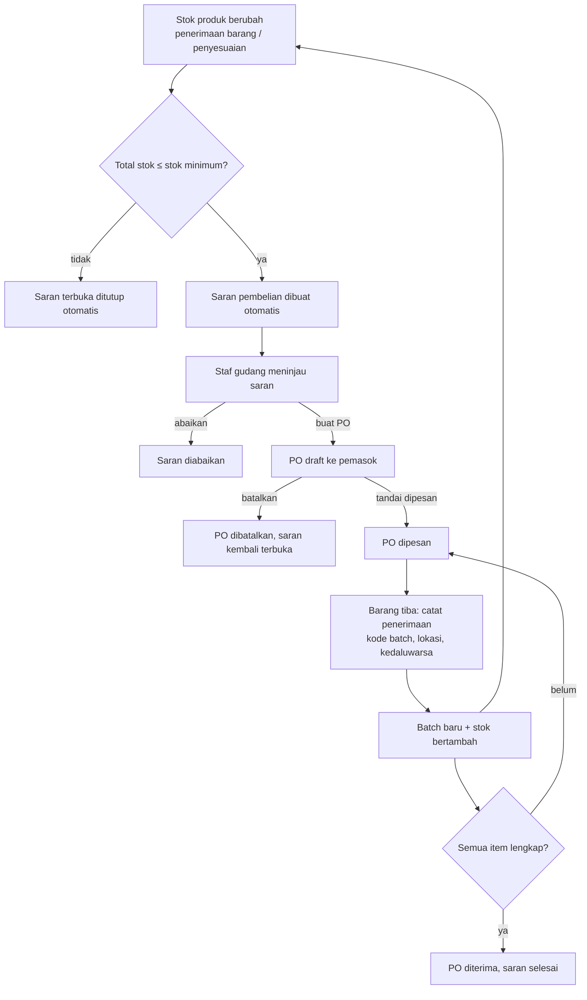
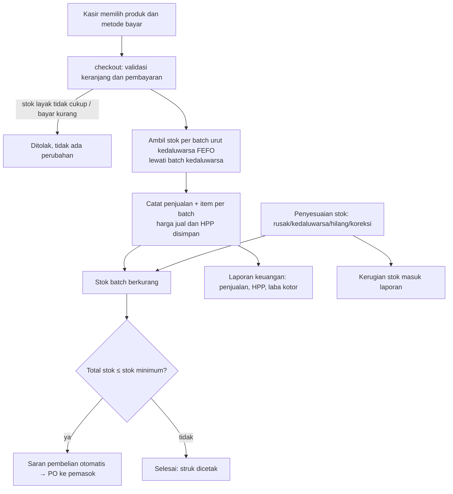
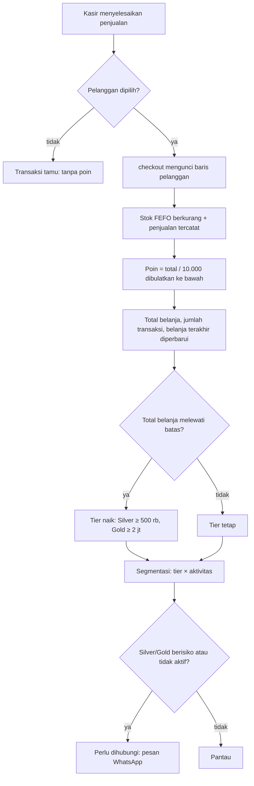

# Toko Asri

Sistem informasi terpadu **ERP + SCM + CRM** untuk toko retail frozen food (tugas akhir mata kuliah SIM).
Dibangun dengan **Next.js (App Router) + TypeScript + Tailwind** dan **Supabase** (Auth + Postgres + RLS).

Logika bisnis yang kritis (penerimaan barang, saran pembelian, pembatalan PO) berada di **database**
(fungsi RPC dan trigger Postgres), sehingga data antar-modul selalu konsisten.

## Status pengerjaan

| Tahap | Modul | Status |
|---|---|---|
| 1 | **SCM**: pemasok, produk, batch/kedaluwarsa, pesanan pembelian, penerimaan barang, saran pembelian, login + peran | ✅ tersedia |
| 2 | **ERP**: kasir/POS (FEFO), riwayat + struk, penyesuaian stok, laporan keuangan | ✅ tersedia |
| 3 | **CRM**: pelanggan, riwayat belanja, poin & tier, segmentasi, integrasi kasir | ✅ tersedia |
| 4 | Integrasi + dashboard pemilik | ⏳ |

## Menjalankan aplikasi

> Gunakan proyek Supabase **khusus demo**, bukan produksi. `supabase/seed.sql` **menghapus data SCM dan seluruh data transaksi serta pelanggan yang ada (penjualan, penyesuaian stok, pelanggan)** sebelum mengisi data contoh. Jangan dijalankan ulang jika Anda sudah memasukkan data sendiri yang ingin dipertahankan.

### 1. Membuat proyek di supabase.com

1. Masuk/daftar di <https://supabase.com>, lalu klik **New project**.
2. Pilih organisasi, isi **Name** (mis. `toko-asri-demo`), buat **Database Password** (simpan), pilih **Region** terdekat (mis. Singapore), lalu **Create new project**. Tunggu hingga status siap (±2 menit).
3. Buka **Project Settings → API** (atau tombol **Connect**), salin:
   - **Project URL** (`https://xxxx.supabase.co`)
   - **anon public key** (di dashboard baru kadang bernama *publishable key*)
4. Buka **Authentication → Providers → Email** dan pastikan Email aktif. Agar akun demo langsung bisa dipakai, matikan **Confirm email** (atau centang *Auto Confirm User* saat membuat akun, lihat langkah 4).

### 2. Menjalankan migration dan seed

Pilih salah satu cara.

**Cara A: SQL Editor (paling mudah)**

1. Di dashboard buka **SQL Editor → New query**.
2. Jalankan **setiap file** di `supabase/migrations/` **berurutan menurut nama** (`20261119000100_scm_schema.sql`, `20261120000100_saran_diabaikan.sql`, `20261120000200_erp_schema.sql`, `20261120000300_erp_checkout.sql`, `20261120000400_erp_adjust_report.sql`, `20261120000500_erp_hardening.sql`, `20261120000600_crm_schema.sql`, `20261120000700_crm_checkout.sql`, `20261120000800_crm_riwayat.sql`): salin isinya, tempel, **Run**. Harus berhasil tanpa galat. Jika proyek Anda sudah menjalankan sebagian, cukup jalankan file yang belum dijalankan, dari yang paling awal.
3. Buka query baru, salin isi `supabase/seed.sql`, **Run**. Ini mengisi 3 pemasok, 4 lokasi simpan, 17 produk, 20 batch (ada yang hampir/sudah kedaluwarsa), 3 saran pembelian, 2 PO contoh, **85 transaksi penjualan** (70 dalam 30 hari terakhir + 15 yang lebih lama untuk contoh pelanggan yang menjauh), 5 riwayat penyesuaian stok, dan **25 pelanggan fiktif** (2 Gold, 8 Silver, sisanya Reguler; sebagian aktif, berisiko, atau tidak aktif).

**Cara B: Supabase CLI**

```bash
npm install -g supabase            # atau gunakan: npx supabase ...
supabase init                      # sekali saja, membuat supabase/config.toml
supabase login
supabase link --project-ref <PROJECT_REF>   # PROJECT_REF = bagian xxxx pada https://xxxx.supabase.co
supabase db push                   # menjalankan semua file di supabase/migrations
```

Lalu jalankan seed, lewat SQL Editor seperti Cara A langkah 3, atau lewat `psql` dengan *connection string* dari **Connect → Session pooler**:

```bash
psql "<CONNECTION_STRING>" -f supabase/seed.sql
```

### 3. Mengisi `.env.local`

```bash
cp .env.example .env.local
```

Isi `.env.local`:

```
NEXT_PUBLIC_SUPABASE_URL=https://xxxx.supabase.co
NEXT_PUBLIC_SUPABASE_ANON_KEY=<anon public key>
```

`.env.local` tidak di-commit (sudah ada di `.gitignore`).

### 4. Membuat akun untuk tiap peran

Peran: **pemilik** (akses penuh), **staf_gudang** (inventori, pembelian, master SCM), **kasir** (hanya beranda pada tahap ini; modul kasir ada di Tahap 2).

1. Buka **Authentication → Users → Add user → Create new user**. Isi email dan kata sandi, centang **Auto Confirm User**. Buat tiga akun, mis.:
   `pemilik@tokoasri.test`, `gudang@tokoasri.test`, `kasir@tokoasri.test`.
2. Beri peran lewat **SQL Editor** (tanpa baris `profiles` pengguna akan melihat halaman *Akun belum diaktifkan*):

```sql
insert into profiles (id, nama, peran)
select id, 'Budi (Pemilik)', 'pemilik'::peran_enum from auth.users where email = 'pemilik@tokoasri.test';

insert into profiles (id, nama, peran)
select id, 'Sari (Gudang)', 'staf_gudang'::peran_enum from auth.users where email = 'gudang@tokoasri.test';

insert into profiles (id, nama, peran)
select id, 'Dewi (Kasir)', 'kasir'::peran_enum from auth.users where email = 'kasir@tokoasri.test';
```

### 5. Menjalankan

```bash
npm install
npm run dev        # http://localhost:3000
```

Masuk dengan salah satu akun di atas. Untuk memeriksa build produksi: `npm run build`.

## Fitur Tahap 1: modul SCM

- **Pemasok**: tambah, ubah, nonaktifkan.
- **Lokasi simpan**: freezer/chiller/rak kering beserta rentang suhu (°C).
- **Produk**: SKU, pemasok, harga beli/jual, **stok minimum** dan **jumlah pesan ulang**.
- **Inventori per batch**: kode batch, lokasi dan suhu, tanggal kedaluwarsa, urut terdekat (**FEFO**); lencana *Aman / Hampir kedaluwarsa (≤14 hari) / Kedaluwarsa* (kedaluwarsa hari ini dihitung kedaluwarsa); stok layak jual dipisah dari stok kedaluwarsa; filter.
- **Saran pembelian otomatis**: saat total stok produk ≤ stok minimum, sistem membuat satu saran (tidak duplikat); saran menutup sendiri saat stok cukup. Saran yang **diabaikan** tidak muncul lagi sampai stok pulih di atas minimum (bisa dibuka kembali dari daftar *Diabaikan*).
- **Pesanan pembelian (PO)**: draft → dipesan → diterima, atau dibatalkan (tidak bisa jika sudah ada barang diterima; saran terkait kembali terbuka). Dapat dibuat dari saran atau manual.
- **Penerimaan barang**: mendukung penerimaan sebagian; membentuk batch baru (kode, lokasi, kedaluwarsa wajib); menolak penerimaan melebihi pesanan atau berulang.
- **Login & peran** dengan Row Level Security di semua tabel; staf gudang tidak dapat mengubah perannya sendiri.

## Alur proses bisnis (Tahap 1)



## Fitur Tahap 2: modul ERP

- **Kasir (POS)**: cari produk, keranjang, metode tunai/QRIS/transfer, hitung kembalian. Stok diambil otomatis per batch dengan aturan **FEFO** (kedaluwarsa terdekat lebih dulu); batch yang sudah kedaluwarsa tidak pernah terjual. Harga dan HPP dibaca server saat transaksi (snapshot di struk). Klik ganda atau kirim ulang tidak membuat transaksi ganda (kunci idempotensi). Dua kasir yang menjual unit terakhir bersamaan: satu berhasil, satu ditolak.
- **Struk dan riwayat penjualan**: struk dapat dicetak; kasir hanya melihat penjualannya sendiri, pemilik melihat semua.
- **Penyesuaian stok**: rusak, kedaluwarsa (buang), hilang, atau koreksi stok opname. Stok hanya boleh bertambah dengan alasan *koreksi*; setiap perubahan tercatat beserta nilai kerugiannya.
- **Laporan keuangan (pemilik)**: penjualan, HPP, laba kotor, margin, kerugian stok, grafik harian, dan produk berdasarkan laba. HPP dihitung dari biaya per batch (harga di PO saat barang diterima).
- **Integrasi dengan SCM**: setiap penjualan dan penyesuaian yang menurunkan stok ke batas minimum otomatis memunculkan **saran pembelian**.
- Akses: `kasir` hanya kasir dan riwayat miliknya; `staf_gudang` gudang dan penyesuaian stok tanpa penjualan/laporan; `pemilik` semuanya.

## Alur proses bisnis (Tahap 2)



## Fitur Tahap 3: modul CRM

- **Data pelanggan**: nama, telepon/WhatsApp, email, alamat, catatan. Nomor telepon disimpan ternormalisasi (`0812-3456-7890`, `+62 812 3456 7890` dianggap nomor yang sama) dan unik. Pelanggan dinonaktifkan, tidak dihapus.
- **Poin dan tier**: transaksi yang memilih pelanggan otomatis menambah poin, total belanja, jumlah transaksi, dan memperbarui tier **dalam transaksi database yang sama** dengan penjualan (kirim ulang tidak memberi poin dua kali; transaksi gagal tidak mengubah pelanggan).
- **Kasir**: cari pelanggan (nama atau telepon), tambah pelanggan baru di tempat, perkiraan poin yang didapat, dan struk memuat pelanggan serta poin. Tanpa memilih pelanggan, transaksi dicatat sebagai tamu (tanpa poin).
- **Detail pelanggan**: poin, bilah kemajuan ke tier berikutnya, riwayat belanja (semua kasir), produk favorit, tombol WhatsApp.
- **Segmentasi (pemilik)**: tier × aktivitas, daftar yang dapat disaring, dan sorotan **Perlu dihubungi** (Silver/Gold yang berisiko atau tidak aktif) dengan pesan WhatsApp siap kirim.
- Akses: `kasir` melihat, menambah, dan mengubah profil pelanggan (tidak dapat mengubah poin/tier dan tidak membuka segmentasi); `staf_gudang` tidak punya akses pelanggan; `pemilik` semuanya.

| Aturan | Nilai |
|---|---|
| Poin | 1 poin per Rp10.000 per transaksi, dibulatkan ke bawah (Rp9.999 → 0, Rp19.999 → 1) |
| Tier | Reguler < Rp500.000 ≤ Silver < Rp2.000.000 ≤ Gold (total belanja kumulatif; tidak pernah turun) |
| Aktif | belanja terakhir ≤ 30 hari lalu |
| Berisiko | 31–90 hari |
| Tidak aktif | > 90 hari, atau belum pernah belanja dan terdaftar > 30 hari |
| Baru | belum pernah belanja dan terdaftar ≤ 30 hari |

Penukaran poin menjadi diskon belum ada (di luar cakupan tahap ini).

## Alur proses bisnis (Tahap 3)



Tahap berikutnya (Tahap 4) menambahkan dashboard ringkasan untuk pemilik yang menyatukan SCM, ERP, dan CRM.

## Pengujian

```bash
npm test          # uji unit (peran, format, kedaluwarsa, keranjang, periode, item PO, loyalitas, pelanggan, segmentasi)
npm run build     # build produksi + type check
```

Uji skema database (butuh Postgres lokal, **bukan** Supabase Anda):

```bash
createdb asri_test
PGDATABASE=asri_test supabase/tests/run.sh   # stub auth + migration + uji + seed dua kali
PGDATABASE=asri_test supabase/tests/concurrency.sh   # uji konkurensi SCM (setelah run.sh)
PGDATABASE=asri_test supabase/tests/erp_concurrency.sh   # uji konkurensi kasir (setelah run.sh)
PGDATABASE=asri_test supabase/tests/crm_concurrency.sh   # uji konkurensi poin pelanggan (setelah run.sh)
```

## Struktur

```
supabase/migrations/   skema, RLS, trigger, fungsi RPC
supabase/seed.sql      data contoh
supabase/tests/        uji SQL + runner
src/lib/               peran, format, kedaluwarsa, klien Supabase
src/app/(app)/gudang/  halaman SCM
docs/superpowers/      dokumen desain dan rencana
```
