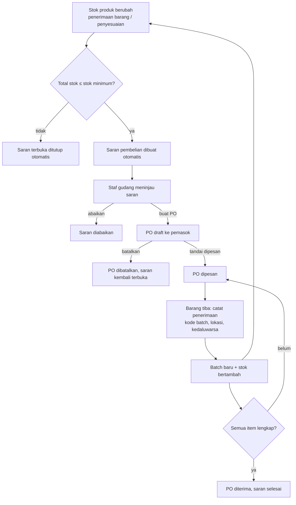

# Toko Asri

Sistem informasi terpadu **ERP + SCM + CRM** untuk toko retail frozen food (tugas akhir mata kuliah SIM).
Dibangun dengan **Next.js (App Router) + TypeScript + Tailwind** dan **Supabase** (Auth + Postgres + RLS).

Logika bisnis yang kritis (penerimaan barang, saran pembelian, pembatalan PO) berada di **database**
(fungsi RPC dan trigger Postgres), sehingga data antar-modul selalu konsisten.

## Status pengerjaan

| Tahap | Modul | Status |
|---|---|---|
| 1 | **SCM**: pemasok, produk, batch/kedaluwarsa, pesanan pembelian, penerimaan barang, saran pembelian, login + peran | ✅ tersedia |
| 2 | ERP: kasir/POS (FEFO), keuangan sederhana, penyesuaian stok | ⏳ berikutnya |
| 3 | CRM: pelanggan, riwayat belanja, poin & tier | ⏳ |
| 4 | Integrasi + dashboard pemilik | ⏳ |

## Menjalankan aplikasi

> Gunakan proyek Supabase **khusus demo**, bukan produksi. `supabase/seed.sql` menghapus data SCM yang ada sebelum mengisi data contoh.

### 1. Membuat proyek di supabase.com

1. Masuk/daftar di <https://supabase.com>, lalu klik **New project**.
2. Pilih organisasi, isi **Name** (mis. `toko-asri-demo`), buat **Database Password** (simpan), pilih **Region** terdekat (mis. Singapore), lalu **Create new project**. Tunggu hingga status siap (±2 menit).
3. Buka **Project Settings → API** (atau tombol **Connect**), salin:
   - **Project URL** (`https://xxxx.supabase.co`)
   - **anon public key** (di dashboard baru kadang bernama *publishable key*)
4. Buka **Authentication → Providers → Email** dan pastikan Email aktif. Agar akun demo langsung bisa dipakai, matikan **Confirm email** (atau centang *Auto Confirm User* saat membuat akun, lihat langkah 4).

### 2. Menjalankan migration dan seed

Pilih salah satu cara.

**Cara A: SQL Editor (paling mudah)**

1. Di dashboard buka **SQL Editor → New query**.
2. Salin seluruh isi `supabase/migrations/20261119000100_scm_schema.sql`, tempel, lalu **Run**. Harus berhasil tanpa galat.
3. Buka query baru, salin isi `supabase/seed.sql`, **Run**. Ini mengisi 3 pemasok, 4 lokasi simpan, 17 produk, 20 batch (ada yang hampir/sudah kedaluwarsa), 3 saran pembelian, dan 2 PO contoh.

**Cara B: Supabase CLI**

```bash
npm install -g supabase            # atau gunakan: npx supabase ...
supabase init                      # sekali saja, membuat supabase/config.toml
supabase login
supabase link --project-ref <PROJECT_REF>   # PROJECT_REF = bagian xxxx pada https://xxxx.supabase.co
supabase db push                   # menjalankan semua file di supabase/migrations
```

Lalu jalankan seed, lewat SQL Editor seperti Cara A langkah 3, atau lewat `psql` dengan *connection string* dari **Connect → Session pooler**:

```bash
psql "<CONNECTION_STRING>" -f supabase/seed.sql
```

### 3. Mengisi `.env.local`

```bash
cp .env.example .env.local
```

Isi `.env.local`:

```
NEXT_PUBLIC_SUPABASE_URL=https://xxxx.supabase.co
NEXT_PUBLIC_SUPABASE_ANON_KEY=<anon public key>
```

`.env.local` tidak di-commit (sudah ada di `.gitignore`).

### 4. Membuat akun untuk tiap peran

Peran: **pemilik** (akses penuh), **staf_gudang** (inventori, pembelian, master SCM), **kasir** (hanya beranda pada tahap ini; modul kasir ada di Tahap 2).

1. Buka **Authentication → Users → Add user → Create new user**. Isi email dan kata sandi, centang **Auto Confirm User**. Buat tiga akun, mis.:
   `pemilik@tokoasri.test`, `gudang@tokoasri.test`, `kasir@tokoasri.test`.
2. Beri peran lewat **SQL Editor** (tanpa baris `profiles` pengguna akan melihat halaman *Akun belum diaktifkan*):

```sql
insert into profiles (id, nama, peran)
select id, 'Budi (Pemilik)', 'pemilik'::peran_enum from auth.users where email = 'pemilik@tokoasri.test';

insert into profiles (id, nama, peran)
select id, 'Sari (Gudang)', 'staf_gudang'::peran_enum from auth.users where email = 'gudang@tokoasri.test';

insert into profiles (id, nama, peran)
select id, 'Dewi (Kasir)', 'kasir'::peran_enum from auth.users where email = 'kasir@tokoasri.test';
```

### 5. Menjalankan

```bash
npm install
npm run dev        # http://localhost:3000
```

Masuk dengan salah satu akun di atas. Untuk memeriksa build produksi: `npm run build`.

## Fitur Tahap 1: modul SCM

- **Pemasok**: tambah, ubah, nonaktifkan.
- **Lokasi simpan**: freezer/chiller/rak kering beserta rentang suhu (°C).
- **Produk**: SKU, pemasok, harga beli/jual, **stok minimum** dan **jumlah pesan ulang**.
- **Inventori per batch**: kode batch, lokasi dan suhu, tanggal kedaluwarsa, urut terdekat (**FEFO**); lencana *Aman / Hampir kedaluwarsa (≤14 hari) / Kedaluwarsa* (kedaluwarsa hari ini dihitung kedaluwarsa); stok layak jual dipisah dari stok kedaluwarsa; filter.
- **Saran pembelian otomatis**: saat total stok produk ≤ stok minimum, sistem membuat satu saran (tidak duplikat); saran menutup sendiri saat stok cukup.
- **Pesanan pembelian (PO)**: draft → dipesan → diterima, atau dibatalkan (tidak bisa jika sudah ada barang diterima; saran terkait kembali terbuka). Dapat dibuat dari saran atau manual.
- **Penerimaan barang**: mendukung penerimaan sebagian; membentuk batch baru (kode, lokasi, kedaluwarsa wajib); menolak penerimaan melebihi pesanan atau berulang.
- **Login & peran** dengan Row Level Security di semua tabel; staf gudang tidak dapat mengubah perannya sendiri.

## Alur proses bisnis (Tahap 1)



Tahap berikutnya menambahkan: penjualan mengurangi stok per batch (FEFO), stok menipis memicu saran, dan transaksi memperbarui data pelanggan.

## Pengujian

```bash
npm test          # uji unit (peran, format, kedaluwarsa)
npm run build     # build produksi + type check
```

Uji skema database (butuh Postgres lokal, **bukan** Supabase Anda):

```bash
createdb asri_test
PGDATABASE=asri_test supabase/tests/run.sh   # stub auth + migration + uji + seed dua kali
PGDATABASE=asri_test supabase/tests/concurrency.sh   # uji konkurensi (setelah run.sh)
```

## Struktur

```
supabase/migrations/   skema, RLS, trigger, fungsi RPC
supabase/seed.sql      data contoh
supabase/tests/        uji SQL + runner
src/lib/               peran, format, kedaluwarsa, klien Supabase
src/app/(app)/gudang/  halaman SCM
docs/superpowers/      dokumen desain dan rencana
```
