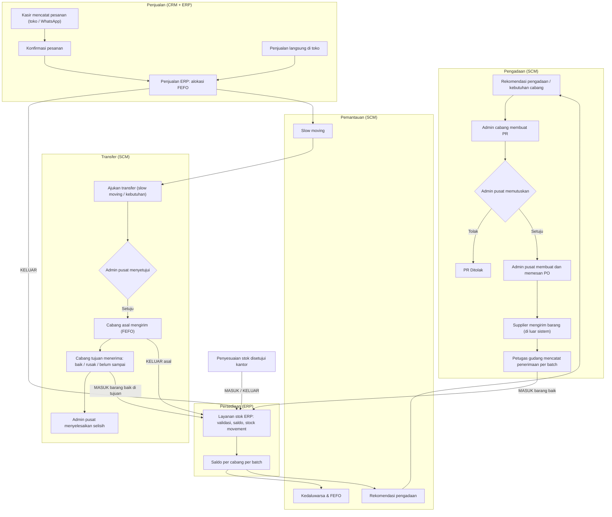

# PRD — Product Requirements Document
## SaaS Toko Asri (ERP · SCM · CRM)

| | |
| --- | --- |
| Versi | 1.0-draf |
| Tanggal | 12 November 2026 |
| Penyusun | Naurah Nasywa Syakirah (seluruh modul), dibantu Claude |
| Status | **Draf — belum disetujui.** Keputusan terbuka ada di [DECISIONS.md](../DECISIONS.md) |
| Dokumen terkait | [ARCHITECTURE](../02-architecture/ARCHITECTURE.md) · [DESIGN](../03-design/DESIGN.md) · [SCHEMA](../04-database/SCHEMA.md) · [RULES](../05-rules/RULES.md) · [TRACEABILITY](../06-review/TRACEABILITY_MATRIX.md) |
| Dasar | Dokumen [Tahap 1](../tahap-1-analisis-kebutuhan/tahap-1-analisis-kebutuhan-scm-v0.1-draf.md), [Tahap 2](../tahap-2-proses-bisnis/tahap-2-proses-bisnis-as-is-to-be-v0.1-draf.md), [Tahap 3](../tahap-3-perancangan-fitur/tahap-3-perancangan-fitur-scm-v0.2-draf.md), [Tahap 4](../tahap-4-integrasi/tahap-4-kajian-awal-integrasi-v0.6-draf.md) |

### Penanda sumber

| Penanda | Arti |
| --- | --- |
| **[F] Wn** | Fakta dari catatan wawancara W1–W16 (Tahap 1). Tidak diubah |
| **[F-P]** | Dinyatakan pengguna sebagai hasil wawancara di master prompt implementasi, tetapi **tidak ada di catatan W1–W16**. Perlu dicatat sumbernya (Tahap 4 R-01) |
| **[K]** | Keputusan yang sudah ditetapkan pengguna di master prompt |
| **[A]** | Asumsi sementara; belum dikonfirmasi mitra |
| **[R]** | Rekomendasi analis |
| **[U]** | Usulan yang menunggu persetujuan (lihat DECISIONS) |

### Perubahan dasar dari dokumen sebelumnya

Pembagian modul per anggota kelompok tidak dipakai lagi. ERP, SCM, dan CRM dirancang sebagai **satu aplikasi** oleh satu penanggung jawab [K]. Semua butir Tahap 2–4 yang dulu berstatus "perlu kesepakatan tim" kini menjadi keputusan desain yang menunggu persetujuan Naurah. Butir yang menyangkut mitra tetap "perlu konfirmasi mitra" (lihat [DECISIONS.md](../DECISIONS.md) DEC-01).

---

## 1.1 Product Overview

### Latar belakang

Toko Asri adalah usaha frozen food dengan beberapa toko/cabang:
- Barang masuk dari supplier dan dari cabang lain, disimpan di toko, lalu dijual [F] W1.
- Pembelian dilakukan lewat supplier [F] W6, dan keputusan membeli ada di admin, bukan toko [F] W7.
- Admin memantau stok dengan aplikasi stok umum [F] W11, tetapi pencatatan stok dan pembukuan masih banyak yang manual [F] W14.
- Toko belum punya website [F] W12.
- Pembeli didominasi mahasiswa dan reseller [F] W13. Pesanan datang langsung di toko atau lewat WhatsApp [F-P].

### Permasalahan (dari wawancara)

| ID | Masalah | Dasar |
| --- | --- | --- |
| P1 | Stok dan tanggal kedaluwarsa dicatat manual di buku | [F] W2, W14 |
| P2 | Pencatatan melibatkan banyak orang sehingga rawan salah — **masalah paling dirasakan** | [F] W16 |
| P3 | Data terpecah: buku di toko, aplikasi stok umum di admin | [F] W2, W11 |
| P4 | Pemeriksaan stok hanya seminggu sekali | [F] W3 |
| P5 | Toko melapor saat stok sudah habis; barang datang 1–3 hari kemudian, sehingga pernah kehabisan stok | [F] W8, W9, W10 |
| P6 | Admin memutuskan pembelian dari laporan manual | [F] W7, W9 |
| P7 | Barang lambat terjual dilaporkan manual lalu dipindah antarcabang | [F] W1, W5 |
| P8 | Selisih stok harus dilaporkan ke kantor sebelum data diperbarui | [F] W15 |
| P9 | Pemantauan kedaluwarsa bergantung pada pemeriksaan rutin oleh orang | [F] W4 |

Yang **bukan** masalah menurut wawancara: barang kedaluwarsa atau rusak **jarang** terjadi [F] W4. Produk ini tidak mengklaim adanya kerugian kedaluwarsa yang besar, sistem utang pelanggan, atau aplikasi pemesanan khusus.

### Solusi

Satu aplikasi web yang mencatat **setiap perubahan stok sebagai dokumen sistem di titik kejadian**, per cabang dan per batch:
- penerimaan barang;
- transfer;
- penjualan;
- penyesuaian.

Kewenangan membeli dan memindahkan barang tetap di admin pusat. Ketiga modul memakai satu sumber data:

| Modul | Peran |
| --- | --- |
| ERP | Pemilik produk, cabang, dan saldo |
| SCM | Pengadaan, penerimaan, transfer, dan pemantauan |
| CRM | Pelanggan dan pesanan |

### Tujuan produk

| ID | Tujuan | Ukuran keberhasilan (target demo/MVP) |
| --- | --- | --- |
| G1 | Satu sumber data stok per cabang per batch | 100% perubahan saldo punya stock movement dan kunci kejadian; rekonsiliasi saldo vs movement = 0 selisih |
| G2 | Jelas siapa mencatat apa | Setiap aksi penting tercatat di activity log dengan pengguna dan waktu |
| G3 | Membeli sebelum stok habis | Rekomendasi pengadaan muncul saat posisi stok ≤ titik pesan ulang |
| G4 | Barang lambat terjual dan dekat kedaluwarsa terlihat | Daftar slow moving dan kedaluwarsa tersedia per cabang tanpa laporan manual |
| G5 | Pesanan pelanggan terhubung dengan stok | Pesanan yang dikonfirmasi selalu menjadi satu penjualan ERP dan mengurangi stok FEFO |

### Target pengguna

Staf internal Toko Asri: admin pusat, admin/staf cabang, petugas gudang/penerimaan, dan kasir. Pelanggan **tidak** memakai aplikasi; pesanan mereka dicatat staf.

### Value proposition

- **Admin pusat:** satu layar untuk stok semua cabang, pesanan yang sedang berjalan, rekomendasi beli, dan barang yang perlu dipindah. Keputusan tetap di tangannya.
- **Cabang:** cukup mengajukan dokumen, tanpa laporan lisan atau buku. Status pengajuan terlihat.
- **Data:** saldo tidak bisa berubah tanpa jejak; klik ganda atau kirim ulang tidak menggandakan stok.

### Ruang lingkup

Aplikasi web responsif (desktop dan HP) berbahasa Indonesia untuk operasi internal multi-cabang:
- master data;
- persediaan per batch;
- pengadaan;
- penerimaan;
- transfer;
- pemantauan kedaluwarsa dan slow moving;
- penjualan;
- pelanggan dan pesanan;
- laporan dan jejak audit.

Rincian per prioritas ada di §1.6.

---

## 1.2 User Persona dan Roles

| Kode | Role | Status | Dasar | Kebutuhan & tujuan | Kewenangan inti |
| --- | --- | --- | --- | --- | --- |
| `SUPER_ADMIN` | Super Admin | **[U] Usulan** — tidak ada di wawancara | Butuh pengelola akun dan konfigurasi sistem | Mengelola akun, peran, dan cabang tugas tanpa ikut operasional | Kelola pengguna dan peran, lihat log sistem. **Tidak** menyetujui dokumen bisnis |
| `ADMIN_PUSAT` | Admin Pusat | **[F]** | W5, W7, W9, W11 | Melihat seluruh cabang dan memutuskan pembelian dan pemindahan | Setujui PR, buat/pesan PO, setujui transfer, setujui penyesuaian stok (sebagai "kantor" [A] A3), master data, parameter |
| `ADMIN_CABANG` | Admin Cabang | **[F]** untuk fungsinya (toko melapor ke admin, W3, W9); nama jabatan [A] | W3, W5, W9 | Mengajukan kebutuhan dan memantau stok cabangnya | Buat PR, ajukan transfer, ajukan penyesuaian, pantau kedaluwarsa dan rekomendasi cabang sendiri |
| `PETUGAS_GUDANG` | Petugas Gudang | **[A] A2** — bisa jadi orang yang sama dengan admin cabang | Butuh pencatat barang datang/keluar | Mencatat barang datang dan barang transfer dengan cepat | Catat penerimaan, kirim dan terima transfer di cabangnya |
| `KASIR` | Kasir | **[U] Usulan** | Barang dijual di toko [F] W1; pesanan di toko/WhatsApp [F-P] | Mencatat penjualan dan pesanan pelanggan | Penjualan langsung, pelanggan, member, pesanan, cek ketersediaan |

Catatan:
- Satu akun memiliki satu role di MVP [U] (DEC-08). Untuk toko kecil, satu orang dapat diberi akun yang role-nya sesuai tugas utamanya.
- Di prototipe, role Kasir masih bernama `STAF_PENJUALAN`, dan Super Admin belum ada (DEC-07).

### Persona singkat

| Persona | Situasi | Frustrasi saat ini | Yang dibutuhkan |
| --- | --- | --- | --- |
| Admin pusat | Menerima laporan stok habis dari tiap toko setiap hari [F] W9 | Memutuskan beli tanpa melihat stok yang sedang dipesan dan laju jual | Rekomendasi pengadaan, persetujuan cepat, ringkasan semua cabang |
| Admin cabang | Mengecek stok mingguan [F] W3, melapor slow moving [F] W5 | Laporan manual dan tidak tahu status pengajuan | Form PR dan transfer, status dan notifikasi, daftar FEFO |
| Petugas gudang | Menerima barang dari supplier dan cabang lain [F] W1 | Mencatat di buku; batch dan kedaluwarsa tertulis manual [F] W2 | Form penerimaan per batch yang cepat di HP |
| Kasir | Melayani mahasiswa dan reseller [F] W13, pesanan WhatsApp [F-P] | Tidak tahu stok layak jual saat menjawab pelanggan | Cek ketersediaan, catat pesanan, penjualan otomatis FEFO |

---

## 1.3 Functional Requirements

Format setiap fitur:
- Tabel ringkas: tujuan, aktor, deskripsi, user story, dasar, dan prioritas.
- **Acceptance criteria (AC)** yang dapat diuji.

Aturan rinci untuk setiap fitur ada di [RULES.md](../05-rules/RULES.md).

### A. Bersama (shared)

#### FR-COR-01 Login dan sesi
| | |
| --- | --- |
| Tujuan | Setiap pencatatan terikat ke orang yang jelas (P2) |
| Aktor | Semua role |
| Deskripsi | Login dengan username dan password; sesi berakhir otomatis; logout |
| User story | Sebagai staf, saya ingin masuk dengan akun saya sendiri, agar setiap catatan atas nama saya |
| Dasar | [F] W16 · Tahap 1 NFR-04 |
| Prioritas | **MVP** |

AC:
1. Login salah menampilkan pesan umum yang tidak membedakan username dan password salah.
2. Halaman selain login mengarahkan ke login bila belum masuk.
3. Sesi berakhir setelah 8 jam.
4. Logout menghapus sesi.

#### FR-COR-02 Manajemen pengguna dan role
| | |
| --- | --- |
| Tujuan | Akun dibuat, diubah, dan dinonaktifkan tanpa akses database |
| Aktor | Super Admin [U] (bila tidak disetujui: Admin Pusat) |
| Deskripsi | Daftar pengguna, tambah, ubah nama/role/cabang, nonaktifkan, reset password |
| User story | Sebagai Super Admin, saya ingin membuat akun petugas cabang baru, agar ia bisa langsung mencatat |
| Dasar | [F] W16; kebutuhan operasional [R] |
| Prioritas | **MVP** (belum ada di prototipe — G-03) |

AC:
1. Role cabang wajib punya cabang.
2. Akun nonaktif tidak bisa login dan sesinya berhenti pada permintaan berikutnya.
3. Password tidak pernah ditampilkan.
4. Perubahan tercatat di activity log.

#### FR-COR-03 Dashboard per role
| | |
| --- | --- |
| Tujuan | Menampilkan hal yang perlu tindakan sesuai role |
| Aktor | Semua role |
| Deskripsi | Kartu ringkasan dan daftar singkat: PR/transfer menunggu, PO terlambat, rekomendasi, kedaluwarsa, pesanan baru, penjualan hari ini |
| User story | Sebagai admin pusat, saya ingin melihat semua hal yang menunggu keputusan saya saat masuk |
| Dasar | [F] W9, W11 |
| Prioritas | **MVP** |

AC:
1. Isi dashboard berbeda per role.
2. Angka mengikuti lingkup cabang.
3. Setiap kartu menuju daftar terfilter.

#### FR-COR-04 Notifikasi dalam aplikasi
| | |
| --- | --- |
| Tujuan | Mengganti laporan lisan/harian (W9) |
| Aktor | Semua role (penerima) |
| Deskripsi | Notifikasi untuk: • PR baru/diputuskan • PO dipesan • barang diterima • transfer perlu tindakan/selisih • batch segera ditindak/kedaluwarsa • rekomendasi baru • penyesuaian menunggu • konflik idempotency |
| User story | Sebagai admin cabang, saya ingin tahu saat PR saya diputuskan tanpa harus menanyakan |
| Dasar | [F] W9 · Tahap 3 F11 |
| Prioritas | **MVP** |

AC:
1. Penanda jumlah belum dibaca di header.
2. Notifikasi membuka dokumen terkait.
3. Pengguna bisa menandai semua sudah dibaca.
4. Notifikasi pemantauan tidak dikirim berulang untuk kondisi yang sama.

#### FR-COR-05 Log integrasi stok
| | |
| --- | --- |
| Tujuan | Menelusuri setiap pengajuan perubahan stok, termasuk yang gagal |
| Aktor | Admin Pusat, Super Admin |
| Deskripsi | Daftar pengajuan ke layanan stok beserta hasilnya: Berhasil, Sudah diproses, Ditolak ERP, Konflik, Gagal teknis, Hasil belum diketahui |
| User story | Sebagai admin pusat, saya ingin melihat penerimaan yang gagal diproses, agar bisa ditindaklanjuti |
| Dasar | Tahap 4 §5.2 lapis 3 |
| Prioritas | **MVP** |

AC:
1. Log tetap ada walau transaksi utama dibatalkan.
2. Log tidak dapat diubah atau dihapus.
3. Log dapat difilter per hasil dan kunci.

#### FR-COR-06 Rekonsiliasi data stok
| | |
| --- | --- |
| Tujuan | Membuktikan saldo selalu sama dengan jejak movement-nya, dan tidak ada pengajuan stok yang menggantung |
| Aktor | Admin Pusat |
| Deskripsi | Pemeriksaan: (a) saldo per batch per cabang = jumlah movement; (b) status pemrosesan cocok dengan catatan kunci ERP; (c) jumlah diterima di PO = jumlah barang baik di penerimaan; (d) movement transfer = jumlah dikirim dan diterima baik |
| User story | Sebagai admin pusat, saya ingin tahu apakah ada data stok yang tidak konsisten sebelum laporan bulanan |
| Dasar | [F] W16 (data rawan salah) · NFR integritas |
| Prioritas | **MVP** (belum ada di prototipe — G-05) |

AC:
1. Setiap pemeriksaan menampilkan 0 atau daftar selisih.
2. Pemeriksaan hanya membaca data dan tidak memperbaiki otomatis.
3. Hasil dapat dijalankan ulang kapan saja.

### B. ERP

#### FR-ERP-01 Master produk
| | |
| --- | --- |
| Tujuan | Satu daftar produk untuk semua modul |
| Aktor | Admin Pusat |
| Deskripsi | Tambah, ubah, aktif/nonaktif produk: SKU, nama, kategori, satuan, harga jual, tanda "wajib diperiksa rutin" |
| User story | Sebagai admin pusat, saya ingin menambah produk baru sekali, agar langsung bisa dipesan, diterima, dan dijual |
| Dasar | [F] W4 (wajib periksa) · Tahap 4 §3 |
| Prioritas | **MVP** |

AC:
1. SKU unik.
2. Produk tidak dihapus, hanya dinonaktifkan.
3. Produk nonaktif tidak bisa dipilih di dokumen baru.
4. Perubahan tercatat.

#### FR-ERP-02 Master cabang
| | |
| --- | --- |
| Tujuan | Daftar cabang untuk lingkup data dan transaksi |
| Aktor | Admin Pusat |
| Deskripsi | Tambah, ubah, aktif/nonaktif cabang |
| User story | Sebagai admin pusat, saya ingin mendaftarkan cabang baru, agar stoknya tercatat terpisah |
| Dasar | [F] W1 (banyak cabang) |
| Prioritas | **MVP** |

AC:
1. Kode cabang unik.
2. Cabang nonaktif tidak menerima transaksi baru.

#### FR-ERP-03 Manajemen persediaan
| | |
| --- | --- |
| Tujuan | Melihat stok per cabang, per produk, dan per batch |
| Aktor | Semua role (lingkup cabang) |
| Deskripsi | Stok total, stok layak jual (tanpa batch kedaluwarsa), kedaluwarsa terdekat; tampilan per batch |
| User story | Sebagai kasir, saya ingin tahu stok layak jual saat pelanggan bertanya |
| Dasar | [F] W2, W11 · Tahap 4 E-01, E-03 |
| Prioritas | **MVP** |

AC:
1. Angka berasal dari saldo ERP, bukan salinan.
2. Pengguna cabang hanya melihat cabangnya.
3. Batch kedaluwarsa tidak dihitung layak jual.

#### FR-ERP-04 Batch dan tanggal kedaluwarsa
| | |
| --- | --- |
| Tujuan | Stok terlacak per batch dengan tanggal kedaluwarsa |
| Aktor | Sistem (dari penerimaan, transfer, saldo awal) |
| Deskripsi | Batch = produk + nomor batch + tanggal kedaluwarsa; dibuat saat stok pertama masuk |
| User story | Sebagai admin cabang, saya ingin tahu batch mana yang kedaluwarsa lebih dulu |
| Dasar | [F] W2, W4 · Tahap 1 BR-08 |
| Prioritas | **MVP** |

AC:
1. Setiap saldo selalu terkait satu batch.
2. Nomor batch dan kedaluwarsa wajib.
3. Bila supplier tidak mencantumkan nomor batch, dipakai nomor batch internal [A] A4.

#### FR-ERP-05 Layanan stok dan stock movement
| | |
| --- | --- |
| Tujuan | Satu-satunya jalur perubahan saldo, idempotent dan dapat ditelusuri |
| Aktor | Sistem (dipanggil penerimaan, transfer, penjualan, penyesuaian, saldo awal) |
| Deskripsi | Menerima kejadian MASUK/KELUAR berkunci; memvalidasi; mengubah saldo; mencatat movement; menerapkan aturan I-1–I-4 |
| User story | Sebagai admin pusat, saya ingin yakin satu penerimaan tidak pernah menambah stok dua kali walau tombol diklik ulang |
| Dasar | [K] ERP satu-satunya pengubah saldo · Tahap 4 §6.2.1 |
| Prioritas | **MVP** |

AC:
1. Saldo tidak pernah negatif.
2. Kunci yang sama dengan isi sama hanya diproses sekali.
3. Isi berbeda dengan kunci sama ditolak.
4. Penolakan bisnis tidak memakai kunci.
5. Movement tidak dapat diubah atau dihapus.

#### FR-ERP-06 Penjualan
| | |
| --- | --- |
| Tujuan | Mencatat penjualan dan mengurangi stok per batch secara FEFO |
| Aktor | Kasir, Admin Cabang, Admin Pusat; juga dari pesanan CRM |
| Deskripsi | Penjualan multi-produk; harga dari master (snapshot); alokasi batch FEFO otomatis; batch kedaluwarsa tidak dijual |
| User story | Sebagai kasir, saya ingin mencatat penjualan tanpa memilih batch, agar batch yang lebih dulu kedaluwarsa terjual lebih dulu |
| Dasar | [F] W1 · Tahap 4 AS-2, E-03 |
| Prioritas | **MVP** |

AC:
1. Stok layak jual kurang menyebabkan penolakan tanpa perubahan saldo.
2. Pengiriman ulang dengan kunci yang sama tidak membuat penjualan kedua.
3. Detail penjualan menampilkan batch yang dipakai.

#### FR-ERP-07 Penyesuaian stok
| | |
| --- | --- |
| Tujuan | Selisih hasil cek, barang kedaluwarsa, dan barang rusak di cabang tercatat dengan persetujuan |
| Aktor | Admin Cabang (mengajukan), Admin Pusat sebagai kantor [A] A3 (memutuskan) |
| Deskripsi | Pengajuan per batch: arah (kurangi/tambah), alasan, keterangan; saldo berubah hanya setelah disetujui |
| User story | Sebagai admin cabang, saya ingin mengajukan koreksi hasil cek mingguan, agar kantor menyetujui sebelum data berubah |
| Dasar | [F] W3, W15 · Tahap 2 keputusan no. 1 dan 4 |
| Prioritas | **MVP** |

AC:
1. Selama Diajukan, stok tidak berubah.
2. Penolakan wajib catatan.
3. Pengurangan tidak boleh melebihi saldo batch.
4. Keputusan hanya sekali.

#### FR-ERP-08 Laporan persediaan dan transaksi
| | |
| --- | --- |
| Tujuan | Ringkasan untuk evaluasi |
| Aktor | Admin Pusat, Admin Cabang |
| Deskripsi | Persediaan per cabang (unit, layak jual, nilai jual); mutasi per jenis; jumlah dan nilai penjualan; produk terlaris; filter periode dan cabang; cetak |
| User story | Sebagai admin pusat, saya ingin melihat mutasi stok bulan ini per cabang |
| Dasar | [F] W11, W14 |
| Prioritas | **MVP** (ekspor Excel/PDF: Post-MVP) |

AC:
1. Angka cocok dengan stock movement pada periode yang sama.
2. Pengguna cabang hanya melihat cabangnya.

#### FR-ERP-09 Saldo awal
| | |
| --- | --- |
| Tujuan | Memasukkan stok fisik yang ada saat aplikasi mulai dipakai |
| Aktor | Admin Pusat |
| Deskripsi | Input saldo per cabang per batch, diproses sebagai kejadian MASUK berkunci `SALDO-AWAL-…` |
| User story | Sebagai admin pusat, saya ingin memasukkan hasil hitung stok awal tiap cabang, agar monitoring langsung berjalan |
| Dasar | Tahap 4 E-08 |
| Prioritas | **MVP** (prototipe: hanya lewat seed — G-04) |

AC:
1. Saldo awal tercatat sebagai movement.
2. Hanya bisa dilakukan sekali per cabang per kunci.
3. Tercatat di activity log.

### C. SCM

#### FR-SCM-01 Manajemen supplier
| | |
| --- | --- |
| Tujuan | Data pemasok terpusat |
| Aktor | Admin Pusat (kelola), Admin Cabang (lihat) |
| Deskripsi | Tambah, ubah, aktif/nonaktif supplier: kode, nama, kontak, telepon, alamat, lead time default |
| User story | Sebagai admin pusat, saya ingin menyimpan lead time tiap supplier, agar estimasi tiba PO terisi otomatis |
| Dasar | [F] W6, W10 · Tahap 3 F01 |
| Prioritas | **MVP** |

AC:
1. Kode unik.
2. Supplier yang punya PO berjalan tidak bisa dinonaktifkan.
3. Supplier tidak dihapus.

#### FR-SCM-02 Hubungan supplier–produk
| | |
| --- | --- |
| Tujuan | Mengetahui siapa memasok apa |
| Aktor | Admin Pusat |
| Deskripsi | Menautkan supplier ke produk ERP (hanya ID, tanpa harga acuan); harga terakhir dibaca dari PO sah |
| User story | Sebagai admin pusat, saya ingin saat membuat PO hanya melihat produk yang memang dipasok supplier itu |
| Dasar | Tahap 4 §3.1.1 |
| Prioritas | **MVP** |

AC:
1. Produk nonaktif tidak bisa ditautkan.
2. Produk tidak disalin ke SCM.

#### FR-SCM-03 Purchase Request (PR)
| | |
| --- | --- |
| Tujuan | Kebutuhan cabang tercatat resmi sebelum stok habis (P5, P6) |
| Aktor | Admin Cabang (cabangnya), Admin Pusat (untuk cabang mana pun) |
| Deskripsi | PR multi-produk dengan jumlah dan alasan; Draf → Diajukan; dapat dibuat dari rekomendasi; dapat dibatalkan sebelum diputuskan |
| User story | Sebagai admin cabang, saya ingin mengajukan kebutuhan barang saat stok mendekati minimum, bukan setelah habis |
| Dasar | [F] W7, W9 · Tahap 3 F02 |
| Prioritas | **MVP** |

AC:
1. Minimal satu produk aktif.
2. Jumlah > 0.
3. Produk tidak boleh ganda.
4. PR tidak mengubah stok.
5. Ada peringatan bila PR lain yang masih Diajukan memuat produk sama.

#### FR-SCM-04 Persetujuan PR
| | |
| --- | --- |
| Tujuan | Keputusan beli tetap di admin pusat |
| Aktor | Admin Pusat |
| Deskripsi | Setujui penuh, setujui dengan mengubah jumlah per item, atau tolak dengan alasan |
| User story | Sebagai admin pusat, saya ingin mengubah jumlah yang diminta sebelum menyetujui |
| Dasar | [F] W7 · Tahap 1 BR-01 |
| Prioritas | **MVP** |

AC:
1. Hanya PR Diajukan yang dapat diputuskan.
2. Tolak wajib alasan.
3. Semua jumlah 0 tidak dianggap setuju.
4. Cabang diberi notifikasi.

#### FR-SCM-05 Purchase Order (PO)
| | |
| --- | --- |
| Tujuan | Pesanan ke supplier terdokumentasi dan terpantau |
| Aktor | Admin Pusat |
| Deskripsi | PO dari item PR yang disetujui; satu supplier dan satu cabang tujuan [A] AS-10; harga snapshot; Draf → Dipesan; estimasi tiba = tanggal pesan + lead time (default 3 hari); tandai terlambat; batal/tutup |
| User story | Sebagai admin pusat, saya ingin tahu PO mana yang belum datang melewati estimasi |
| Dasar | [F] W6, W7, W10 · Tahap 3 F04 |
| Prioritas | **MVP** |

AC:
1. Setiap item PO merujuk item PR yang disetujui.
2. Jumlah PO ≤ sisa disetujui.
3. Harga terkunci setelah dipesan.
4. PO yang sudah menerima barang baik hanya dapat ditutup, tidak dibatalkan.
5. Pengiriman pesanan ke supplier dilakukan di luar sistem.

#### FR-SCM-06 Penerimaan barang
| | |
| --- | --- |
| Tujuan | Satu-satunya pintu barang supplier masuk ke stok |
| Aktor | Petugas Gudang, Admin Cabang (cabang tujuan PO), Admin Pusat |
| Deskripsi | Penerimaan per PO; baik dan rusak per item; penerimaan sebagian/bertahap; Draf → konfirmasi; barang baik diajukan ke layanan stok dengan kunci nomor penerimaan; status pemrosesan dan kirim ulang |
| User story | Sebagai petugas gudang, saya ingin mencatat barang datang dari HP dan langsung menambah stok cabang |
| Dasar | [F] W1, W2, W4, W16 · Tahap 3 F05 · Tahap 4 §4.2 |
| Prioritas | **MVP** |

AC:
1. Jumlah baik ≤ sisa PO.
2. Barang rusak wajib keterangan dan tidak masuk stok.
3. Penerimaan Selesai hanya setelah ERP Berhasil.
4. Gagal teknis atau hasil belum diketahui mengunci isi dan menyediakan Kirim ulang.
5. Kirim ulang tidak menggandakan stok.

#### FR-SCM-07 Pencatatan batch
| | |
| --- | --- |
| Tujuan | Batch dan kedaluwarsa tercatat sejak barang masuk |
| Aktor | Petugas Gudang |
| Deskripsi | Satu item PO dapat dipecah ke beberapa batch; nomor batch dan tanggal kedaluwarsa wajib |
| User story | Sebagai petugas gudang, saya ingin mencatat dua batch berbeda untuk produk yang sama dalam satu penerimaan |
| Dasar | [F] W2 · Tahap 3 F06 |
| Prioritas | **MVP** |

AC:
1. Tanggal kedaluwarsa harus setelah tanggal terima.
2. Produk dan batch yang sama tidak boleh ditulis dua kali dalam satu penerimaan.

#### FR-SCM-08 Transfer stok antarcabang
| | |
| --- | --- |
| Tujuan | Memindahkan barang (terutama slow moving) secara terkendali |
| Aktor | Admin Cabang asal/tujuan dan Admin Pusat (ajukan [A] AS-9); Admin Pusat (setujui [A] AS-15); Petugas Gudang/Admin Cabang asal (kirim) dan tujuan (terima) |
| Deskripsi | Ajukan → disetujui → kirim per batch (FEFO, alasan bila tidak) → terima per kategori: baik, rusak, belum sampai → susulan → admin pusat menyelesaikan selisih |
| User story | Sebagai admin pusat, saya ingin memindahkan barang lambat terjual ke cabang yang lebih laku |
| Dasar | [F] W1, W5 · Tahap 3 F07 · Tahap 4 §4.3–4.4 |
| Prioritas | **MVP** |

AC:
1. Stok asal berkurang saat dikirim; stok tujuan bertambah saat barang baik diterima.
2. Barang rusak dan hilang tidak masuk stok layak jual.
3. Batch kedaluwarsa tidak bisa dikirim.
4. Contoh 10/8/1/1 menghasilkan saldo dan selisih sesuai Tahap 4 §4.4.

#### FR-SCM-09 Slow-moving monitoring
| | |
| --- | --- |
| Tujuan | Menandai barang lambat terjual dan menyarankan cabang tujuan |
| Aktor | Admin Pusat |
| Deskripsi | Parameter: periode, batas laju jual, batas umur stok, aturan DAN/ATAU. Daftar per cabang dengan laju, umur, kedaluwarsa terdekat, saran cabang lebih laku. Aksi: ajukan transfer, tandai ditinjau |
| User story | Sebagai admin pusat, saya ingin melihat produk yang lambat di satu cabang tetapi laku di cabang lain |
| Dasar | [F] W5 · Tahap 3 F08 |
| Prioritas | **MVP** — bergantung data penjualan ERP |

AC:
1. Tanpa parameter, sistem menampilkan "belum diatur" dan tidak memakai angka karangan.
2. Riwayat kurang dari satu periode dinilai "data belum cukup".
3. Sistem tidak memindahkan barang otomatis.

#### FR-SCM-10 Expiry monitoring
| | |
| --- | --- |
| Tujuan | Batch dekat kedaluwarsa terlihat sebelum terlambat |
| Aktor | Admin Pusat, Admin Cabang, Petugas Gudang |
| Deskripsi | Kategori per batch: Aman, Perlu perhatian, Segera ditindak, Kedaluwarsa (ambang diatur admin pusat); tanda produk wajib periksa; tanda "didahulukan"; aksi transfer atau penyesuaian |
| User story | Sebagai admin cabang, saya ingin daftar batch yang harus dijual minggu ini |
| Dasar | [F] W2, W4 · Tahap 3 F09 |
| Prioritas | **MVP** |

AC:
1. Sisa hari ≤ 0 = Kedaluwarsa (tidak layak jual).
2. Notifikasi hanya saat batch berpindah ke Segera ditindak atau Kedaluwarsa.
3. Pengeluaran barang hanya lewat penyesuaian ERP.

#### FR-SCM-11 FEFO
| | |
| --- | --- |
| Tujuan | Batch yang lebih dulu kedaluwarsa keluar lebih dulu |
| Aktor | Sistem; Petugas Gudang (transfer) |
| Deskripsi | Urutan FEFO di daftar kedaluwarsa; saran batch saat kirim transfer; alokasi otomatis saat penjualan |
| User story | Sebagai petugas gudang, saya ingin sistem menyarankan batch mana yang dikirim |
| Dasar | [F] W2, W4 · Tahap 4 AS-2 |
| Prioritas | **MVP** |

AC:
1. Penjualan selalu FEFO.
2. Pengiriman transfer yang tidak FEFO wajib alasan.
3. Batch kedaluwarsa tidak pernah dipilih.

#### FR-SCM-12 Rekomendasi pengadaan — versi dasar
| | |
| --- | --- |
| Tujuan | Sinyal beli sebelum stok habis (P5) |
| Aktor | Admin Pusat, Admin Cabang |
| Deskripsi | Per produk per cabang dengan stok minimum dan target: • posisi = layak jual + sisa PO berjalan + transfer masuk dalam perjalanan • muncul bila posisi ≤ minimum • jumlah = target − posisi • tombol Buat PR |
| User story | Sebagai admin cabang, saya ingin tahu produk apa yang perlu diajukan hari ini |
| Dasar | [F] W8, W9, W10 · Tahap 3 F10 |
| Prioritas | **MVP** |

AC:
1. Tidak pernah membuat PR/PO otomatis.
2. Produk tanpa stok minimum tidak dinilai.
3. Contoh Tahap 3 (min 10/target 30) menghasilkan 30, 20, dan "tidak muncul".

#### FR-SCM-13 Rekomendasi pengadaan — versi laju jual
| | |
| --- | --- |
| Tujuan | Memperhitungkan laju jual dan lead time |
| Aktor | Sama dengan FR-SCM-12 |
| Deskripsi | Titik pesan = laju × L + minimum; target = maks(stok target, laju × (L + T) + minimum). Aktif bila parameter periode diatur dan riwayat cukup |
| User story | Sebagai admin pusat, saya ingin jumlah beli menyesuaikan kecepatan laku |
| Dasar | [F] W8, W10 · Tahap 1 rumus F |
| Prioritas | **MVP** (aktif otomatis hanya bila data cukup) |

AC:
1. Menampilkan komponen hitungan.
2. Kembali ke versi dasar bila data belum cukup.

#### FR-SCM-14 Activity log
| | |
| --- | --- |
| Tujuan | Siapa melakukan apa dan kapan (P2) |
| Aktor | Admin Pusat (semua), Admin Cabang (cabangnya) |
| Deskripsi | Log setiap aksi penting semua modul: pengguna, waktu, modul, aksi, dokumen, cabang, data sebelum/sesudah; filter dan detail |
| User story | Sebagai admin pusat, saya ingin tahu siapa yang mengubah jumlah penerimaan |
| Dasar | [F] W16 · Tahap 3 F12 |
| Prioritas | **MVP** |

AC:
1. Log tidak dapat diubah atau dihapus.
2. Filter modul, pengguna, cabang, tanggal, dan nomor dokumen tersedia.

#### FR-SCM-15 Parameter pemantauan dan pengadaan
| | |
| --- | --- |
| Tujuan | Nilai acuan diatur, bukan dikarang sistem |
| Aktor | Admin Pusat |
| Deskripsi | Parameter slow moving, ambang kedaluwarsa, cakupan T, serta stok minimum dan target per produk per cabang |
| User story | Sebagai admin pusat, saya ingin mengatur stok minimum tiap cabang berbeda |
| Dasar | [F] W5, W7 · Tahap 1 BR-15 |
| Prioritas | **MVP** |

AC:
1. Tidak ada nilai bawaan selain T = 1 hari [A] K-18.
2. Target > minimum.
3. Ambang Segera < Perlu perhatian.
4. Setiap perubahan tercatat.

#### Post-MVP (SCM)

| ID | Fitur | Dasar | Alasan ditunda |
| --- | --- | --- | --- |
| FR-SCM-16 | Evaluasi performa supplier (ketepatan waktu, kesesuaian jumlah, % rusak) dari data penerimaan | Tahap 1 FR-SUP-04 (Could) | Tidak disebut mitra; data perlu terkumpul dulu |
| FR-SCM-17 | Scan barcode saat penerimaan | Tahap 1 (Could) | Belum diketahui apakah produk berbarcode |
| FR-SCM-18 | Retur barang ke supplier | Tahap 1 (Won't MVP) | Tidak disebut mitra; barang rusak cukup dicatat |

### D. CRM

#### FR-CRM-01 Manajemen pelanggan
| | |
| --- | --- |
| Tujuan | Data pelanggan untuk pesanan dan riwayat |
| Aktor | Kasir, Admin Cabang, Admin Pusat |
| Deskripsi | Tambah, ubah, cari pelanggan: nama, telepon/WhatsApp (unik bila diisi), jenis Mahasiswa/Reseller/Umum, catatan |
| User story | Sebagai kasir, saya ingin mencari reseller dari nomor WhatsApp-nya |
| Dasar | [F] W13 · [F-P] pesanan WhatsApp |
| Prioritas | **MVP** |

AC:
1. Nama wajib.
2. Telepon unik.
3. Jenis wajib.
4. Perubahan tercatat.

#### FR-CRM-02 Member
| | |
| --- | --- |
| Tujuan | Menandai pelanggan tetap |
| Aktor | Kasir, Admin Cabang, Admin Pusat |
| Deskripsi | Daftarkan/nonaktifkan member: nomor member otomatis dan tanggal bergabung. **Tanpa poin, diskon, atau tingkatan** |
| User story | Sebagai kasir, saya ingin tahu apakah pelanggan ini member |
| Dasar | [K] master prompt meminta data member · Tahap 4 R-01: belum ada di W1–W16 |
| Prioritas | **MVP** (fitur keuntungan member: out of scope sampai ada dasar) |

AC:
1. Satu pelanggan satu nomor member.
2. Nonaktif tidak menghapus riwayat.

#### FR-CRM-03 Riwayat pembelian
| | |
| --- | --- |
| Tujuan | Melihat pembelian pelanggan |
| Aktor | Kasir, Admin Cabang, Admin Pusat |
| Deskripsi | Daftar pesanan pelanggan dengan status, penjualan ERP terkait, total belanja yang sudah dikonfirmasi |
| User story | Sebagai admin cabang, saya ingin melihat reseller mana yang paling sering membeli |
| Dasar | [F] W13 |
| Prioritas | **MVP** |

AC:
1. Total hanya dari pesanan Dikonfirmasi/Selesai.
2. Data penjualan dibaca dari ERP, tidak disalin.

#### FR-CRM-04 Pesanan
| | |
| --- | --- |
| Tujuan | Pesanan pelanggan tercatat dan terhubung ke stok |
| Aktor | Kasir, Admin Cabang, Admin Pusat |
| Deskripsi | Catat pesanan: pelanggan, cabang, kanal (Di toko/WhatsApp — label saja), produk, jumlah. Konfirmasi meneruskan ke penjualan ERP |
| User story | Sebagai kasir, saya ingin mencatat pesanan WhatsApp lalu mengonfirmasinya saat barang siap |
| Dasar | [F-P] · Tahap 4 R-03, §3.2 no. 12 |
| Prioritas | **MVP** |

AC:
1. Pesanan Baru tidak mengubah stok.
2. Konfirmasi menghasilkan tepat satu penjualan ERP (kunci = nomor pesanan).
3. Penolakan ERP disimpan di pesanan dan pesanan tetap Baru.

#### FR-CRM-05 Status pesanan
| | |
| --- | --- |
| Tujuan | Pesanan terpantau sampai selesai |
| Aktor | Kasir, Admin Cabang, Admin Pusat |
| Deskripsi | Baru → Dikonfirmasi → Selesai; Baru → Dibatalkan (alasan wajib) |
| User story | Sebagai kasir, saya ingin tahu pesanan mana yang belum diambil |
| Dasar | Tahap 4 R-03 [R] |
| Prioritas | **MVP** (pembatalan setelah Dikonfirmasi: Post-MVP, butuh retur penjualan) |

AC:
1. Transisi hanya sesuai RULES ST-ORD.
2. Setiap transisi tercatat.

#### FR-CRM-06 Ketersediaan stok dari ERP
| | |
| --- | --- |
| Tujuan | Menjawab pelanggan dengan stok yang benar |
| Aktor | Kasir, Admin Cabang, Admin Pusat |
| Deskripsi | Stok layak jual per produk per cabang dan kedaluwarsa terdekat, dibaca dari view ERP, tanpa pencadangan [A] AS-13 |
| User story | Sebagai kasir, saya ingin tahu apakah nugget masih tersedia sebelum menjawab WhatsApp |
| Dasar | Tahap 4 AS-6, AS-13 |
| Prioritas | **MVP** |

AC:
1. CRM tidak menyimpan angka stok.
2. Pengguna cabang melihat cabangnya.

#### Post-MVP (CRM)

| ID | Fitur | Dasar | Alasan ditunda |
| --- | --- | --- | --- |
| FR-CRM-07 | Estimasi kedatangan barang (dari PO) untuk menjawab pelanggan | Tahap 4 R-04 | Perlu keputusan kebutuhan |
| FR-CRM-08 | Sinyal permintaan pelanggan ke SCM (produk dicari tetapi habis) | Tahap 4 R-05, Tahap 1 (Could) | Perlu pencatatan permintaan dulu |
| FR-CRM-09 | Pembatalan/retur pesanan yang sudah dikonfirmasi | — | Butuh retur penjualan di ERP |

---

## 1.4 Non-Functional Requirements

| ID | Kategori | Kebutuhan | Ukuran / verifikasi |
| --- | --- | --- | --- |
| NFR-SEC-01 | Security | Password di-hash (scrypt/argon2); tidak pernah disimpan atau ditampilkan polos | Uji isi tabel |
| NFR-SEC-02 | Security | Proteksi CSRF untuk semua permintaan yang mengubah data; cookie sesi HttpOnly, SameSite, Secure di HTTPS | Uji POST tanpa token = 400 |
| NFR-SEC-03 | Security | Otorisasi role dan lingkup cabang dicek di backend untuk setiap aksi | Uji 403 per role |
| NFR-SEC-04 | Security | Query berparameter; tidak ada rahasia di repositori | Review kode |
| NFR-SEC-05 | Security | Pembatasan percobaan login [U] | Post-MVP awal (G-07) |
| NFR-PRF-01 | Performance | Halaman daftar ≤ 2 detik untuk 10.000 movement dengan pagination | Uji lokal (belum diukur) |
| NFR-PRF-02 | Performance | Pengajuan stok bersamaan menunggu ≤ 5 detik (lock timeout) lalu gagal teknis yang aman | Uji UJI-18 |
| NFR-AVL-01 | Availability | Target jam operasional toko; health check `/sehat`; backup database harian [R] | Rencana deployment |
| NFR-AVL-02 | Availability | Kegagalan database ditampilkan sebagai halaman error yang jelas, bukan data salah | Uji error 503 |
| NFR-SCL-01 | Scalability | Puluhan pengguna dan beberapa cabang; satu aplikasi + satu PostgreSQL cukup; modul dapat dipisah kelak tanpa mengubah kepemilikan data | Arsitektur |
| NFR-USA-01 | Usability | Bahasa Indonesia; format tanggal "08 Nov 2026", rupiah "Rp38.000"; istilah konsisten | Review UI |
| NFR-USA-02 | Usability | Error per field; input tidak hilang saat validasi gagal; konfirmasi untuk aksi berisiko | Uji form |
| NFR-MNT-01 | Maintainability | Kode per modul; modul lain hanya memakai layanan publik/view milik pemilik data | Uji batas modul |
| NFR-MNT-02 | Maintainability | Migration berurutan dan tidak diubah setelah dijalankan | Runner menolak file berubah |
| NFR-INT-01 | Data integrity | Saldo tidak negatif; setiap perubahan saldo = movement; tanpa movement ganda | Constraint + uji idempotency |
| NFR-INT-02 | Data integrity | Transaksi READ COMMITTED; perubahan dokumen dan saldo dalam satu transaksi | Uji integrasi |
| NFR-RSP-01 | Responsiveness | Dapat dipakai di HP lebar 360–390 px tanpa scroll horizontal halaman | Uji E2E HP |
| NFR-AUD-01 | Auditability | Activity log, stock movement, dan log integrasi append-only | Uji trigger |
| NFR-AUD-02 | Auditability | Data historis tidak dihapus fisik; master memakai aktif/nonaktif | Review skema |

---

## 1.5 Business Process

Diagram berikut adalah gambaran besar. Rinciannya ada di Tahap 2 (To-Be), DESIGN §3.6 (user flow), dan ARCHITECTURE §2.5 (sequence).

---

## 1.6 Scope dan Prioritas

| Kategori | Fitur |
| --- | --- |
| **MVP** | Bersama: • FR-COR-01 sampai 06  ERP: • FR-ERP-01 sampai 09  SCM: • FR-SCM-01 sampai 15  CRM: • FR-CRM-01 sampai 06 |
| **Post-MVP** | SCM: • FR-SCM-16 evaluasi supplier • FR-SCM-17 barcode • FR-SCM-18 retur ke supplier  CRM: • FR-CRM-07 estimasi kedatangan • FR-CRM-08 sinyal permintaan • FR-CRM-09 pembatalan/retur pesanan terkonfirmasi  Lainnya: • ekspor laporan Excel/PDF • pembatasan percobaan login • satu akun banyak role • penjadwal otomatis harian (MVP memakai perintah terjadwal) • catatan kerugian keuangan barang rusak/hilang (E-09) |
| **Out of scope** | • Portal supplier • PO otomatis tanpa persetujuan (bertentangan dengan W7) • Forecasting machine learning • Notifikasi email/WhatsApp • Integrasi API WhatsApp • Utang/piutang pelanggan (tidak ada dasar) • Poin, diskon, atau tingkatan member (tidak ada dasar) • Aplikasi pemesanan khusus/e-commerce untuk pelanggan (W12, tidak ada dasar) • Akuntansi, hutang supplier, dan pembayaran • Pencadangan stok untuk pesanan (AS-13) • Microservices |

Fitur MVP yang **belum ada di prototipe** (branch `feat/mvp-aplikasi`):
- FR-COR-02 manajemen pengguna;
- FR-COR-06 rekonsiliasi;
- FR-ERP-09 form saldo awal;
- role Super Admin dan Kasir.

Lihat DECISIONS bagian "Selisih dokumen dan prototipe".
