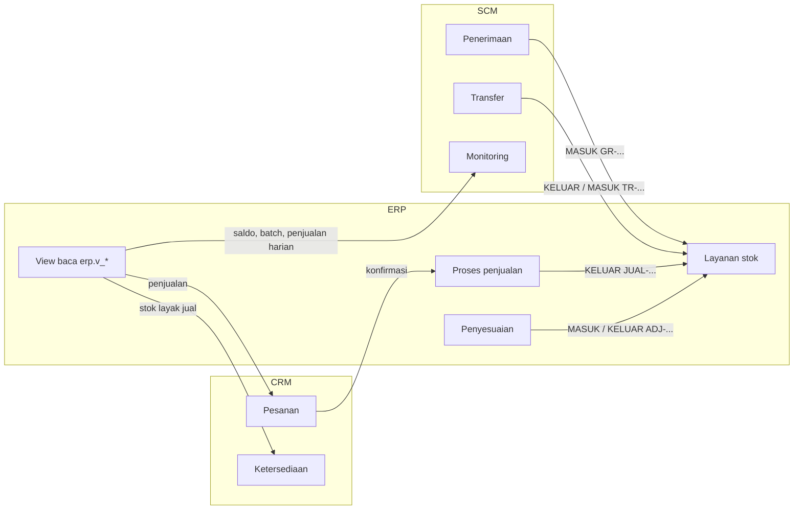
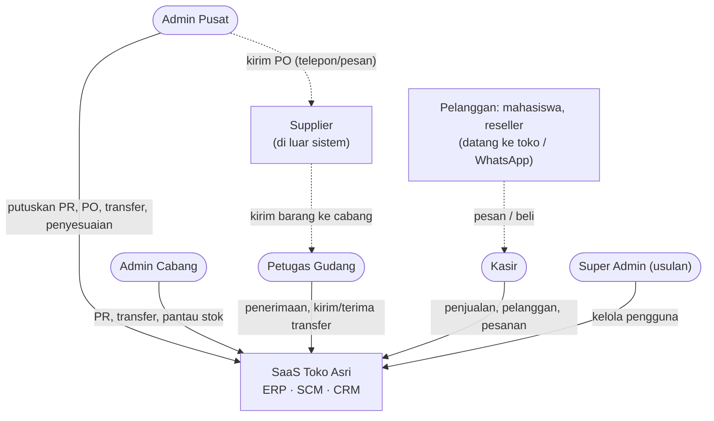
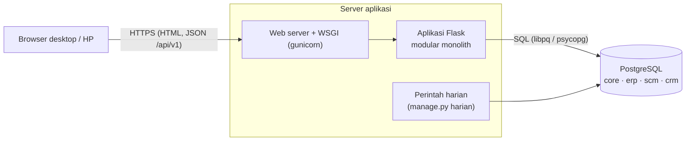
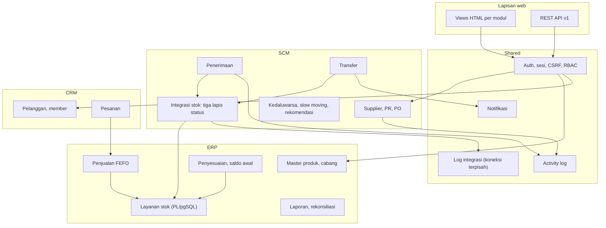
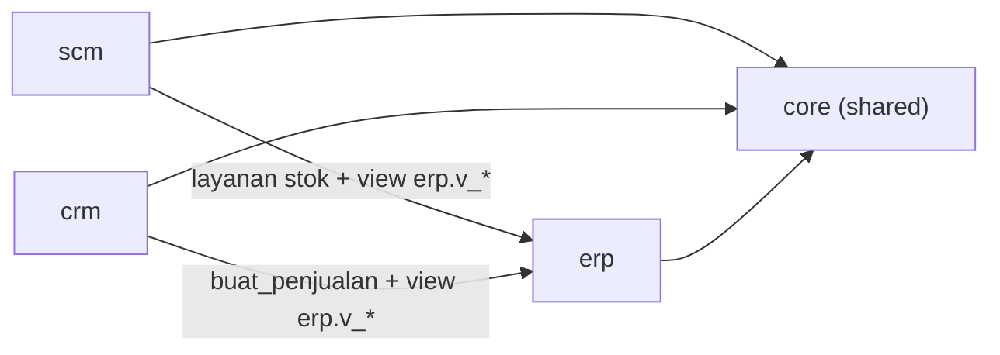
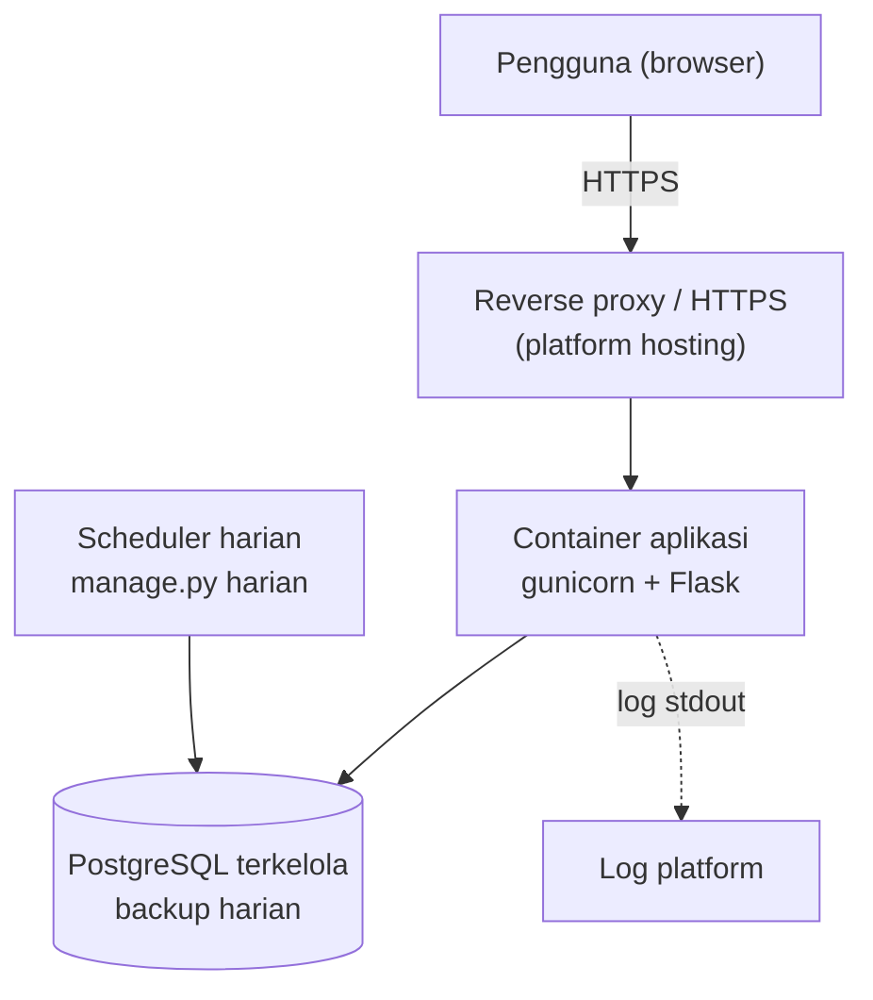
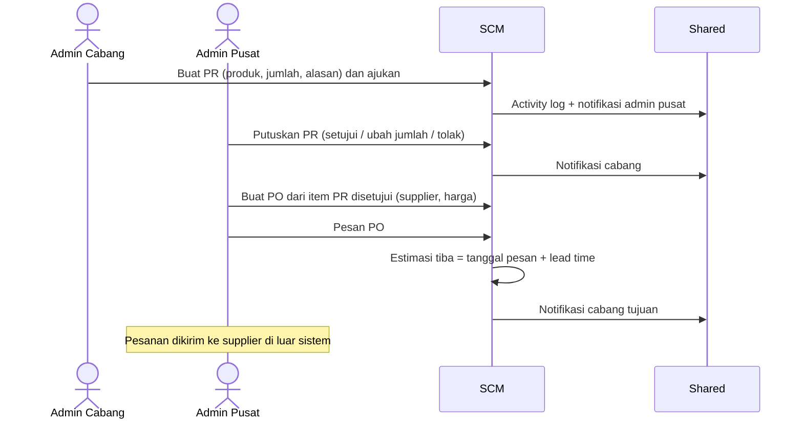
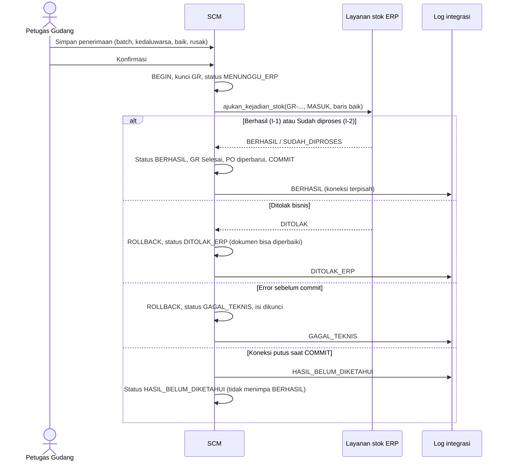
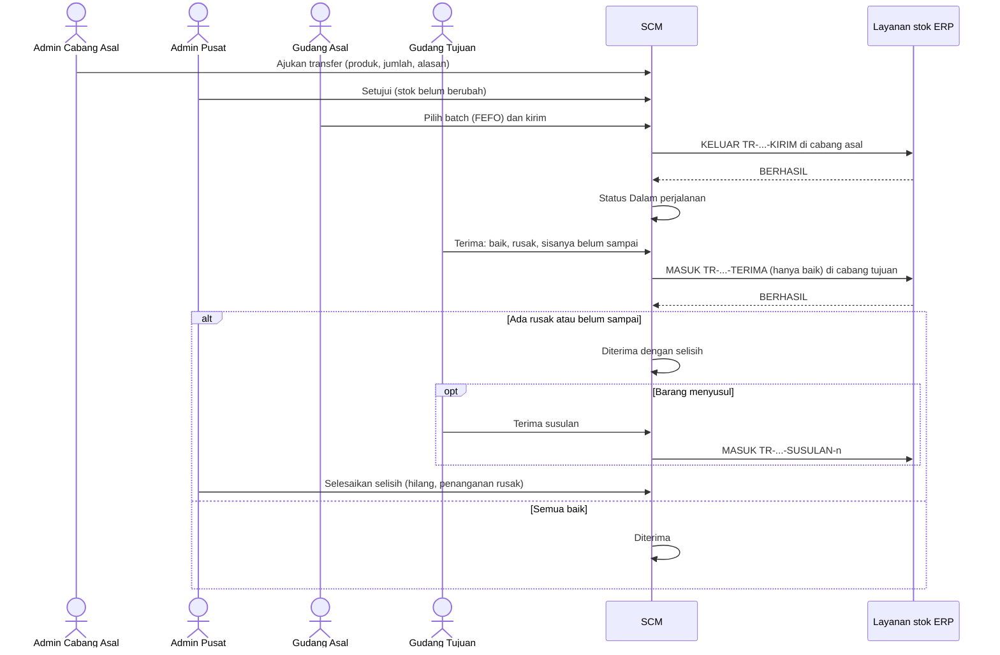
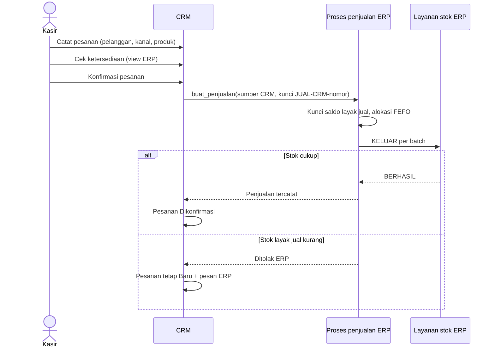

# System Architecture Document
## SaaS Toko Asri (ERP · SCM · CRM)

| | |
| --- | --- |
| Versi | 1.0-draf · 12 November 2026 |
| Status | **Draf — belum disetujui.** Stack adalah usulan (DEC-02) |
| Acuan | [PRD](../01-product/PRD.md) · Tahap 4 v0.6 (kepemilikan data, tiga lapis status, idempotency) · prototipe di branch `feat/mvp-aplikasi` |

> **Batas klaim.** Mekanisme idempotency dan transaksi bersamaan sudah diuji di dua tempat:
> - skema minimal Tahap 4: 77 PASS;
> - prototipe aplikasi: 61 tes lulus, 11 Nov 2026.
>
> Keduanya pengujian **lingkungan pengembangan**, bukan bukti kesiapan produksi. Belum diuji:
> - beban dan kinerja;
> - kehilangan koneksi di jaringan nyata (yang diuji adalah simulasi `CommitUnknown`);
> - driver psycopg;
> - pemulihan dari backup.

---

## 2.1 Architecture Overview

**Pilihan: modular monolith + satu PostgreSQL** [R] (DEC-03). Alasannya:
- Perubahan dokumen SCM dan saldo ERP harus berhasil atau gagal **bersama**. Dalam satu database, ini cukup dengan satu transaksi, tanpa saga atau kompensasi.
- Skala Toko Asri (beberapa cabang, puluhan pengguna) tidak membutuhkan layanan terpisah.
- Batas modul tetap dijaga di kode dan skema database, sehingga modul dapat dipisah kelak bila perlu.

| Lapisan | Rancangan | Status |
| --- | --- | --- |
| Frontend | Halaman web server-rendered (Jinja2) + CSS/JS ringan tanpa CDN; responsif | Usulan; dipakai prototipe |
| Backend | Python 3.11+ / Flask 3, satu proses; blueprint per modul (`core`, `erp`, `scm`, `crm`, `api`); lapisan layanan berisi aturan bisnis | Usulan (DEC-02) |
| Database | PostgreSQL 16 (≥ 13); skema `core`, `erp`, `scm`, `crm`; aturan stok kritis di PL/pgSQL | Usulan (DEC-02/03) |
| API | REST JSON `/api/v1`, memanggil layanan yang sama dengan UI | Usulan |
| Authentication | Sesi cookie bertanda tangan (HttpOnly, SameSite=Lax, Secure di HTTPS), password hash scrypt, CSRF token | Usulan |
| Authorization | RBAC 5 role + lingkup cabang, dicek di lapisan layanan (bukan hanya di UI); matriks di RULES §5.4 | Usulan |
| Integrasi modul | Panggilan fungsi dalam proses + satu transaksi; baca lintas modul hanya lewat view `erp.v_*` | Usulan |
| Deployment | Satu container/proses aplikasi (gunicorn) + PostgreSQL terkelola; HTTPS; perintah harian terjadwal | **Belum dilakukan**; butuh persetujuan (DEC-14) |

---

## 2.2 Module Architecture

| Modul | Tanggung jawab | Tidak boleh |
| --- | --- | --- |
| **Shared (`core`)** | Pengguna dan role, login/sesi, CSRF, otorisasi, penomoran dokumen, activity log, notifikasi, log integrasi, UI shell | Menyimpan data bisnis modul |
| **ERP (`erp`)** | Produk, cabang, batch, saldo per batch per cabang, layanan stok, stock movement, penjualan (FEFO), penyesuaian, saldo awal, laporan, rekonsiliasi saldo | Membuat PR/PO/transfer; menyimpan data pelanggan |
| **SCM (`scm`)** | Supplier, supplier–produk, PR, persetujuan, PO, penerimaan, transfer, status pemrosesan stok (lapis 2), parameter perencanaan, monitoring kedaluwarsa/slow moving/rekomendasi | Mengubah `erp.*` secara langsung; menyimpan saldo |
| **CRM (`crm`)** | Pelanggan, member, pesanan, status pesanan, riwayat pembelian (membaca penjualan ERP) | Mengubah stok; mengajukan kejadian stok langsung |

Pintu publik antar-modul:

| Pemilik | Pintu tulis (fungsi layanan) | Pintu baca |
| --- | --- | --- |
| ERP | `ajukan_kejadian_stok`, `buat_penjualan`, `status_kunci` | View `erp.v_cabang`, `v_produk`, `v_batch`, `v_saldo_batch`, `v_stok_produk`, `v_penjualan`, `v_penjualan_baris`, `v_penjualan_harian`, `v_stock_movement`, `v_kunci_kejadian` |
| SCM | — (tidak dipanggil modul lain di MVP) | — |
| CRM | — | — |
| Shared | `catat_aktivitas`, `kirim_notifikasi`, `catat_log_integrasi` | `core.pengguna` (identitas) |

---

## 2.3 Data Ownership

Prinsip ditetapkan pengguna [K]:
- ERP satu-satunya pengubah saldo.
- SCM mengirim perintah perubahan stok lewat layanan ERP.
- CRM hanya membaca ketersediaan lewat ERP.

| Data | Pemilik | Pengguna lain (baca) |
| --- | --- | --- |
| Produk, cabang | ERP | SCM, CRM (lewat view) |
| Saldo per batch, batch, stock movement | ERP | SCM (monitoring), CRM (ketersediaan) |
| Penjualan | ERP | SCM (laju jual agregat), CRM (riwayat pembelian) |
| Penyesuaian stok | ERP | — |
| Supplier, supplier–produk | SCM | ERP (opsional, baca) |
| PR, PO, penerimaan, transfer | SCM | ERP (laporan, Post-MVP) |
| Parameter stok minimum/target, monitoring | SCM | — |
| Status pemrosesan stok (lapis 2) | SCM | — |
| Pelanggan, member, pesanan | CRM | — |
| Pengguna, audit, notifikasi, log integrasi | Shared | Semua modul menulis lewat fungsi shared |

Bagaimana CRM bisa "mengurangi stok" tanpa melanggar prinsip:
1. CRM **tidak** mengubah stok.
2. Saat pesanan dikonfirmasi, CRM menyerahkan pesanan ke **proses penjualan ERP**. ERP adalah pemilik penjualan, dan ERP-lah yang memanggil layanan stok.
3. Kunci penjualannya adalah `JUAL-CRM-<nomor pesanan>`.

---

## 2.4 Integration Architecture

### Integrasi ERP–SCM

| Langkah SCM | Kejadian stok ke ERP | Kunci | Cabang |
| --- | --- | --- | --- |
| Konfirmasi penerimaan barang | MASUK (hanya barang baik) | `GR-YYYYMM-NNNN` | Tujuan PO |
| Kirim transfer | KELUAR per batch | `TR-YYYYMM-NNNN-KIRIM` | Asal |
| Terima transfer | MASUK (hanya baik) | `TR-…-TERIMA` | Tujuan |
| Terima susulan | MASUK (hanya baik) | `TR-…-SUSULAN-n` | Tujuan |
| PR, PO, persetujuan transfer, rusak, hilang | Tidak ada kejadian stok | — | — |

### Integrasi ERP–CRM

| Langkah CRM | Ke ERP | Kunci |
| --- | --- | --- |
| Cek ketersediaan | Baca `erp.v_stok_produk` (stok layak jual) | — |
| Konfirmasi pesanan | `erp.buat_penjualan(sumber=CRM)`, yang memanggil layanan stok (KELUAR FEFO) | `JUAL-CRM-<nomor>` |
| Riwayat pembelian | Baca `erp.v_penjualan`, `v_penjualan_baris` | — |

### Alur pertukaran data

### API contract (internal)

`erp.ajukan_kejadian_stok(kunci, jenis, cabang_id, baris[], sumber, pengguna_id)`:

| Bagian | Isi |
| --- | --- |
| Input | `baris[]` = `{produk_id, nomor_batch, kedaluwarsa (YYYY-MM-DD), jumlah > 0}` (1–200 baris, tanpa duplikat produk+batch) |
| Output | `{kode, aturan, pesan, sidik, jumlah_movement}` |
| Prasyarat | Dipanggil di dalam transaksi pemanggil dengan isolasi READ COMMITTED |

| `kode` | Aturan | Arti |
| --- | --- | --- |
| `BERHASIL` | I-1 | Saldo diubah tepat sekali |
| `SUDAH_DIPROSES` | I-2 | Kunci sudah berhasil dengan isi sama; tidak ada perubahan |
| `KONFLIK` | I-3 | Kunci sudah berhasil dengan isi berbeda; ditolak |
| `DITOLAK` | I-1 / I-4 | Validasi bisnis gagal; kunci tidak terpakai |

REST API eksternal (`/api/v1`) dirinci di prototipe `docs/implementasi/04-api.md`. Ringkasan endpoint per modul:

| Modul | Endpoint utama |
| --- | --- |
| Shared | `GET /sesi`, `GET /notifikasi`, `GET /aktivitas` |
| ERP | `GET /erp/produk`, `/erp/cabang`, `/erp/stok`, `/erp/movement`, `/erp/kunci/{kunci}`; `POST /erp/penjualan` (header `Idempotency-Key` wajib) |
| SCM | `GET/POST /scm/pr`, `POST /scm/pr/{id}/ajukan`, `/putuskan`; `GET/POST /scm/po`, `POST /scm/po/{id}/pesan`, `/batal`, `/tutup`; `POST /scm/gr`, `/scm/gr/{id}/konfirmasi`; `GET/POST /scm/transfer`, `POST /scm/transfer/{id}/putuskan`, `/kirim`, `/terima`, `/susulan`, `/selesaikan`, `/batal`; `GET /scm/rekomendasi`, `/kedaluwarsa`, `/slow-moving` |
| CRM | `GET /crm/ketersediaan`; `GET/POST /crm/pelanggan`; `GET/POST /crm/pesanan`, `POST /crm/pesanan/{id}/konfirmasi`, `/selesai`, `/batal` |

Endpoint tambahan yang dirancang untuk fitur yang belum ada di prototipe:
- `GET/POST /core/pengguna`, `PATCH /core/pengguna/{id}` (FR-COR-02);
- `GET /erp/rekonsiliasi` (FR-COR-06);
- `POST /erp/saldo-awal` (FR-ERP-09).

Kepemilikan endpoint mengikuti §2.3: endpoint `/erp/*` hanya dilayani layanan ERP, dan seterusnya.

### Internal event

Tidak ada message broker. "Event" = efek samping yang ditulis **di dalam transaksi yang sama** dengan perubahan dokumen:
- activity log;
- notifikasi.

Pengecualian: log integrasi ditulis di luar transaksi.

| Event | Pemicu | Efek |
| --- | --- | --- |
| `PR_DIAJUKAN`, `PR_DIPUTUSKAN` | SCM | Notifikasi admin pusat / cabang |
| `PO_DIPESAN` | SCM | Notifikasi cabang tujuan (estimasi tiba) |
| `BARANG_DITERIMA` | SCM → ERP | Saldo naik; notifikasi admin pusat |
| `TRANSFER_DISETUJUI`, `TRANSFER_DIKIRIM`, `TRANSFER_SELISIH` | SCM → ERP | Notifikasi cabang asal/tujuan/admin pusat |
| `PESANAN_DIKONFIRMASI` | CRM → ERP | Saldo turun FEFO |
| `PENYESUAIAN_DIAJUKAN`, `PENYESUAIAN_DIPUTUSKAN` | ERP | Notifikasi |
| `ED_KATEGORI_BERUBAH`, `REKOMENDASI_BARU` | Pengecekan terjadwal | Notifikasi sekali per perubahan |
| `KONFLIK_IDEMPOTENCY` | ERP (I-3) | Log integrasi + notifikasi admin pusat |

### Transaction

- Setiap aksi pengguna = satu transaksi `READ COMMITTED`. Transaksi bersarang memakai `SAVEPOINT`.
- Langkah yang mengubah stok mengikuti urutan di bawah, semuanya **dalam satu transaksi**:
  1. kunci dokumen SCM dengan `SELECT … FOR UPDATE`;
  2. tulis status lapis 2 `MENUNGGU_ERP`;
  3. panggil layanan stok;
  4. tulis status `BERHASIL` dan perbarui dokumen.
- Di dalam layanan stok:
  - klaim kunci dilakukan lebih dulu dalam subtransaksi;
  - baris saldo dikunci dalam urutan kanonik untuk menghindari deadlock;
  - penolakan bisnis membatalkan subtransaksi, termasuk klaimnya.

### Idempotency

Aturan I-1…I-4 Tahap 4 berlaku, dengan mekanisme K-M1…K-M8. Ringkasannya:
- **Sidik isi:** SHA-256 dari JSON kanonik yang barisnya diurutkan.
- **Kunci per langkah:** tetap untuk setiap langkah (tabel di atas). Untuk API penjualan, kunci berasal dari header `Idempotency-Key`.
- **Isi terkunci:** saat status Gagal teknis atau Hasil belum diketahui, isi dokumen dikunci, sehingga kirim ulang selalu memakai isi yang sama.

### Retry

| Situasi | Retry | Siapa |
| --- | --- | --- |
| Ditolak ERP (bisnis) | Tidak otomatis. Dokumen dapat diperbaiki, lalu diajukan lagi dengan **kunci sama** (I-4) | Pengguna |
| Gagal teknis sebelum commit | Tombol **Kirim ulang** dengan kunci dan isi sama; aman karena saldo pasti belum berubah | Pengguna |
| Hasil belum diketahui | Tombol **Kirim ulang** wajib. ERP menjawab I-1 bila belum pernah berhasil, atau I-2 bila sudah | Pengguna (Post-MVP: penyelesai otomatis yang memeriksa `status_kunci`) |
| Konflik (I-3) | Tidak boleh retry; perlu investigasi | Admin pusat |
| Lock timeout | Sama dengan gagal teknis | Pengguna |

### Timeout

| Timeout | Nilai | Status |
| --- | --- | --- |
| `lock_timeout` per koneksi | 5 detik (konfigurasi `DB_LOCK_TIMEOUT`) | Ada di prototipe |
| `statement_timeout` | 15 detik [U] | Belum di prototipe (G-06) |
| Timeout request worker (gunicorn) | 30 detik [U] | Saat deployment |
| Sesi login | 8 jam | Ada |

### Error handling

| Kelas | Contoh | Penanganan | Saldo |
| --- | --- | --- | --- |
| Validasi input | Jumlah ≤ 0, tanggal salah | 422 + pesan per field; tidak ada transaksi | Tidak berubah |
| Otorisasi | Role/cabang salah | 403 | Tidak berubah |
| Konflik status | Konfirmasi dokumen yang sudah selesai | 409 | Tidak berubah |
| Ditolak ERP | Saldo kurang, produk nonaktif | 409 `DITOLAK_ERP`; status lapis 2 `DITOLAK_ERP` | Pasti tidak berubah |
| Gagal teknis sebelum commit | Error program, lock timeout | 503 `GAGAL_TEKNIS`; rollback; isi dikunci | Pasti tidak berubah |
| Hasil belum diketahui | Koneksi putus saat COMMIT | 503 `HASIL_BELUM_DIKETAHUI`; isi dikunci; status `BERHASIL` yang sudah ter-commit tidak ditimpa | Belum pasti; dipastikan lewat kunci |

Kode lengkap ada di RULES §5.7.

### Logging

| Log | Isi | Sifat |
| --- | --- | --- |
| `core.audit_log` | Aksi bisnis, data sebelum/sesudah | Append-only, dalam transaksi |
| `core.log_integrasi` | Setiap pengajuan stok dan hasilnya | Append-only, **koneksi terpisah** agar tetap tersimpan walau transaksi utama batal |
| Log aplikasi (stderr) | Exception, error database | Dikumpulkan platform deployment |

### Reconciliation

Pemeriksaan baca-saja (FR-COR-06). Belum ada di prototipe (G-05); query disiapkan di SCHEMA §4.5 (lampiran kueri).

| ID | Pemeriksaan | Harus |
| --- | --- | --- |
| REK-1 | Saldo per cabang per batch = Σ `stock_movement.perubahan` | 0 selisih |
| REK-2 | Status pemrosesan lapis 2 vs `erp.kunci_kejadian`: • `BERHASIL` ⇔ kunci ada • `DITOLAK_ERP` / `GAGAL_TEKNIS` ⇒ kunci tidak ada • `HASIL_BELUM_DIKETAHUI` ⇒ ditampilkan untuk dipastikan | 0 selisih (selain daftar "perlu dipastikan") |
| REK-3 | `po_baris.jumlah_diterima_baik` = Σ `gr_baris.jumlah_baik` penerimaan Selesai | 0 selisih |
| REK-4 | Movement transfer: KIRIM = −Σ dikirim; TERIMA + SUSULAN = Σ baik | 0 selisih |
| REK-5 | Stock opname fisik vs saldo sistem | Selisih → penyesuaian (FR-ERP-07) |

REK-1 sampai REK-4 sudah dijalankan pada database pengembangan lokal prototipe (12 Nov 2026) dengan hasil 0 selisih, dan kemampuan mendeteksinya sudah dibuktikan dengan injeksi kesalahan; lihat SCHEMA §4.5. REK-5 memerlukan stok opname fisik dan belum pernah dilakukan.

---

## 2.5 Architecture Diagrams

Semua diagram divalidasi dengan mermaid-cli 11 (lihat [TRACEABILITY_MATRIX](../06-review/TRACEABILITY_MATRIX.md) §Validasi).

### System context

### Container architecture

### Component architecture

### Module dependency

Aturan: tidak ada panah ERP → SCM/CRM dan tidak ada panah SCM ↔ CRM di MVP. Pelanggaran dideteksi oleh uji statis batas modul.

### Deployment architecture (usulan, belum dijalankan)

### Sequence pembelian (PR → PO)

### Sequence penerimaan

### Sequence transfer

### Sequence penjualan

