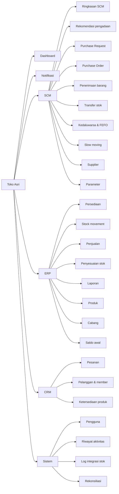
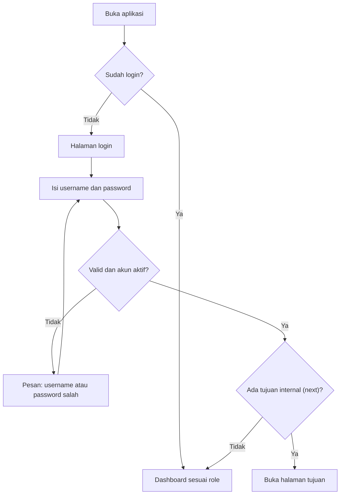
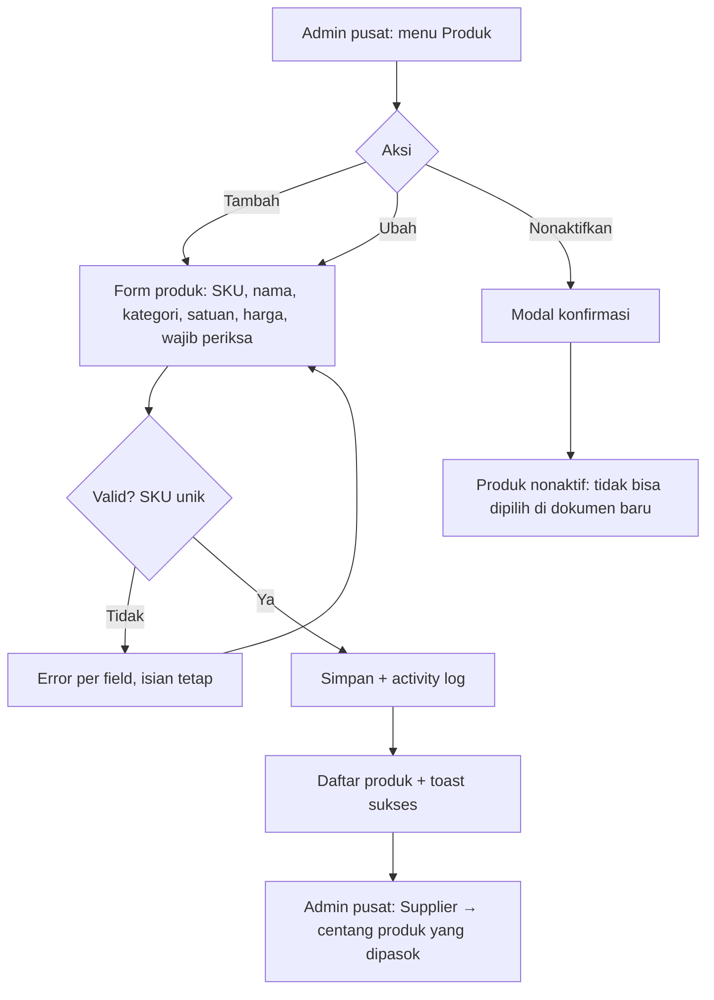
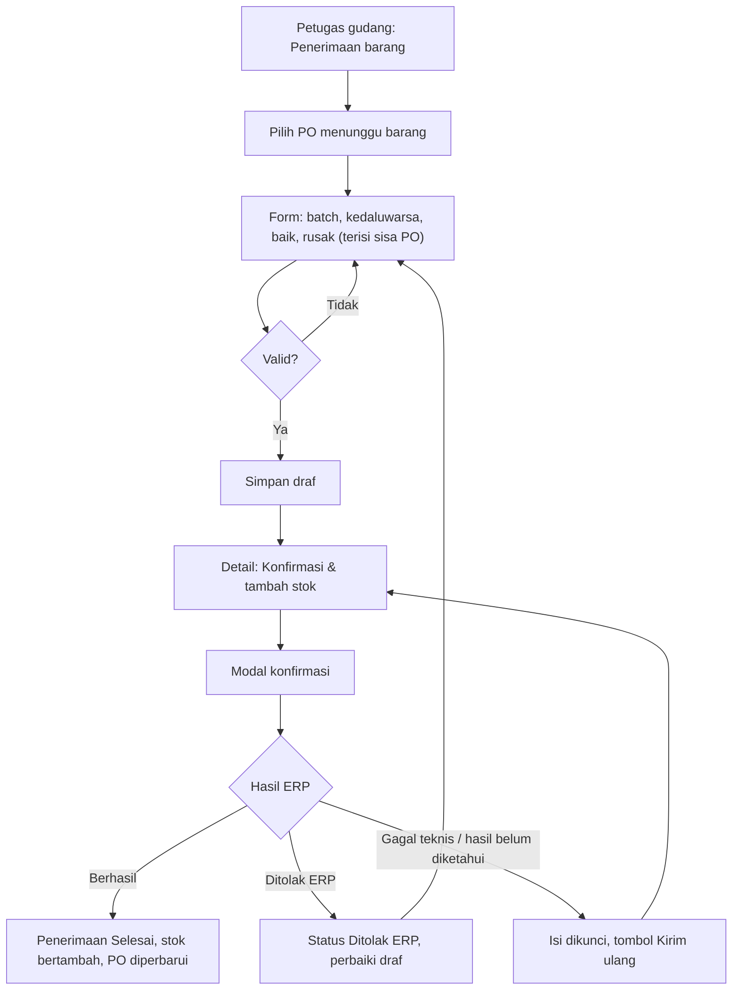
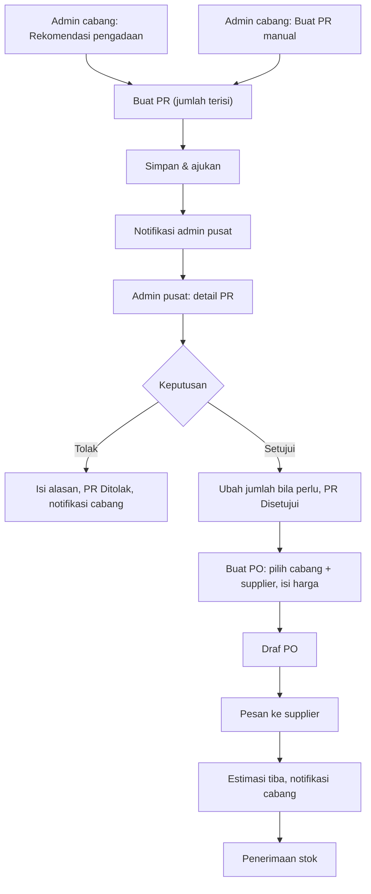
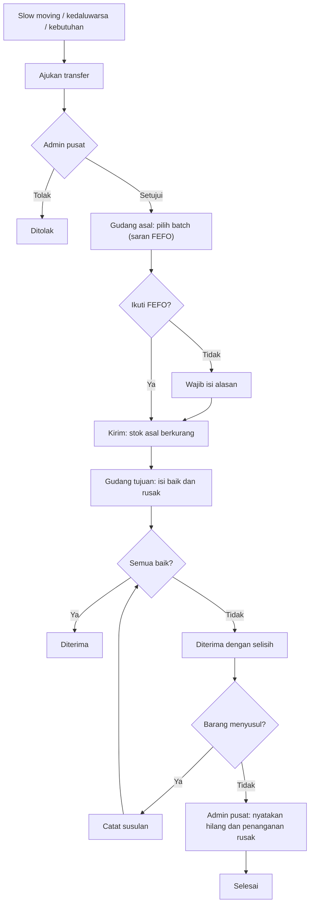
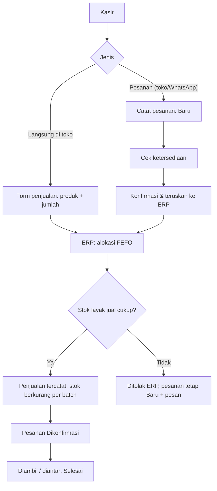
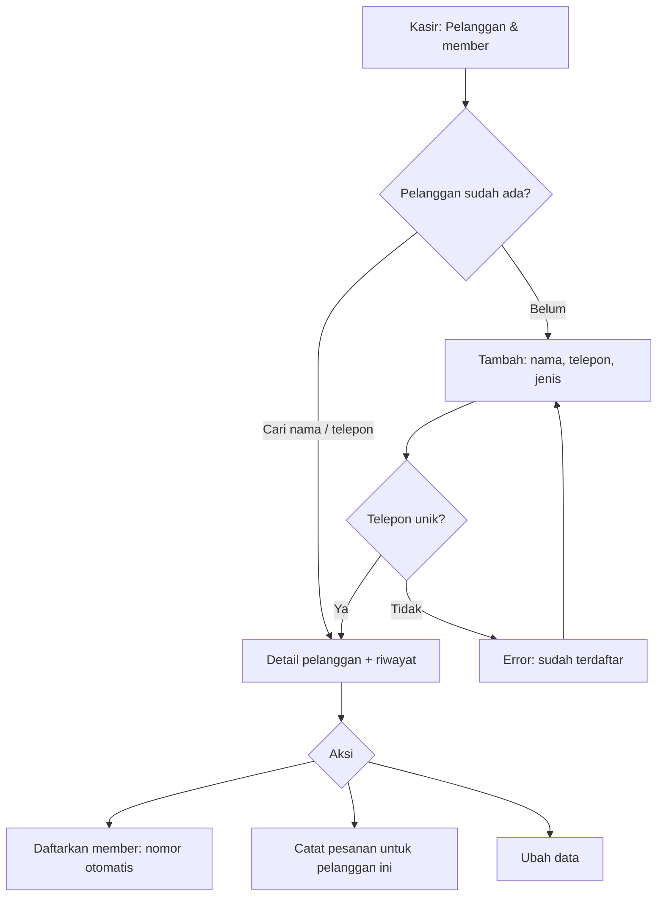
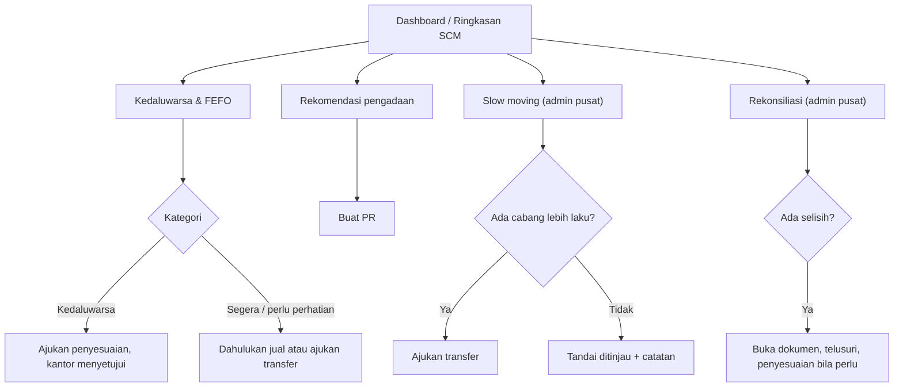

# UI/UX Design Document
## SaaS Toko Asri (ERP · SCM · CRM)

| | |
| --- | --- |
| Versi | 1.0-draf · 12 November 2026 |
| Status | **Draf — belum disetujui** |
| Acuan | [PRD](../01-product/PRD.md) (FR, role) · [RULES](../05-rules/RULES.md) (status, permission, validasi) · prototipe branch `feat/mvp-aplikasi` (screenshot di `docs/implementasi/screenshot/` pada branch itu) |

---

## 3.1 Design Direction

| Prinsip | Penerapan |
| --- | --- |
| **Modern & profesional** | Warna dasar netral, satu warna utama biru-teal (nuansa "dingin" untuk frozen food), tipografi sistem, tanpa ornamen |
| **Minimalis** | Satu tindakan utama per layar (tombol primer), tindakan lain sekunder; informasi pendukung di kartu terpisah |
| **Mudah digunakan** | Alur mengikuti dokumen nyata (PR → PO → penerimaan); form terisi otomatis dari dokumen sebelumnya (PO dari PR, penerimaan dari sisa PO, PR dari rekomendasi) |
| **Konsisten** | Satu pola untuk daftar, form, dan detail; badge status berwarna sama di semua modul |
| **Responsif** | Desktop ≥ 1024 px: sidebar tetap. HP 360–860 px: sidebar off-canvas, tabel bertumpuk, tombol ≥ 40 px |
| **Bahasa Indonesia** | Seluruh label, pesan, dan format: tanggal "08 Nov 2026", rupiah "Rp38.000", angka "1.250" |
| **Jujur tentang status** | Status dokumen, status pemrosesan stok, dan kegagalan teknis ditampilkan terpisah (RULES §5.6) |

---

## 3.2 Design System

### Color palette

| Token | Nilai | Pemakaian |
| --- | --- | --- |
| `--primary` | `#0F6A8B` | Tombol primer, tautan, menu aktif |
| `--primary-600` | `#0C5A77` | Hover tombol primer |
| `--primary-50` / `--primary-100` | `#E8F3F7` / `#CFE6EF` | Latar sorotan, fokus |
| `--sidebar` | `#0E2A36` | Latar sidebar |
| `--bg` | `#F4F6F8` | Latar halaman |
| `--surface` / `--surface-2` | `#FFFFFF` / `#F8FAFB` | Kartu / header tabel, bar filter |
| `--line` / `--line-2` | `#E3E8EC` / `#D3DBE1` | Garis / border input |
| `--text` / `--muted` / `--faint` | `#17222B` / `#5B6B78` / `#8796A2` | Teks utama / sekunder / petunjuk |
| `--green` + `--green-50` | `#1D7A4B` + `#E7F5ED` | Sukses, Berhasil, Disetujui |
| `--blue` + `--blue-50` | `#1F5FBF` + `#E9F0FC` | Sedang berjalan (Diajukan, Dipesan, Dalam perjalanan) |
| `--yellow` + `--yellow-50` | `#8A5A00` + `#FDF3DC` | Perlu perhatian, sebagian, draf |
| `--red` + `--red-50` | `#B42318` + `#FDECEA` | Ditolak, gagal, kedaluwarsa, aksi berbahaya |
| abu (`--gray-50`) | `#EEF1F3` | Dibatalkan, ditutup, nonaktif |

Kontras teks utama terhadap putih > 12:1; warna status selalu disertai teks, tidak mengandalkan warna saja.

### Typography

| Token | Ukuran / bobot | Pemakaian |
| --- | --- | --- |
| Font | `system-ui, "Segoe UI", Roboto, Arial` | Seluruh UI (tanpa unduhan font) |
| Mono | `ui-monospace, Consolas` 12,5 px | Nomor dokumen, kunci kejadian, nomor batch |
| H1 | 22 px / 650 (HP 19 px) | Judul halaman |
| H2 | 16 px / 650 | Judul kartu |
| Body | 14 px / 400, line-height 1,5 | Teks umum |
| Small | 12–12,5 px | Petunjuk, metadata |
| Angka tabel | `tabular-nums`, rata kanan | Jumlah, harga |

### Spacing, grid, layout

| Token | Nilai |
| --- | --- |
| Skala spacing | 4 · 8 · 12 · 16 · 18 · 24 px |
| Padding konten | 24 px desktop, 16/12 px HP |
| Grid | `grid-2`, `grid-3`, `grid-4` dengan gap 16 px; turun ke 2 kolom ≤ 1100 px dan 1 kolom ≤ 860 px (kartu statistik 2 kolom di HP) |
| Lebar konten maks. | 1320 px |
| Layout | Sidebar 252 px + area utama (header 60 px sticky + konten) |
| Breakpoint | 1100 px (grid), 860 px (sidebar off-canvas, form 1 kolom), 640 px (tabel bertumpuk) |

### Border radius & shadow

| Token | Nilai |
| --- | --- |
| `--radius` | 10 px (kartu) |
| `--radius-sm` | 7 px (tombol, input) |
| Badge | 999 px (pil) |
| `--shadow` | `0 1px 2px rgba(16,24,40,.05), 0 1px 3px rgba(16,24,40,.06)` (kartu) |
| Dialog | `0 24px 64px rgba(0,0,0,.25)` |

### Iconography

Ikon garis 24×24, stroke 2, warna mengikuti teks, disimpan sebagai sprite SVG inline (tanpa CDN). Set minimum: home, bell, box, cart, doc, check, truck, inbox, clock, trend, slow, users, store, factory, sliders, list, chart, swap, plug, menu, plus, logout, empty. Ikon selalu ditemani label teks di menu dan tombol utama.

### Komponen

| Komponen | Varian & aturan |
| --- | --- |
| **Button** | Primer (aksi utama, maks. satu per area), sekunder (outline), bahaya (merah: tolak, batalkan, nonaktifkan), ghost (aksi baris: Hapus). Tinggi 36 px (HP 40), kecil 30 px (HP 34). Saat submit: spinner + nonaktif (cegah klik ganda) |
| **Input** | Tinggi 38 px; label di atas; `*` merah untuk wajib; teks bantuan abu di bawah; error merah di bawah + border merah + `aria-invalid`; nilai dipertahankan saat gagal validasi |
| **Select** | Sama dengan input; opsi pertama "— Pilih —"; filter memakai label "Kategori: semua" |
| **Table** | Header huruf kecil kapital abu, baris hover, angka rata kanan, kolom aksi di kanan; di bawah 640 px tiap baris jadi kartu dengan label kolom (`data-label`); di atas tabel bar filter (cari + filter + Terapkan); di bawah pagination "Menampilkan 1–20 dari N" |
| **Modal** | Konfirmasi untuk aksi berisiko (setujui, kirim, ubah stok, tutup, batal): judul, satu kalimat dampak, tombol Batal + tombol aksi (merah bila destruktif) |
| **Badge** | Hijau: selesai/berhasil · biru: berjalan · kuning: perlu perhatian/sebagian/draf · merah: ditolak/gagal/kedaluwarsa · abu: batal/nonaktif. Teks status selalu dari kamus RULES §5.6 |
| **Alert** | Info (biru), peringatan (kuning), error (merah), sukses (hijau); judul tebal + kalimat. Dipakai untuk status pemrosesan stok di dokumen |
| **Toast** | Kanan bawah; sukses/info hilang sendiri 5 detik, error tetap sampai ditutup |
| **Sidebar** | Logo + nama aplikasi; grup menu per modul (SCM, ERP, CRM, Sistem) hanya menu yang diizinkan role; item aktif disorot; kaki: status "data demo/stack sementara" saat demo |
| **Header** | Tombol menu (HP), nama cabang pengguna, lonceng notifikasi + jumlah belum dibaca, avatar + nama + role, tombol keluar |
| **Stepper** | Langkah dokumen (mis. Diajukan → Disetujui → Dalam perjalanan → Diterima → Selesai) dengan warna selesai/aktif/gagal |
| **Kartu statistik** | Label, angka besar, petunjuk; angka > 0 untuk hal yang butuh tindakan berwarna merah; seluruh kartu dapat diklik ke daftar terfilter |

### State standar (berlaku untuk semua layar kecuali disebut lain)

| State | Pola |
| --- | --- |
| **Loading** | Halaman dirender server (tidak ada skeleton panjang); saat submit: tombol spinner + nonaktif; filter berganti otomatis saat dipilih |
| **Empty** | Ikon kotak + judul ("Belum ada PR") + kalimat penjelas + tombol aksi utama bila pengguna berhak |
| **Error validasi** | Kotak "Periksa kembali isian" berisi daftar + error per field |
| **Error aksi** | Toast merah berisi pesan dari RULES §5.7; tetap di halaman dokumen |
| **Error sistem** | Halaman 403/404/500/503 dengan tombol Kembali dan Ke dashboard |
| **Responsif** | Lihat breakpoint; tabel bertumpuk; form satu kolom; aksi membungkus ke baris baru |

---

## 3.3 Information Architecture



Visibilitas menu per role mengikuti matriks RULES §5.4: menu yang tidak diizinkan tidak ditampilkan, dan aksesnya tetap ditolak backend (403).

| Grup | Super Admin | Admin Pusat | Admin Cabang | Petugas Gudang | Kasir |
| --- | --- | --- | --- | --- | --- |
| Dashboard, Notifikasi | ✓ | ✓ | ✓ | ✓ | ✓ |
| SCM (Ringkasan, PO, Penerimaan, Transfer, Kedaluwarsa) | — | ✓ | ✓ | ✓ | — |
| SCM (Rekomendasi, PR, Supplier) | — | ✓ | ✓ | — | — |
| SCM (Slow moving, Parameter) | — | ✓ | — | — | — |
| ERP Persediaan | — | ✓ | ✓ | ✓ | ✓ |
| ERP Stock movement | — | ✓ | ✓ | ✓ | — |
| ERP Penjualan | — | ✓ | ✓ | — | ✓ |
| ERP Penyesuaian, Laporan | — | ✓ | ✓ | — | — |
| ERP Produk, Cabang, Saldo awal | — | ✓ | — | — | — |
| CRM | — | ✓ | ✓ | — | ✓ |
| Sistem: Pengguna | ✓ | — | — | — | — |
| Sistem: Riwayat aktivitas | ✓ | ✓ | ✓ (cabangnya) | — | — |
| Sistem: Log integrasi, Rekonsiliasi | ✓ (log) | ✓ | — | — | — |

---

## 3.4 Screen Inventory

Kolom **WF** menunjuk wireframe di §3.5. State loading/empty/error/responsif mengikuti "State standar" §3.2; hanya perbedaannya yang ditulis.

### Bersama

| ID | Halaman | Tujuan | Pengguna | Komponen & data | Aksi | Navigasi | Empty / error khusus | WF | FR | Prio |
| --- | --- | --- | --- | --- | --- | --- | --- | --- | --- | --- |
| SCR-01 | Login | Masuk | Semua | Logo, username, password, tombol Masuk | Masuk | → Dashboard / `next` internal | Error: "Username atau password salah, atau akun nonaktif." (401) | WF-01 | COR-01 | MVP |
| SCR-02 | Dashboard per role | Hal yang perlu tindakan | Semua | Kartu statistik per role; rekomendasi; kedaluwarsa terdekat; persediaan per cabang; aktivitas terbaru | Buat PR, Catat pesanan (sesuai role) | Kartu → daftar terfilter | Tiap kartu angka 0 tetap tampil; daftar kosong pakai empty state | WF-02 | COR-03 | MVP |
| SCR-03 | Notifikasi | Pesan status | Semua | Tabel waktu, judul+pesan, jenis; filter Belum dibaca/Semua | Buka (tandai dibaca), Tandai semua dibaca | → dokumen terkait | "Tidak ada notifikasi" | WF-T1 | COR-04 | MVP |
| SCR-04 | Riwayat aktivitas | Siapa melakukan apa | Super Admin, Admin Pusat, Admin Cabang | Filter: cari, modul, cabang, pengguna, tanggal; tabel | Detail | → SCR-05 | — | WF-T1 | SCM-14 | MVP |
| SCR-05 | Detail aktivitas | Data sebelum/sesudah | Sama | Daftar kunci-nilai; JSON sebelum/sesudah | — | ← SCR-04 | 403 bila cabang lain | WF-T3 | SCM-14 | MVP |
| SCR-06 | Log integrasi stok | Lapis 3 | Super Admin, Admin Pusat | Filter kunci & hasil; tabel waktu, kunci, hasil (badge), pesan, pengguna | — | — | "Belum ada log" | WF-T1 | COR-05 | MVP |
| SCR-07 | Pengguna | Kelola akun | Super Admin | Tabel username, nama, role, cabang, status, login terakhir; form tambah/ubah | Tambah, Ubah, Nonaktifkan, Reset password | → form | Validasi: role cabang wajib cabang | WF-07 | COR-02 | MVP (G-03) |
| SCR-08 | Rekonsiliasi | Cek konsistensi stok | Admin Pusat | Empat kartu REK-1…4 (0 / jumlah selisih) + tabel selisih | Jalankan ulang | → dokumen terkait | Semua 0: pesan "Tidak ada selisih" | WF-08 | COR-06 | MVP (G-05) |
| SCR-09 | Halaman error | Kegagalan | Semua | Kode, judul, pesan | Kembali, Ke dashboard | — | — | WF-T3 | — | MVP |

### ERP

| ID | Halaman | Tujuan | Pengguna | Komponen & data | Aksi | Navigasi | Empty / error khusus | WF | FR | Prio |
| --- | --- | --- | --- | --- | --- | --- | --- | --- | --- | --- |
| SCR-10 | Persediaan | Stok per produk / per batch | Semua kecuali Super Admin | Toggle Per produk/Per batch; filter cari, cabang (pusat), produk; kolom: stok total, layak jual, kedaluwarsa terdekat, harga / batch, kedaluwarsa, sisa hari, saldo, status | Lihat batch | Per produk → per batch terfilter | Layak jual 0 berwarna merah | WF-10 | ERP-03, ERP-04 | MVP |
| SCR-11 | Stock movement | Jejak perubahan saldo | Admin Pusat, Admin Cabang, Petugas Gudang | Filter kunci, cabang, produk; waktu, kunci, sumber, cabang, produk/batch, perubahan (+hijau/−merah) | — | — | — | WF-T1 | ERP-05 | MVP |
| SCR-12 | Penjualan — daftar | Riwayat penjualan | Admin Pusat, Admin Cabang, Kasir | Filter nomor, sumber, cabang; nomor, waktu, cabang, sumber, pencatat, total | Penjualan langsung | → SCR-13/14 | — | WF-T1 | ERP-06 | MVP |
| SCR-13 | Penjualan — form | Catat penjualan langsung | Sama | Cabang (pusat), baris produk (harga) + jumlah + stok layak jual, kunci tersembunyi | Tambah produk, Simpan | → SCR-14 | Ditolak ERP: alert merah "Stok layak jual tidak cukup: …" | WF-13 | ERP-06 | MVP |
| SCR-14 | Penjualan — detail | Bukti & alokasi batch | Sama | Barang, harga, subtotal, total; alokasi batch FEFO; kunci stok | Cetak | ← daftar | — | WF-T3 | ERP-06, SCM-11 | MVP |
| SCR-15 | Penyesuaian — daftar | Pengajuan koreksi | Admin Pusat, Admin Cabang | Filter status, cabang; nomor, cabang, arah, alasan, diajukan, status | Ajukan penyesuaian | → SCR-16/17 | — | WF-T1 | ERP-07 | MVP |
| SCR-16 | Penyesuaian — form | Ajukan | Sama | Cabang (pusat pilih dulu), arah, alasan, keterangan, baris batch + jumlah | Tambah batch, Ajukan | → SCR-17 | Pengurangan > saldo: error field | WF-T2 | ERP-07 | MVP |
| SCR-17 | Penyesuaian — detail | Keputusan kantor | Sama (putuskan: Admin Pusat) | Keterangan, batch, saldo saat ini, keputusan | Setujui & perbarui saldo, Tolak (catatan wajib) | ← daftar | Sudah diputuskan: panel keputusan hilang | WF-17 | ERP-07 | MVP |
| SCR-18 | Laporan | Ringkasan persediaan & transaksi | Admin Pusat, Admin Cabang | Filter periode, cabang; kartu penjualan & nilai stok; tabel persediaan per cabang, mutasi per jenis, terlaris | Cetak | — | Periode tanpa data: empty per tabel | WF-18 | ERP-08 | MVP |
| SCR-19 | Produk — daftar | Master produk | Admin Pusat | Filter cari, status; SKU, nama, kategori, satuan, harga, status | Tambah, Ubah, Nonaktifkan/Aktifkan (modal) | → SCR-20 | — | WF-T1 | ERP-01 | MVP |
| SCR-20 | Produk — form | Tambah/ubah | Admin Pusat | SKU, nama, kategori, satuan, harga jual, wajib periksa | Simpan, Batal | ← daftar | SKU ganda: error field | WF-T2 | ERP-01 | MVP |
| SCR-21 | Cabang — daftar | Master cabang | Admin Pusat | Kode, nama, alamat, status | Tambah, Ubah, Nonaktifkan | → SCR-22 | — | WF-T1 | ERP-02 | MVP |
| SCR-22 | Cabang — form | Tambah/ubah | Admin Pusat | Kode, nama, alamat | Simpan | ← daftar | Kode ganda | WF-T2 | ERP-02 | MVP |
| SCR-23 | Saldo awal | Input stok awal | Admin Pusat | Cabang, baris produk + batch + kedaluwarsa + jumlah | Simpan & catat saldo awal (modal) | → SCR-10 | Kunci sudah dipakai: info "Saldo awal cabang ini sudah dicatat" | WF-23 | ERP-09 | MVP (G-04) |

### SCM

| ID | Halaman | Tujuan | Pengguna | Komponen & data | Aksi | Navigasi | Empty / error khusus | WF | FR | Prio |
| --- | --- | --- | --- | --- | --- | --- | --- | --- | --- | --- |
| SCR-30 | Ringkasan SCM | Kondisi rantai pasok | Admin Pusat, Admin Cabang, Petugas Gudang | Peringatan pengajuan stok bermasalah; alur PR/PO/transfer per status (bar); kedaluwarsa per kategori; rekomendasi; PO terlambat; slow moving (pusat) | — | Tiap kartu → daftar | Parameter belum diatur: teks "Ambang belum diatur" | WF-30 | SCM-* | MVP |
| SCR-31 | Supplier — daftar | Master supplier | Admin Pusat, Admin Cabang (lihat) | Filter; kode, nama, kontak, lead time, jumlah produk, jumlah PO, status | Tambah (pusat) | → SCR-33 | — | WF-T1 | SCM-01 | MVP |
| SCR-32 | Supplier — form | Tambah/ubah | Admin Pusat | Kode, nama, kontak, telepon, lead time, alamat | Simpan | → SCR-33 | Telepon format salah | WF-T2 | SCM-01 | MVP |
| SCR-33 | Supplier — detail | Produk dipasok & PO | Admin Pusat, Admin Cabang | Centang produk ERP aktif; detail; PO terakhir | Simpan daftar produk, Ubah, Nonaktifkan | → PO | Nonaktif saat PO berjalan: toast error | WF-33 | SCM-02 | MVP |
| SCR-34 | PR — daftar | Pengajuan kebutuhan | Admin Pusat, Admin Cabang | Filter nomor, status, cabang; nomor, cabang, jumlah item, dibuat, diajukan, status | Buat PR | → SCR-36 | — | WF-T1 | SCM-03 | MVP |
| SCR-35 | PR — form | Buat/ubah draf | Admin Pusat (pilih cabang), Admin Cabang | Cabang, catatan, baris produk + jumlah + alasan (prefill dari rekomendasi) | Simpan draf, Simpan & ajukan | → SCR-36 | Error per baris | WF-35 | SCM-03 | MVP |
| SCR-36 | PR — detail & persetujuan | Status & keputusan | Admin Pusat (putuskan), Admin Cabang | Stepper; peringatan PR ganda; tabel stok layak jual, diminta, disetujui (input untuk pusat), sudah PO; alasan tolak | Ubah, Ajukan, Batalkan, Setujui, Tolak, Buat PO | → PO terkait | Tolak tanpa alasan: error | WF-36 | SCM-03, SCM-04 | MVP |
| SCR-37 | PO — daftar | Pesanan supplier | Admin Pusat, Admin Cabang, Petugas Gudang | Filter nomor/supplier, status, cabang, supplier, "hanya terlambat"; estimasi tiba (merah bila terlambat), total, status, "ada penolakan" | Buat PO (pusat) | → SCR-39 | — | WF-T1 | SCM-05 | MVP |
| SCR-38 | PO — form | Buat dari PR | Admin Pusat | Langkah 1: cabang + supplier; langkah 2: item PR disetujui (sisa), jumlah, harga (prefill harga terakhir), catatan | Tampilkan item, Simpan draf | → SCR-39 | Tidak ada item: empty "pastikan PR disetujui & produk terdaftar di supplier" | WF-38 | SCM-05 | MVP |
| SCR-39 | PO — detail | Pantau & tindak | Sama | Kartu tanggal pesan, estimasi tiba, total; item: dipesan, diterima baik, ditolak, sisa, harga; daftar penerimaan; panel tutup/batal | Pesan ke supplier, Catat penerimaan, Tutup/Batalkan (alasan, modal), Cetak | → SCR-41, SCR-42 | — | WF-39 | SCM-05 | MVP |
| SCR-40 | Penerimaan — daftar | Barang datang | Admin Pusat, Admin Cabang, Petugas Gudang | Kartu "PO menunggu barang" + tombol Catat penerimaan; tabel GR: nomor, PO, supplier, cabang, tanggal, status dokumen, status pemrosesan | Catat penerimaan | → SCR-41/42 | — | WF-T1 | SCM-06 | MVP |
| SCR-41 | Penerimaan — form | Catat barang per batch | Sama | Tanggal terima, catatan; baris: item PO (sisa), nomor batch, kedaluwarsa, baik, rusak, keterangan rusak (prefill sisa) | Tambah baris (batch lain), Simpan draf, Simpan & lanjut konfirmasi | → SCR-42 | Error per baris (sisa PO, kedaluwarsa, batch wajib) | WF-41 | SCM-06, SCM-07 | MVP |
| SCR-42 | Penerimaan — detail | Konfirmasi & status | Sama | Alert status pemrosesan (kunci, status, pesan, percobaan); panel konfirmasi/kirim ulang; tabel barang; log pengajuan ke ERP | Konfirmasi & tambah stok / Kirim ulang (modal), Ubah, Batalkan draf | ← PO | Gagal teknis/hasil belum diketahui: alert kuning/merah + isi terkunci | WF-42 | SCM-06 | MVP |
| SCR-43 | Transfer — daftar | Pemindahan barang | Admin Pusat, Admin Cabang, Petugas Gudang | Filter; nomor, rute, alasan, diminta, diajukan, status | Ajukan transfer | → SCR-45 | — | WF-T1 | SCM-08 | MVP |
| SCR-44 | Transfer — form | Ajukan | Admin Pusat, Admin Cabang | Asal, tujuan, alasan, catatan, baris produk + jumlah (prefill dari slow moving/kedaluwarsa) | Ajukan | → SCR-45 | Jumlah > stok asal: error tanpa angka stok cabang lain | WF-T2 | SCM-08 | MVP |
| SCR-45 | Transfer — detail | Seluruh langkah | Sesuai langkah (RULES §5.4) | Stepper; panel kontekstual: Setujui (pusat) / Kirim per batch dengan saran FEFO (asal) / Terima baik-rusak (tujuan) / Susulan / Selesaikan selisih (pusat); tabel dikirim-baik-rusak-hilang-belum sampai; status pemrosesan per kunci; log | Setujui, Tolak, Kirim, Simpan penerimaan, Catat susulan, Selesaikan selisih, Batalkan | — | Batch kedaluwarsa: input nonaktif + badge; non-FEFO tanpa alasan: error | WF-45 | SCM-08, SCM-11 | MVP |
| SCR-46 | Kedaluwarsa & FEFO | Batch yang harus didahulukan | Admin Pusat, Admin Cabang, Petugas Gudang | Info ambang; filter cari, kategori, cabang; cabang, produk (+wajib periksa, didahulukan), urutan FEFO, batch, kedaluwarsa, sisa hari, saldo, kategori | Transfer, Dahulukan jual/Lepas, Ajukan penyesuaian (kedaluwarsa) | → SCR-44, SCR-16 | Ambang belum diatur: alert kuning, kategori "Belum diatur" | WF-46 | SCM-10, SCM-11 | MVP |
| SCR-47 | Slow moving | Barang lambat | Admin Pusat | Info parameter; daftar: produk/cabang, stok, laju/hari, umur, kedaluwarsa terdekat, saran cabang, status; tabel "data belum cukup" | Ajukan transfer (prefill), Tandai ditinjau (catatan) | → SCR-44 | Parameter belum diatur: empty + tombol Atur parameter | WF-47 | SCM-09 | MVP |
| SCR-48 | Rekomendasi pengadaan | Apa yang perlu dibeli | Admin Pusat, Admin Cabang | Penjelasan rumus; peringatan produk tanpa stok minimum; tabel cabang, produk, layak jual, sisa PO, transfer masuk, posisi, titik/target, versi, disarankan, PR menunggu | Buat PR (prefill) | → SCR-35 | Tidak ada: empty "semua di atas titik pesan" | WF-48 | SCM-12, SCM-13 | MVP |
| SCR-49 | Parameter | Atur nilai acuan | Admin Pusat | Seksi slow moving, kedaluwarsa, cakupan T; tautan stok minimum per cabang; terakhir diubah | Simpan parameter | → SCR-50 | Isian setengah: error "isi keempatnya atau kosongkan" | WF-T2 | SCM-15 | MVP |
| SCR-50 | Stok minimum & target | Per produk per cabang | Admin Pusat | Tabel produk, minimum, target, diubah | Simpan | ← SCR-49 | Target ≤ minimum: error per baris | WF-50 | SCM-15 | MVP |

### CRM

| ID | Halaman | Tujuan | Pengguna | Komponen & data | Aksi | Navigasi | Empty / error khusus | WF | FR | Prio |
| --- | --- | --- | --- | --- | --- | --- | --- | --- | --- | --- |
| SCR-60 | Pesanan — daftar | Pesanan pelanggan | Admin Pusat, Admin Cabang, Kasir | Filter nomor/pelanggan, status, kanal; nomor, pelanggan, kanal, cabang, unit, waktu, status (+"ditolak ERP"), total | Catat pesanan | → SCR-62 | — | WF-T1 | CRM-04, CRM-05 | MVP |
| SCR-61 | Pesanan — form | Catat pesanan | Sama | Pelanggan (+tombol Pelanggan baru), kanal, cabang (pusat), catatan, baris produk (harga, stok) + jumlah | Tambah produk, Simpan pesanan | → SCR-62 | — | WF-61 | CRM-04 | MVP |
| SCR-62 | Pesanan — detail | Konfirmasi & status | Sama | Stepper Baru→Dikonfirmasi→Selesai; barang + stok layak jual (merah bila kurang); integrasi ERP (nomor penjualan, kunci); panel batal | Konfirmasi & teruskan ke ERP, Tandai selesai, Batalkan (alasan) | → SCR-14 | Ditolak ERP: alert merah, pesanan tetap Baru | WF-62 | CRM-04, CRM-05 | MVP |
| SCR-63 | Pelanggan — daftar | Data pelanggan | Sama | Filter cari, jenis, member; kode, nama, telepon, jenis, member, jumlah pembelian | Tambah pelanggan | → SCR-65 | — | WF-T1 | CRM-01 | MVP |
| SCR-64 | Pelanggan — form | Tambah/ubah | Sama | Nama, telepon/WhatsApp, jenis, catatan | Simpan | → SCR-65 / kembali ke SCR-61 | Telepon sudah terdaftar | WF-T2 | CRM-01 | MVP |
| SCR-65 | Pelanggan — detail | Profil & riwayat | Sama | Kartu total belanja, jumlah pesanan, tanggal member; tabel riwayat pembelian | Ubah, Daftarkan/Nonaktifkan member, Catat pesanan | → SCR-62 | — | WF-65 | CRM-02, CRM-03 | MVP |
| SCR-66 | Ketersediaan produk | Stok untuk pelanggan | Sama | Filter cari, cabang (pusat); cabang, produk, harga, stok layak jual, kedaluwarsa terdekat, status (Tersedia/Terbatas/Habis) | — | — | — | WF-T1 | CRM-06 | MVP |

---

## 3.5 Wireframe (low-fidelity)

Semua halaman MVP memiliki wireframe:
- **Halaman bertipe sama** memakai template **WF-T1** (daftar), **WF-T2** (form), atau **WF-T3** (detail sederhana). Kolom, field, dan aksi spesifiknya mengikuti baris Screen Inventory.
- **Halaman yang tata letaknya khusus** punya wireframe sendiri.

### WF-T1 — Template daftar
```
┌────────────┬──────────────────────────────────────────────────────────────────┐
│ ▣ Toko Asri│ ☰  Cabang Utara                              🔔3  (A) Nama ⎋     │
│            ├──────────────────────────────────────────────────────────────────┤
│ Dashboard  │ Judul Halaman                                   [+ Aksi utama]   │
│ Notifikasi │ Kalimat penjelas singkat                                          │
│ SCM        │ ┌──────────────────────────────────────────────────────────────┐ │
│  · …       │ │ [Cari…            ] [Status: semua ▾] [Cabang ▾] [Terapkan]  │ │
│ ERP        │ ├──────────────────────────────────────────────────────────────┤ │
│  · …       │ │ NOMOR      KOLOM A      KOLOM B     JUMLAH   STATUS      ⋯   │ │
│ CRM        │ │ PR-…-0001  ……           ……              12  [Diajukan]       │ │
│  · …       │ │ PR-…-0002  ……           ……               5  [Disetujui]      │ │
│ Sistem     │ ├──────────────────────────────────────────────────────────────┤ │
│            │ │ Menampilkan 1–20 dari 57        [‹ Sebelumnya] 1/3 [Berikut ›]│ │
│            │ └──────────────────────────────────────────────────────────────┘ │
└────────────┴──────────────────────────────────────────────────────────────────┘
HP (≤640 px): sidebar disembunyikan (☰), tiap baris tabel menjadi kartu:
┌──────────────────────────┐
│ Nomor        PR-…-0001   │
│ Kolom A      ……          │
│ Status       [Diajukan]  │
└──────────────────────────┘
Empty: [ikon] "Belum ada …" + kalimat + [+ Aksi utama]
```

### WF-T2 — Template form
```
Crumb: Daftar / Baru
Judul form
┌ Periksa kembali isian: • pesan 1 • pesan 2 ┐   ← hanya bila gagal validasi
┌────────────────────────────────────────────────────────────┐
│ Label wajib *              Label                            │
│ [ input             ]      [ input             ]            │
│ teks bantuan               error merah                      │
│ Label (lebar penuh)                                         │
│ [ textarea                                             ]    │
│ ── baris dinamis (bila ada) ───────────────────────────────│
│ PRODUK            JUMLAH   ALASAN                           │
│ [Pilih ▾]         [  ]     [        ]           Hapus       │
│ [+ Tambah baris]                                            │
│                                  [Batal] [Simpan] [Primer]  │
└────────────────────────────────────────────────────────────┘
HP: semua field satu kolom; tabel baris dapat digulir horizontal.
```

### WF-T3 — Template detail
```
Crumb: Daftar / NOMOR
NOMOR-DOKUMEN [Badge status]                    [Aksi sekunder] [Aksi primer]
Metadata: cabang · tanggal · oleh …
(●Langkah 1)──(●Langkah 2)──(○Langkah 3)            ← stepper bila dokumen berstatus
┌ Alert status / alasan (bila ada) ───────────────────────────────┐
┌ Kartu kiri: rincian ┐  ┌ Kartu kanan: rincian lain ┐
└─────────────────────┘  └───────────────────────────┘
┌ Tabel item ──────────────────────────────────────────┐
└──────────────────────────────────────────────────────┘
```

### WF-01 Login
```
          ┌────────────────────────────────┐
          │ ▣ SaaS Toko Asri               │
          │   ERP · SCM · CRM              │
          │ Masuk                          │
          │ Gunakan akun dari admin.       │
          │ ┌ error login (bila ada) ────┐ │
          │ Username *  [              ]   │
          │ Password *  [              ]   │
          │ [          Masuk           ]   │
          │ ▸ Akun demo (hanya mode demo)  │
          └────────────────────────────────┘
```

### WF-02 Dashboard (Admin Pusat; role lain mengganti isi kartu)
```
Selamat datang, Nama                                  [+ Buat PR] [Catat pesanan]
Admin Pusat · Semua cabang
┌PR menunggu┐┌Transfer menunggu┐┌Penyesuaian menunggu┐┌Rekomendasi┐
│     2     ││        1        ││         1          ││     5     │
└───────────┘└─────────────────┘└────────────────────┘└───────────┘
┌PO terlambat┐┌Transfer selisih┐┌Pengajuan stok bermasalah┐┌Penjualan hari ini┐
└────────────┘└────────────────┘└─────────────────────────┘└──────────────────┘
┌ Rekomendasi pengadaan    [Semua]┐ ┌ Kedaluwarsa terdekat (FEFO) [Semua]┐
│ Produk  Cabang  Posisi  Saran   │ │ Produk/batch  Cabang  Sisa  Kategori│
└─────────────────────────────────┘ └─────────────────────────────────────┘
┌ Persediaan layak jual           ┐ ┌ Aktivitas terbaru            [Semua]┐
└─────────────────────────────────┘ └─────────────────────────────────────┘
HP: kartu 2 kolom, panel bertumpuk 1 kolom.
Admin Cabang: Rekomendasi · PR menunggu · Transfer perlu dikirim/diterima · PO ditunggu · Batch kritis · Pesanan baru · Penjualan
Petugas Gudang: PO menunggu barang · Transfer kirim · Transfer terima · Pengajuan stok bermasalah
Kasir: Pesanan baru · Penjualan hari ini · Cek ketersediaan · Pelanggan
```

### WF-07 Pengguna (Super Admin)
```
Pengguna                                                       [+ Tambah pengguna]
[Cari…] [Role ▾] [Cabang ▾] [Status ▾]
USERNAME      NAMA            ROLE            CABANG        STATUS   LOGIN TERAKHIR   ⋯
admin.utara   ……              Admin Cabang    Utara         [Aktif]  11 Nov 2026      [Ubah][Reset][Nonaktifkan]
Form: Username* · Nama* · Role* [▾] · Cabang* (muncul bila role cabang) · Password awal* (sekali)
```

### WF-08 Rekonsiliasi
```
Rekonsiliasi stok                                    [Jalankan ulang]   Terakhir: 12 Nov 2026 10:00
┌REK-1 Saldo vs movement┐┌REK-2 Status vs kunci┐┌REK-3 PO vs penerimaan┐┌REK-4 Transfer vs movement┐
│  0 selisih ✓          ││ 0 selisih ✓         ││ 0 selisih ✓          ││ 1 selisih ⚠               │
└───────────────────────┘└─────────────────────┘└──────────────────────┘└───────────────────────────┘
┌ Rincian selisih REK-4 ─────────────────────────────────────────────┐
│ TR-…-0003   dikirim 10 · movement KIRIM 9   [Buka transfer]         │
└────────────────────────────────────────────────────────────────────┘
"Halaman ini hanya membaca data dan tidak memperbaiki otomatis."
```

### WF-10 Persediaan
```
Persediaan                                          [Per produk] [Per batch]
[Cari…] [Cabang ▾] [Produk ▾] [☐ saldo 0]
Per produk: CABANG  PRODUK/SKU  STOK TOTAL  LAYAK JUAL  KEDALUWARSA TERDEKAT  HARGA  [Batch]
Per batch : CABANG  PRODUK [periksa rutin]  BATCH  KEDALUWARSA  SISA HARI  SALDO  [Layak jual|Kedaluwarsa]
```

### WF-13 Penjualan langsung
```
Penjualan langsung — batch dipilih otomatis FEFO
┌ Ditolak ERP: Stok layak jual tidak cukup: … ┐  ← bila ditolak
Cabang* [▾] (hanya admin pusat)
PRODUK                       JUMLAH   STOK LAYAK JUAL
[Nugget 500 g — Rp38.000 ▾]  [ 2 ]    41            Hapus
[+ Tambah produk]                          [Batal] [Simpan penjualan]
```

### WF-17 Penyesuaian — detail & keputusan
```
ADJ-…-0001 [Diajukan]        Cabang · Kedaluwarsa · Kurangi stok
┌ Keterangan, diajukan oleh/kapan ┐ ┌ Batch: produk/batch  jumlah  saldo kini ┐
┌ Keputusan kantor ─────────────────────────────────────┐
│ Catatan (wajib bila menolak) [                      ] │
│                         [Tolak]  [Setujui & perbarui saldo] │
└───────────────────────────────────────────────────────┘
```

### WF-18 Laporan
```
Laporan persediaan & transaksi                               [Cetak]
Dari [tgl] Sampai [tgl] [Cabang ▾] [Terapkan]
┌Jumlah penjualan┐┌Nilai penjualan┐┌Nilai stok layak jual┐
┌ Persediaan per cabang ┐ ┌ Mutasi per jenis ┐
┌ Produk terlaris (lebar penuh) ┐
```

### WF-23 Saldo awal
```
Saldo awal — hanya sekali per cabang; tercatat sebagai kejadian SALDO-AWAL-<kode cabang>
Cabang* [▾]
PRODUK*      NOMOR BATCH*   KEDALUWARSA*   JUMLAH*
[▾]          [        ]     [tgl]          [   ]     Hapus
[+ Tambah baris]                  [Batal] [Simpan & catat saldo awal]  → modal konfirmasi
```

### WF-30 Ringkasan SCM
```
┌ ⚠ 2 pengajuan stok ke ERP belum berhasil: GR-… Gagal teknis — [buka dokumen] ┐
┌Purchase Request──────┐┌Purchase Order────────┐┌Transfer stok─────────┐
│[Diajukan] ████ 2     ││[Dipesan]  ███ 1      ││[Dalam perjalanan] █ 1│
│[Selesai]  ██   1     ││[Diterima sebagian] █ ││[Selisih] █ 1         │
└──────────────────────┘└──────────────────────┘└──────────────────────┘
┌Kedaluwarsa per kategori┐┌Rekomendasi┐┌PO terlambat┐┌Slow moving (pusat)┐
```

### WF-33 Supplier — detail
```
Nama Supplier [Aktif]                                   [Ubah] [Nonaktifkan]
┌ Produk yang dipasok ─────────────────┐ ┌ Detail & PO terakhir ──────────┐
│ ☑ Nugget  ☑ Sosis  ☐ Bakso  ☐ …      │ │ Kode · Lead time · Alamat       │
│              [Simpan daftar produk]  │ │ PO  Cabang  Tanggal  Status     │
└──────────────────────────────────────┘ └─────────────────────────────────┘
```

### WF-35 PR — form
```
Buat Purchase Request — Cabang Utara. PR tidak mengubah stok.
Cabang* [▾] (pusat)     Catatan [                        ]
PRODUK              JUMLAH   ALASAN
[Pilih produk ▾]    [   ]    [Rekomendasi pengadaan]   Hapus
[+ Tambah produk]          [Batal] [Simpan draf] [Simpan & ajukan]
```

### WF-36 PR — detail & persetujuan
```
PR-…-0003 [Diajukan]   Cabang Selatan · dibuat … oleh …      [Ubah][Ajukan][Batalkan PR][Buat PO]
(●Draf)──(●Diajukan)──(○Diputuskan)──(○PO dibuat)
┌ ⚠ Ada PR lain Diajukan untuk produk yang sama: … ┐
┌ Barang diminta                         [Isi sesuai permintaan] ┐
│ PRODUK   STOK LAYAK JUAL  DIMINTA  DISETUJUI  SUDAH PO  ALASAN │
│ Dimsum   18               20 pak   [ 20 ]     0         …      │
│ Catatan / alasan penolakan [                              ]    │
│                                       [Tolak]  [Setujui]       │
└────────────────────────────────────────────────────────────────┘
```

### WF-38 PO — form
```
1) Cabang tujuan* [▾]   Supplier* [▾]   [Tampilkan item PR]
2) Item PR yang dapat dipesan ke <Supplier> — estimasi tiba = tgl pesan + 2 hari
PR          PRODUK     SISA DISETUJUI   JUMLAH PO   HARGA BELI (Rp)
PR-…-0001   Nugget     30 pak           [ 30 ]      [ 30000 ] Terakhir Rp30.000
Catatan [                     ]                 [Batal] [Simpan draf PO]
```

### WF-39 PO — detail
```
PO-…-0001 [Diterima sebagian] [Terlambat]  Supplier → Cabang     [Catat penerimaan][Pesan ke supplier][Cetak]
┌Tanggal pesan┐┌Estimasi tiba (lead time)┐┌Total┐
Item: PRODUK  DARI PR  DIPESAN  DITERIMA BAIK  DITOLAK/RUSAK  SISA  HARGA  SUBTOTAL
┌ Penerimaan barang: GR  tgl  [Selesai] [Berhasil] ┐ ┌ Tutup atau batalkan: Alasan* [  ] [Tutup PO] ┐
```

### WF-41 Penerimaan — form
```
Catat penerimaan barang — PO-…-0001 Supplier → Cabang
Tanggal terima* [tgl]   Catatan [        ]
ITEM PO (SISA)      NO. BATCH*  KEDALUWARSA*  BAIK  RUSAK  KETERANGAN RUSAK
[Nugget (sisa 30)▾] [NA-1101 ]  [tgl      ]   [28]  [ 2 ]  [Kemasan sobek ]  Hapus
[+ Tambah baris (batch lain)]
ⓘ Rusak tidak masuk stok · baik ≤ sisa PO · kedaluwarsa > tanggal terima
                   [Batal] [Simpan draf] [Simpan & lanjut konfirmasi]
```

### WF-42 Penerimaan — detail (konfirmasi / kirim ulang)
```
GR-…-0001 [Draf]   PO … · Supplier → Cabang · diterima … · dicatat …       [Ubah][Batalkan draf]
┌ ⚠ Status pemrosesan stok (GR-…-0001): Gagal teknis sebelum commit       ┐
│ pesan · Percobaan 1 · Isi dokumen dikunci. Kirim ulang memakai isi sama. │
┌ Kirim ulang ke ERP                                 [Kirim ulang] ┐  ← atau "Konfirmasi & tambah stok"
Barang: PRODUK  BATCH  KEDALUWARSA  BAIK  RUSAK  KETERANGAN   (Total)
┌ Log pengajuan ke ERP: waktu  kunci  hasil  pesan ┐
```

### WF-45 Transfer — detail (panel berganti sesuai langkah & role)
```
TR-…-0001 [Diterima dengan selisih]  Utara → Selatan · Slow moving        [Batalkan]
(●Diajukan)──(●Disetujui)──(●Dalam perjalanan)──(◐Diterima)──(○Selesai)
Panel A (Admin Pusat, Diajukan):  PRODUK DIMINTA [DISETUJUI] · Alasan tolak · [Tolak][Setujui]
Panel B (Asal, Disetujui):        per produk: BATCH  KEDALUWARSA  SALDO  SARAN FEFO  [DIKIRIM]
                                  (batch kedaluwarsa: input nonaktif) · Alasan non-FEFO [ ] · [Kirim & kurangi stok asal]
Panel C (Tujuan, Dalam perjalanan): PRODUK/BATCH  DIKIRIM  [BAIK] [RUSAK] [KET.]  · [Simpan penerimaan]
Panel D (Tujuan, Selisih):        [BAIK susulan] [RUSAK] · [Catat barang susulan]
Panel E (Admin Pusat, Selisih):   [Keterangan hilang (n)] [Penanganan rusak (n)] · [Selesaikan selisih]
Tabel: PRODUK/BATCH  DIKIRIM  BAIK  RUSAK  HILANG  BELUM SAMPAI  (Total 10 · 8 · 1 · 0 · 1)
┌ Barang diminta ┐ ┌ Pemrosesan stok: TR-…-KIRIM [Berhasil] · TR-…-TERIMA [Berhasil] ┐
```

### WF-46 Kedaluwarsa & FEFO
```
ⓘ Perlu perhatian ≤30 hari · Segera ditindak ≤7 hari · Kedaluwarsa ≤0 hari
[Cari…] [Kategori ▾] [Cabang ▾]
CABANG  PRODUK [periksa rutin][didahulukan]  FEFO  BATCH  KEDALUWARSA  SISA  SALDO  KATEGORI        TINDAKAN
Utara   Otak-otak                            1     OT-…   09 Nov 2026  -3    6     [Kedaluwarsa]   [Ajukan penyesuaian]
Utara   Bakso                                1     BK-…   17 Nov 2026   5    12    [Segera]        [Transfer][Dahulukan jual]
```

### WF-47 Slow moving
```
ⓘ Periode 30 hari · lambat bila laju ≤0,4/hari dan umur ≥30 hari
PRODUK/CABANG   STOK  LAJU/HARI  UMUR  KEDALUWARSA (sisa)  SARAN CABANG            STATUS          TINDAKAN
Sosis / Utara   20    0,00       60    07 Des (25 hari)    Selatan 0,17/hari       [Perlu ditinjau] [Ajukan transfer]
                                                                                                    [Catatan…][Tandai ditinjau]
┌ Data belum cukup: produk/cabang/stok ┐
```

### WF-48 Rekomendasi pengadaan
```
ⓘ Posisi = layak jual + sisa PO + transfer masuk · rumus dasar & laju jual
⚠ 9 pasangan produk–cabang belum punya stok minimum/target
CABANG PRODUK LAYAK JUAL SISA PO TRANSFER MASUK POSISI TITIK/TARGET VERSI DISARANKAN PR MENUNGGU
Utara  Dimsum 4          0       0              4      5 / 15       Dasar 11 pak       –           [Buat PR]
```

### WF-50 Stok minimum & target
```
Stok minimum & target — Cabang Utara
PRODUK (satuan)   STOK MINIMUM   STOK TARGET   DIUBAH
Nugget (pak)      [ 15 ]         [ 50 ]        11 Nov 2026
Otak-otak (pak)   [    ]         [    ]        Belum diatur
                                        [Kembali] [Simpan]
```

### WF-61 Pesanan — form
```
Catat pesanan — Pesanan Baru belum mengurangi stok            [+ Pelanggan baru]
Pelanggan* [▾]   Kanal* [Langsung di toko ▾ | WhatsApp]   Cabang* (pusat)   Catatan [ ]
PRODUK                                   JUMLAH
[Nugget — Rp38.000 (stok 41) ▾]          [ 5 ]   Hapus
[+ Tambah produk]                         [Batal] [Simpan pesanan]
```

### WF-62 Pesanan — detail
```
ORD-…-0002 [Baru]  Pelanggan (Mahasiswa) · WhatsApp · Cabang · waktu   [Konfirmasi & teruskan ke ERP]
(●Baru)──(○Dikonfirmasi)──(○Selesai)
┌ ⚠ Konfirmasi terakhir ditolak ERP: Stok layak jual tidak cukup … ┐
┌ Barang dipesan: PRODUK JUMLAH STOK LAYAK JUAL HARGA · Perkiraan total ┐ ┌ Integrasi ERP: penjualan, kunci ┐
┌ Batalkan pesanan: Alasan* [  ] [Batalkan pesanan] ┐
```

### WF-65 Pelanggan — detail
```
Nama Pelanggan [Member MBR-…]   Reseller · 0811-…        [Ubah][Daftarkan member][Catat pesanan]
┌Total belanja┐┌Jumlah pesanan┐┌Bergabung member┐
Riwayat: PESANAN  TANGGAL  CABANG  KANAL  STATUS  PENJUALAN ERP  TOTAL
```

### Peta wireframe → halaman MVP

| Wireframe | Halaman |
| --- | --- |
| WF-T1 (daftar) | SCR-03, 04, 06, 11, 12, 15, 19, 21, 31, 34, 37, 40, 43, 60, 63, 66 |
| WF-T2 (form) | SCR-16, 20, 22, 32, 44, 49, 64 |
| WF-T3 (detail) | SCR-05, 09, 14 |
| Khusus | SCR-01 (WF-01), 02 (WF-02), 07 (WF-07), 08 (WF-08), 10 (WF-10), 13 (WF-13), 17 (WF-17), 18 (WF-18), 23 (WF-23), 30 (WF-30), 33 (WF-33), 35 (WF-35), 36 (WF-36), 38 (WF-38), 39 (WF-39), 41 (WF-41), 42 (WF-42), 45 (WF-45), 46 (WF-46), 47 (WF-47), 48 (WF-48), 50 (WF-50), 61 (WF-61), 62 (WF-62), 65 (WF-65) |

---

## 3.6 User Flow

### Login


### Pengelolaan produk


### Penerimaan stok


### Pembelian


### Transfer


### Penjualan


### Pengelolaan pelanggan


### Monitoring stok

