# Database Schema Document
## SaaS Toko Asri (ERP · SCM · CRM)

| | |
| --- | --- |
| Versi | 1.0-draf · 12 November 2026 |
| Status | **Draf — belum disetujui** |
| DBMS | PostgreSQL 16 (usulan, DEC-02) |
| Sumber kebenaran | Migration `db/migrations/0001`–`0005` pada branch `feat/mvp-aplikasi`. Spesifikasi tabel §4.3 **dibangkitkan otomatis dari katalog database** hasil migration itu (database pengembangan lokal `toko_asri_dev`, 12 Nov 2026), bukan ditulis ulang tangan. |
| Acuan | [PRD](../01-product/PRD.md) · [ARCHITECTURE](../02-architecture/ARCHITECTURE.md) §2.3–2.4 · [RULES](../05-rules/RULES.md) |

> **Batas klaim.** Skema ini sudah diuji pada database pengembangan lokal (61 tes otomatis prototipe, rekonsiliasi §4.5). Skema ini **belum** pernah dijalankan ke database produksi. Pengujian itu juga **tidak** membuktikan kesiapan produksi: belum ada uji beban, uji backup–restore, maupun uji pada server sungguhan. Perubahan yang direncanakan (§4.6, migration 0006) **belum dibuat dan belum dijalankan**.

---

## 4.1 Konvensi

| Aspek | Konvensi | Contoh |
| --- | --- | --- |
| Skema | Satu skema PostgreSQL per modul: `core` (platform bersama), `erp`, `scm`, `crm`. Pemilik tabel = pemilik skema (§4.4) | `scm.po` |
| Penamaan | `snake_case`, Bahasa Indonesia, tunggal; tabel anak memakai akhiran `_baris`; kolom waktu `*_pada`; kolom pelaku `*_oleh` | `po_baris`, `diputuskan_pada`, `dibuat_oleh` |
| Primary key | `id integer GENERATED ALWAYS AS IDENTITY`; `bigint` untuk tabel log yang tumbuh cepat (`audit_log`, `log_integrasi`, `notifikasi`, `stock_movement`). Pengecualian: kunci alami untuk `erp.kunci_kejadian(kunci)`, `scm.pengajuan_stok(kunci)`, `core.nomor_dokumen(jenis, periode)`, `scm.parameter(id = 1)`, serta PK komposit pada tabel relasi | `erp.saldo_batch (cabang_id, batch_id)` |
| Foreign key | `<entitas>_id` → `id` tabel induk; selalu dideklarasikan sebagai FK. Antarskema diperbolehkan (SCM/CRM merujuk `erp.produk`, `erp.cabang`, `erp.batch`) karena satu database (DEC-03); FK itu **hanya untuk integritas referensial** dan tidak memberi hak menulis tabel ERP. `ON DELETE CASCADE` hanya dari header ke baris dokumennya (`pr_baris`, `po_baris`, `gr_baris`, `transfer_baris`, `pesanan_baris`); dalam praktik dokumen tidak dihapus (lihat soft delete) | `po_baris.po_id → scm.po.id` |
| Tipe data | `integer` untuk jumlah barang (satuan utuh, mis. pak); `numeric(12,2)` untuk harga satuan dan `numeric(14,2)` untuk total (rupiah, tanpa float); `numeric(10,2)` untuk parameter laju; `date` untuk tanggal kedaluwarsa, tanggal terima, dan estimasi tiba; `timestamptz` untuk kejadian; `text` + `CHECK` untuk status/enum (bukan tipe ENUM, agar migration menambah nilai cukup mengganti CHECK); `jsonb` hanya untuk data sebelum/sesudah, isi kanonik, dan isi yang dikunci | `harga_jual numeric(12,2)` |
| Timestamp | `dibuat_pada timestamptz NOT NULL DEFAULT now()`; `diperbarui_pada` diisi trigger `core.set_diperbarui_pada()` pada tabel yang dapat diubah. Waktu disimpan UTC, ditampilkan Asia/Jakarta | `trg_po_upd` |
| Index | Setiap FK yang sering difilter + kolom filter daftar (status, cabang, waktu menurun). Nama `<tabel>_<kolom>_idx`. Index parsial bila keunikan hanya berlaku untuk nilai terisi (mis. `pelanggan_telepon_unik … WHERE telepon IS NOT NULL`) | `audit_log_cabang_idx (cabang_id, waktu DESC)` |
| Unique | Nomor dokumen, kode/SKU, telepon pelanggan, nomor batch per produk + kedaluwarsa, pasangan relasi | `UNIQUE (produk_id, nomor_batch, kedaluwarsa)` |
| Check | Jumlah ≥ 0 / > 0, status dalam daftar, konsistensi antarkolom (mis. baik + rusak > 0; alasan wajib bila Ditolak; role cabang wajib cabang) | `saldo_tidak_negatif CHECK (jumlah >= 0)` |
| Soft delete | Data master (`produk`, `cabang`, `supplier`, `pengguna`, `member`) **tidak dihapus**; memakai `aktif boolean`. Dokumen tidak dihapus; memakai status `DIBATALKAN`. Tabel jejak (`stock_movement`, `audit_log`, `log_integrasi`) **append-only**: UPDATE/DELETE ditolak trigger `core.tolak_ubah_hapus()` | `trg_movement_append_only` |
| Nomor dokumen | `<JENIS>-<YYYYMM>-<NNNN>` dari `core.nomor_berikutnya(jenis)` (baris penghitung dikunci `FOR UPDATE`) | `PO-202611-0003` |
| Migration | File SQL bernomor, dijalankan sekali, masing-masing satu transaksi, dicatat beserta checksum SHA-256 di `public.schema_migrations`; file yang sudah dijalankan tidak boleh diubah (ditolak bila checksum beda) | `0004_scm.sql` |

---

## 4.2 ERD

### ERD lengkap (38 tabel, 77 relasi)

Dibangkitkan dari katalog `pg_constraint`. Hanya kolom PK/FK yang ditampilkan agar terbaca; kolom lengkap ada di §4.3. Notasi: `||--o{` = FK wajib (NOT NULL), `|o--o{` = FK opsional. Label relasi = nama kolom FK.

```mermaid
erDiagram
    core_audit_log {
        bigint id PK
        int pengguna_id FK
        int cabang_id FK
    }
    core_log_integrasi {
        bigint id PK
        int pengguna_id FK
    }
    core_nomor_dokumen {
        text jenis PK
        text periode PK
    }
    core_notifikasi {
        bigint id PK
        int pengguna_id FK
    }
    core_pengguna {
        int id PK
        int cabang_id FK
    }
    crm_member {
        int pelanggan_id PK,FK
    }
    crm_pelanggan {
        int id PK
    }
    crm_pesanan {
        int id PK
        int pelanggan_id FK
        int cabang_id FK
        int erp_penjualan_id FK
        int dibuat_oleh FK
    }
    crm_pesanan_baris {
        int id PK
        int pesanan_id FK
        int produk_id FK
    }
    erp_batch {
        int id PK
        int produk_id FK
    }
    erp_cabang {
        int id PK
    }
    erp_kunci_kejadian {
        text kunci PK
        int cabang_id FK
        int diajukan_oleh FK
    }
    erp_penjualan {
        int id PK
        int cabang_id FK
        text kunci_stok FK
        int dibuat_oleh FK
    }
    erp_penjualan_alokasi {
        int penjualan_id PK,FK
        int produk_id FK
        int batch_id PK,FK
    }
    erp_penjualan_baris {
        int id PK
        int penjualan_id FK
        int produk_id FK
    }
    erp_penyesuaian {
        int id PK
        int cabang_id FK
        text kunci_stok FK
        int diajukan_oleh FK
        int diputuskan_oleh FK
    }
    erp_penyesuaian_baris {
        int id PK
        int penyesuaian_id FK
        int batch_id FK
    }
    erp_produk {
        int id PK
    }
    erp_saldo_batch {
        int cabang_id PK,FK
        int batch_id PK,FK
    }
    erp_stock_movement {
        bigint id PK
        text kunci FK
        int cabang_id FK
        int produk_id FK
        int batch_id FK
    }
    scm_gr {
        int id PK
        int po_id FK
        int cabang_id FK
        int dicatat_oleh FK
    }
    scm_gr_baris {
        int id PK
        int gr_id FK
        int po_baris_id FK
    }
    scm_parameter {
        int id PK
        int diubah_oleh FK
    }
    scm_parameter_stok {
        int cabang_id PK,FK
        int produk_id PK,FK
        int diubah_oleh FK
    }
    scm_pengajuan_stok {
        text kunci PK
        int cabang_id FK
    }
    scm_po {
        int id PK
        int supplier_id FK
        int cabang_id FK
        int dibuat_oleh FK
    }
    scm_po_baris {
        int id PK
        int po_id FK
        int pr_baris_id FK
        int produk_id FK
    }
    scm_pr {
        int id PK
        int cabang_id FK
        int dibuat_oleh FK
        int diputuskan_oleh FK
    }
    scm_pr_baris {
        int id PK
        int pr_id FK
        int produk_id FK
    }
    scm_status_kedaluwarsa {
        int cabang_id PK,FK
        int batch_id PK,FK
    }
    scm_status_rekomendasi {
        int cabang_id PK,FK
        int produk_id PK,FK
    }
    scm_supplier {
        int id PK
    }
    scm_supplier_produk {
        int supplier_id PK,FK
        int produk_id PK,FK
    }
    scm_tinjauan_slow_moving {
        int id PK
        int cabang_id FK
        int produk_id FK
        int ditinjau_oleh FK
    }
    scm_transfer {
        int id PK
        int cabang_asal_id FK
        int cabang_tujuan_id FK
        int diajukan_oleh FK
        int disetujui_oleh FK
        int dikirim_oleh FK
        int diterima_oleh FK
    }
    scm_transfer_baris {
        int id PK
        int transfer_id FK
        int produk_id FK
    }
    scm_transfer_kirim {
        int id PK
        int transfer_baris_id FK
        int batch_id FK
    }
    scm_transfer_penerimaan {
        int id PK
        int transfer_id FK
        int dicatat_oleh FK
    }
    core_pengguna |o--o{ core_audit_log : "pengguna_id"
    erp_cabang |o--o{ core_audit_log : "cabang_id"
    core_pengguna |o--o{ core_log_integrasi : "pengguna_id"
    core_pengguna ||--o{ core_notifikasi : "pengguna_id"
    erp_cabang |o--o{ core_pengguna : "cabang_id"
    crm_pelanggan ||--o{ crm_member : "pelanggan_id"
    core_pengguna ||--o{ crm_pesanan : "dibuat_oleh"
    crm_pelanggan ||--o{ crm_pesanan : "pelanggan_id"
    erp_cabang ||--o{ crm_pesanan : "cabang_id"
    erp_penjualan |o--o{ crm_pesanan : "erp_penjualan_id"
    crm_pesanan ||--o{ crm_pesanan_baris : "pesanan_id"
    erp_produk ||--o{ crm_pesanan_baris : "produk_id"
    erp_produk ||--o{ erp_batch : "produk_id"
    core_pengguna |o--o{ erp_kunci_kejadian : "diajukan_oleh"
    erp_cabang ||--o{ erp_kunci_kejadian : "cabang_id"
    core_pengguna |o--o{ erp_penjualan : "dibuat_oleh"
    erp_cabang ||--o{ erp_penjualan : "cabang_id"
    erp_kunci_kejadian ||--o{ erp_penjualan : "kunci_stok"
    erp_batch ||--o{ erp_penjualan_alokasi : "batch_id"
    erp_penjualan ||--o{ erp_penjualan_alokasi : "penjualan_id"
    erp_produk ||--o{ erp_penjualan_alokasi : "produk_id"
    erp_penjualan ||--o{ erp_penjualan_baris : "penjualan_id"
    erp_produk ||--o{ erp_penjualan_baris : "produk_id"
    core_pengguna ||--o{ erp_penyesuaian : "diajukan_oleh"
    core_pengguna |o--o{ erp_penyesuaian : "diputuskan_oleh"
    erp_cabang ||--o{ erp_penyesuaian : "cabang_id"
    erp_kunci_kejadian |o--o{ erp_penyesuaian : "kunci_stok"
    erp_batch ||--o{ erp_penyesuaian_baris : "batch_id"
    erp_penyesuaian ||--o{ erp_penyesuaian_baris : "penyesuaian_id"
    erp_batch ||--o{ erp_saldo_batch : "batch_id"
    erp_cabang ||--o{ erp_saldo_batch : "cabang_id"
    erp_batch ||--o{ erp_stock_movement : "batch_id"
    erp_cabang ||--o{ erp_stock_movement : "cabang_id"
    erp_kunci_kejadian ||--o{ erp_stock_movement : "kunci"
    erp_produk ||--o{ erp_stock_movement : "produk_id"
    core_pengguna ||--o{ scm_gr : "dicatat_oleh"
    erp_cabang ||--o{ scm_gr : "cabang_id"
    scm_po ||--o{ scm_gr : "po_id"
    scm_gr ||--o{ scm_gr_baris : "gr_id"
    scm_po_baris ||--o{ scm_gr_baris : "po_baris_id"
    core_pengguna |o--o{ scm_parameter : "diubah_oleh"
    core_pengguna |o--o{ scm_parameter_stok : "diubah_oleh"
    erp_cabang ||--o{ scm_parameter_stok : "cabang_id"
    erp_produk ||--o{ scm_parameter_stok : "produk_id"
    erp_cabang ||--o{ scm_pengajuan_stok : "cabang_id"
    core_pengguna ||--o{ scm_po : "dibuat_oleh"
    erp_cabang ||--o{ scm_po : "cabang_id"
    scm_supplier ||--o{ scm_po : "supplier_id"
    erp_produk ||--o{ scm_po_baris : "produk_id"
    scm_po ||--o{ scm_po_baris : "po_id"
    scm_pr_baris ||--o{ scm_po_baris : "pr_baris_id"
    core_pengguna ||--o{ scm_pr : "dibuat_oleh"
    core_pengguna |o--o{ scm_pr : "diputuskan_oleh"
    erp_cabang ||--o{ scm_pr : "cabang_id"
    erp_produk ||--o{ scm_pr_baris : "produk_id"
    scm_pr ||--o{ scm_pr_baris : "pr_id"
    erp_batch ||--o{ scm_status_kedaluwarsa : "batch_id"
    erp_cabang ||--o{ scm_status_kedaluwarsa : "cabang_id"
    erp_cabang ||--o{ scm_status_rekomendasi : "cabang_id"
    erp_produk ||--o{ scm_status_rekomendasi : "produk_id"
    erp_produk ||--o{ scm_supplier_produk : "produk_id"
    scm_supplier ||--o{ scm_supplier_produk : "supplier_id"
    core_pengguna ||--o{ scm_tinjauan_slow_moving : "ditinjau_oleh"
    erp_cabang ||--o{ scm_tinjauan_slow_moving : "cabang_id"
    erp_produk ||--o{ scm_tinjauan_slow_moving : "produk_id"
    core_pengguna ||--o{ scm_transfer : "diajukan_oleh"
    core_pengguna |o--o{ scm_transfer : "dikirim_oleh"
    core_pengguna |o--o{ scm_transfer : "disetujui_oleh"
    core_pengguna |o--o{ scm_transfer : "diterima_oleh"
    erp_cabang ||--o{ scm_transfer : "cabang_asal_id"
    erp_cabang ||--o{ scm_transfer : "cabang_tujuan_id"
    erp_produk ||--o{ scm_transfer_baris : "produk_id"
    scm_transfer ||--o{ scm_transfer_baris : "transfer_id"
    erp_batch ||--o{ scm_transfer_kirim : "batch_id"
    scm_transfer_baris ||--o{ scm_transfer_kirim : "transfer_baris_id"
    core_pengguna ||--o{ scm_transfer_penerimaan : "dicatat_oleh"
    scm_transfer ||--o{ scm_transfer_penerimaan : "transfer_id"
```



### ERD ringkas (tanpa kolom pelaku `*_oleh` / `pengguna_id`)

Diagram yang sama tanpa relasi dari `core.pengguna` ke kolom pelaku, untuk melihat struktur bisnis.

```mermaid
erDiagram
    core_audit_log {
        bigint id PK
        int pengguna_id FK
        int cabang_id FK
    }
    core_log_integrasi {
        bigint id PK
        int pengguna_id FK
    }
    core_nomor_dokumen {
        text jenis PK
        text periode PK
    }
    core_notifikasi {
        bigint id PK
        int pengguna_id FK
    }
    core_pengguna {
        int id PK
        int cabang_id FK
    }
    crm_member {
        int pelanggan_id PK,FK
    }
    crm_pelanggan {
        int id PK
    }
    crm_pesanan {
        int id PK
        int pelanggan_id FK
        int cabang_id FK
        int erp_penjualan_id FK
        int dibuat_oleh FK
    }
    crm_pesanan_baris {
        int id PK
        int pesanan_id FK
        int produk_id FK
    }
    erp_batch {
        int id PK
        int produk_id FK
    }
    erp_cabang {
        int id PK
    }
    erp_kunci_kejadian {
        text kunci PK
        int cabang_id FK
        int diajukan_oleh FK
    }
    erp_penjualan {
        int id PK
        int cabang_id FK
        text kunci_stok FK
        int dibuat_oleh FK
    }
    erp_penjualan_alokasi {
        int penjualan_id PK,FK
        int produk_id FK
        int batch_id PK,FK
    }
    erp_penjualan_baris {
        int id PK
        int penjualan_id FK
        int produk_id FK
    }
    erp_penyesuaian {
        int id PK
        int cabang_id FK
        text kunci_stok FK
        int diajukan_oleh FK
        int diputuskan_oleh FK
    }
    erp_penyesuaian_baris {
        int id PK
        int penyesuaian_id FK
        int batch_id FK
    }
    erp_produk {
        int id PK
    }
    erp_saldo_batch {
        int cabang_id PK,FK
        int batch_id PK,FK
    }
    erp_stock_movement {
        bigint id PK
        text kunci FK
        int cabang_id FK
        int produk_id FK
        int batch_id FK
    }
    scm_gr {
        int id PK
        int po_id FK
        int cabang_id FK
        int dicatat_oleh FK
    }
    scm_gr_baris {
        int id PK
        int gr_id FK
        int po_baris_id FK
    }
    scm_parameter {
        int id PK
        int diubah_oleh FK
    }
    scm_parameter_stok {
        int cabang_id PK,FK
        int produk_id PK,FK
        int diubah_oleh FK
    }
    scm_pengajuan_stok {
        text kunci PK
        int cabang_id FK
    }
    scm_po {
        int id PK
        int supplier_id FK
        int cabang_id FK
        int dibuat_oleh FK
    }
    scm_po_baris {
        int id PK
        int po_id FK
        int pr_baris_id FK
        int produk_id FK
    }
    scm_pr {
        int id PK
        int cabang_id FK
        int dibuat_oleh FK
        int diputuskan_oleh FK
    }
    scm_pr_baris {
        int id PK
        int pr_id FK
        int produk_id FK
    }
    scm_status_kedaluwarsa {
        int cabang_id PK,FK
        int batch_id PK,FK
    }
    scm_status_rekomendasi {
        int cabang_id PK,FK
        int produk_id PK,FK
    }
    scm_supplier {
        int id PK
    }
    scm_supplier_produk {
        int supplier_id PK,FK
        int produk_id PK,FK
    }
    scm_tinjauan_slow_moving {
        int id PK
        int cabang_id FK
        int produk_id FK
        int ditinjau_oleh FK
    }
    scm_transfer {
        int id PK
        int cabang_asal_id FK
        int cabang_tujuan_id FK
        int diajukan_oleh FK
        int disetujui_oleh FK
        int dikirim_oleh FK
        int diterima_oleh FK
    }
    scm_transfer_baris {
        int id PK
        int transfer_id FK
        int produk_id FK
    }
    scm_transfer_kirim {
        int id PK
        int transfer_baris_id FK
        int batch_id FK
    }
    scm_transfer_penerimaan {
        int id PK
        int transfer_id FK
        int dicatat_oleh FK
    }
    erp_cabang |o--o{ core_audit_log : "cabang_id"
    erp_cabang |o--o{ core_pengguna : "cabang_id"
    crm_pelanggan ||--o{ crm_member : "pelanggan_id"
    crm_pelanggan ||--o{ crm_pesanan : "pelanggan_id"
    erp_cabang ||--o{ crm_pesanan : "cabang_id"
    erp_penjualan |o--o{ crm_pesanan : "erp_penjualan_id"
    crm_pesanan ||--o{ crm_pesanan_baris : "pesanan_id"
    erp_produk ||--o{ crm_pesanan_baris : "produk_id"
    erp_produk ||--o{ erp_batch : "produk_id"
    erp_cabang ||--o{ erp_kunci_kejadian : "cabang_id"
    erp_cabang ||--o{ erp_penjualan : "cabang_id"
    erp_kunci_kejadian ||--o{ erp_penjualan : "kunci_stok"
    erp_batch ||--o{ erp_penjualan_alokasi : "batch_id"
    erp_penjualan ||--o{ erp_penjualan_alokasi : "penjualan_id"
    erp_produk ||--o{ erp_penjualan_alokasi : "produk_id"
    erp_penjualan ||--o{ erp_penjualan_baris : "penjualan_id"
    erp_produk ||--o{ erp_penjualan_baris : "produk_id"
    erp_cabang ||--o{ erp_penyesuaian : "cabang_id"
    erp_kunci_kejadian |o--o{ erp_penyesuaian : "kunci_stok"
    erp_batch ||--o{ erp_penyesuaian_baris : "batch_id"
    erp_penyesuaian ||--o{ erp_penyesuaian_baris : "penyesuaian_id"
    erp_batch ||--o{ erp_saldo_batch : "batch_id"
    erp_cabang ||--o{ erp_saldo_batch : "cabang_id"
    erp_batch ||--o{ erp_stock_movement : "batch_id"
    erp_cabang ||--o{ erp_stock_movement : "cabang_id"
    erp_kunci_kejadian ||--o{ erp_stock_movement : "kunci"
    erp_produk ||--o{ erp_stock_movement : "produk_id"
    erp_cabang ||--o{ scm_gr : "cabang_id"
    scm_po ||--o{ scm_gr : "po_id"
    scm_gr ||--o{ scm_gr_baris : "gr_id"
    scm_po_baris ||--o{ scm_gr_baris : "po_baris_id"
    erp_cabang ||--o{ scm_parameter_stok : "cabang_id"
    erp_produk ||--o{ scm_parameter_stok : "produk_id"
    erp_cabang ||--o{ scm_pengajuan_stok : "cabang_id"
    erp_cabang ||--o{ scm_po : "cabang_id"
    scm_supplier ||--o{ scm_po : "supplier_id"
    erp_produk ||--o{ scm_po_baris : "produk_id"
    scm_po ||--o{ scm_po_baris : "po_id"
    scm_pr_baris ||--o{ scm_po_baris : "pr_baris_id"
    erp_cabang ||--o{ scm_pr : "cabang_id"
    erp_produk ||--o{ scm_pr_baris : "produk_id"
    scm_pr ||--o{ scm_pr_baris : "pr_id"
    erp_batch ||--o{ scm_status_kedaluwarsa : "batch_id"
    erp_cabang ||--o{ scm_status_kedaluwarsa : "cabang_id"
    erp_cabang ||--o{ scm_status_rekomendasi : "cabang_id"
    erp_produk ||--o{ scm_status_rekomendasi : "produk_id"
    erp_produk ||--o{ scm_supplier_produk : "produk_id"
    scm_supplier ||--o{ scm_supplier_produk : "supplier_id"
    erp_cabang ||--o{ scm_tinjauan_slow_moving : "cabang_id"
    erp_produk ||--o{ scm_tinjauan_slow_moving : "produk_id"
    erp_cabang ||--o{ scm_transfer : "cabang_asal_id"
    erp_cabang ||--o{ scm_transfer : "cabang_tujuan_id"
    erp_produk ||--o{ scm_transfer_baris : "produk_id"
    scm_transfer ||--o{ scm_transfer_baris : "transfer_id"
    erp_batch ||--o{ scm_transfer_kirim : "batch_id"
    scm_transfer_baris ||--o{ scm_transfer_kirim : "transfer_baris_id"
    scm_transfer ||--o{ scm_transfer_penerimaan : "transfer_id"
```



**Catatan relasi yang sengaja tidak dibuat FK**

| Kolom | Alasan |
| --- | --- |
| `scm.pengajuan_stok.kunci` → `erp.kunci_kejadian.kunci` | Lapis 2 dibuat **sebelum** ERP memproses (status `MENUNGGU_ERP`), dan bisa berakhir `DITOLAK_ERP`/`GAGAL_TEKNIS` tanpa baris di ERP. Kesesuaian diperiksa oleh REK-2 (§4.5), bukan FK. |
| `scm.gr.kunci_stok`, `scm.transfer.*` kunci | Sama: kunci dibentuk dari nomor dokumen dan dikirim ke ERP; ERP menjadi sumber kebenaran hasilnya. |
| `core.log_integrasi.kunci` | Lapis 3 juga mencatat percobaan yang gagal sebelum ERP menyimpan apa pun. |
| `core.audit_log.entitas_id` | Merujuk ke banyak tabel (polimorfik); disimpan sebagai teks. |

---

## 4.3 Spesifikasi Tabel

Setiap tabel: fungsi, pemilik, kolom (tipe, null, default, PK/FK), constraint, index, dan trigger. Dibangkitkan dari database hasil migration 0001–0005.


### 4.3.1 Skema `core` — pemilik: SHARED (platform)

#### `core.audit_log`

**Fungsi:** Activity log seluruh modul (append-only) · **Pemilik:** SHARED (platform)

| Kolom | Tipe | Null | Default | Kunci / relasi |
| --- | --- | --- | --- | --- |
| `id` | bigint | tidak | `identity` | PK |
| `waktu` | timestamp with time zone | tidak | `now()` |  |
| `pengguna_id` | integer | ya |  | FK → core.pengguna.id |
| `modul` | text | tidak |  |  |
| `aksi` | text | tidak |  |  |
| `entitas` | text | tidak |  |  |
| `entitas_id` | text | ya |  |  |
| `nomor_dokumen` | text | ya |  |  |
| `cabang_id` | integer | ya |  | FK → erp.cabang.id |
| `ringkasan` | text | tidak |  |  |
| `data_sebelum` | jsonb | ya |  |  |
| `data_sesudah` | jsonb | ya |  |  |

**Constraint:** `audit_log_modul_check`: CHECK ((modul = ANY (ARRAY['CORE'::text, 'ERP'::text, 'SCM'::text, 'CRM'::text])))

**Index:** `audit_log_cabang_idx` ((cabang_id, waktu DESC)); `audit_log_entitas_idx` ((entitas, entitas_id)); `audit_log_waktu_idx` ((waktu DESC))

**Trigger:** `trg_audit_append_only`

#### `core.log_integrasi`

**Fungsi:** Lapis 3: log setiap pengajuan kejadian stok ke ERP (append-only, ditulis di luar transaksi utama) · **Pemilik:** SHARED (platform)

| Kolom | Tipe | Null | Default | Kunci / relasi |
| --- | --- | --- | --- | --- |
| `id` | bigint | tidak | `identity` | PK |
| `waktu` | timestamp with time zone | tidak | `now()` |  |
| `kunci` | text | tidak |  |  |
| `hasil` | text | tidak |  |  |
| `pesan` | text | ya |  |  |
| `percobaan` | integer | tidak | `1` |  |
| `pengguna_id` | integer | ya |  | FK → core.pengguna.id |

**Constraint:** `log_integrasi_hasil_check`: CHECK ((hasil = ANY (ARRAY['BERHASIL'::text, 'SUDAH_DIPROSES'::text, 'DITOLAK_ERP'::text, 'KONFLIK'::text, 'GAGAL_TEKNIS'::text, 'HASIL_BELUM_DIKETAHUI'::text])))

**Index:** `log_integrasi_kunci_idx` ((kunci, waktu))

**Trigger:** `trg_log_integrasi_append_only`

#### `core.nomor_dokumen`

**Fungsi:** Penghitung nomor dokumen per jenis per bulan · **Pemilik:** SHARED (platform)

| Kolom | Tipe | Null | Default | Kunci / relasi |
| --- | --- | --- | --- | --- |
| `jenis` | text | tidak |  | PK |
| `periode` | text | tidak |  | PK |
| `terakhir` | integer | tidak | `0` |  |

**Constraint:** `nomor_dokumen_terakhir_check`: CHECK ((terakhir >= 0))

#### `core.notifikasi`

**Fungsi:** Notifikasi dalam aplikasi, satu baris per penerima · **Pemilik:** SHARED (platform)

| Kolom | Tipe | Null | Default | Kunci / relasi |
| --- | --- | --- | --- | --- |
| `id` | bigint | tidak | `identity` | PK |
| `pengguna_id` | integer | tidak |  | FK → core.pengguna.id |
| `jenis` | text | tidak |  |  |
| `judul` | text | tidak |  |  |
| `pesan` | text | tidak |  |  |
| `tautan` | text | ya |  |  |
| `dibuat_pada` | timestamp with time zone | tidak | `now()` |  |
| `dibaca_pada` | timestamp with time zone | ya |  |  |

**Index:** `notifikasi_belum_dibaca_idx` ((pengguna_id, dibaca_pada, dibuat_pada DESC))

#### `core.pengguna`

**Fungsi:** Akun login, peran, dan cabang tugas pengguna · **Pemilik:** SHARED (platform)

| Kolom | Tipe | Null | Default | Kunci / relasi |
| --- | --- | --- | --- | --- |
| `id` | integer | tidak | `identity` | PK |
| `username` | text | tidak |  |  |
| `nama` | text | tidak |  |  |
| `password_hash` | text | tidak |  |  |
| `peran` | text | tidak |  |  |
| `cabang_id` | integer | ya |  | FK → erp.cabang.id |
| `aktif` | boolean | tidak | `true` |  |
| `login_terakhir` | timestamp with time zone | ya |  |  |
| `dibuat_pada` | timestamp with time zone | tidak | `now()` |  |
| `diperbarui_pada` | timestamp with time zone | tidak | `now()` |  |

**Constraint:** `pengguna_cabang_sesuai_peran`: CHECK ((((peran = 'ADMIN_PUSAT'::text) AND (cabang_id IS NULL)) OR ((peran <> 'ADMIN_PUSAT'::text) AND (cabang_id IS NOT NULL)))); `pengguna_nama_check`: CHECK ((btrim(nama) <> ''::text)); `pengguna_peran_check`: CHECK ((peran = ANY (ARRAY['ADMIN_PUSAT'::text, 'ADMIN_CABANG'::text, 'PETUGAS_GUDANG'::text, 'STAF_PENJUALAN'::text]))); `pengguna_username_check`: CHECK ((username ~ '^[a-z0-9._-]{3,40}$'::text)); `pengguna_username_key`: UNIQUE (username)

**Trigger:** `trg_pengguna_upd`


### 4.3.2 Skema `erp` — pemilik: ERP

#### `erp.batch`

**Fungsi:** Identitas batch: produk + nomor batch + tanggal kedaluwarsa · **Pemilik:** ERP

| Kolom | Tipe | Null | Default | Kunci / relasi |
| --- | --- | --- | --- | --- |
| `id` | integer | tidak | `identity` | PK |
| `produk_id` | integer | tidak |  | FK → erp.produk.id |
| `nomor_batch` | text | tidak |  |  |
| `kedaluwarsa` | date | tidak |  |  |
| `dibuat_pada` | timestamp with time zone | tidak | `now()` |  |

**Constraint:** `batch_nomor_batch_check`: CHECK (((btrim(nomor_batch) <> ''::text) AND (length(nomor_batch) <= 50))); `batch_produk_id_nomor_batch_kedaluwarsa_key`: UNIQUE (produk_id, nomor_batch, kedaluwarsa)

#### `erp.cabang`

**Fungsi:** Master cabang/toko · **Pemilik:** ERP

| Kolom | Tipe | Null | Default | Kunci / relasi |
| --- | --- | --- | --- | --- |
| `id` | integer | tidak | `identity` | PK |
| `kode` | text | tidak |  |  |
| `nama` | text | tidak |  |  |
| `alamat` | text | ya |  |  |
| `aktif` | boolean | tidak | `true` |  |
| `dibuat_pada` | timestamp with time zone | tidak | `now()` |  |
| `diperbarui_pada` | timestamp with time zone | tidak | `now()` |  |

**Constraint:** `cabang_kode_check`: CHECK ((kode ~ '^[A-Z0-9-]{2,20}$'::text)); `cabang_nama_check`: CHECK ((btrim(nama) <> ''::text)); `cabang_kode_key`: UNIQUE (kode)

**Trigger:** `trg_cabang_upd`

#### `erp.kunci_kejadian`

**Fungsi:** Catatan kunci kejadian stok yang Berhasil beserta sidik isi (idempotency) · **Pemilik:** ERP

| Kolom | Tipe | Null | Default | Kunci / relasi |
| --- | --- | --- | --- | --- |
| `kunci` | text | tidak |  | PK |
| `jenis` | text | tidak |  |  |
| `cabang_id` | integer | tidak |  | FK → erp.cabang.id |
| `sidik_isi` | text | tidak |  |  |
| `isi` | jsonb | tidak |  |  |
| `sumber` | text | tidak |  |  |
| `diajukan_oleh` | integer | ya |  | FK → core.pengguna.id |
| `dicatat_pada` | timestamp with time zone | tidak | `now()` |  |

**Constraint:** `kunci_kejadian_jenis_check`: CHECK ((jenis = ANY (ARRAY['MASUK'::text, 'KELUAR'::text]))); `kunci_kejadian_kunci_check`: CHECK (((btrim(kunci) <> ''::text) AND (length(kunci) <= 100))); `kunci_kejadian_sidik_isi_check`: CHECK ((sidik_isi ~ '^[0-9a-f]{64}$'::text))

#### `erp.penjualan`

**Fungsi:** Header penjualan (langsung atau dari pesanan CRM) · **Pemilik:** ERP

| Kolom | Tipe | Null | Default | Kunci / relasi |
| --- | --- | --- | --- | --- |
| `id` | integer | tidak | `identity` | PK |
| `nomor` | text | tidak |  |  |
| `cabang_id` | integer | tidak |  | FK → erp.cabang.id |
| `sumber` | text | tidak |  |  |
| `referensi` | text | ya |  |  |
| `kunci_stok` | text | tidak |  | FK → erp.kunci_kejadian.kunci |
| `total` | numeric(14,2) | tidak |  |  |
| `dibuat_oleh` | integer | ya |  | FK → core.pengguna.id |
| `dibuat_pada` | timestamp with time zone | tidak | `now()` |  |

**Constraint:** `penjualan_sumber_check`: CHECK ((sumber = ANY (ARRAY['LANGSUNG'::text, 'CRM'::text]))); `penjualan_total_check`: CHECK ((total >= (0)::numeric)); `penjualan_kunci_stok_key`: UNIQUE (kunci_stok); `penjualan_nomor_key`: UNIQUE (nomor)

**Index:** `penjualan_cabang_idx` ((cabang_id, dibuat_pada DESC))

#### `erp.penjualan_alokasi`

**Fungsi:** Alokasi batch FEFO per penjualan · **Pemilik:** ERP

| Kolom | Tipe | Null | Default | Kunci / relasi |
| --- | --- | --- | --- | --- |
| `penjualan_id` | integer | tidak |  | PK; FK → erp.penjualan.id |
| `produk_id` | integer | tidak |  | FK → erp.produk.id |
| `batch_id` | integer | tidak |  | PK; FK → erp.batch.id |
| `jumlah` | integer | tidak |  |  |

**Constraint:** `penjualan_alokasi_jumlah_check`: CHECK ((jumlah > 0))

#### `erp.penjualan_baris`

**Fungsi:** Barang terjual dan harga snapshot · **Pemilik:** ERP

| Kolom | Tipe | Null | Default | Kunci / relasi |
| --- | --- | --- | --- | --- |
| `id` | integer | tidak | `identity` | PK |
| `penjualan_id` | integer | tidak |  | FK → erp.penjualan.id |
| `produk_id` | integer | tidak |  | FK → erp.produk.id |
| `jumlah` | integer | tidak |  |  |
| `harga_satuan` | numeric(12,2) | tidak |  |  |

**Constraint:** `penjualan_baris_harga_satuan_check`: CHECK ((harga_satuan >= (0)::numeric)); `penjualan_baris_jumlah_check`: CHECK ((jumlah > 0)); `penjualan_baris_penjualan_id_produk_id_key`: UNIQUE (penjualan_id, produk_id)

#### `erp.penyesuaian`

**Fungsi:** Pengajuan penyesuaian stok (opname, kedaluwarsa, rusak) dan keputusan kantor · **Pemilik:** ERP

| Kolom | Tipe | Null | Default | Kunci / relasi |
| --- | --- | --- | --- | --- |
| `id` | integer | tidak | `identity` | PK |
| `nomor` | text | tidak |  |  |
| `cabang_id` | integer | tidak |  | FK → erp.cabang.id |
| `arah` | text | tidak |  |  |
| `alasan` | text | tidak |  |  |
| `keterangan` | text | tidak |  |  |
| `status` | text | tidak | `'DIAJUKAN'::text` |  |
| `catatan_keputusan` | text | ya |  |  |
| `kunci_stok` | text | ya |  | FK → erp.kunci_kejadian.kunci |
| `diajukan_oleh` | integer | tidak |  | FK → core.pengguna.id |
| `diajukan_pada` | timestamp with time zone | tidak | `now()` |  |
| `diputuskan_oleh` | integer | ya |  | FK → core.pengguna.id |
| `diputuskan_pada` | timestamp with time zone | ya |  |  |

**Constraint:** `penyesuaian_alasan_check`: CHECK ((alasan = ANY (ARRAY['KEDALUWARSA'::text, 'RUSAK'::text, 'SELISIH_OPNAME'::text, 'LAINNYA'::text]))); `penyesuaian_arah_check`: CHECK ((arah = ANY (ARRAY['KURANG'::text, 'TAMBAH'::text]))); `penyesuaian_disetujui_punya_kunci`: CHECK (((status <> 'DISETUJUI'::text) OR (kunci_stok IS NOT NULL))); `penyesuaian_keterangan_check`: CHECK ((btrim(keterangan) <> ''::text)); `penyesuaian_status_check`: CHECK ((status = ANY (ARRAY['DIAJUKAN'::text, 'DISETUJUI'::text, 'DITOLAK'::text]))); `penyesuaian_kunci_stok_key`: UNIQUE (kunci_stok); `penyesuaian_nomor_key`: UNIQUE (nomor)

#### `erp.penyesuaian_baris`

**Fungsi:** Batch dan jumlah yang disesuaikan · **Pemilik:** ERP

| Kolom | Tipe | Null | Default | Kunci / relasi |
| --- | --- | --- | --- | --- |
| `id` | integer | tidak | `identity` | PK |
| `penyesuaian_id` | integer | tidak |  | FK → erp.penyesuaian.id |
| `batch_id` | integer | tidak |  | FK → erp.batch.id |
| `jumlah` | integer | tidak |  |  |

**Constraint:** `penyesuaian_baris_jumlah_check`: CHECK ((jumlah > 0)); `penyesuaian_baris_penyesuaian_id_batch_id_key`: UNIQUE (penyesuaian_id, batch_id)

#### `erp.produk`

**Fungsi:** Master produk · **Pemilik:** ERP

| Kolom | Tipe | Null | Default | Kunci / relasi |
| --- | --- | --- | --- | --- |
| `id` | integer | tidak | `identity` | PK |
| `sku` | text | tidak |  |  |
| `nama` | text | tidak |  |  |
| `kategori` | text | tidak | `'Frozen food'::text` |  |
| `satuan` | text | tidak | `'pcs'::text` |  |
| `harga_jual` | numeric(12,2) | tidak | `0` |  |
| `wajib_periksa` | boolean | tidak | `false` |  |
| `aktif` | boolean | tidak | `true` |  |
| `dibuat_pada` | timestamp with time zone | tidak | `now()` |  |
| `diperbarui_pada` | timestamp with time zone | tidak | `now()` |  |

**Constraint:** `produk_harga_jual_check`: CHECK ((harga_jual >= (0)::numeric)); `produk_nama_check`: CHECK ((btrim(nama) <> ''::text)); `produk_satuan_check`: CHECK ((btrim(satuan) <> ''::text)); `produk_sku_check`: CHECK ((sku ~ '^[A-Z0-9-]{2,30}$'::text)); `produk_sku_key`: UNIQUE (sku)

**Index:** `produk_nama_idx` ((lower(nama)))

**Trigger:** `trg_produk_upd`

#### `erp.saldo_batch`

**Fungsi:** Saldo stok per cabang per batch (satu-satunya tempat saldo) · **Pemilik:** ERP

| Kolom | Tipe | Null | Default | Kunci / relasi |
| --- | --- | --- | --- | --- |
| `cabang_id` | integer | tidak |  | PK; FK → erp.cabang.id |
| `batch_id` | integer | tidak |  | PK; FK → erp.batch.id |
| `jumlah` | integer | tidak |  |  |
| `diterima_pertama` | timestamp with time zone | tidak | `now()` |  |

**Constraint:** `saldo_tidak_negatif`: CHECK ((jumlah >= 0))

**Index:** `saldo_batch_batch_idx` ((batch_id))

#### `erp.stock_movement`

**Fungsi:** Jejak setiap perubahan saldo per baris kejadian (append-only) · **Pemilik:** ERP

| Kolom | Tipe | Null | Default | Kunci / relasi |
| --- | --- | --- | --- | --- |
| `id` | bigint | tidak | `identity` | PK |
| `kunci` | text | tidak |  | FK → erp.kunci_kejadian.kunci |
| `baris` | integer | tidak |  |  |
| `cabang_id` | integer | tidak |  | FK → erp.cabang.id |
| `produk_id` | integer | tidak |  | FK → erp.produk.id |
| `batch_id` | integer | tidak |  | FK → erp.batch.id |
| `perubahan` | integer | tidak |  |  |
| `sumber` | text | tidak |  |  |
| `dicatat_pada` | timestamp with time zone | tidak | `now()` |  |

**Constraint:** `stock_movement_baris_check`: CHECK ((baris >= 1)); `stock_movement_perubahan_check`: CHECK ((perubahan <> 0)); `satu_movement_per_baris_kunci`: UNIQUE (kunci, baris)

**Index:** `stock_movement_cabang_idx` ((cabang_id, dicatat_pada DESC)); `stock_movement_produk_idx` ((produk_id, cabang_id))

**Trigger:** `trg_movement_append_only`


### 4.3.3 Skema `scm` — pemilik: SCM

#### `scm.gr`

**Fungsi:** Header penerimaan barang · **Pemilik:** SCM

| Kolom | Tipe | Null | Default | Kunci / relasi |
| --- | --- | --- | --- | --- |
| `id` | integer | tidak | `identity` | PK |
| `nomor` | text | tidak |  |  |
| `po_id` | integer | tidak |  | FK → scm.po.id |
| `cabang_id` | integer | tidak |  | FK → erp.cabang.id |
| `status` | text | tidak | `'DRAF'::text` |  |
| `tanggal_terima` | date | tidak | `CURRENT_DATE` |  |
| `catatan` | text | ya |  |  |
| `dicatat_oleh` | integer | tidak |  | FK → core.pengguna.id |
| `dibuat_pada` | timestamp with time zone | tidak | `now()` |  |
| `diperbarui_pada` | timestamp with time zone | tidak | `now()` |  |

**Constraint:** `gr_status_check`: CHECK ((status = ANY (ARRAY['DRAF'::text, 'SELESAI'::text, 'DIBATALKAN'::text]))); `gr_nomor_key`: UNIQUE (nomor)

**Index:** `gr_po_idx` ((po_id))

**Trigger:** `trg_gr_upd`

#### `scm.gr_baris`

**Fungsi:** Barang diterima per batch: baik dan rusak · **Pemilik:** SCM

| Kolom | Tipe | Null | Default | Kunci / relasi |
| --- | --- | --- | --- | --- |
| `id` | integer | tidak | `identity` | PK |
| `gr_id` | integer | tidak |  | FK → scm.gr.id (cascade) |
| `po_baris_id` | integer | tidak |  | FK → scm.po_baris.id |
| `nomor_batch` | text | tidak |  |  |
| `kedaluwarsa` | date | tidak |  |  |
| `jumlah_baik` | integer | tidak | `0` |  |
| `jumlah_rusak` | integer | tidak | `0` |  |
| `keterangan_rusak` | text | ya |  |  |

**Constraint:** `gr_baris_ada_isi`: CHECK (((jumlah_baik + jumlah_rusak) > 0)); `gr_baris_jumlah_baik_check`: CHECK ((jumlah_baik >= 0)); `gr_baris_jumlah_rusak_check`: CHECK ((jumlah_rusak >= 0)); `gr_baris_nomor_batch_check`: CHECK (((btrim(nomor_batch) <> ''::text) AND (length(nomor_batch) <= 50))); `gr_baris_rusak_ada_keterangan`: CHECK (((jumlah_rusak = 0) OR (COALESCE(btrim(keterangan_rusak), ''::text) <> ''::text))); `gr_baris_gr_id_po_baris_id_nomor_batch_kedaluwarsa_key`: UNIQUE (gr_id, po_baris_id, nomor_batch, kedaluwarsa)

#### `scm.parameter`

**Fungsi:** Parameter monitoring global (satu baris); NULL = belum diatur · **Pemilik:** SCM

| Kolom | Tipe | Null | Default | Kunci / relasi |
| --- | --- | --- | --- | --- |
| `id` | integer | tidak | `1` | PK |
| `sm_periode_hari` | integer | ya |  |  |
| `sm_batas_laju` | numeric(10,2) | ya |  |  |
| `sm_batas_umur_hari` | integer | ya |  |  |
| `sm_aturan` | text | ya |  |  |
| `ed_perhatian_hari` | integer | ya |  |  |
| `ed_segera_hari` | integer | ya |  |  |
| `cakupan_hari` | integer | tidak | `1` |  |
| `diubah_oleh` | integer | ya |  | FK → core.pengguna.id |
| `diubah_pada` | timestamp with time zone | ya |  |  |

**Constraint:** `ed_ambang_urut`: CHECK (((ed_segera_hari IS NULL) OR (ed_perhatian_hari IS NULL) OR (ed_segera_hari < ed_perhatian_hari))); `parameter_cakupan_hari_check`: CHECK ((cakupan_hari >= 1)); `parameter_ed_perhatian_hari_check`: CHECK ((ed_perhatian_hari >= 1)); `parameter_ed_segera_hari_check`: CHECK ((ed_segera_hari >= 1)); `parameter_id_check`: CHECK ((id = 1)); `parameter_sm_aturan_check`: CHECK ((sm_aturan = ANY (ARRAY['DAN'::text, 'ATAU'::text]))); `parameter_sm_batas_laju_check`: CHECK ((sm_batas_laju >= (0)::numeric)); `parameter_sm_batas_umur_hari_check`: CHECK ((sm_batas_umur_hari >= 1)); `parameter_sm_periode_hari_check`: CHECK (((sm_periode_hari >= 7) AND (sm_periode_hari <= 180)))

#### `scm.parameter_stok`

**Fungsi:** Stok minimum dan stok target per produk per cabang · **Pemilik:** SCM

| Kolom | Tipe | Null | Default | Kunci / relasi |
| --- | --- | --- | --- | --- |
| `cabang_id` | integer | tidak |  | PK; FK → erp.cabang.id |
| `produk_id` | integer | tidak |  | PK; FK → erp.produk.id |
| `stok_minimum` | integer | tidak |  |  |
| `stok_target` | integer | tidak |  |  |
| `diubah_oleh` | integer | ya |  | FK → core.pengguna.id |
| `diubah_pada` | timestamp with time zone | tidak | `now()` |  |

**Constraint:** `parameter_stok_stok_minimum_check`: CHECK ((stok_minimum >= 0)); `stok_target_lebih_dari_minimum`: CHECK ((stok_target > stok_minimum))

#### `scm.pengajuan_stok`

**Fungsi:** Lapis 2: status pemrosesan per kunci kejadian stok dan isi yang dikunci · **Pemilik:** SCM

| Kolom | Tipe | Null | Default | Kunci / relasi |
| --- | --- | --- | --- | --- |
| `kunci` | text | tidak |  | PK |
| `jenis_dokumen` | text | tidak |  |  |
| `dokumen_id` | integer | tidak |  |  |
| `langkah` | text | tidak |  |  |
| `jenis` | text | tidak |  |  |
| `cabang_id` | integer | tidak |  | FK → erp.cabang.id |
| `isi` | jsonb | tidak |  |  |
| `status` | text | tidak |  |  |
| `pesan` | text | ya |  |  |
| `percobaan` | integer | tidak | `0` |  |
| `diperbarui_pada` | timestamp with time zone | tidak | `now()` |  |

**Constraint:** `pengajuan_stok_jenis_check`: CHECK ((jenis = ANY (ARRAY['MASUK'::text, 'KELUAR'::text]))); `pengajuan_stok_jenis_dokumen_check`: CHECK ((jenis_dokumen = ANY (ARRAY['GR'::text, 'TRANSFER'::text]))); `pengajuan_stok_langkah_check`: CHECK ((langkah = ANY (ARRAY['TERIMA_PO'::text, 'KIRIM'::text, 'TERIMA'::text, 'SUSULAN'::text]))); `pengajuan_stok_status_check`: CHECK ((status = ANY (ARRAY['BELUM_DIAJUKAN'::text, 'MENUNGGU_ERP'::text, 'BERHASIL'::text, 'DITOLAK_ERP'::text, 'GAGAL_TEKNIS'::text, 'HASIL_BELUM_DIKETAHUI'::text])))

**Index:** `pengajuan_stok_dok_idx` ((jenis_dokumen, dokumen_id))

#### `scm.po`

**Fungsi:** Header Purchase Order (satu supplier, satu cabang tujuan) · **Pemilik:** SCM

| Kolom | Tipe | Null | Default | Kunci / relasi |
| --- | --- | --- | --- | --- |
| `id` | integer | tidak | `identity` | PK |
| `nomor` | text | tidak |  |  |
| `supplier_id` | integer | tidak |  | FK → scm.supplier.id |
| `cabang_id` | integer | tidak |  | FK → erp.cabang.id |
| `status` | text | tidak | `'DRAF'::text` |  |
| `tanggal_pesan` | date | ya |  |  |
| `estimasi_tiba` | date | ya |  |  |
| `catatan` | text | ya |  |  |
| `alasan_tutup` | text | ya |  |  |
| `dibuat_oleh` | integer | tidak |  | FK → core.pengguna.id |
| `dibuat_pada` | timestamp with time zone | tidak | `now()` |  |
| `diperbarui_pada` | timestamp with time zone | tidak | `now()` |  |

**Constraint:** `po_dipesan_punya_tanggal`: CHECK (((status = ANY (ARRAY['DRAF'::text, 'DIBATALKAN'::text])) OR (tanggal_pesan IS NOT NULL))); `po_status_check`: CHECK ((status = ANY (ARRAY['DRAF'::text, 'DIPESAN'::text, 'DITERIMA_SEBAGIAN'::text, 'DITERIMA_LENGKAP'::text, 'DITUTUP'::text, 'DIBATALKAN'::text]))); `po_nomor_key`: UNIQUE (nomor)

**Index:** `po_cabang_status_idx` ((cabang_id, status)); `po_supplier_idx` ((supplier_id))

**Trigger:** `trg_po_upd`

#### `scm.po_baris`

**Fungsi:** Item PO: harga snapshot, diterima baik, ditolak · **Pemilik:** SCM

| Kolom | Tipe | Null | Default | Kunci / relasi |
| --- | --- | --- | --- | --- |
| `id` | integer | tidak | `identity` | PK |
| `po_id` | integer | tidak |  | FK → scm.po.id (cascade) |
| `pr_baris_id` | integer | tidak |  | FK → scm.pr_baris.id |
| `produk_id` | integer | tidak |  | FK → erp.produk.id |
| `jumlah_dipesan` | integer | tidak |  |  |
| `harga_satuan` | numeric(12,2) | tidak |  |  |
| `jumlah_diterima_baik` | integer | tidak | `0` |  |
| `jumlah_ditolak` | integer | tidak | `0` |  |

**Constraint:** `po_baris_harga_satuan_check`: CHECK ((harga_satuan >= (0)::numeric)); `po_baris_jumlah_dipesan_check`: CHECK ((jumlah_dipesan > 0)); `po_baris_jumlah_diterima_baik_check`: CHECK ((jumlah_diterima_baik >= 0)); `po_baris_jumlah_ditolak_check`: CHECK ((jumlah_ditolak >= 0)); `po_baris_terima_tidak_lebih`: CHECK ((jumlah_diterima_baik <= jumlah_dipesan)); `po_baris_po_id_pr_baris_id_key`: UNIQUE (po_id, pr_baris_id)

**Index:** `po_baris_po_idx` ((po_id))

#### `scm.pr`

**Fungsi:** Header Purchase Request · **Pemilik:** SCM

| Kolom | Tipe | Null | Default | Kunci / relasi |
| --- | --- | --- | --- | --- |
| `id` | integer | tidak | `identity` | PK |
| `nomor` | text | tidak |  |  |
| `cabang_id` | integer | tidak |  | FK → erp.cabang.id |
| `status` | text | tidak | `'DRAF'::text` |  |
| `catatan` | text | ya |  |  |
| `alasan_tolak` | text | ya |  |  |
| `dibuat_oleh` | integer | tidak |  | FK → core.pengguna.id |
| `diajukan_pada` | timestamp with time zone | ya |  |  |
| `diputuskan_oleh` | integer | ya |  | FK → core.pengguna.id |
| `diputuskan_pada` | timestamp with time zone | ya |  |  |
| `dibuat_pada` | timestamp with time zone | tidak | `now()` |  |
| `diperbarui_pada` | timestamp with time zone | tidak | `now()` |  |

**Constraint:** `pr_status_check`: CHECK ((status = ANY (ARRAY['DRAF'::text, 'DIAJUKAN'::text, 'DISETUJUI'::text, 'DISETUJUI_SEBAGIAN'::text, 'DITOLAK'::text, 'DIBATALKAN'::text, 'SELESAI'::text]))); `pr_tolak_wajib_alasan`: CHECK (((status <> 'DITOLAK'::text) OR (COALESCE(btrim(alasan_tolak), ''::text) <> ''::text))); `pr_nomor_key`: UNIQUE (nomor)

**Index:** `pr_cabang_status_idx` ((cabang_id, status))

**Trigger:** `trg_pr_upd`

#### `scm.pr_baris`

**Fungsi:** Item PR: diminta, disetujui, sudah di-PO · **Pemilik:** SCM

| Kolom | Tipe | Null | Default | Kunci / relasi |
| --- | --- | --- | --- | --- |
| `id` | integer | tidak | `identity` | PK |
| `pr_id` | integer | tidak |  | FK → scm.pr.id (cascade) |
| `produk_id` | integer | tidak |  | FK → erp.produk.id |
| `jumlah_diminta` | integer | tidak |  |  |
| `jumlah_disetujui` | integer | ya |  |  |
| `jumlah_po` | integer | tidak | `0` |  |
| `alasan` | text | ya |  |  |

**Constraint:** `pr_baris_jumlah_diminta_check`: CHECK ((jumlah_diminta > 0)); `pr_baris_jumlah_disetujui_check`: CHECK ((jumlah_disetujui >= 0)); `pr_baris_jumlah_po_check`: CHECK ((jumlah_po >= 0)); `pr_baris_po_tidak_lebih`: CHECK ((jumlah_po <= COALESCE(jumlah_disetujui, 0))); `pr_baris_pr_id_produk_id_key`: UNIQUE (pr_id, produk_id)

#### `scm.status_kedaluwarsa`

**Fungsi:** Kategori kedaluwarsa terakhir per batch per cabang dan tanda didahulukan · **Pemilik:** SCM

| Kolom | Tipe | Null | Default | Kunci / relasi |
| --- | --- | --- | --- | --- |
| `cabang_id` | integer | tidak |  | PK; FK → erp.cabang.id |
| `batch_id` | integer | tidak |  | PK; FK → erp.batch.id |
| `kategori` | text | tidak |  |  |
| `didahulukan` | boolean | tidak | `false` |  |
| `diperbarui_pada` | timestamp with time zone | tidak | `now()` |  |

**Constraint:** `status_kedaluwarsa_kategori_check`: CHECK ((kategori = ANY (ARRAY['AMAN'::text, 'PERLU_PERHATIAN'::text, 'SEGERA_DITINDAK'::text, 'KEDALUWARSA'::text])))

#### `scm.status_rekomendasi`

**Fungsi:** Penanda produk–cabang yang sedang ada di daftar rekomendasi · **Pemilik:** SCM

| Kolom | Tipe | Null | Default | Kunci / relasi |
| --- | --- | --- | --- | --- |
| `cabang_id` | integer | tidak |  | PK; FK → erp.cabang.id |
| `produk_id` | integer | tidak |  | PK; FK → erp.produk.id |
| `masuk_pada` | timestamp with time zone | tidak | `now()` |  |

#### `scm.supplier`

**Fungsi:** Master supplier · **Pemilik:** SCM

| Kolom | Tipe | Null | Default | Kunci / relasi |
| --- | --- | --- | --- | --- |
| `id` | integer | tidak | `identity` | PK |
| `kode` | text | tidak |  |  |
| `nama` | text | tidak |  |  |
| `kontak` | text | ya |  |  |
| `telepon` | text | ya |  |  |
| `alamat` | text | ya |  |  |
| `lead_time_hari` | integer | ya |  |  |
| `aktif` | boolean | tidak | `true` |  |
| `dibuat_pada` | timestamp with time zone | tidak | `now()` |  |
| `diperbarui_pada` | timestamp with time zone | tidak | `now()` |  |

**Constraint:** `supplier_kode_check`: CHECK ((kode ~ '^[A-Z0-9-]{2,20}$'::text)); `supplier_lead_time_hari_check`: CHECK (((lead_time_hari IS NULL) OR ((lead_time_hari >= 0) AND (lead_time_hari <= 60)))); `supplier_nama_check`: CHECK ((btrim(nama) <> ''::text)); `supplier_telepon_check`: CHECK (((telepon IS NULL) OR (telepon ~ '^[0-9+ -]{6,20}$'::text))); `supplier_kode_key`: UNIQUE (kode)

**Trigger:** `trg_supplier_upd`

#### `scm.supplier_produk`

**Fungsi:** Produk yang dipasok supplier (hanya pasangan ID, tanpa harga) · **Pemilik:** SCM

| Kolom | Tipe | Null | Default | Kunci / relasi |
| --- | --- | --- | --- | --- |
| `supplier_id` | integer | tidak |  | PK; FK → scm.supplier.id |
| `produk_id` | integer | tidak |  | PK; FK → erp.produk.id |
| `dibuat_pada` | timestamp with time zone | tidak | `now()` |  |

**Index:** `supplier_produk_produk_idx` ((produk_id))

#### `scm.tinjauan_slow_moving`

**Fungsi:** Catatan peninjauan slow moving · **Pemilik:** SCM

| Kolom | Tipe | Null | Default | Kunci / relasi |
| --- | --- | --- | --- | --- |
| `id` | integer | tidak | `identity` | PK |
| `cabang_id` | integer | tidak |  | FK → erp.cabang.id |
| `produk_id` | integer | tidak |  | FK → erp.produk.id |
| `catatan` | text | tidak |  |  |
| `ditinjau_oleh` | integer | tidak |  | FK → core.pengguna.id |
| `ditinjau_pada` | timestamp with time zone | tidak | `now()` |  |

**Constraint:** `tinjauan_slow_moving_catatan_check`: CHECK ((btrim(catatan) <> ''::text))

**Index:** `tinjauan_sm_idx` ((cabang_id, produk_id, ditinjau_pada DESC))

#### `scm.transfer`

**Fungsi:** Header transfer antarcabang · **Pemilik:** SCM

| Kolom | Tipe | Null | Default | Kunci / relasi |
| --- | --- | --- | --- | --- |
| `id` | integer | tidak | `identity` | PK |
| `nomor` | text | tidak |  |  |
| `cabang_asal_id` | integer | tidak |  | FK → erp.cabang.id |
| `cabang_tujuan_id` | integer | tidak |  | FK → erp.cabang.id |
| `status` | text | tidak | `'DIAJUKAN'::text` |  |
| `alasan` | text | tidak |  |  |
| `catatan` | text | ya |  |  |
| `alasan_tolak` | text | ya |  |  |
| `diajukan_oleh` | integer | tidak |  | FK → core.pengguna.id |
| `disetujui_oleh` | integer | ya |  | FK → core.pengguna.id |
| `disetujui_pada` | timestamp with time zone | ya |  |  |
| `dikirim_oleh` | integer | ya |  | FK → core.pengguna.id |
| `dikirim_pada` | timestamp with time zone | ya |  |  |
| `diterima_oleh` | integer | ya |  | FK → core.pengguna.id |
| `diterima_pada` | timestamp with time zone | ya |  |  |
| `dibuat_pada` | timestamp with time zone | tidak | `now()` |  |
| `diperbarui_pada` | timestamp with time zone | tidak | `now()` |  |

**Constraint:** `transfer_alasan_check`: CHECK ((alasan = ANY (ARRAY['SLOW_MOVING'::text, 'KEBUTUHAN_CABANG'::text, 'KEDALUWARSA_DEKAT'::text, 'LAINNYA'::text]))); `transfer_cabang_berbeda`: CHECK ((cabang_asal_id <> cabang_tujuan_id)); `transfer_status_check`: CHECK ((status = ANY (ARRAY['DIAJUKAN'::text, 'DISETUJUI'::text, 'DITOLAK'::text, 'DIBATALKAN'::text, 'DALAM_PERJALANAN'::text, 'DITERIMA'::text, 'DITERIMA_DENGAN_SELISIH'::text, 'SELESAI'::text]))); `transfer_tolak_wajib_alasan`: CHECK (((status <> 'DITOLAK'::text) OR (COALESCE(btrim(alasan_tolak), ''::text) <> ''::text))); `transfer_nomor_key`: UNIQUE (nomor)

**Index:** `transfer_asal_idx` ((cabang_asal_id, status)); `transfer_tujuan_idx` ((cabang_tujuan_id, status))

**Trigger:** `trg_transfer_upd`

#### `scm.transfer_baris`

**Fungsi:** Produk yang diminta/disetujui · **Pemilik:** SCM

| Kolom | Tipe | Null | Default | Kunci / relasi |
| --- | --- | --- | --- | --- |
| `id` | integer | tidak | `identity` | PK |
| `transfer_id` | integer | tidak |  | FK → scm.transfer.id (cascade) |
| `produk_id` | integer | tidak |  | FK → erp.produk.id |
| `jumlah_diminta` | integer | tidak |  |  |
| `jumlah_disetujui` | integer | ya |  |  |

**Constraint:** `transfer_baris_jumlah_diminta_check`: CHECK ((jumlah_diminta > 0)); `transfer_baris_jumlah_disetujui_check`: CHECK ((jumlah_disetujui >= 0)); `transfer_baris_transfer_id_produk_id_key`: UNIQUE (transfer_id, produk_id)

#### `scm.transfer_kirim`

**Fungsi:** Batch yang dikirim dan hasil terima: baik, rusak, hilang · **Pemilik:** SCM

| Kolom | Tipe | Null | Default | Kunci / relasi |
| --- | --- | --- | --- | --- |
| `id` | integer | tidak | `identity` | PK |
| `transfer_baris_id` | integer | tidak |  | FK → scm.transfer_baris.id |
| `batch_id` | integer | tidak |  | FK → erp.batch.id |
| `jumlah_dikirim` | integer | tidak |  |  |
| `alasan_non_fefo` | text | ya |  |  |
| `jumlah_baik` | integer | tidak | `0` |  |
| `jumlah_rusak` | integer | tidak | `0` |  |
| `jumlah_hilang` | integer | tidak | `0` |  |
| `keterangan_rusak` | text | ya |  |  |
| `penanganan_rusak` | text | ya |  |  |
| `keterangan_hilang` | text | ya |  |  |

**Constraint:** `transfer_kirim_jumlah_baik_check`: CHECK ((jumlah_baik >= 0)); `transfer_kirim_jumlah_dikirim_check`: CHECK ((jumlah_dikirim > 0)); `transfer_kirim_jumlah_hilang_check`: CHECK ((jumlah_hilang >= 0)); `transfer_kirim_jumlah_rusak_check`: CHECK ((jumlah_rusak >= 0)); `transfer_kirim_kategori_tidak_lebih`: CHECK ((((jumlah_baik + jumlah_rusak) + jumlah_hilang) <= jumlah_dikirim)); `transfer_kirim_transfer_baris_id_batch_id_key`: UNIQUE (transfer_baris_id, batch_id)

#### `scm.transfer_penerimaan`

**Fungsi:** Rencana dan riwayat penerimaan utama dan susulan · **Pemilik:** SCM

| Kolom | Tipe | Null | Default | Kunci / relasi |
| --- | --- | --- | --- | --- |
| `id` | integer | tidak | `identity` | PK |
| `transfer_id` | integer | tidak |  | FK → scm.transfer.id |
| `urutan` | integer | tidak |  |  |
| `kunci` | text | ya |  |  |
| `dicatat_oleh` | integer | tidak |  | FK → core.pengguna.id |
| `dicatat_pada` | timestamp with time zone | tidak | `now()` |  |
| `isi` | jsonb | tidak |  |  |

**Constraint:** `transfer_penerimaan_urutan_check`: CHECK ((urutan >= 0)); `transfer_penerimaan_transfer_id_urutan_key`: UNIQUE (transfer_id, urutan)


### 4.3.4 Skema `crm` — pemilik: CRM

#### `crm.member`

**Fungsi:** Penanda keanggotaan pelanggan · **Pemilik:** CRM

| Kolom | Tipe | Null | Default | Kunci / relasi |
| --- | --- | --- | --- | --- |
| `pelanggan_id` | integer | tidak |  | PK; FK → crm.pelanggan.id |
| `nomor_member` | text | tidak |  |  |
| `bergabung_pada` | date | tidak | `CURRENT_DATE` |  |
| `aktif` | boolean | tidak | `true` |  |

**Constraint:** `member_nomor_member_key`: UNIQUE (nomor_member)

#### `crm.pelanggan`

**Fungsi:** Data pelanggan · **Pemilik:** CRM

| Kolom | Tipe | Null | Default | Kunci / relasi |
| --- | --- | --- | --- | --- |
| `id` | integer | tidak | `identity` | PK |
| `kode` | text | tidak |  |  |
| `nama` | text | tidak |  |  |
| `telepon` | text | ya |  |  |
| `jenis` | text | tidak |  |  |
| `catatan` | text | ya |  |  |
| `aktif` | boolean | tidak | `true` |  |
| `dibuat_pada` | timestamp with time zone | tidak | `now()` |  |
| `diperbarui_pada` | timestamp with time zone | tidak | `now()` |  |

**Constraint:** `pelanggan_jenis_check`: CHECK ((jenis = ANY (ARRAY['MAHASISWA'::text, 'RESELLER'::text, 'UMUM'::text]))); `pelanggan_nama_check`: CHECK ((btrim(nama) <> ''::text)); `pelanggan_telepon_check`: CHECK (((telepon IS NULL) OR (telepon ~ '^[0-9+ -]{6,20}$'::text))); `pelanggan_kode_key`: UNIQUE (kode)

**Index:** `pelanggan_nama_idx` ((lower(nama))); `pelanggan_telepon_unik` ((telepon) WHERE (telepon IS NOT NULL))

**Trigger:** `trg_pelanggan_upd`

#### `crm.pesanan`

**Fungsi:** Header pesanan pelanggan · **Pemilik:** CRM

| Kolom | Tipe | Null | Default | Kunci / relasi |
| --- | --- | --- | --- | --- |
| `id` | integer | tidak | `identity` | PK |
| `nomor` | text | tidak |  |  |
| `pelanggan_id` | integer | tidak |  | FK → crm.pelanggan.id |
| `cabang_id` | integer | tidak |  | FK → erp.cabang.id |
| `kanal` | text | tidak |  |  |
| `status` | text | tidak | `'BARU'::text` |  |
| `catatan` | text | ya |  |  |
| `alasan_batal` | text | ya |  |  |
| `erp_penjualan_id` | integer | ya |  | FK → erp.penjualan.id |
| `pesan_erp` | text | ya |  |  |
| `dibuat_oleh` | integer | tidak |  | FK → core.pengguna.id |
| `dibuat_pada` | timestamp with time zone | tidak | `now()` |  |
| `diperbarui_pada` | timestamp with time zone | tidak | `now()` |  |

**Constraint:** `pesanan_kanal_check`: CHECK ((kanal = ANY (ARRAY['TOKO'::text, 'WHATSAPP'::text]))); `pesanan_konfirmasi_punya_penjualan`: CHECK (((status <> ALL (ARRAY['DIKONFIRMASI'::text, 'SELESAI'::text])) OR (erp_penjualan_id IS NOT NULL))); `pesanan_status_check`: CHECK ((status = ANY (ARRAY['BARU'::text, 'DIKONFIRMASI'::text, 'SELESAI'::text, 'DIBATALKAN'::text]))); `pesanan_erp_penjualan_id_key`: UNIQUE (erp_penjualan_id); `pesanan_nomor_key`: UNIQUE (nomor)

**Index:** `pesanan_cabang_status_idx` ((cabang_id, status)); `pesanan_pelanggan_idx` ((pelanggan_id, dibuat_pada DESC))

**Trigger:** `trg_pesanan_upd`

#### `crm.pesanan_baris`

**Fungsi:** Barang dipesan · **Pemilik:** CRM

| Kolom | Tipe | Null | Default | Kunci / relasi |
| --- | --- | --- | --- | --- |
| `id` | integer | tidak | `identity` | PK |
| `pesanan_id` | integer | tidak |  | FK → crm.pesanan.id (cascade) |
| `produk_id` | integer | tidak |  | FK → erp.produk.id |
| `jumlah` | integer | tidak |  |  |

**Constraint:** `pesanan_baris_jumlah_check`: CHECK ((jumlah > 0)); `pesanan_baris_pesanan_id_produk_id_key`: UNIQUE (pesanan_id, produk_id)

---

## 4.4 Ownership per Tabel

Prinsip: **satu tabel, satu pemilik penulis**. Modul lain hanya membaca lewat view `erp.v_*` atau fungsi publik pemiliknya (ARCHITECTURE §2.3). Skema `core` dimiliki platform bersama.

| Tabel | Pemilik (penulis) | Pembaca lain | Jalur tulis yang sah |
| --- | --- | --- | --- |
| `core.pengguna` | CORE | Semua (identitas, role, cabang) | Layanan auth/pengguna |
| `core.audit_log` | CORE | Semua modul menulis lewat fungsi aplikasi `app.core.layanan.catat_aktivitas` | INSERT saja |
| `core.notifikasi` | CORE | Semua modul menulis lewat `app.core.layanan.kirim_notifikasi` | INSERT; UPDATE hanya `dibaca_pada` |
| `core.log_integrasi` | CORE | ERP & SCM (penulis lewat koneksi terpisah) | INSERT saja |
| `core.nomor_dokumen` | CORE | Semua | `core.nomor_berikutnya(jenis)` |
| `erp.produk`, `erp.cabang` | ERP | SCM, CRM lewat `erp.v_produk`, `erp.v_cabang` | Layanan master ERP |
| `erp.batch` | ERP | SCM, CRM lewat `erp.v_batch` | Dibuat **hanya** di dalam `erp.ajukan_kejadian_stok` |
| `erp.saldo_batch` | ERP | SCM, CRM lewat `erp.v_saldo_batch`, `erp.v_stok_produk` | **Hanya** `erp.ajukan_kejadian_stok` |
| `erp.stock_movement` | ERP | SCM lewat `erp.v_stock_movement` | **Hanya** `erp.ajukan_kejadian_stok`; append-only |
| `erp.kunci_kejadian` | ERP | SCM lewat `erp.v_kunci_kejadian`, `erp.status_kunci()` | **Hanya** `erp.ajukan_kejadian_stok` |
| `erp.penjualan`, `_baris`, `_alokasi` | ERP | CRM lewat `erp.v_penjualan*` | Layanan penjualan ERP (`app.erp.layanan.buat_penjualan`) |
| `erp.penyesuaian`, `_baris` | ERP | — | Layanan penyesuaian ERP |
| `scm.supplier`, `scm.supplier_produk` | SCM | — | Layanan SCM |
| `scm.pr`, `scm.po`, `scm.gr`, `scm.transfer` + tabel `_baris`/`_kirim`/`_penerimaan` | SCM | ERP tidak membaca | Layanan SCM; perubahan stok **selalu** lewat ERP |
| `scm.pengajuan_stok` | SCM | Halaman log/rekonsiliasi | Layanan integrasi SCM |
| `scm.parameter`, `scm.parameter_stok`, `scm.status_*`, `scm.tinjauan_slow_moving` | SCM | — | Layanan monitoring SCM |
| `crm.pelanggan`, `crm.member`, `crm.pesanan`, `crm.pesanan_baris` | CRM | ERP tidak membaca | Layanan CRM; konfirmasi memanggil `app.erp.layanan.buat_penjualan` (fungsi Python, bukan fungsi SQL) |

**Penegakan saat ini** (fakta dari prototipe):
- Tes statis `test_scm_dan_crm_tidak_menulis_tabel_erp` menolak kode SCM/CRM yang berisi INSERT/UPDATE/DELETE ke `erp.*` atau membaca tabel ERP selain view `erp.v_*` dan fungsi publik.
- Tes `test_tidak_ada_tabel_saldo_di_scm_atau_crm` memastikan saldo hanya ada di ERP.

**Belum ditegakkan di level database:** semua modul memakai satu role database. Pemisahan hak per skema (`GRANT` per modul) tercatat sebagai rekomendasi pascapilot (DEC-03).

---

## 4.5 Integritas Persediaan

### Pemetaan persyaratan ke mekanisme dan bukti

| Persyaratan | Mekanisme di database | Bukti (tes otomatis di branch `feat/mvp-aplikasi`) |
| --- | --- | --- |
| Saldo tidak boleh negatif | `saldo_batch.jumlah CHECK (jumlah >= 0)` (`saldo_tidak_negatif`) + pemeriksaan saldo di fungsi sebelum mengurangi | `test_saldo_tidak_boleh_negatif`, `test_uji_17_kunci_berbeda_batch_sama_tidak_negatif` |
| Saldo hanya diubah ERP | Seluruh perubahan lewat `erp.ajukan_kejadian_stok`; SCM/CRM tidak punya kode yang menulis `erp.*` | `test_scm_dan_crm_tidak_menulis_tabel_erp`, `test_tidak_ada_tabel_saldo_di_scm_atau_crm` |
| Setiap perubahan saldo punya jejak | Fungsi menulis `stock_movement` di transaksi yang sama dengan UPDATE saldo; trigger append-only | `test_stock_movement_dan_audit_log_append_only`; REK-1 |
| Satu kejadian diproses satu kali (idempotency) | Klaim `erp.kunci_kejadian` dengan `INSERT … ON CONFLICT DO NOTHING` + sidik SHA-256 isi kanonik; kunci sama + isi sama → `SUDAH_DIPROSES`, isi beda → `KONFLIK` | `test_uji_1_sampai_4_dan_urutan_baris`, `test_uji_14_bersamaan_isi_sama`, `test_uji_15_bersamaan_isi_berbeda`, `test_sidik_isi_tidak_bergantung_urutan_baris` |
| Semua baris atau tidak sama sekali | Satu transaksi; satu baris gagal → seluruh kejadian dibatalkan dan klaim kunci dilepas (subtransaksi) | `test_satu_baris_gagal_semua_batal`, `test_uji_8_sampai_10_ditolak_lalu_diperbaiki_kunci_sama` |
| Tidak ada lost update saat bersamaan | `SELECT … FOR UPDATE` dalam urutan kanonik (cabang, produk, batch); wajib READ COMMITTED (error TA900 bila bukan); `lock_timeout` 5 s | `test_wajib_read_committed`, `test_uji_16_pertama_ditolak_kedua_diproses`, `test_uji_18_lock_timeout_lalu_kirim_ulang` |
| Kegagalan teknis tidak menggandakan stok | Lapis 2 (`scm.pengajuan_stok`) mengunci isi; kirim ulang memakai kunci & isi yang sama; `HASIL_BELUM_DIKETAHUI` dipastikan lewat `erp.status_kunci()` | `test_gagal_teknis_sebelum_commit_lalu_kirim_ulang`, `test_hasil_belum_diketahui_padahal_tidak_commit`, `test_hasil_belum_diketahui_padahal_sudah_commit`, `test_uji_19_koneksi_putus_sebelum_commit` |
| Batch unik & kedaluwarsa jelas | `erp.batch UNIQUE (produk_id, nomor_batch, kedaluwarsa)`, `kedaluwarsa NOT NULL` | Constraint skema; **belum ada tes khusus** (perlu ditambah) |
| Batch kedaluwarsa tidak dijual/dikirim | Alokasi FEFO melewati batch dengan sisa hari ≤ 0; transfer menolak batch kedaluwarsa | `test_penjualan_fefo_lewati_kedaluwarsa_dan_idempoten`, `test_transfer_batch_kedaluwarsa_diblokir_dan_non_fefo_wajib_alasan`, `test_fefo_melewati_batch_kedaluwarsa_dan_urut` |
| Penyesuaian butuh persetujuan kantor (W15) | Status `DIAJUKAN` → hanya Admin Pusat yang dapat `DISETUJUI` → baru kejadian `ADJ-<nomor>` | `test_penyesuaian_kedaluwarsa_butuh_persetujuan_kantor` |
| Barang rusak tidak masuk stok | Hanya `jumlah_baik` yang diajukan ke ERP; semua rusak → tidak ada kejadian stok | `test_semua_rusak_tanpa_kejadian_stok`, `test_transfer_10_8_1_1` |
| Audit tidak bisa diubah | `audit_log`, `log_integrasi` append-only | `test_stock_movement_dan_audit_log_append_only` |

Seluruh 61 tes lulus pada run terakhir di branch `feat/mvp-aplikasi` (dicatat di `docs/implementasi` pada branch itu). Itu adalah pengujian **lingkungan pengembangan lokal**, bukan produksi.

### Rekonsiliasi — hasil nyata (12 November 2026)

Kueri REK-1 sampai REK-4 (lampiran di bawah) dijalankan pada dua database pengembangan lokal. Keduanya berisi **data demo/uji, bukan data mitra**.

| Database | Baris `saldo_batch` | Baris `stock_movement` | REK-1 | REK-2 | REK-3 | REK-4 |
| --- | --- | --- | --- | --- | --- | --- |
| `toko_asri_dev` (seed demo) | 18 | 205 | 0 | 0 | 0 | 0 |
| `toko_asri_test` (sisa run tes) | 53 | 251 | 0 | 0 | 0 | 0 |

**Bukti bahwa kueri mampu mendeteksi selisih.** Hasil 0 baru bermakna bila kueri benar-benar bisa menemukan masalah. Karena itu, di `toko_asri_dev` disuntikkan satu kesalahan per pemeriksaan, masing-masing di dalam transaksi yang di-`ROLLBACK` sehingga data tidak berubah:

| Kesalahan yang disuntikkan | Hasil |
| --- | --- |
| `saldo_batch.jumlah` +1 pada satu baris | REK-1 = 1, lainnya 0 |
| `scm.pengajuan_stok` berstatus `BERHASIL` diubah menjadi `GAGAL_TEKNIS` | REK-2 = 1 |
| `po_baris.jumlah_diterima_baik` −1 | REK-3 = 1 |
| `transfer_kirim.jumlah_baik` −1 | REK-4 = 1 |

REK-5 (stok opname fisik dibanding saldo sistem) belum dapat dijalankan karena belum ada data opname dari mitra.

### Lampiran — kueri rekonsiliasi (hanya membaca)

```sql
-- REK-1 saldo = Σ movement per cabang per batch
SELECT 'REK-1' AS cek, count(*) AS selisih FROM (
  SELECT s.cabang_id, s.batch_id, s.jumlah, coalesce(m.total,0) AS total
    FROM erp.saldo_batch s
    LEFT JOIN (SELECT cabang_id, batch_id, sum(perubahan) total
                 FROM erp.stock_movement GROUP BY 1,2) m USING (cabang_id, batch_id)
   WHERE s.jumlah <> coalesce(m.total,0)) x
UNION ALL
-- REK-2 status lapis 2 vs kunci ERP
SELECT 'REK-2', count(*) FROM scm.pengajuan_stok p
  LEFT JOIN erp.kunci_kejadian k ON k.kunci = p.kunci
 WHERE (p.status = 'BERHASIL' AND k.kunci IS NULL)
    OR (p.status IN ('DITOLAK_ERP','GAGAL_TEKNIS') AND k.kunci IS NOT NULL)
UNION ALL
-- REK-3 PO diterima baik = Σ penerimaan Selesai
SELECT 'REK-3', count(*) FROM scm.po_baris pb
  LEFT JOIN (SELECT g.po_baris_id, sum(g.jumlah_baik) baik
               FROM scm.gr_baris g JOIN scm.gr ON gr.id = g.gr_id
              WHERE gr.status = 'SELESAI' GROUP BY 1) r ON r.po_baris_id = pb.id
 WHERE pb.jumlah_diterima_baik <> coalesce(r.baik,0)
UNION ALL
-- REK-4 movement transfer vs dokumen
SELECT 'REK-4', count(*) FROM scm.transfer t
  LEFT JOIN (SELECT tb.transfer_id, sum(k.jumlah_dikirim) kirim, sum(k.jumlah_baik) baik
               FROM scm.transfer_kirim k JOIN scm.transfer_baris tb ON tb.id = k.transfer_baris_id
              GROUP BY 1) d ON d.transfer_id = t.id
  LEFT JOIN (SELECT split_part(kunci,'-KIRIM',1) nomor, -sum(perubahan) kirim
               FROM erp.stock_movement WHERE kunci LIKE 'TR-%-KIRIM' GROUP BY 1) mk ON mk.nomor = t.nomor
  LEFT JOIN (SELECT regexp_replace(kunci,'-(TERIMA|SUSULAN-[0-9]+)$','') nomor, sum(perubahan) baik
               FROM erp.stock_movement WHERE kunci ~ '^TR-.*-(TERIMA|SUSULAN-[0-9]+)$' GROUP BY 1) mt
         ON mt.nomor = t.nomor
 WHERE t.status IN ('DALAM_PERJALANAN','DITERIMA','DITERIMA_DENGAN_SELISIH','SELESAI')
   AND (coalesce(d.kirim,0) <> coalesce(mk.kirim,0)
        OR (t.status <> 'DALAM_PERJALANAN' AND coalesce(d.baik,0) <> coalesce(mt.baik,0)));
```

Keterbatasan REK-2: pengajuan `HASIL_BELUM_DIKETAHUI` dan `MENUNGGU_ERP` tidak dihitung sebagai selisih. Halaman rekonsiliasi (SCR-08, rencana) akan menampilkannya sebagai daftar "perlu dipastikan".

---

## 4.6 Rencana Implementasi

### Migration

| Versi | Isi | Status |
| --- | --- | --- |
| `0001_skema_dan_master_erp` | Skema `core/erp/scm/crm`, fungsi trigger bersama, `erp.cabang`, `erp.produk` | **Sudah ada**, dijalankan di DB lokal |
| `0002_core_bersama` | `core.pengguna`, `nomor_dokumen`, `audit_log`, `notifikasi`, `log_integrasi` | Sudah ada |
| `0003_erp_stok_penjualan` | Batch, saldo, movement, kunci kejadian, `ajukan_kejadian_stok`, `status_kunci`, penjualan, penyesuaian, view `erp.v_*` | Sudah ada |
| `0004_scm` | Supplier, PR, PO, GR, pengajuan stok, transfer, parameter, monitoring | Sudah ada |
| `0005_crm` | Pelanggan, member, pesanan | Sudah ada |
| `0006_role_dan_rekonsiliasi` (**usulan**) | (a) CHECK `peran` ditambah `SUPER_ADMIN`, `KASIR`; data `STAF_PENJUALAN` → `KASIR` (G-01, G-02, menunggu DEC-07). (b) CHECK cabang: `SUPER_ADMIN` & `ADMIN_PUSAT` tanpa cabang. (c) View `erp.v_rekonsiliasi` dari kueri §4.5 (G-05). (d) `ALTER ROLE … SET statement_timeout = '15s'` untuk role aplikasi (G-06). | **Belum dibuat** — menunggu persetujuan |
| Post-MVP | Tabel retur supplier, evaluasi supplier, barcode, kanal online (FR-SCM-16..18, FR-CRM-07..09) | Tidak direncanakan untuk MVP |

Aturan:
1. Hanya migration maju; file yang sudah dijalankan tidak diubah (dijaga checksum, `test_migration_idempoten_dan_menolak_perubahan_file`).
2. Satu file = satu transaksi.
3. Uji di DB lokal kosong **dan** DB berisi data sebelum dipakai di mana pun.
4. **Tidak ada migration yang dijalankan ke database produksi** dalam pekerjaan dokumen ini. Database produksi belum ada (DEC-14).

### Seed

| Jenis | Isi | Aturan |
| --- | --- | --- |
| Seed demo (`python manage.py seed`, `app/seed.py`) | 3 cabang, produk, supplier, pelanggan, dan transaksi **contoh** berlabel "(demo)" | Hanya untuk lokal/demo. Dibuat lewat layanan aplikasi agar mematuhi aturan bisnis. Password demo hanya untuk lokal |
| Seed produksi (rencana) | Satu akun Super Admin awal (password sekali pakai, wajib diganti), master cabang & produk dari mitra | Data master harus dari mitra, **tidak boleh** dari seed demo. Saldo awal lewat form saldo awal (FR-ERP-09, kunci `SALDO-AWAL-<kode cabang>`), bukan INSERT langsung |
| `reset-demo` | Menghapus seluruh skema lalu migration + seed ulang | Hanya berjalan dengan `IZINKAN_RESET=1`; **tidak boleh** dipakai di produksi |

### Indexing

- Index yang sudah ada tercantum per tabel di §4.3: 23 index eksplisit, ditambah index otomatis dari PK dan UNIQUE.
- Kueri berat yang perlu dipantau saat data bertambah:
  - rekomendasi (agregasi penjualan per produk–cabang);
  - slow moving (laju jual per periode);
  - laporan (penjualan per periode).
- Rekomendasi: jalankan `EXPLAIN ANALYZE` pada data pilot sebelum menambah index. Kandidat:
  - `erp.penjualan (cabang_id, dibuat_pada)`;
  - `erp.stock_movement (kunci)` untuk REK-4.
  - Keduanya **belum** diukur, sehingga belum ditambahkan.

### Rollback

| Situasi | Langkah |
| --- | --- |
| Migration gagal di tengah | Otomatis batal (satu transaksi); tidak tercatat di `schema_migrations` |
| Migration berhasil tetapi keliru | Tulis migration korektif baru (maju). Tidak ada skrip *down* otomatis, karena menghapus kolom/tabel berisi data stok berisiko kehilangan jejak |
| Kerusakan data / kesalahan operasional | Pulihkan dari backup `pg_dump` terakhir (rencana: harian + sebelum setiap migration), lalu jalankan rekonsiliasi REK-1..4 |
| Kesalahan stok karena salah input | **Bukan** rollback database: ajukan penyesuaian (FR-ERP-07) agar tercatat di movement dan audit |

Prosedur backup–restore **belum diuji** (NFR-AVL-02). Pengujiannya wajib sebelum pilot.
