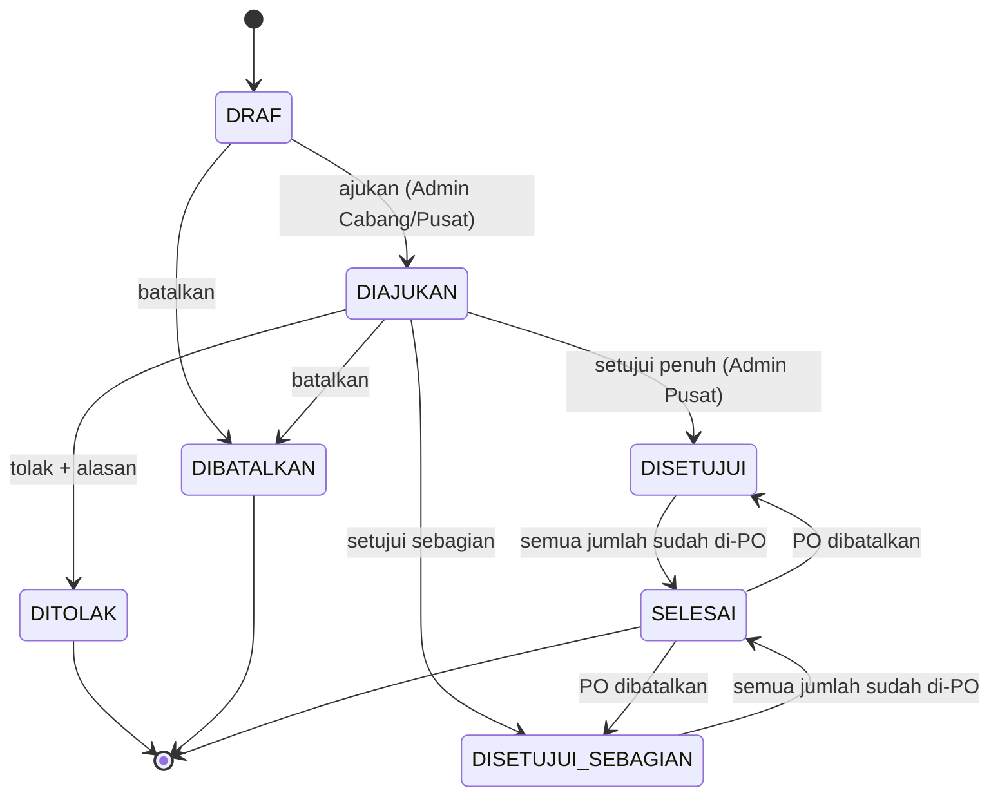
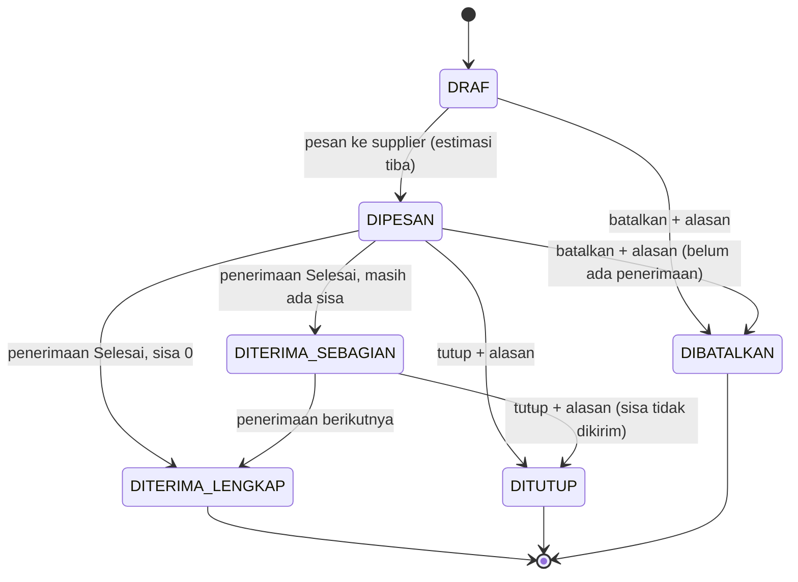
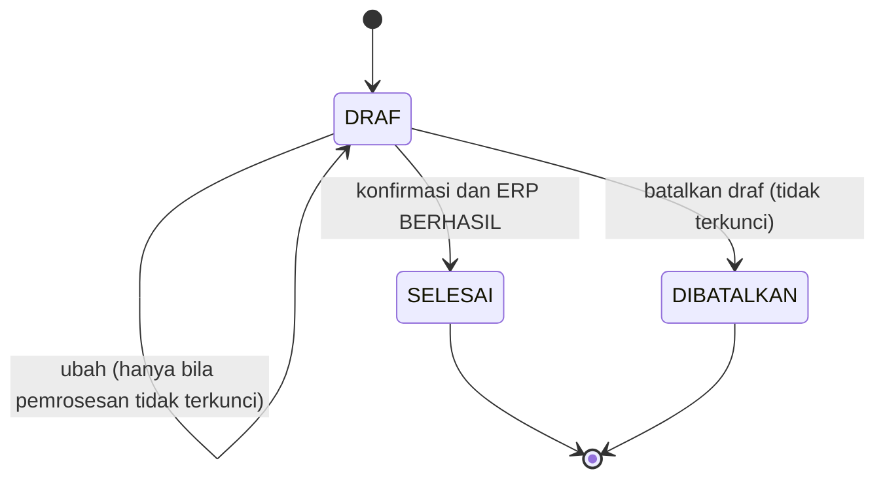
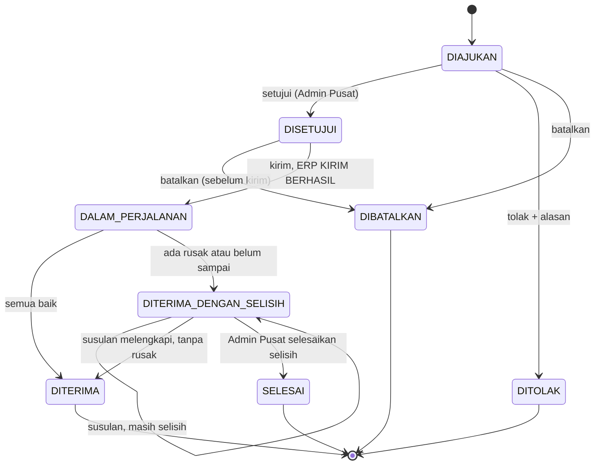
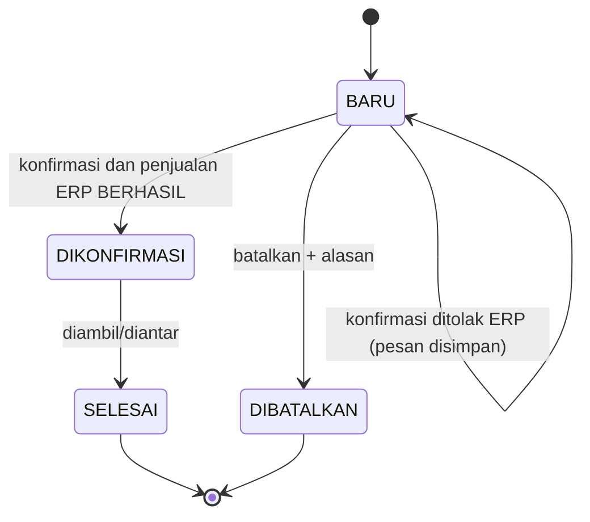
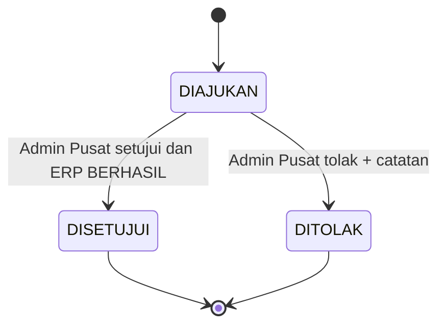
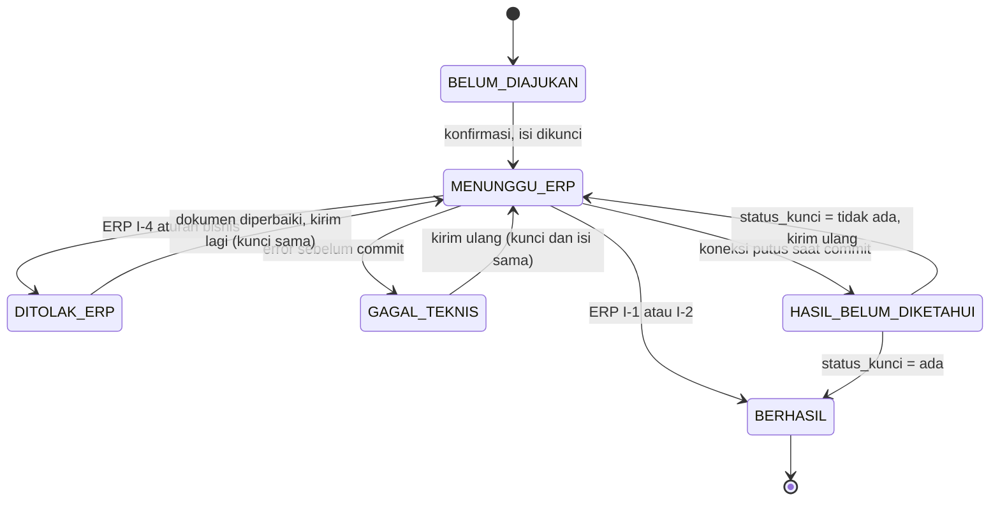

# Business Rules & Validation Document
## SaaS Toko Asri (ERP · SCM · CRM)

| | |
| --- | --- |
| Versi | 1.0-draf · 12 November 2026 |
| Status | **Draf — belum disetujui** |
| Acuan | [PRD](../01-product/PRD.md) · [ARCHITECTURE](../02-architecture/ARCHITECTURE.md) · [DESIGN](../03-design/DESIGN.md) · [SCHEMA](../04-database/SCHEMA.md) · aturan BR-Fxx Tahap 3 dan PK/I-x Tahap 4 (`docs/tahap-3-*`, `docs/tahap-4-integrasi`) |

**Penanda sumber** (sama dengan PRD):

| Penanda | Arti |
| --- | --- |
| [F] Wn | Fakta wawancara |
| [F-P] | Dinyatakan Naurah di master prompt |
| [K] | Ditetapkan Naurah |
| [A] | Asumsi (AS-n Tahap 4) |
| [R] | Rekomendasi |
| [U] | Usulan, belum terkonfirmasi |

**Kolom "Ditegakkan di"**:

| Kode | Arti |
| --- | --- |
| DB | Constraint/trigger/fungsi database |
| BE | Layanan backend |
| FE | Form |
| — | Belum diimplementasi |

Kode di kolom ini mengacu pada prototipe `feat/mvp-aplikasi`.

---

## 5.1 Aturan Bisnis

### Pembelian (Purchase Request)

| ID | Aturan | Sumber | Ditegakkan di |
| --- | --- | --- | --- |
| BR-PUR-01 | Kebutuhan barang diajukan cabang sebagai PR. PR **tidak** mengubah stok. | [F] W6, W7, W9 | BE |
| BR-PUR-02 | PR dibuat oleh Admin Cabang untuk cabangnya, atau Admin Pusat untuk cabang yang dipilih. | [F] W7 · [A] | BE |
| BR-PUR-03 | Satu PR berisi ≥ 1 baris. Produk unik per PR, harus aktif. Jumlah bilangan bulat > 0. | [R] | FE, BE, DB |
| BR-PUR-04 | PR dapat diisi dari rekomendasi pengadaan; jumlah saran boleh diubah. | [R] | BE |
| BR-PUR-05 | Bila ada PR lain berstatus Diajukan untuk produk–cabang yang sama, tampilkan peringatan. Ini **bukan** larangan. | [R] | BE |
| BR-PUR-06 | PR hanya dapat diubah saat Draf. PR hanya dapat dibatalkan saat Draf atau Diajukan. | [R] | BE |

### Approval

| ID | Aturan | Sumber | Ditegakkan di |
| --- | --- | --- | --- |
| BR-APR-01 | Keputusan pembelian ada di kantor pusat: hanya Admin Pusat yang menyetujui atau menolak PR. | [F] W7 | BE |
| BR-APR-02 | Penolakan wajib menyertakan alasan. | [R] | FE, BE, DB (`pr_tolak_wajib_alasan`) |
| BR-APR-03 | Jumlah disetujui boleh ≤ diminta per baris. Bila ada baris yang lebih kecil, status menjadi Disetujui sebagian. | [R] | BE, DB |
| BR-APR-04 | Persetujuan transfer dilakukan Admin Pusat. | [A] AS-15 | BE |
| BR-APR-05 | Penyesuaian stok wajib disetujui kantor (Admin Pusat) sebelum saldo berubah. | [F] W15 | BE, DB (`penyesuaian_disetujui_punya_kunci`) |
| BR-APR-06 | Pengaju tidak dapat menyetujui dokumennya sendiri. Ini terpenuhi otomatis karena dokumen cabang disetujui Admin Pusat. Bila Admin Pusat membuat PR sendiri, persetujuan oleh dirinya **diizinkan** di MVP karena pengguna kantor sedikit. | [U] | — (keputusan DEC-11) |

### Purchase Order

| ID | Aturan | Sumber | Ditegakkan di |
| --- | --- | --- | --- |
| BR-PO-01 | PO dibuat Admin Pusat dari baris PR yang disetujui. Jumlah PO ≤ sisa disetujui yang belum di-PO. | [R] | BE |
| BR-PO-02 | Satu PO = satu supplier + satu cabang tujuan. | [A] AS-10 | DB (kolom wajib) |
| BR-PO-03 | Produk PO harus terdaftar di supplier tersebut (`scm.supplier_produk`). | [R] | BE |
| BR-PO-04 | Harga beli disalin ke `po_baris.harga_satuan` (snapshot) dan tidak ikut berubah bila harga berikutnya berbeda. | [R] | DB, BE |
| BR-PO-05 | Saat Dipesan, estimasi tiba = tanggal pesan + lead time supplier. Barang datang 1–3 hari setelah pesan. | [F] W10 | BE |
| BR-PO-06 | PO lewat estimasi tiba dan belum lengkap ditandai Terlambat. | [R] | BE |
| BR-PO-07 | Pembatalan PO: hanya PO Draf/Dipesan yang belum menerima barang, dengan alasan wajib. Penutupan: hanya PO Dipesan/Diterima sebagian, dengan alasan wajib. Keduanya ditolak bila masih ada penerimaan Draf. | [R] | BE |
| BR-PO-08 | PR berstatus Selesai bila seluruh jumlah disetujui sudah masuk PO aktif. Bila PO dibatalkan, PR kembali ke status sebelumnya. | [R] | BE |

### Receiving (Penerimaan barang)

| ID | Aturan | Sumber | Ditegakkan di |
| --- | --- | --- | --- |
| BR-RCV-01 | Barang supplier dikirim langsung ke cabang tujuan PO dan diterima cabang itu. | [A] AS-8 | BE |
| BR-RCV-02 | Setiap baris mencatat nomor batch, tanggal kedaluwarsa, jumlah baik, dan jumlah rusak. | [F] W2 · [R] | FE, BE, DB |
| BR-RCV-03 | Total baik ≤ sisa PO per item. Baik + rusak > 0. Keterangan wajib bila rusak > 0. | [R] | FE, BE, DB |
| BR-RCV-04 | Tanggal kedaluwarsa > tanggal terima. Tanggal terima ≤ hari ini. | [R] | BE |
| BR-RCV-05 | Hanya jumlah **baik** yang masuk stok. Barang rusak dicatat di dokumen, bukan di saldo. | [F] W4 · [R] | BE |
| BR-RCV-06 | Konfirmasi penerimaan mengajukan kejadian MASUK berkunci `GR-<nomor>` ke ERP. Penerimaan Selesai **hanya** bila ERP Berhasil. | [R] Tahap 4 | BE, DB |
| BR-RCV-07 | Satu PO dapat menerima beberapa kali. Status PO dihitung ulang setiap penerimaan Selesai. | [R] | BE |

### Transfer

| ID | Aturan | Sumber | Ditegakkan di |
| --- | --- | --- | --- |
| BR-TRF-01 | Barang dapat dipindah antarcabang, termasuk barang slow moving. | [F] W1, W5 | BE |
| BR-TRF-02 | Transfer diajukan Admin Cabang (asal atau tujuan) atau Admin Pusat. Alasan wajib: Slow moving, Kebutuhan cabang, Kedaluwarsa dekat, Lainnya. | [A] AS-9 | FE, BE, DB |
| BR-TRF-03 | Cabang asal ≠ cabang tujuan. | [R] | DB |
| BR-TRF-04 | Setelah disetujui, gudang asal memilih batch. Sistem menyarankan FEFO; memilih selain FEFO wajib disertai alasan. Batch kedaluwarsa tidak boleh dikirim. | [R] | FE, BE |
| BR-TRF-05 | Stok asal diperiksa ulang saat kirim. Kirim = kejadian KELUAR `TR-<nomor>-KIRIM` di cabang asal. | [R] | BE, DB |
| BR-TRF-06 | Barang dalam perjalanan hanya tercatat di dokumen SCM, tidak di saldo ERP. | [A] AS-12 | BE |
| BR-TRF-07 | Penerimaan cabang tujuan: baik masuk (`TR-<nomor>-TERIMA`), rusak dicatat di dokumen. Barang belum sampai menghasilkan status Diterima dengan selisih. | [R] | BE |
| BR-TRF-08 | Barang susulan dicatat sebagai kejadian baru `TR-<nomor>-SUSULAN-n`. | [R] | BE |
| BR-TRF-09 | Selisih diselesaikan Admin Pusat: sisa dinyatakan hilang (keterangan wajib) dan penanganan rusak dicatat (wajib). Penyelesaian ini **tidak** membuat kejadian stok karena barang sudah keluar dari saldo asal. | [R] | BE |
| BR-TRF-10 | Transfer hanya dapat dibatalkan sebelum dikirim, oleh pengaju, cabang asal, atau Admin Pusat. | [R] | BE |

### Penjualan

| ID | Aturan | Sumber | Ditegakkan di |
| --- | --- | --- | --- |
| BR-SAL-01 | Penjualan mengurangi stok per batch dengan urutan FEFO: kedaluwarsa paling awal lebih dulu, batch kedaluwarsa dilewati. | [R] Tahap 3 | BE, DB |
| BR-SAL-02 | Jumlah > stok layak jual → seluruh penjualan ditolak. Tidak ada penjualan sebagian. | [R] | BE, DB |
| BR-SAL-03 | Harga jual disalin dari master produk saat transaksi (snapshot). | [R] | BE, DB |
| BR-SAL-04 | Setiap penjualan punya kunci idempotency. Pengiriman ganda (klik dua kali, retry API) tidak menggandakan penjualan. API wajib header `Idempotency-Key`. | [R] Tahap 4 | BE, DB |
| BR-SAL-05 | Penjualan dicatat Kasir/Admin Cabang untuk cabangnya, atau Admin Pusat dengan memilih cabang. | [U] | BE |
| BR-SAL-06 | Penjualan tidak dapat diubah atau dihapus. Koreksi dilakukan lewat penyesuaian, dan retur penjualan adalah Post-MVP. | [R] | BE |

### Pelanggan & pesanan

| ID | Aturan | Sumber | Ditegakkan di |
| --- | --- | --- | --- |
| BR-CUS-01 | Jenis pelanggan: Mahasiswa, Reseller, Umum. | [F] W13 | DB |
| BR-CUS-02 | Nama wajib. Telepon opsional, tetapi bila diisi harus unik dan berformat angka. | [R] | FE, BE, DB |
| BR-CUS-03 | Member adalah penanda keanggotaan dengan nomor otomatis. Poin/diskon di luar MVP. | [R] | BE |
| BR-CUS-04 | Pesanan berkanal Toko atau WhatsApp. WhatsApp hanya **dicatat sebagai kanal**, tanpa integrasi WhatsApp. | [F-P] · [F] W12 | DB |
| BR-CUS-05 | Pesanan Baru **tidak** mengurangi stok dan tidak mencadangkan stok. | [A] AS-13 | BE |
| BR-CUS-06 | Konfirmasi pesanan memanggil penjualan ERP berkunci `JUAL-CRM-<nomor pesanan>`. Berhasil → Dikonfirmasi. Ditolak → tetap Baru + pesan ERP. | [R] | BE, DB |
| BR-CUS-07 | Pesanan hanya dapat dibatalkan saat Baru, dengan alasan wajib. | [R] | BE |
| BR-CUS-08 | Riwayat pembelian pelanggan = pesanan Dikonfirmasi/Selesai. | [R] | BE |

### Persediaan (umum)

| ID | Aturan | Sumber | Ditegakkan di |
| --- | --- | --- | --- |
| BR-INV-01 | ERP adalah satu-satunya pemilik dan pengubah saldo. | [K] · [R] | BE, DB |
| BR-INV-02 | Saldo dicatat per cabang per batch. | [F] W2 | DB |
| BR-INV-03 | Stok layak jual = saldo batch dengan sisa hari > 0. | [R] | BE |
| BR-INV-04 | Saldo awal per cabang dicatat sekali lewat kejadian `SALDO-AWAL-<kode cabang>`. | [R] | — (G-04) |
| BR-INV-05 | Monitoring stok menggantikan cek mingguan manual, tetapi **tidak menggantikan** stok opname fisik. | [F] W3 | — |

---

## 5.2 Aturan Persediaan

| ID | Kejadian | Aturan | Kunci kejadian | Pemicu & peran |
| --- | --- | --- | --- | --- |
| INV-01 | **Penambahan** | Hanya lewat penerimaan supplier, penerimaan transfer/susulan, penyesuaian TAMBAH yang disetujui, atau saldo awal. Batch dibuat otomatis bila belum ada (produk + nomor + kedaluwarsa). | `GR-…`, `TR-…-TERIMA`, `TR-…-SUSULAN-n`, `ADJ-…`, `SALDO-AWAL-…` | Petugas Gudang/Admin Cabang; Admin Pusat |
| INV-02 | **Pengurangan** | Hanya lewat penjualan, pengiriman transfer, atau penyesuaian KURANG yang disetujui. Saldo tidak boleh negatif (DB CHECK). | `JUAL-…`, `JUAL-CRM-…`, `TR-…-KIRIM`, `ADJ-…` | Kasir/Admin Cabang; gudang asal; Admin Pusat |
| INV-03 | **Adjustment** | Diajukan Admin Cabang dengan alasan (Kedaluwarsa, Rusak, Selisih opname, Lainnya) per batch. Diputuskan Admin Pusat; penolakan wajib catatan. Saldo berubah hanya saat disetujui, dalam satu transaksi dengan kejadian ERP. | `ADJ-<nomor>` | [F] W15 |
| INV-04 | **Batch** | Identitas batch = produk + nomor batch + tanggal kedaluwarsa (unik). Nomor batch dari kemasan supplier; bila tidak ada, diisi dengan pola yang disepakati gudang. | — | [R]; format nomor perlu konfirmasi mitra (DEC-16) |
| INV-05 | **FEFO** | Penjualan: alokasi otomatis FEFO. Transfer: saran FEFO, boleh menyimpang dengan alasan. Urutan: kedaluwarsa naik, lalu id batch. | — | [R] |
| INV-06 | **Rusak** | Rusak saat diterima: dicatat di dokumen, tidak masuk saldo. Rusak di gudang: penyesuaian KURANG alasan Rusak. | `ADJ-…` | [F] W4 |
| INV-07 | **Hilang** | Hilang dalam transfer: dinyatakan Admin Pusat saat menyelesaikan selisih, tanpa kejadian stok. Hilang di gudang: ditemukan lewat opname, lalu penyesuaian KURANG alasan Selisih opname. | `ADJ-…` | [R] |
| INV-08 | **Kedaluwarsa** | Batch dengan sisa hari ≤ 0 tidak layak jual dan tidak dapat dikirim. Batch dikategorikan: Perlu perhatian, Segera ditindak, Kedaluwarsa (ambang di parameter). Bila ambang belum diatur, hanya kategori Kedaluwarsa yang tampil. Pemusnahan = penyesuaian KURANG alasan Kedaluwarsa. Produk "wajib periksa" diberi tanda. | `ADJ-…` | [F] W2, W4 · [R] |
| INV-09 | **Rekonsiliasi** | REK-1..4 dijalankan **harian** (usulan) dan sebelum/sesudah migration. Hasil ≠ 0 tidak diperbaiki otomatis: Admin Pusat menelusuri dokumen, lalu mengajukan penyesuaian bila perlu. REK-5 (opname fisik vs sistem) dilakukan berkala sesuai jadwal mitra; selisih → penyesuaian. | — | [R]; jadwal opname perlu konfirmasi mitra |
| INV-10 | **Slow moving** | Lambat bila laju jual ≤ batas per hari dalam periode **dan** umur stok ≥ batas hari (parameter). Data < periode → kategori "Data belum cukup". Tindak lanjut: transfer atau tandai ditinjau. | — | [F] W5 · [R] |
| INV-11 | **Rekomendasi** | Posisi = layak jual + sisa PO + transfer masuk. Bila posisi ≤ stok minimum, saran = target − posisi. Versi laju jual memakai rata-rata penjualan × cakupan T bila data cukup. | — | [F] W8, W9 · [R] |

---

## 5.3 Aturan Integrasi

| ID | Aturan |
| --- | --- |
| INT-01 | SCM dan CRM **tidak** menulis tabel ERP. Perubahan stok hanya lewat `erp.ajukan_kejadian_stok`. Penjualan hanya lewat `app.erp.layanan.buat_penjualan`. Data ERP dibaca lewat view `erp.v_*`. |
| INT-02 | Setiap kejadian stok membawa **kunci unik deterministik** dari nomor dokumen (lihat INV-01/02). Kunci tidak pernah dipakai ulang untuk isi yang berbeda. |
| INT-03 | Kunci sama + isi sama → `SUDAH_DIPROSES` (aman diulang). Kunci sama + isi berbeda → `KONFLIK`, tidak ada perubahan. |
| INT-04 | Satu kejadian = satu transaksi. Semua baris berhasil atau semua batal. |
| INT-05 | Sebelum ke ERP, SCM mencatat lapis 2 (`scm.pengajuan_stok`) dengan isi yang dikunci. Selama status `MENUNGGU_ERP`/`GAGAL_TEKNIS`/`HASIL_BELUM_DIKETAHUI`, isi dokumen **tidak dapat diubah**. |
| INT-06 | Retry hanya **manual** lewat tombol Kirim ulang, dengan kunci dan isi yang sama. Tidak ada retry otomatis di MVP. Pengguna selalu melihat statusnya. |
| INT-07 | `HASIL_BELUM_DIKETAHUI` (koneksi putus saat COMMIT) dipastikan dengan `erp.status_kunci(kunci)` sebelum boleh dikirim ulang. |
| INT-08 | Status `BERHASIL` tidak pernah ditimpa. |
| INT-09 | Setiap percobaan dicatat di `core.log_integrasi` lewat koneksi terpisah, sehingga log tetap ada walau transaksi utama batal. |
| INT-10 | Tidak ada event/queue asinkron di MVP. Integrasi bersifat panggilan langsung dalam satu proses (modular monolith, DEC-03). |
| INT-11 | Activity log dan notifikasi ditulis **di dalam transaksi yang sama** dengan perubahan dokumen, sehingga keduanya ada bila dan hanya bila dokumen berubah (ARCHITECTURE §2.4 *Internal event*). Satu-satunya pengecualian adalah log integrasi (INT-09). |

---

## 5.4 Matriks Otorisasi

Role menurut PRD §1.2: Super Admin [U], Admin Pusat [F], Admin Cabang [F], Petugas Gudang [A], Kasir [U] (di prototipe: `STAF_PENJUALAN`, G-02).

Notasi:

| Notasi | Arti |
| --- | --- |
| ✓ | Diizinkan, semua cabang |
| C | Diizinkan, hanya cabangnya sendiri |
| L | Hanya lihat |
| — | Ditolak (403) |

Pembatasan cabang ditegakkan di backend: query difilter `cabang_id`, dan akses dokumen cabang lain → 404/403 (`test_isolasi_cabang`, `test_cabang_lain_tidak_dapat_melihat_pr`).

| Permission | Super Admin | Admin Pusat | Admin Cabang | Petugas Gudang | Kasir |
| --- | --- | --- | --- | --- | --- |
| **Sistem** | | | | | |
| Login, dashboard, notifikasi sendiri | ✓ | ✓ | C | C | C |
| Kelola pengguna (tambah, ubah, nonaktifkan, reset password) | ✓ | — | — | — | — |
| Riwayat aktivitas | ✓ | ✓ | C | — | — |
| Log integrasi stok | ✓ | ✓ | — | — | — |
| Rekonsiliasi | — | ✓ | — | — | — |
| **ERP** | | | | | |
| Kelola produk & cabang | — | ✓ | — | — | — |
| Input saldo awal | — | ✓ | — | — | — |
| Lihat persediaan | — | ✓ | C | C | C |
| Lihat stock movement | — | ✓ | C | C | — |
| Catat penjualan langsung | — | ✓ | C | — | C |
| Ajukan penyesuaian | — | ✓ | C | — | — |
| Setujui/tolak penyesuaian | — | ✓ | — | — | — |
| Laporan | — | ✓ | C | — | — |
| **SCM** | | | | | |
| Kelola supplier & produk supplier | — | ✓ | L | — | — |
| Buat/ajukan/ubah/batal PR | — | ✓ | C | — | — |
| Setujui/tolak PR | — | ✓ | — | — | — |
| Buat PO, pesan, tutup/batal PO | — | ✓ | — | — | — |
| Lihat PO | — | ✓ | C | C | — |
| Catat & konfirmasi penerimaan, kirim ulang | — | ✓ | C | C | — |
| Ajukan transfer | — | ✓ | C (asal/tujuan) | — | — |
| Setujui/tolak transfer | — | ✓ | — | — | — |
| Kirim transfer (pilih batch) | — | ✓ | C (asal) | C (asal) | — |
| Terima transfer & susulan | — | ✓ | C (tujuan) | C (tujuan) | — |
| Selesaikan selisih transfer | — | ✓ | — | — | — |
| Kedaluwarsa & FEFO | — | ✓ | C | C | — |
| Slow moving, parameter, stok minimum/target | — | ✓ | — | — | — |
| Rekomendasi pengadaan | — | ✓ | C | — | — |
| **CRM** | | | | | |
| Kelola pelanggan & member | — | ✓ | C\* | — | C\* |
| Catat/konfirmasi/selesaikan/batalkan pesanan | — | ✓ | C | — | C |
| Cek ketersediaan produk | — | ✓ | C | — | C |

\* Data pelanggan dipakai bersama semua cabang (satu pelanggan dapat membeli di cabang mana pun) [U]. Riwayat pesanan tetap menampilkan cabang transaksi.

**Catatan keputusan**

| Butir | Keputusan |
| --- | --- |
| Super Admin | Sengaja **tanpa** akses operasional (pemisahan tugas) [U]. Ini usulan DEC-07. Bila ditolak, fungsi kelola pengguna dipindah ke Admin Pusat. |
| Satu role per akun | DEC-08 |
| Penonaktifan akun | Langsung memutus sesi berikutnya |

---

## 5.5 Aturan Validasi

| Lapisan | Aturan | Contoh |
| --- | --- | --- |
| **Frontend** (bantuan, bukan pertahanan) | Atribut `required`, `min`, `type=date/number`, `maxlength`. Nilai dipertahankan saat gagal. Error per field. Tombol submit dinonaktifkan saat proses (cegah klik ganda). Modal konfirmasi untuk aksi yang mengubah stok/status. | Jumlah `min=1`; tanggal kedaluwarsa `type=date` |
| **Backend** (pertahanan utama) | Seluruh aturan BR/INV divalidasi ulang di layanan, tidak percaya input form/API. Validasi peran & cabang di setiap aksi. Validasi status dokumen (transisi §5.6) dengan baris dokumen dikunci `FOR UPDATE`. Kumpulkan semua error field lalu kembalikan sekaligus (`Validasi`). Teks dipangkas dan dibatasi panjangnya. | "Jumlah baik melebihi sisa PO (sisa 30)." |
| **API** | JSON `Content-Type: application/json`. Sesi + token CSRF untuk metode tulis. `Idempotency-Key` wajib untuk penjualan. Respons error seragam `{error:{kode, pesan, errors}}`. Pagination `?halaman=` dengan ukuran halaman tetap dari konfigurasi `PER_HALAMAN`. ID di URL bilangan bulat. | `POST /api/v1/erp/penjualan` tanpa kunci → 422 |
| **Database** (jaring terakhir) | `NOT NULL`, `CHECK` (jumlah, status, konsistensi), `UNIQUE`, FK, trigger append-only, `saldo_tidak_negatif`, fungsi ERP memvalidasi baris kejadian (produk, batch, kedaluwarsa, jumlah wajib; tanpa duplikat; cabang aktif). Pelanggaran → error DB diterjemahkan ke pesan umum, tidak membocorkan detail SQL. | `saldo_tidak_negatif` |

**Validasi per field umum**

| Field | Aturan |
| --- | --- |
| Username | `^[a-z0-9._-]{3,40}$`, unik |
| Password | Disimpan sebagai hash (`test_password_disimpan_sebagai_hash`). Panjang minimum 8 karakter **[R], belum ditegakkan** — masuk bersama manajemen pengguna (G-03) |
| SKU / kode | Wajib, unik, huruf besar/angka/tanda hubung |
| Nama | Wajib, tidak hanya spasi |
| Telepon | Opsional, `^[0-9+ -]{6,20}$`, unik bila diisi (pelanggan) |
| Jumlah barang | Bilangan bulat > 0 (≥ 0 untuk rusak/hilang) |
| Harga | ≥ 0, maks. 2 desimal, rupiah |
| Lead time | Bilangan bulat 0–60 hari |
| Tanggal kedaluwarsa | Wajib, > tanggal terima |
| Alasan/catatan wajib | Tidak kosong setelah dipangkas; ≤ 500 karakter |
| Parameter | Kelompok parameter diisi semua atau dikosongkan semua; stok target > stok minimum |

---

## 5.6 Status dan Transisi

Ada tiga lapis status yang **tidak boleh dicampur** dalam satu kolom maupun satu badge:

| Lapis | Menjawab | Disimpan di | Contoh |
| --- | --- | --- | --- |
| 1. Status dokumen | Di tahap mana dokumen bisnis ini? | Kolom `status` tiap dokumen | PO `DIPESAN` |
| 2. Status pemrosesan stok | Apakah kejadian stok dokumen ini sudah diproses ERP? | `scm.pengajuan_stok.status` per kunci | `GAGAL_TEKNIS` |
| 3. Kegagalan teknis / log | Apa yang terjadi pada setiap percobaan? | `core.log_integrasi.hasil` (append-only) | Percobaan 1 `GAGAL_TEKNIS`, percobaan 2 `BERHASIL` |

Aturan penghubung antarlapis:
- Status dokumen yang bergantung pada stok (GR Selesai, Transfer Dalam perjalanan/Diterima, Pesanan Dikonfirmasi, Penyesuaian Disetujui) **hanya** berubah di transaksi yang sama dengan hasil ERP `BERHASIL`.
- Kegagalan teknis tidak pernah mengubah status dokumen.

### Purchase Request

### Purchase Order

"Terlambat" adalah **tanda turunan** (estimasi tiba < hari ini dan status Dipesan/Diterima sebagian), bukan status.

### Receiving (Penerimaan barang)

Penerimaan dengan seluruh barang rusak menjadi Selesai **tanpa** kejadian stok.

### Transfer

`DITERIMA` adalah akhir untuk transfer tanpa selisih (fakta prototipe). Stepper di DESIGN menampilkan "Selesai" sebagai langkah terakhir untuk keduanya.

### Customer order (Pesanan CRM)

### Penyesuaian stok

### Stock processing (lapis 2, per kunci kejadian)

Kunci sama dengan isi berbeda (I-3 `KONFLIK`) **tidak** mengubah status lapis 2 dokumen asal. Percobaan dicatat di lapis 3, Admin Pusat menerima notifikasi peringatan, dan pengguna menerima error `KONFLIK` (fakta prototipe, `app/scm/integrasi.py`).

| Status lapis 2 | Isi dokumen | Tombol | Badge |
| --- | --- | --- | --- |
| BELUM_DIAJUKAN | Dapat diubah | Konfirmasi | abu |
| MENUNGGU_ERP | Terkunci | — | biru |
| BERHASIL | Final | — | hijau |
| DITOLAK_ERP | Dapat diperbaiki | Konfirmasi lagi | merah |
| GAGAL_TEKNIS | Terkunci | Kirim ulang | merah |
| HASIL_BELUM_DIKETAHUI | Terkunci | Pastikan / kirim ulang | kuning |

**Lapis 3 — hasil per percobaan** (`core.log_integrasi.hasil`):

| Hasil | Arti |
| --- | --- |
| `BERHASIL` | I-1 |
| `SUDAH_DIPROSES` | I-2 |
| `KONFLIK` | I-3 |
| `DITOLAK_ERP` | I-4 |
| `GAGAL_TEKNIS` | — |
| `HASIL_BELUM_DIKETAHUI` | — |

Tiap baris lapis 3 berisi `percobaan` ke-n, waktu, pengguna, dan pesan. Baris tidak pernah diubah.

---

## 5.7 Error Handling

| Kode | HTTP | Kapan | Pesan ke pengguna (contoh) | Logging | Retry | Rollback | Audit |
| --- | --- | --- | --- | --- | --- | --- | --- |
| `VALIDASI` | 422 | Input tidak memenuhi aturan | "Periksa kembali isian." + error per field | Tidak (bukan kesalahan sistem) | Pengguna memperbaiki input | Transaksi dibatalkan | Tidak |
| `BELUM_LOGIN` | 401 | Tanpa sesi / sesi habis | "Silakan login." → redirect login | Info | Login ulang | — | Login gagal dicatat (usulan rate limit G-07) |
| `DILARANG` | 403 | Role/cabang tidak berhak | "Anda tidak memiliki akses untuk tindakan ini." | Warning (pengguna, URL) | Tidak | Dibatalkan | Ya (usulan) |
| `TIDAK_DITEMUKAN` | 404 | ID tidak ada atau milik cabang lain | "Data tidak ditemukan." | Info | Tidak | — | Tidak |
| `KONFLIK` | 409 | Aksi tidak sesuai status (mis. setujui PR yang sudah diputuskan), data bentrok, atau ERP I-3 | "PR ini sudah diputuskan. Muat ulang halaman." | Info | Muat ulang lalu ulangi bila masih relevan | Dibatalkan | Tidak |
| `DITOLAK_ERP` | 409 | ERP menolak aturan bisnis (stok kurang, batch kedaluwarsa, cabang nonaktif) | "Stok layak jual tidak cukup: Nugget (butuh 5, tersedia 3)." | Lapis 3 | Perbaiki dokumen lalu kirim lagi (kunci sama) | Seluruh kejadian dibatalkan, klaim kunci dilepas | Lapis 2 + 3 |
| `GAGAL_TEKNIS` | 503 | Error teknis sebelum commit (lock timeout, error DB) | "Stok belum berubah karena gangguan teknis. Tekan Kirim ulang." | Error + lapis 3 | **Manual**, kunci & isi sama | Dibatalkan; isi tetap dikunci | Lapis 2 + 3 |
| `HASIL_BELUM_DIKETAHUI` | 503 | Koneksi putus saat COMMIT | "Hasil belum dapat dipastikan. Sistem akan memeriksa sebelum mengirim ulang." | Error + lapis 3 | Setelah `status_kunci` dipastikan | Tidak diketahui → dipastikan | Lapis 2 + 3 |
| `DATABASE` | 503 | Database tidak dapat dihubungi | "Terjadi gangguan database. Coba lagi." | Error | Pengguna mengulang | Otomatis | Tidak |
| `CSRF` | 400 | Token CSRF hilang/salah | "Sesi formulir kedaluwarsa. Muat ulang halaman." | Warning | Muat ulang | — | Tidak |
| `500` | 500 | Error tak terduga | "Terjadi kesalahan. Tim sudah dapat melihat catatannya." | Error + stack trace (server saja, tidak ke pengguna) | Tidak otomatis | Otomatis | Tidak |

**Prinsip**

| Kode | Prinsip |
| --- | --- |
| ERR-01 | Pesan dalam Bahasa Indonesia, menyebut apa yang salah dan apa yang dilakukan. Tidak menampilkan SQL, stack trace, atau data cabang lain (mis. tidak menampilkan angka stok cabang lain kepada cabang yang tidak berhak). |
| ERR-02 | Setiap aksi tulis berjalan dalam satu transaksi. Error apa pun → rollback penuh, kecuali log lapis 3 yang ditulis lewat koneksi terpisah. |
| ERR-03 | Tidak ada retry otomatis di MVP (INT-06). Pengguna memicu Kirim ulang. Ini disengaja agar tidak terjadi pengiriman ganda yang tak terlihat. |
| ERR-04 | Batas waktu: `lock_timeout` 5 s (sudah ada). `statement_timeout` 15 s (usulan, G-06). |
| ERR-05 | Aksi bisnis yang berhasil dicatat di `core.audit_log` beserta data sebelum/sesudah. Percobaan integrasi dicatat di `core.log_integrasi`. Kegagalan validasi tidak dicatat agar log tidak penuh. |
| ERR-06 | Format respons API untuk semua kode: `{"error": {"kode": "...", "pesan": "...", "errors": {"field": "pesan"}}}`. |
