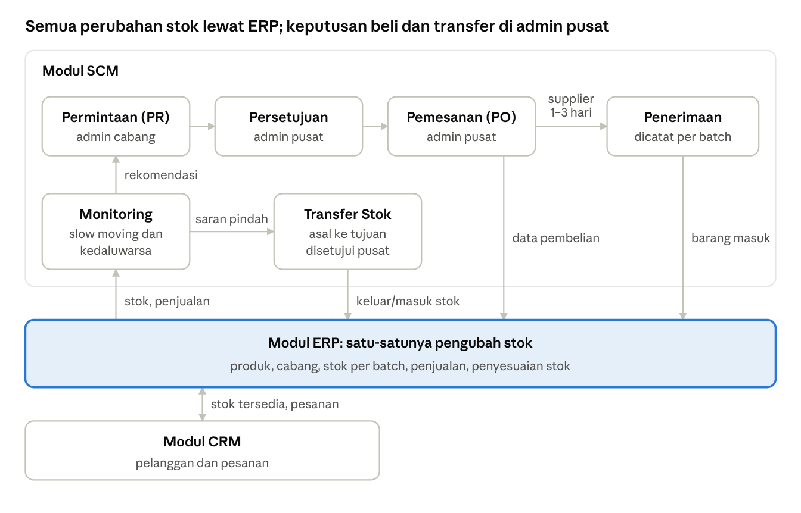
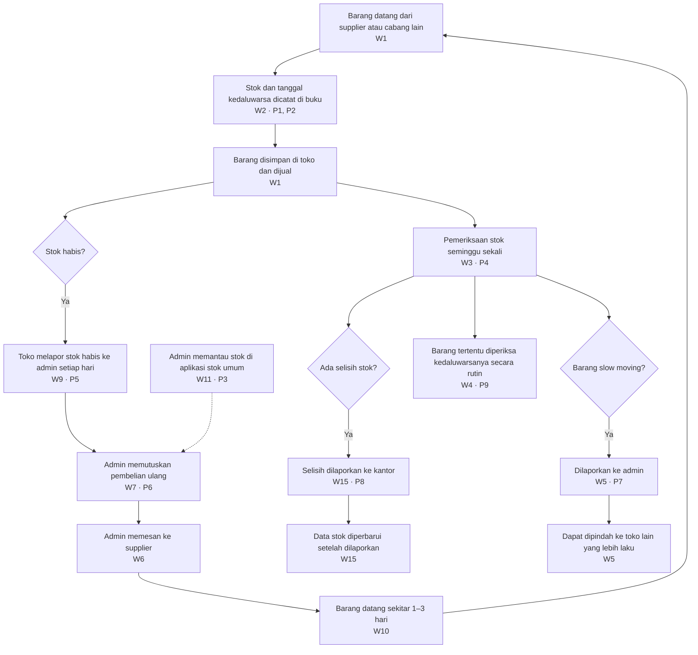
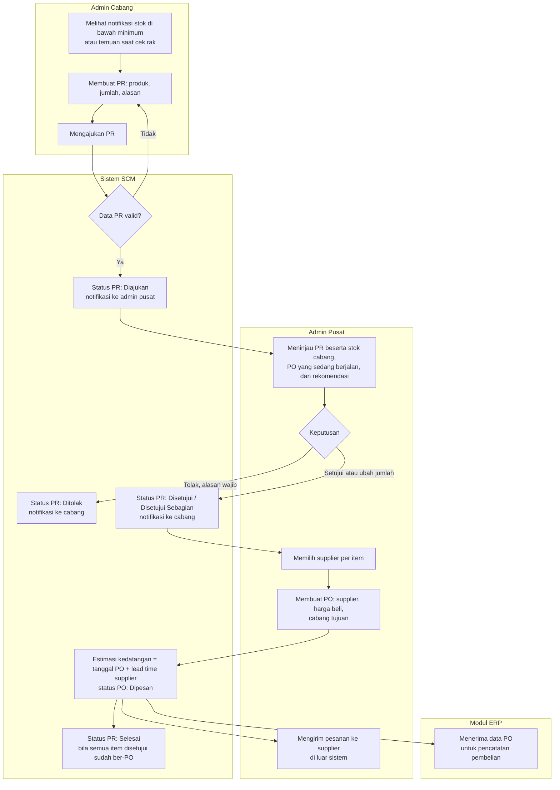
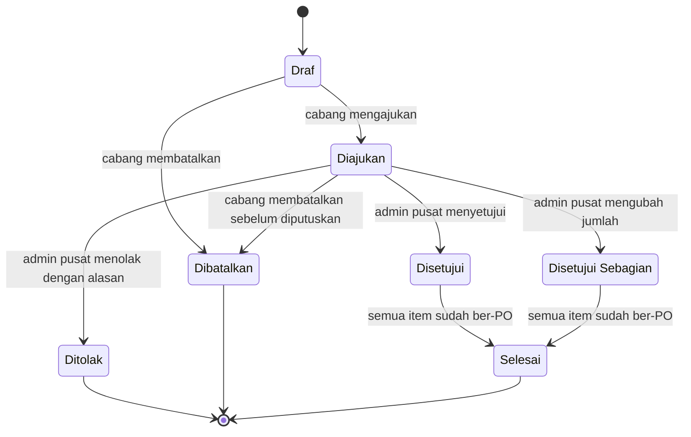
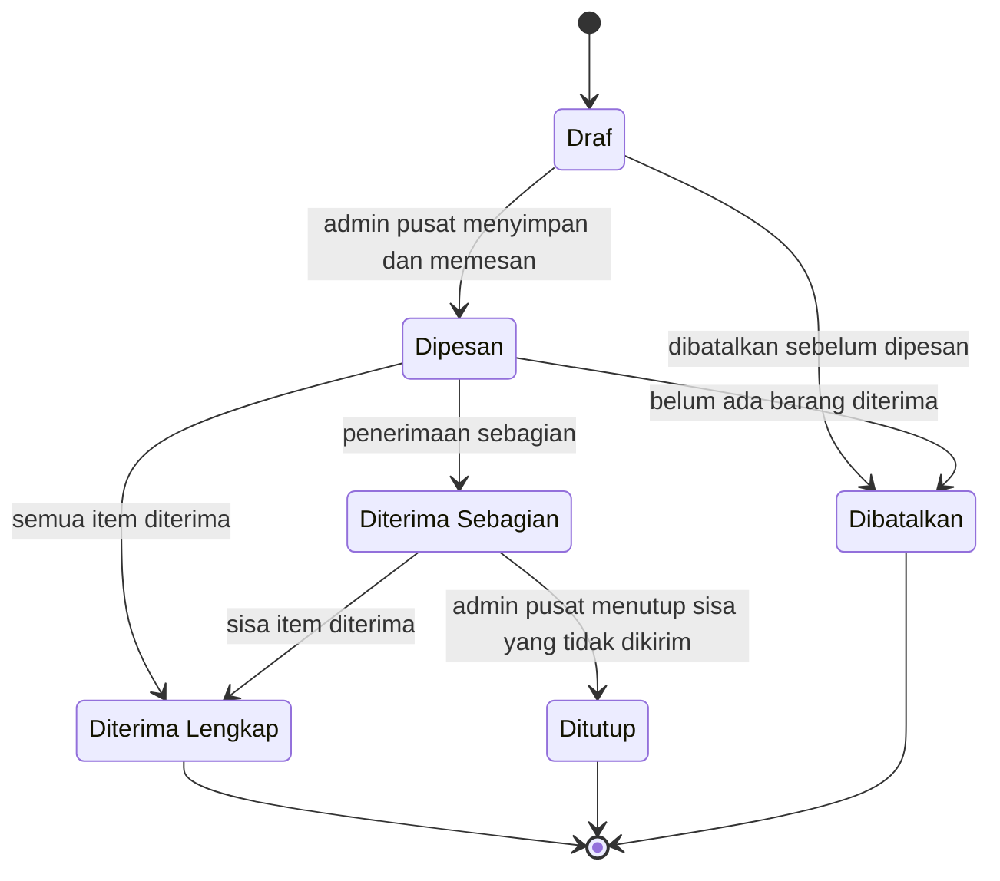
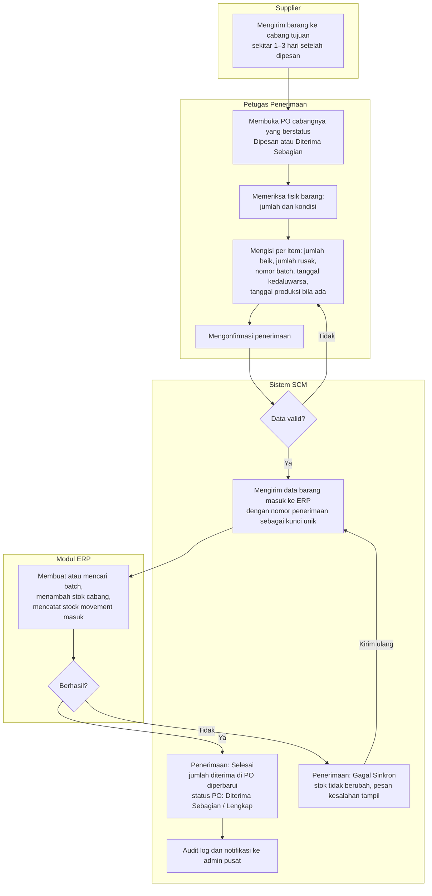
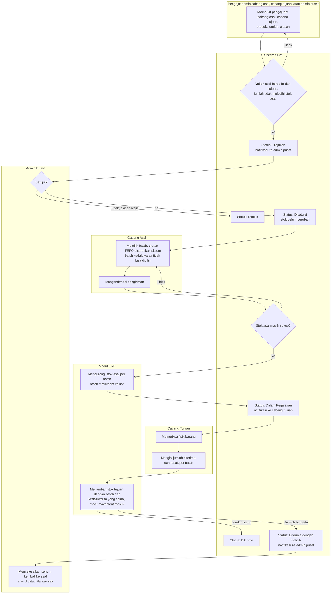
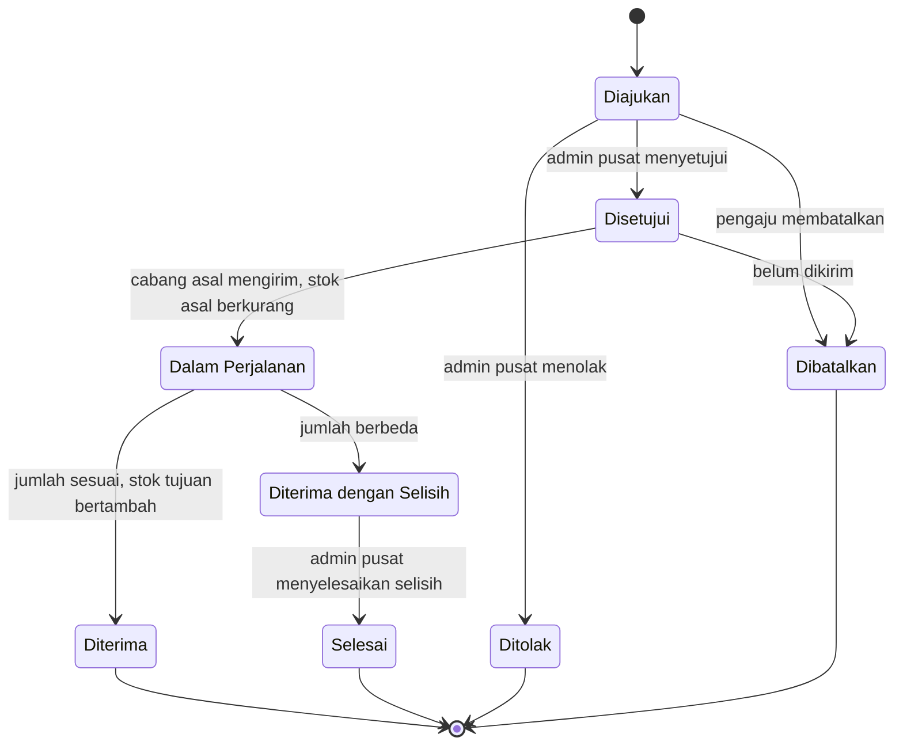
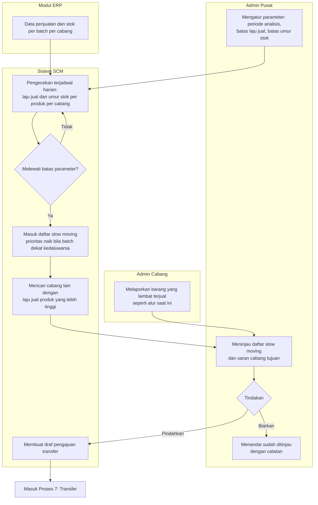
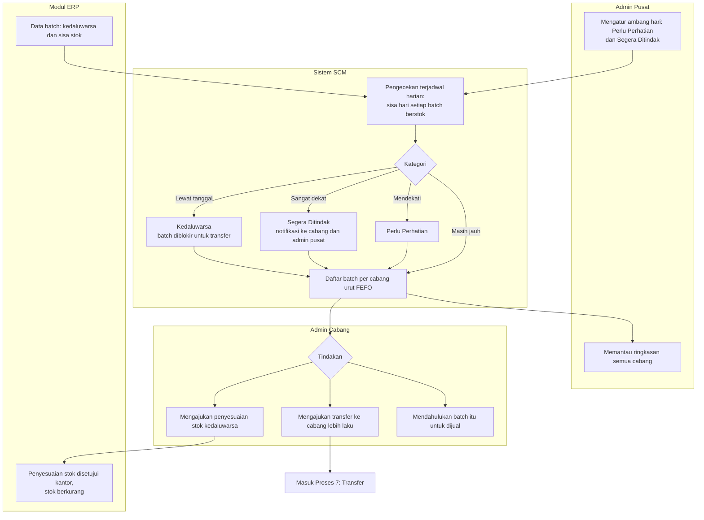

# Tahap 2 — Analisis Proses Bisnis As-Is dan To-Be Modul SCM Toko Asri

> **Catatan repositori — status dokumen:** Draf, **belum disetujui** tim (Naurah, Kayla, Rei) maupun mitra. Versi 0.1 (versi pertama; dokumen asli tidak bernomor versi). Isi di bawah tidak diubah dari draf asli, kecuali diagram interaktif gambaran besar yang diganti gambar statis.

10 November 2026

## Ringkasan

To-Be mengubah satu hal pokok: **setiap perubahan stok dicatat sebagai dokumen sistem di titik kejadian**, sedangkan kewenangan membeli dan memindahkan barang tetap di admin pusat. Proses yang dianalisis ada sembilan, dari permintaan barang cabang sampai pemantauan kedaluwarsa.

Acuan utama: [Tahap 1 — Analisis Kebutuhan Modul SCM Toko Asri](https://claude.ai/artifact/J4bRxEydLZKALJbZQDFSuT). Kode W1–W16, US, FR, dan BR merujuk ke dokumen itu.

Penanda yang dipakai:

- **[F] Wn** — fakta wawancara, tidak diubah.
- **ASUMSI SEMENTARA** — rancangan awal yang belum disepakati tim atau mitra.
- **[R]** — rekomendasi analis.
- **Belum diketahui** — langkah As-Is yang tidak dijelaskan di wawancara. Bagian ini tidak diisi dengan tebakan.

### Perubahan keputusan dari Tahap 1

Asumsi integrasi tim (ERP oleh Kayla, CRM oleh Rei) mengubah tujuh keputusan Tahap 1. Semuanya berstatus ASUMSI SEMENTARA sampai tim sepakat.

| No | Keputusan di Tahap 1 | Keputusan di Tahap 2 | Sebab |
| --- | --- | --- | --- |
| 1 | Stock opname dan penyesuaian stok (FR-ADJ-01) jadi fitur SCM, prioritas Should | Dikeluarkan dari SCM. Dikerjakan ERP; SCM hanya membaca hasilnya | Asumsi ERP: stock opname lewat ERP. Menjawab temuan kritis no. 1 Tahap 1 |
| 2 | Konfirmasi penerimaan menambah stok cabang (FR-GR-04) | SCM mengirim data penerimaan ke ERP. ERP yang membuat batch dan menambah stok. Penerimaan baru berstatus Selesai setelah ERP berhasil | Asumsi ERP: ERP pemilik stok; SCM mengirim barang masuk |
| 3 | Tabel product_batches ada di daftar tabel SCM | Batch dan tanggal kedaluwarsa disimpan ERP; SCM membaca untuk monitoring | Asumsi ERP: ERP mencatat batch dan kedaluwarsa. Berdampak ke Tahap 5 |
| 4 | Pengeluaran barang kedaluwarsa/rusak dicatat SCM (FR-ED-03) | Diproses sebagai penyesuaian stok di ERP. SCM hanya menandai batch dan meneruskan ke ERP | Konsekuensi dari no. 1 |
| 5 | Data penjualan digital belum pasti (asumsi A7) | ERP mencatat penjualan dan mengurangi stok otomatis. Slow moving dan rekomendasi berbasis laju jual tetap Should sampai format data penjualan pasti | Asumsi ERP |
| 6 | CRM membaca ketersediaan produk dari SCM (FR-INT-03) | CRM membaca stok dari ERP. Hubungan CRM–SCM tinggal sinyal permintaan pelanggan (Could) | Asumsi CRM |
| 7 | Login dan peran dirancang untuk SCM | Satu sistem login bersama; SCM tidak membuat tabel pengguna sendiri | Asumsi integrasi |

Yang tidak berubah: keputusan beli tetap di admin pusat (BR-01), rekomendasi tidak pernah membuat PO otomatis (BR-03), dan transfer mengurangi stok asal saat dikirim (BR-10). Struktur database final belum ditetapkan di dokumen ini.

## Gambaran Besar To-Be

SCM mengelola dokumen rantai pasok (PR, PO, penerimaan, transfer) dan pemantauan. ERP adalah satu-satunya modul yang mengubah stok, dan CRM berhubungan dengan stok hanya lewat ERP. Pengiriman supplier tetap berjalan di luar sistem.

## As-Is: Proses Saat Ini

Alur saat ini bergerak lewat laporan manual: toko mencatat di buku, melapor ke admin, dan admin memutuskan. Kode P1–P9 menandai titik masalah dari Tahap 1. Wawancara hanya menjelaskan garis besar, jadi diagram ini sengaja tidak lebih rinci dari faktanya.

| No | Proses | Alur saat ini | Dasar | Belum diketahui | Masalah |
| --- | --- | --- | --- | --- | --- |
| 1 | Permintaan barang dari toko | Toko melaporkan stok habis ke admin setiap hari | [F] W9 | Media laporan (lisan, chat, catatan); apakah stok menipis juga dilaporkan | P5, P6 |
| 2 | Persetujuan pengadaan | Admin yang memutuskan kapan membeli kembali, bukan toko | [F] W7 | Dasar admin menentukan jumlah beli; ada atau tidak stok minimum | P6 |
| 3 | Pemesanan ke supplier | Admin memesan barang melalui supplier | [F] W6, W7 | Cara memesan; apakah ada dokumen pesanan; berapa supplier | P6 |
| 4 | Pengiriman barang | Barang datang sekitar 1–3 hari setelah dipesan | [F] W10 | Dikirim langsung ke toko atau ke satu lokasi pusat; siapa yang mengantar | — |
| 5 | Penerimaan barang | Barang masuk dari supplier atau cabang lain, lalu disimpan di toko | [F] W1 | Siapa yang mengecek; apakah jumlah dicocokkan dengan pesanan; apa yang dilakukan bila rusak | P1, P2 |
| 6 | Pembaruan stok | Stok dan kedaluwarsa dicatat di buku; admin memantau di aplikasi stok umum; selisih harus dilaporkan ke kantor sebelum data diperbarui | [F] W2, W11, W14, W15 | Siapa yang memindahkan data dari buku ke aplikasi, dan seberapa sering | P1, P2, P3, P4, P8 |
| 7 | Transfer antarcabang | Barang bisa masuk dari toko cabang lain; barang slow moving dapat dipindah ke toko lain | [F] W1, W5 | Siapa yang menyetujui, cara mengirim, dan apakah ada catatan transfer | P7 |
| 8 | Penanganan slow moving | Barang slow moving dilaporkan ke admin, lalu dapat dipindahkan | [F] W5 | Kriteria barang disebut slow moving | P7 |
| 9 | Pemantauan kedaluwarsa | Tanggal kedaluwarsa dicatat di buku; barang tertentu wajib diperiksa rutin; kedaluwarsa dan rusak jarang terjadi | [F] W2, W4 | Daftar barang yang wajib diperiksa; berapa hari sebelum kedaluwarsa dianggap perlu tindakan | P9 |

Kelemahan utama As-Is ada di proses 1 dan 6. Informasi bergerak ke admin hanya saat stok sudah habis atau saat cek mingguan. Pencatatannya juga terjadi di dua tempat, yaitu buku dan aplikasi stok umum.

## To-Be Proses 1–3: Permintaan, Persetujuan, dan Pemesanan

Laporan stok habis harian (W9) diganti Purchase Request yang bisa diajukan **sebelum stok habis**, dan hanya admin pusat yang mengubahnya menjadi Purchase Order (W7). Diagram memakai subgraph sebagai pengganti swimlane BPMN, karena Mermaid tidak punya notasi BPMN.

| Langkah | Aktor | Aturan | Dasar |
| --- | --- | --- | --- |
| Membuat PR | Admin cabang | Minimal satu item, jumlah > 0, alasan wajib; cabang otomatis dari akun pengguna | [F] W9; BR-17 |
| Validasi PR | Sistem | Produk harus aktif di data produk ERP; PR ganda untuk produk yang masih berstatus Diajukan diberi peringatan, tidak diblokir | [R] |
| Keputusan | Admin pusat | Hanya admin pusat; boleh mengubah jumlah per item; penolakan wajib alasan | [F] W7; BR-01 |
| Memilih supplier | Admin pusat | Hanya supplier aktif yang terdaftar memasok produk itu | [R] |
| Membuat PO | Admin pusat | Satu PO = satu supplier + satu cabang tujuan (ASUMSI SEMENTARA, A5 Tahap 1); item PO harus berasal dari item PR yang disetujui (BR-04, ASUMSI SEMENTARA) | [F] W6 |
| Estimasi kedatangan | Sistem | Default = tanggal PO + lead time supplier; tanpa lead time, default 3 hari | [F] W10; BR-16 |
| Mengirim pesanan | Admin pusat | Dilakukan di luar sistem karena supplier tidak punya akses di MVP. PO bisa dicetak atau dibagikan sebagai PDF [R] | [F] W6 |
| Pencatatan pembelian | ERP | Menerima nomor PO, supplier, item, jumlah, dan harga beli | Asumsi integrasi |

**Status Purchase Request** (sesuai FR-PR-02):

**Status Purchase Order** (sesuai FR-PO-03):

PO yang sudah menerima barang tidak bisa dibatalkan, hanya ditutup. Dengan begitu, riwayat penerimaan dan stok yang sudah masuk ke ERP tetap punya dokumen asal.

## To-Be Proses 4–6: Pengiriman, Penerimaan, dan Pembaruan Stok

Penerimaan barang menjadi **satu-satunya pintu barang supplier masuk ke stok**: petugas mencatat batch dan kedaluwarsa, SCM mengirimnya ke ERP, dan penerimaan baru berstatus Selesai setelah ERP berhasil menambah stok.

**Proses 4 — Pengiriman.** Pengiriman dilakukan supplier di luar sistem. Sistem hanya memantau estimasi kedatangan: PO berstatus Dipesan yang melewati estimasi ditandai Terlambat dan admin pusat mendapat notifikasi. Tujuan kirim ASUMSI SEMENTARA: langsung ke cabang tujuan PO (A1 Tahap 1).

**Proses 5 dan 6 — Penerimaan dan pembaruan stok:**

| Aturan penerimaan | Dasar |
| --- | --- |
| Jumlah baik + jumlah rusak ≤ sisa jumlah PO; kelebihan ditolak sistem | BR-09 |
| Nomor batch dan tanggal kedaluwarsa wajib untuk produk ber-kedaluwarsa; tanggal kedaluwarsa harus setelah tanggal terima | [F] W2; BR-08 |
| Barang rusak dicatat jumlah dan alasannya, tidak masuk stok. Tindak lanjut ke supplier dilakukan admin pusat di luar sistem (retur = Won't Have) | [F] W4; MoSCoW Tahap 1 |
| Satu PO bisa diterima beberapa kali (bertahap) | FR-GR-03 |
| Penerimaan yang sudah Selesai tidak bisa diedit; salah input dikoreksi lewat penyesuaian stok di ERP dengan rujukan nomor penerimaan | BR-06; asumsi ERP |
| Jika supplier tidak mencantumkan nomor batch, sistem membuat batch internal dari tanggal terima (ASUMSI SEMENTARA, A4 Tahap 1) | [R] |

**Penanganan transaksi gagal:**

| Skenario | Perilaku sistem |
| --- | --- |
| ERP tidak merespons atau error | Penerimaan berstatus Gagal Sinkron, stok tidak berubah, petugas dapat mengirim ulang |
| Kirim ulang setelah ERP sebenarnya sudah berhasil | ERP menolak nomor penerimaan yang sama, sehingga stok tidak bertambah dua kali (ASUMSI SEMENTARA: ERP mendukung kunci unik ini) |
| Satu item gagal (misalnya produk nonaktif) | Seluruh penerimaan dibatalkan, tidak ada item yang masuk sebagian |
| Dua petugas mengonfirmasi PO yang sama bersamaan | Sisa PO diperiksa ulang di dalam transaksi; konfirmasi kedua ditolak bila melebihi sisa |

Karena database diasumsikan terpusat, ada dua pilihan teknis yang dibahas di Tahap 4: SCM memanggil API ERP, atau SCM memanggil fungsi layanan ERP dalam satu transaksi database. Pilihan kedua lebih sederhana untuk menjamin konsistensi, tetapi membuat modul lebih terikat.

**Proses 6 — Siapa yang mengubah stok.** Setelah To-Be, stok hanya diubah oleh ERP. SCM dan CRM hanya mengirim kejadian.

| Kejadian | Dokumen sumber | Modul pengirim | Pengubah stok | Arah stok |
| --- | --- | --- | --- | --- |
| Barang supplier diterima | Penerimaan barang | SCM | ERP | + cabang tujuan |
| Transfer dikirim | Transfer stok | SCM | ERP | − cabang asal |
| Transfer diterima | Transfer stok | SCM | ERP | + cabang tujuan |
| Penjualan berhasil | Transaksi penjualan | ERP, atau CRM lewat ERP | ERP | − cabang penjual |
| Stock opname / selisih | Penyesuaian stok, disetujui kantor | ERP | ERP | + atau − |
| Barang kedaluwarsa atau rusak dikeluarkan | Penyesuaian stok | ERP (ditandai dari monitoring SCM) | ERP | − |

## To-Be Proses 7: Transfer Barang Antarcabang

Transfer berjalan dalam empat langkah: diajukan, disetujui admin pusat, dikirim, dan diterima. **Stok asal berkurang saat dikirim dan stok tujuan bertambah saat diterima** (BR-10), sehingga barang dalam perjalanan tidak terhitung di dua cabang sekaligus.

| Aturan transfer | Dasar |
| --- | --- |
| Hanya admin pusat yang menyetujui transfer | [F] W5, W7; BR-01 |
| Stok asal dicek dua kali: saat pengajuan dan saat pengiriman. Di antara keduanya barang bisa terjual, jadi pengiriman ditolak bila stok tidak lagi cukup | [R] |
| Stok tidak dicadangkan saat disetujui. Pencadangan menambah kerumitan yang belum perlu untuk MVP | [R] |
| Batch dipilih berurutan FEFO; memilih batch lain wajib alasan; batch kedaluwarsa diblokir | BR-11, BR-12 |
| Batch dan tanggal kedaluwarsa ikut pindah ke cabang tujuan, tidak dibuat ulang | [R] |
| Transfer Dalam Perjalanan tidak bisa dibatalkan; masalah di jalan diselesaikan lewat selisih penerimaan | [R] |
| Selisih yang dikembalikan ke asal menambah stok asal lewat ERP; selisih hilang/rusak tidak mengubah stok lagi, hanya dicatat | BR-13 |
| Pengguna cabang hanya melihat transfer yang melibatkan cabangnya | BR-17 |

Siapa yang boleh mengajukan transfer belum dijelaskan wawancara. Rancangan ini mengizinkan cabang asal, cabang tujuan, dan admin pusat (ASUMSI SEMENTARA). Cara barang diantar antarcabang juga belum diketahui (A10 Tahap 1).

## To-Be Proses 8–9: Slow Moving dan Kedaluwarsa

Keduanya adalah **proses pemantauan yang berakhir di keputusan manusia**: sistem menandai dan menyarankan, lalu admin memutuskan apakah barang dipindah, dijual lebih dulu, atau dikeluarkan lewat ERP. Tidak ada aksi stok otomatis.

### Proses 8 — Penanganan slow moving

| Aturan slow moving | Dasar |
| --- | --- |
| Laju jual = jumlah terjual dalam periode analisis ÷ jumlah hari periode, per produk per cabang | [R] |
| Umur stok = hari sejak batch tertua yang masih tersisa diterima | [R] |
| Nilai awal semua parameter **belum ditentukan**. Diisi admin pusat saat pengaturan awal, berdasarkan jawaban mitra (pertanyaan no. 9 Tahap 1) | [F] W5; batasan proyek |
| Saran cabang tujuan hanya menampilkan cabang dengan laju jual produk itu lebih tinggi daripada cabang asal | [F] W5 |
| Laporan manual dari cabang tetap diterima, sehingga alur saat ini tidak hilang bila data penjualan belum lengkap | [F] W5 |
| Fitur perhitungan otomatis bergantung pada data penjualan ERP (ASUMSI SEMENTARA) | Asumsi ERP |

### Proses 9 — Pemantauan kedaluwarsa

| Aturan kedaluwarsa | Dasar |
| --- | --- |
| Kategori dihitung dari sisa hari = tanggal kedaluwarsa − hari ini, per batch berstok | [F] W2 |
| Nilai ambang hari **belum ditentukan**; diisi admin pusat berdasarkan jawaban mitra (pertanyaan no. 10 Tahap 1) | Batasan proyek |
| Produk yang wajib diperiksa rutin (W4) diberi tanda khusus agar selalu tampil di daftar cabang | [F] W4; [R] |
| Pengeluaran barang kedaluwarsa dilakukan lewat penyesuaian stok ERP yang disetujui kantor | [F] W15; asumsi ERP |
| Monitoring hanya akurat bila penjualan di ERP mengurangi stok per batch dengan urutan FEFO (ASUMSI SEMENTARA, belum dikonfirmasi tim ERP) | Temuan kritis no. 3 Tahap 1 |

Karena wawancara menyebut kedaluwarsa jarang terjadi (W4), proses 9 diposisikan sebagai pencegahan dan pengganti pemeriksaan manual, bukan penanganan kerugian.

## Analisis Gap dan Perubahan Peran

Perubahan terbesar ada di dua titik: cabang melapor **sebelum** stok habis, dan stok berubah **hanya** lewat dokumen yang dicatat di saat kejadian.

| No | Proses | As-Is | To-Be | Masalah teratasi |
| --- | --- | --- | --- | --- |
| 1 | Permintaan barang | Laporan stok habis harian, media belum diketahui | PR di sistem, bisa diajukan saat stok menyentuh minimum | P5, P6 |
| 2 | Persetujuan | Admin memutuskan dari laporan | Admin pusat memutuskan dengan data stok, PO berjalan, dan rekomendasi; keputusan tercatat | P6 |
| 3 | Pemesanan | Admin memesan ke supplier, dokumen belum diketahui | PO dengan harga, estimasi kedatangan, dan status; data dikirim ke ERP | P6 |
| 4 | Pengiriman | Datang 1–3 hari | Tetap di luar sistem; keterlambatan ditandai otomatis | — |
| 5 | Penerimaan | Dicatat di buku | Dicatat per batch dan kedaluwarsa terhadap PO; barang rusak tercatat | P1, P2 |
| 6 | Pembaruan stok | Buku + aplikasi stok umum; cek mingguan | ERP satu-satunya pengubah stok; setiap perubahan punya stock movement | P1, P2, P3, P4 |
| 7 | Transfer antarcabang | Dapat dipindah, mekanisme belum diketahui | Empat langkah dengan persetujuan admin pusat dan pelacakan batch | P7 |
| 8 | Slow moving | Dilaporkan manual | Ditandai otomatis dari parameter, laporan manual tetap ada | P7 |
| 9 | Kedaluwarsa | Dicatat di buku, barang tertentu diperiksa rutin | Daftar batch per cabang dengan kategori sisa hari dan urutan FEFO | P9 |

| Aktor | Sebelum | Sesudah | Pekerjaan baru yang perlu diterima |
| --- | --- | --- | --- |
| Admin cabang | Mencatat di buku, melapor stok habis, melapor slow moving | Membuat PR dan pengajuan transfer, memantau kedaluwarsa cabangnya | Mengisi PR di sistem, bukan melapor lisan atau lewat pesan |
| Petugas penerimaan | Mencatat barang masuk di buku | Mencatat penerimaan per batch di sistem | Mengisi nomor batch dan tanggal kedaluwarsa per item |
| Admin pusat | Memutuskan dari laporan dan aplikasi stok umum | Menyetujui PR dan transfer, membuat PO, mengatur parameter | Menetapkan stok minimum, parameter slow moving, dan ambang kedaluwarsa |
| Kantor | Menerima laporan selisih | Menyetujui penyesuaian stok di ERP | Bagian dari modul ERP |

Risiko perubahan [R]: pencatatan per batch menambah pekerjaan petugas di awal. Formulir penerimaan harus singkat, bisa diisi dari ponsel, dan mengisi otomatis data dari PO. Tanpa itu, staf bisa kembali ke buku dan masalah W16 muncul lagi. Selama masa peralihan, aplikasi stok umum (W11) sebaiknya tidak dipakai bersamaan untuk produk yang sama.

## Evaluasi Kritis dan Kesiapan Tahap 3

Alur To-Be **siap dipakai untuk Tahap 3 (perancangan fitur)**. Ada satu hal yang harus dikonfirmasi ke Kayla sebelum Tahap 5: apakah penjualan di ERP mengurangi stok per batch.

### Temuan kritis

1. **Monitoring kedaluwarsa dan FEFO bergantung pada cara ERP mengurangi stok saat penjualan.** Jika penjualan hanya mengurangi total stok produk tanpa memilih batch, sisa stok per batch menjadi salah, dan proses 8 serta 9 menampilkan data keliru.
2. **Konsistensi SCM–ERP harus diputuskan bersama.** Ada dua pilihan: SCM memanggil API ERP dengan kunci unik per dokumen, atau memakai satu transaksi database bersama. Ini dibahas di Tahap 4, tetapi tim ERP perlu tahu sejak sekarang bahwa endpoint barang masuk dan keluar harus menolak dokumen ganda.
3. **Tanpa nilai parameter, fitur pemantauan tidak bekerja.** Stok minimum, parameter slow moving, dan ambang kedaluwarsa belum diketahui. Tahap 3 perlu menentukan tampilan saat parameter belum diatur, yaitu "Belum diatur" dan bukan angka karangan.
4. **Transfer tanpa pencadangan stok adalah kompromi yang disengaja.** Risikonya, pengiriman ditolak karena barang terjual setelah disetujui. Ini lebih sederhana dan cukup untuk skala MVP.
5. **Mermaid tidak mendukung notasi BPMN.** Diagram di dokumen ini memakai subgraph sebagai swimlane. Jika dosen mensyaratkan BPMN formal, gambar ulang di draw.io atau Camunda Modeler dengan lane dan langkah yang sama.
6. **Pesanan CRM tidak masuk alur SCM.** Pesanan pelanggan diproses ERP dan mengurangi stok di sana. SCM hanya terdampak lewat stok tersedia dan data penjualan. Ini sesuai asumsi tim dan mencegah CRM menyentuh data SCM secara langsung.

### ASUMSI SEMENTARA di Tahap 2

| ID | ASUMSI SEMENTARA | Dampak jika salah | Konfirmasi ke |
| --- | --- | --- | --- |
| AS-1 | ERP menyimpan batch dan tanggal kedaluwarsa, dan SCM cukup membacanya | SCM perlu tabel batch sendiri, dan berisiko duplikasi | Kayla |
| AS-2 | Penjualan di ERP mengurangi stok per batch dengan urutan FEFO | Proses 8 dan 9 tidak akurat | Kayla |
| AS-3 | ERP menolak dokumen barang masuk/keluar dengan nomor yang sama | Stok bisa bertambah dua kali saat kirim ulang | Kayla |
| AS-4 | ERP menyediakan data penjualan harian per produk per cabang | Slow moving dan rekomendasi berbasis laju jual tidak bisa dihitung | Kayla |
| AS-5 | Penyesuaian stok kedaluwarsa/rusak tersedia di ERP dengan persetujuan kantor | Proses 9 tidak punya jalan keluar barang | Kayla |
| AS-6 | CRM membaca stok dari ERP, tidak dari SCM | Perlu endpoint ketersediaan di SCM | Rei |
| AS-7 | Satu login bersama dengan peran admin pusat, admin cabang, petugas penerimaan, kantor | Rancangan hak akses berubah | Tim integrasi |
| AS-8 | Supplier mengirim langsung ke cabang tujuan PO | Perlu lokasi gudang pusat dan transfer tambahan | Mitra |
| AS-9 | Transfer boleh diajukan cabang asal, cabang tujuan, atau admin pusat | Hak akses pengajuan berubah | Mitra |
| AS-10 | Satu PO = satu supplier dan satu cabang tujuan | Struktur PO berubah | Mitra |

### Pertanyaan tambahan

Pertanyaan mitra no. 1–14 di Tahap 1 masih berlaku. Tambahan dari Tahap 2:

1. Kepada Kayla: saat penjualan, apakah ERP memilih batch yang dikurangi? Jika ya, dengan aturan apa?
2. Kepada Kayla: apakah ERP akan menyediakan endpoint barang masuk dan barang keluar yang bisa dipanggil SCM, atau SCM menulis lewat fungsi bersama?
3. Kepada Kayla: apakah ERP memblokir penjualan batch yang sudah kedaluwarsa?
4. Kepada Rei: apakah CRM perlu informasi estimasi kedatangan barang dari PO, misalnya untuk menjawab pelanggan "kapan barang tersedia"?
5. Kepada mitra: siapa yang biasanya meminta pemindahan barang, toko yang kelebihan atau toko yang kekurangan?
6. Kepada mitra: jika barang transfer datang kurang atau rusak, bagaimana penyelesaiannya saat ini?

### Rekomendasi

1. Lanjut ke Tahap 3 sekarang. Status, aturan, dan alur di dokumen ini menjadi dasar spesifikasi tiap fitur.
2. Kirim AS-1 sampai AS-5 ke Kayla minggu ini, karena jawabannya menentukan batas tabel SCM dan ERP di Tahap 5.
3. Validasi diagram As-Is ke mitra. Kolom "Belum diketahui" adalah daftar yang paling cepat untuk ditanyakan.
