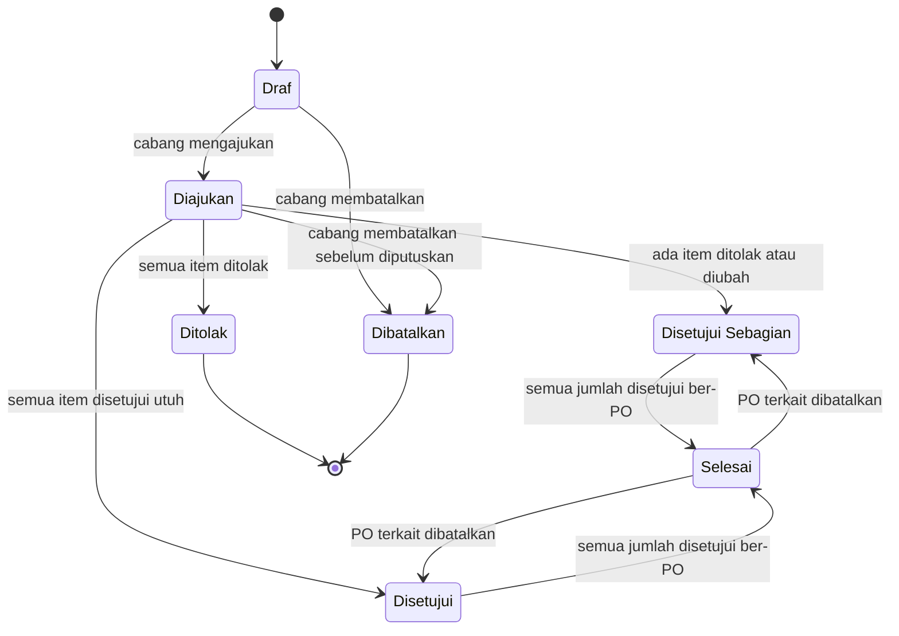
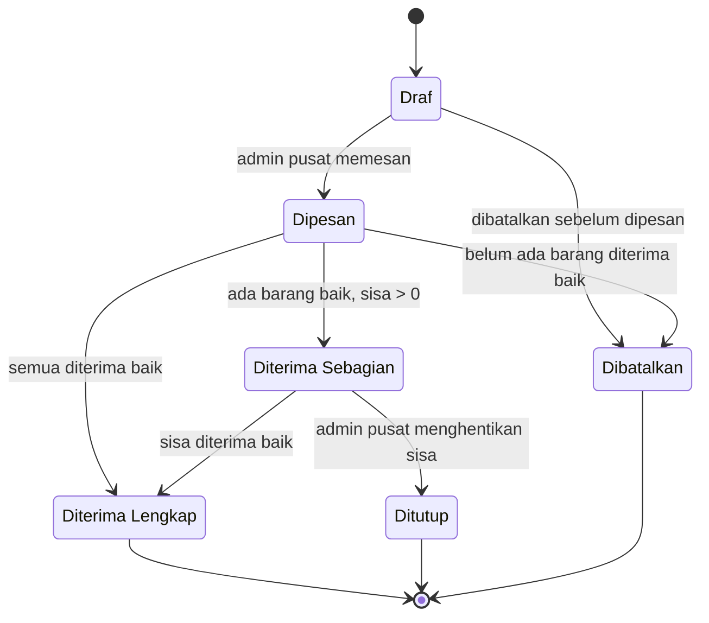
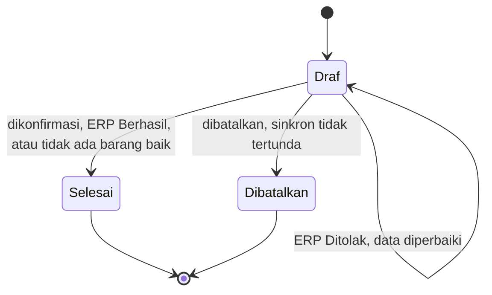
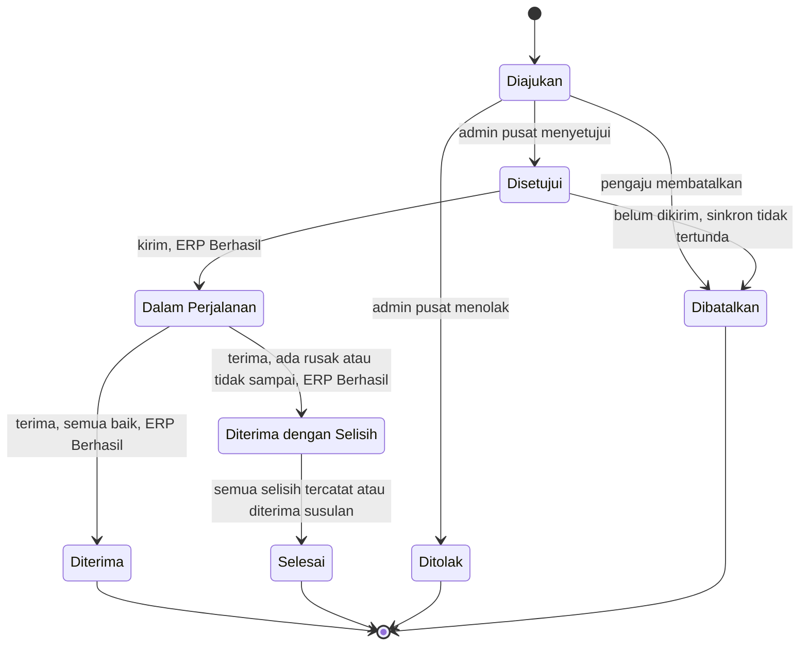

# Tahap 3 — Perancangan Fitur SCM Toko Asri

> Modul: Supply Chain Management (SCM) · Proyek SaaS Toko Asri (ERP · SCM · CRM)
> Penanggung jawab SCM: Naurah · Versi: **0.2** · Tanggal: 10 November 2026 · Status: **Draf revisi, menunggu persetujuan**

Dokumen ini menguraikan 12 fitur SCM menjadi spesifikasi fungsional. Dasarnya adalah keputusan Tahap 1 (analisis kebutuhan) dan Tahap 2 (proses bisnis As-Is/To-Be). Versi 0.2 adalah hasil audit kritis terhadap versi 0.1. Ringkasan perubahannya ada di [bagian 8](#8-catatan-perubahan).

Dokumen ini **tidak** memuat rancangan database, API, desain antarmuka, atau kode.

---

## Daftar Isi

1. [Konvensi Dokumen](#1-konvensi-dokumen)
2. [Batas Modul dan Konsistensi dengan ERP](#2-batas-modul-dan-konsistensi-dengan-erp)
3. [Peran dan Hak Akses](#3-peran-dan-hak-akses)
4. [Spesifikasi Fitur](#4-spesifikasi-fitur)
   - [F01 Supplier Management](#f01--supplier-management)
   - [F02 Purchase Request](#f02--purchase-request-pr)
   - [F03 Approval Purchase Request](#f03--approval-purchase-request)
   - [F04 Purchase Order](#f04--purchase-order-po)
   - [F05 Goods Receiving](#f05--goods-receiving)
   - [F06 Pencatatan Batch dan Tanggal Kedaluwarsa](#f06--pencatatan-batch-dan-tanggal-kedaluwarsa)
   - [F07 Stock Transfer Antarcabang](#f07--stock-transfer-antarcabang)
   - [F08 Slow-Moving Stock Monitoring](#f08--slow-moving-stock-monitoring)
   - [F09 Expiry Monitoring dan FEFO](#f09--expiry-monitoring-dan-fefo)
   - [F10 Replenishment Recommendation](#f10--replenishment-recommendation)
   - [F11 Notification](#f11--notification)
   - [F12 Activity Log](#f12--activity-log)
5. [Prioritas MVP dan Pengembangan Lanjutan](#5-prioritas-mvp-dan-pengembangan-lanjutan)
6. [Daftar Konfirmasi Terbuka](#6-daftar-konfirmasi-terbuka)
7. [Evaluasi Kritis](#7-evaluasi-kritis)
8. [Catatan Perubahan](#8-catatan-perubahan)
9. [Keputusan yang Harus Dibahas](#9-keputusan-yang-harus-dibahas)

---

## 1. Konvensi Dokumen

### 1.1 Label sumber

| Label | Arti |
| --- | --- |
| **[FAKTA] Wn** | Fakta wawancara mitra (W1–W16, lihat Tahap 1). Tidak diubah. |
| **ASUMSI SEMENTARA** | Rancangan awal yang belum disepakati tim atau mitra. |
| **[REKOMENDASI]** | Rekomendasi analis. Boleh ditolak tim atau mitra. |
| **KONFIRMASI** | Informasi yang belum tersedia. Tidak diisi dengan tebakan. |

### 1.2 Kode rujukan

- **W1–W16**: fakta wawancara (Tahap 1).
- **BR-01 s.d. BR-18**: business rules global (Tahap 1). Aturan baru di dokumen ini memakai kode per fitur, misalnya `BR-F02-01`.
- **AS-1 s.d. AS-10**: asumsi sementara (Tahap 2).
- **PK-1 s.d. PK-9**: prinsip konsistensi dengan ERP (bagian 2.2).
- **K-xx**: butir konfirmasi terbuka (bagian 6).
- **AC-Fxx-nn**: acceptance criteria. Ditulis dengan pola *Diberikan – Ketika – Maka*. Kolom **Menguji** menunjukkan aturan yang dibuktikan oleh kriteria itu, agar langsung bisa menjadi test case di Tahap 9.

### 1.3 Istilah

| Istilah | Definisi |
| --- | --- |
| Stok tersedia | Jumlah stok produk di satu cabang menurut ERP. SCM tidak menghitung stok sendiri. |
| Stok layak jual | Stok tersedia tanpa batch yang sudah kedaluwarsa. Apakah ERP menyediakan angka ini masih **KONFIRMASI** (K-16). |
| Jumlah diterima baik | Barang yang lolos pemeriksaan saat penerimaan dan masuk stok. |
| Jumlah ditolak | Barang yang datang tetapi tidak diterima masuk stok karena rusak atau tidak sesuai. |
| Sisa PO | Jumlah dipesan − jumlah diterima baik, per item PO, selama PO berstatus Dipesan atau Diterima Sebagian. Untuk PO Draf, Ditutup, dan Dibatalkan, sisa PO yang dihitung = 0. **Jumlah ditolak tidak mengurangi sisa PO.** |
| Posisi stok | Stok layak jual + sisa PO berjalan + transfer masuk berstatus Dalam Perjalanan. Dipakai F10. |
| Kejadian stok | Data yang dikirim SCM ke ERP dan mengubah stok: barang masuk atau barang keluar. |
| Kunci kejadian | Identitas unik satu kejadian stok: nomor dokumen + langkah. Lihat bagian 2.2. |
| Batch | Kelompok barang dengan produk, nomor batch, dan tanggal kedaluwarsa yang sama. Saldonya disimpan ERP per cabang. |
| FEFO | *First Expired, First Out*: batch dengan tanggal kedaluwarsa terdekat dikeluarkan lebih dulu. |
| Admin pusat | Pemegang keputusan pengadaan dan transfer ([FAKTA] W7). |
| Kantor | Penyetuju selisih stok ([FAKTA] W15). Prosesnya ada di ERP. |

### 1.4 Penomoran dokumen [REKOMENDASI]

| Dokumen | Format | Contoh |
| --- | --- | --- |
| Purchase Request | `PR-YYYYMM-NNNN` | PR-202611-0001 |
| Purchase Order | `PO-YYYYMM-NNNN` | PO-202611-0001 |
| Penerimaan barang | `GR-YYYYMM-NNNN` | GR-202611-0001 |
| Transfer stok | `TR-YYYYMM-NNNN` | TR-202611-0001 |
| Batch internal | `INT-<nomor GR>-<urut 2 digit>` | INT-GR-202611-0007-01 |

Nomor dibuat sistem, unik, dan tidak dapat diubah.

### 1.5 Ringkasan status semua dokumen

Status bisnis dan status sinkron ERP dipisahkan. Status bisnis menjawab "dokumen ini sampai tahap mana". Status sinkron menjawab "apakah kejadian stoknya sudah tercatat di ERP".

| Dokumen | Status bisnis | Tanda tambahan (bukan status) |
| --- | --- | --- |
| Supplier | Aktif, Nonaktif | — |
| Purchase Request | Draf, Diajukan, Disetujui, Disetujui Sebagian, Ditolak, Dibatalkan, Selesai | — |
| Purchase Order | Draf, Dipesan, Diterima Sebagian, Diterima Lengkap, Ditutup, Dibatalkan | Terlambat; Ada penolakan; Status sinkron data PO |
| Penerimaan barang | Draf, Selesai, Dibatalkan | Status sinkron ERP |
| Transfer stok | Diajukan, Disetujui, Ditolak, Dibatalkan, Dalam Perjalanan, Diterima, Diterima dengan Selisih, Selesai | Status sinkron ERP per langkah |
| Notifikasi | Belum dibaca, Sudah dibaca | — |
| Baris slow moving | Perlu ditinjau, Ditinjau, Diajukan transfer | — |
| Baris rekomendasi | Perlu tindakan, PR dibuat | — |
| Batch (monitoring) | Kategori dihitung: Aman, Perlu Perhatian, Segera Ditindak, Kedaluwarsa | Didahulukan |

**Status sinkron ERP** dipakai untuk setiap kiriman ke ERP:

| Nilai | Arti | Dokumen boleh diubah? |
| --- | --- | --- |
| Menunggu ERP | Sudah dikirim, jawaban belum diterima | Tidak. Terkunci |
| Gagal terhubung | Tidak ada jawaban atau koneksi gagal. Belum pasti ERP sudah memproses atau belum | Tidak. Hanya **Kirim ulang** dengan kunci yang sama |
| Ditolak ERP | ERP menjawab menolak data. Pasti tidak ada perubahan stok | Ya. Dokumen kembali ke langkah sebelumnya untuk diperbaiki |
| Berhasil | ERP sudah mencatat | Mengikuti status bisnis |

---

## 2. Batas Modul dan Konsistensi dengan ERP

### 2.1 Pemilik data

Prinsipnya: **SCM memiliki dokumen rantai pasok, ERP memiliki stok, CRM memiliki pelanggan.** Setiap data punya satu pemilik. Modul lain hanya membaca atau mengirim kejadian.

| Data / fungsi | Pemilik | Peran SCM | Peran ERP | Peran CRM | Status |
| --- | --- | --- | --- | --- | --- |
| Produk, satuan, kategori | ERP | Membaca | Mengelola | Membaca | Asumsi integrasi |
| Cabang | ERP / integrasi | Membaca | Mengelola | Membaca | Asumsi integrasi |
| Pengguna, login, peran | Integrasi | Membaca peran | Membaca peran | Membaca peran | AS-7 |
| Supplier dan produk yang dipasok | **SCM** | Mengelola | Membaca (pencatatan pembelian) | — | **K-01** |
| PR, PO, penerimaan, transfer | **SCM** | Mengelola | Menerima data PO dan kejadian stok | — | Tahap 2 |
| Stok per produk per cabang | ERP | Membaca | Mengelola | Membaca | Asumsi ERP |
| Batch dan saldo per batch per cabang | ERP | Menangkap data batch saat penerimaan dan transfer; membaca untuk monitoring | Menyimpan, mengurangi saat penjualan | — | AS-1 |
| Stock movement | ERP | Memicu lewat kejadian stok | Mencatat | — | Tahap 2 |
| Penjualan | ERP | Membaca (laju jual) | Mengelola | Meneruskan pesanan ke ERP | Asumsi ERP/CRM |
| Pemblokiran penjualan batch kedaluwarsa | ERP | — | Mengelola | Mengikuti ERP | **K-16** |
| Stock opname, penyesuaian stok, pengeluaran barang kedaluwarsa/rusak | ERP | Memberi tanda dan tautan dari monitoring | Mengelola, termasuk persetujuan kantor | — | Tahap 2 |
| Stok minimum dan stok target per produk per cabang | **SCM** | Mengelola (parameter F10) | — | — | **K-02** |
| Parameter slow moving dan kedaluwarsa | **SCM** | Mengelola | — | — | Tahap 2 |
| Hutang dan pembayaran supplier | ERP | Mengirim data PO dan hasil penerimaan | Mengelola | — | **K-15** |
| Notifikasi | Layanan bersama [REKOMENDASI] | Mengirim kejadian SCM | Mengirim kejadian ERP | Mengirim kejadian CRM | **K-03** |
| Audit / activity log | Layanan bersama [REKOMENDASI] | Mencatat aksi SCM | Mencatat aksi ERP | Mencatat aksi CRM | **K-04** |
| Permintaan produk dari pelanggan | CRM | Membaca sebagai sinyal (Could) | — | Mengelola | AS-6 |

**Hal yang sengaja tidak dibuat SCM:** tabel produk, tabel cabang, tabel pengguna, tabel stok, tabel saldo batch, pencatatan penjualan, pemblokiran penjualan, stock opname, penyesuaian stok, dan pencatatan keuangan pembelian.

### 2.2 Prinsip konsistensi dengan ERP (kebutuhan untuk Tahap 4)

Bagian ini **bukan** rancangan API atau database. Isinya adalah syarat yang harus dipenuhi apa pun mekanisme integrasi yang dipilih di Tahap 4.

**Kejadian stok yang dikirim SCM**

| Dokumen | Langkah | Kejadian | Kunci kejadian | Arah |
| --- | --- | --- | --- | --- |
| Penerimaan barang | Konfirmasi | Barang masuk per batch | `GR-…` | + cabang tujuan PO |
| Transfer | Kirim | Barang keluar per batch | `TR-…-KIRIM` | − cabang asal |
| Transfer | Terima | Barang masuk per batch | `TR-…-TERIMA` | + cabang tujuan |
| Transfer | Terima susulan ke-n | Barang masuk per batch | `TR-…-SUSULAN-n` | + cabang tujuan |

Data PO juga dikirim ke ERP, tetapi tidak mengubah stok. Kuncinya nomor PO.

**Kemungkinan kegagalan komunikasi**

| No | Kejadian | Akibat bila tidak diatur | Perilaku yang disyaratkan |
| --- | --- | --- | --- |
| 1 | Kiriman SCM tidak sampai ke ERP | Pengguna mengira stok sudah berubah | Status sinkron Gagal terhubung; dokumen terkunci; kirim ulang dengan kunci sama |
| 2 | ERP sudah memproses, tetapi jawabannya tidak sampai ke SCM | Kirim ulang menambah atau mengurangi stok dua kali | ERP mengenali kunci yang sama dan menjawab "sudah diproses" tanpa mengubah stok lagi; SCM menandai Berhasil |
| 3 | ERP menolak data (produk nonaktif, stok asal tidak cukup) | Data setengah jadi | Status Ditolak ERP; pasti tidak ada perubahan stok; dokumen dapat diperbaiki |
| 4 | ERP hanya memproses sebagian item | Stok tidak sesuai dokumen | Tidak boleh terjadi. Satu kejadian diproses seluruhnya atau tidak sama sekali |
| 5 | ERP berhasil, tetapi SCM gagal menyimpan status dokumen | SCM menampilkan status lama | Saat dokumen dibuka atau saat pengecekan berkala, SCM menanyakan status kunci ke ERP dan menyesuaikan |
| 6 | Kunci yang sama dikirim dengan isi berbeda | Data salah diterima sebagai ulangan | ERP menolak sebagai konflik |
| 7 | Dua pengguna mengonfirmasi langkah yang sama bersamaan | Dua kejadian untuk satu langkah | Hanya satu kejadian per langkah; konfirmasi kedua ditolak SCM |
| 8 | Dokumen dibatalkan saat kirimannya belum pasti | Stok sudah berubah tetapi dokumen batal | Dokumen terkunci selama Menunggu ERP atau Gagal terhubung |

**Prinsip konsistensi**

| Kode | Prinsip |
| --- | --- |
| PK-1 | Satu kejadian stok = satu kunci unik = nomor dokumen + langkah |
| PK-2 | Kirim ulang selalu memakai kunci yang sama. Kunci baru tidak pernah dibuat untuk mengulang |
| PK-3 | ERP menyimpan kunci yang sudah diproses dan tidak memproses kunci yang sama dua kali (**idempotency**) |
| PK-4 | Satu kejadian diproses semua-atau-tidak sama sekali (**atomicity**) |
| PK-5 | Status bisnis dokumen SCM baru berubah setelah ERP menjawab Berhasil |
| PK-6 | Selama status sinkron Menunggu ERP atau Gagal terhubung, dokumen tidak dapat diubah, dibatalkan, atau dilanjutkan |
| PK-7 | Ada daftar dokumen dengan sinkron tertunda untuk admin pusat, dan pengecekan berkala ke ERP [REKOMENDASI] |
| PK-8 | SCM tidak menulis langsung ke data stok ERP, meskipun database terpusat |
| PK-9 | ERP menolak kejadian yang membuat stok negatif (BR-18) |

Jika Tahap 4 memilih satu transaksi database bersama antara SCM dan ERP, kegagalan no. 1, 2, dan 5 hampir hilang dan status sinkron bisa disederhanakan. PK-1 tetap disarankan karena kunci itu juga menjadi jejak audit. Kemampuan ERP memenuhi PK-3, PK-4, dan PK-9 masih **KONFIRMASI** (AS-3, K-20).

---

## 3. Peran dan Hak Akses

Peran mengikuti sistem login bersama (AS-7). Satu pengguna boleh memiliki lebih dari satu peran.

| Aksi | Admin pusat | Admin cabang | Petugas penerimaan | Kantor |
| --- | :---: | :---: | :---: | :---: |
| Kelola supplier | ✓ | Lihat | — | — |
| Buat dan ajukan PR | ✓ [REKOMENDASI] | ✓ (cabang sendiri) | — | — |
| Setujui / tolak PR | ✓ | — | — | — |
| Buat dan kelola PO, termasuk tutup dan batal | ✓ | Lihat PO cabangnya | Lihat PO cabangnya | — |
| Catat penerimaan barang | ✓ | ✓ (cabang sendiri) | ✓ (cabang sendiri) | — |
| Kirim ulang kejadian ke ERP | ✓ | ✓ (dokumen cabangnya) | ✓ (dokumen yang ia catat) | — |
| Ajukan transfer | ✓ | ✓ (sebagai asal atau tujuan) | — | — |
| Setujui transfer, nyatakan barang hilang | ✓ | — | — | — |
| Kirim / terima transfer, catat terima susulan | — | ✓ (cabang sendiri) | ✓ (cabang sendiri) | — |
| Atur parameter (stok minimum/target, slow moving, kedaluwarsa) | ✓ | — | — | — |
| Lihat monitoring slow moving | ✓ semua cabang | — [REKOMENDASI] | — | — |
| Lihat monitoring kedaluwarsa | ✓ semua cabang | ✓ (cabang sendiri) | ✓ (cabang sendiri) | — |
| Lihat rekomendasi pengadaan | ✓ semua cabang | ✓ (cabang sendiri) | — | — |
| Lihat activity log | ✓ semua cabang | ✓ (cabang sendiri) | — | — |
| Setujui penyesuaian stok | — | — | — | ✓ (di ERP) |

Catatan:

- Peran **Kantor** tidak punya aksi di SCM karena penyesuaian stok ada di ERP. Kantor sama atau tidak dengan admin pusat masih **KONFIRMASI** (A3 Tahap 1).
- Peran **Petugas penerimaan** mungkin dirangkap staf toko (A2 Tahap 1). Peran tetap dipisah agar hak aksesnya bisa diatur.
- Semua pembatasan "cabang sendiri" dicek di backend, bukan hanya disembunyikan di tampilan (BR-17).

---

## 4. Spesifikasi Fitur

Setiap fitur ditulis dengan struktur yang sama: ringkasan, kondisi awal, alur utama, alur alternatif, input, output, status, business rules, hubungan ERP/CRM, acceptance criteria, dan butir konfirmasi.

---

### F01 — Supplier Management

| Atribut | Isi |
| --- | --- |
| Tujuan | Menyediakan satu daftar supplier dan produk yang dipasok sebagai dasar pembuatan PO |
| Masalah yang dijawab | Pembelian melalui supplier ([FAKTA] W6) belum terdokumentasi di sistem |
| Aktor | Admin pusat (kelola); admin cabang (lihat) |
| Prioritas | **Must** (data dasar dan produk dipasok); Could (evaluasi performa) |
| Dasar | [FAKTA] W6; FR-SUP-01 s.d. FR-SUP-04; US-01, US-02 |

**Kondisi awal**

- Pengguna sudah login dengan peran admin pusat.
- Data produk tersedia dari ERP.

**Alur utama — tambah supplier**

1. Admin pusat membuka daftar supplier dan memilih **Tambah Supplier**.
2. Admin mengisi data supplier dan lead time default.
3. Admin menambahkan produk yang dipasok dengan memilih produk dari ERP.
4. Sistem memvalidasi data.
5. Sistem menyimpan supplier berstatus **Aktif** dan mencatat activity log.

**Alur alternatif**

| Kode | Kondisi | Perilaku |
| --- | --- | --- |
| A1 | Nama supplier sama dengan supplier aktif lain | Sistem memberi peringatan; admin boleh tetap menyimpan |
| A2 | Admin mengubah data supplier | Perubahan tersimpan; nilai lama dan baru tercatat di activity log |
| A3 | Admin menonaktifkan supplier | Supplier tidak bisa dipilih di PO baru. PO yang sudah berjalan tetap bisa diterima |
| A4 | Admin mencoba menghapus supplier yang punya riwayat PO | Ditolak. Sistem menawarkan **Nonaktifkan** (BR-14) |
| A5 | Admin menghapus supplier tanpa riwayat PO | Diizinkan [REKOMENDASI] |
| A6 | Admin mengaktifkan kembali supplier nonaktif | Diizinkan dan tercatat |

**Input**

| Field | Wajib | Validasi |
| --- | :---: | --- |
| Nama supplier | ✓ | 3–100 karakter |
| Nama kontak | — | maks. 100 karakter |
| Nomor telepon | ✓ | Angka, `+`, spasi, atau `-`; 8–20 karakter |
| Email | — | Format email |
| Alamat | — | maks. 255 karakter |
| Lead time default (hari) | — | Bilangan bulat 0–30. Kosong = memakai default 3 hari (BR-16) |
| Catatan | — | maks. 500 karakter |
| Produk dipasok (daftar) | — | Produk harus aktif di ERP; satu produk tidak boleh dua kali untuk supplier yang sama |

**Output**

- Data supplier dan daftar produk yang dipasok.
- **Harga beli terakhir** per produk–supplier, dihitung otomatis (BR-F01-02). Tidak diinput manual.
- Halaman detail supplier: data kontak, produk dipasok, riwayat PO (nomor, tanggal, status, total).
- Ringkasan performa (Could), dihitung dari data F04 dan F05:
  - ketepatan waktu = PO yang penerimaan pertamanya ≤ estimasi kedatangan ÷ PO yang sudah menerima barang;
  - kesesuaian jumlah = total diterima baik ÷ total dipesan, untuk PO yang sudah selesai (Diterima Lengkap atau Ditutup);
  - persentase ditolak = total ditolak ÷ (total diterima baik + total ditolak).

**Status:** `Aktif` ↔ `Nonaktif`

**Business rules**

| Kode | Aturan |
| --- | --- |
| BR-14 | Supplier yang punya riwayat PO hanya dapat dinonaktifkan |
| BR-F01-01 | Hanya supplier aktif yang muncul saat membuat PO |
| BR-F01-02 | Harga beli terakhir = harga pada PO terbaru (menurut tanggal pemesanan) untuk produk dan supplier itu, yang statusnya Dipesan, Diterima Sebagian, Diterima Lengkap, atau Ditutup. PO Draf dan Dibatalkan tidak pernah dipakai. Nilai dihitung, bukan ditimpa, sehingga pembatalan PO otomatis tidak memengaruhi harga terakhir |
| BR-F01-03 | Satu produk boleh dipasok lebih dari satu supplier (**KONFIRMASI** K-05) |

**Hubungan ERP/CRM**

- ERP: SCM membaca produk dari ERP. ERP membaca data supplier untuk pencatatan pembelian (K-01).
- CRM: tidak ada.

**Acceptance criteria**

| Kode | Kriteria | Menguji |
| --- | --- | --- |
| AC-F01-01 | Diberikan admin pusat login, ketika mengisi nama dan telepon yang valid lalu menyimpan, maka supplier muncul dengan status Aktif | Alur utama |
| AC-F01-02 | Diberikan supplier punya riwayat PO, ketika admin memilih hapus, maka sistem menolak dan menawarkan nonaktifkan | BR-14 |
| AC-F01-03 | Diberikan supplier nonaktif, ketika admin membuat PO baru, maka supplier itu tidak ada di pilihan | BR-F01-01 |
| AC-F01-04 | Diberikan admin cabang login, ketika memanggil aksi tambah atau ubah supplier, maka ditolak (403) | Hak akses |
| AC-F01-05 | Diberikan lead time default dikosongkan, ketika supplier dipakai di PO, maka estimasi kedatangan memakai 3 hari | BR-16 |
| AC-F01-06 | Diberikan PO lama Dipesan dengan harga 10.000 lalu PO baru Draf dengan harga 12.000, maka harga terakhir tetap 10.000 | BR-F01-02 |
| AC-F01-07 | Diberikan PO terbaru Dipesan dengan harga 12.000 kemudian dibatalkan, maka harga terakhir kembali ke harga PO sah sebelumnya | BR-F01-02 |

**Perlu konfirmasi:** K-01, K-05.

---

### F02 — Purchase Request (PR)

| Atribut | Isi |
| --- | --- |
| Tujuan | Mengganti laporan stok habis harian dengan pengajuan resmi yang bisa dibuat sebelum stok habis |
| Masalah yang dijawab | P5, P6: laporan dibuat setelah stok habis, lalu barang datang 1–3 hari kemudian |
| Aktor | Admin cabang (utama); admin pusat [REKOMENDASI] |
| Prioritas | **Must** |
| Dasar | [FAKTA] W7, W8, W9, W10; FR-PR-01, FR-PR-02, FR-PR-04; US-03, US-04 |

**Kondisi awal**

- Pengguna login sebagai admin cabang dan terhubung ke satu cabang.
- Produk aktif tersedia dari ERP.

**Alur utama**

1. Admin cabang memilih **Buat PR**. Cabang terisi otomatis dari akun.
2. Admin menambah item: memilih produk, mengisi jumlah, dan memilih alasan PR.
3. Untuk setiap item, sistem menampilkan stok tersedia, stok minimum, sisa PO berjalan, dan PR lain yang masih menunggu untuk produk yang sama.
4. Admin menyimpan sebagai **Draf** atau langsung **Ajukan**.
5. Saat diajukan, sistem memvalidasi, mengubah status menjadi **Diajukan**, mengirim notifikasi ke admin pusat (F11), dan mencatat activity log (F12).

**Alur alternatif**

| Kode | Kondisi | Perilaku |
| --- | --- | --- |
| A1 | PR dibuat dari rekomendasi (F10) | Item dan jumlah terisi dari rekomendasi; admin masih bisa mengubah sebelum mengajukan |
| A2 | Produk yang sama masih ada di PR berstatus Diajukan untuk cabang yang sama | Sistem memberi peringatan beserta nomor PR itu, tetapi tidak memblokir |
| A3 | Admin cabang membatalkan PR berstatus Draf atau Diajukan | Status menjadi Dibatalkan; jika sudah Diajukan, admin pusat mendapat notifikasi |
| A4 | Admin cabang mengubah PR berstatus Diajukan | Tidak diizinkan. Admin harus membatalkan lalu membuat PR baru [REKOMENDASI] |
| A5 | Admin pusat membuat PR untuk suatu cabang | Diizinkan [REKOMENDASI]; cabang dipilih manual. Ini jalur untuk pembelian atas inisiatif admin pusat (lihat F04, evaluasi PO tanpa PR) |
| A6 | Validasi gagal | Pesan kesalahan tampil per field; status tidak berubah |
| A7 | PO yang memuat item PR ini dibatalkan | Item kembali tersedia; PR berstatus Selesai kembali menjadi Disetujui atau Disetujui Sebagian (BR-F02-03) |

**Input**

| Field | Wajib | Validasi |
| --- | :---: | --- |
| Cabang | ✓ | Otomatis dari akun admin cabang; harus cabang aktif |
| Item: produk | ✓ | Produk aktif di ERP; tidak boleh ganda dalam satu PR |
| Item: jumlah | ✓ | > 0, dalam satuan produk ERP (format bilangan: **KONFIRMASI** K-06) |
| Alasan | ✓ | Pilihan: *Stok menipis*, *Stok habis*, *Permintaan pelanggan*, *Lainnya*; *Lainnya* wajib keterangan |
| Catatan | — | maks. 500 karakter |
| Jumlah item | ✓ | Minimal 1 item |

**Output**

- Dokumen PR dengan nomor, cabang, pembuat, tanggal, item, dan status.
- Per item: jumlah diminta, jumlah disetujui, jumlah sudah ber-PO, sisa belum ber-PO.
- Daftar dan riwayat PR yang dapat difilter berdasarkan status, tanggal, dan produk.

**Status**

| Status | Masuk ketika | Aksi yang tersedia |
| --- | --- | --- |
| Draf | Disimpan tanpa diajukan | Ubah, ajukan, batalkan |
| Diajukan | Diajukan oleh pembuat | Diputuskan (F03), batalkan oleh pembuat |
| Disetujui | Semua item disetujui dengan jumlah sama dengan permintaan | Dijadikan PO (F04) |
| Disetujui Sebagian | Minimal satu item disetujui, dan ada item yang ditolak atau jumlahnya diubah | Dijadikan PO (F04) |
| Ditolak | Semua item ditolak | — (status akhir) |
| Dibatalkan | Dibatalkan sebelum diputuskan | — (status akhir) |
| Selesai | Semua jumlah yang disetujui sudah masuk PO yang tidak dibatalkan | Kembali ke Disetujui / Disetujui Sebagian bila PO terkait dibatalkan |



> Perubahan dari Tahap 2: Selesai tidak lagi status akhir mutlak. Alasannya, jika PO dibatalkan karena supplier tidak bisa memenuhi, admin pusat perlu memesan item yang sama ke supplier lain tanpa meminta cabang membuat PR ulang. PO yang **Ditutup** tidak membuka kembali PR; jika barang masih dibutuhkan, cabang membuat PR baru.

**Business rules**

| Kode | Aturan |
| --- | --- |
| BR-02 | Cabang tidak dapat memesan langsung ke supplier |
| BR-17 | Admin cabang hanya dapat membuat dan melihat PR cabangnya |
| BR-F02-01 | PR yang sudah Diajukan tidak dapat diubah isinya |
| BR-F02-02 | Alasan wajib diisi |
| BR-F02-03 | PR Selesai kembali ke Disetujui / Disetujui Sebagian hanya bila PO terkait Dibatalkan, bukan bila Ditutup |
| BR-F02-04 | PR tidak mengubah stok |

**Hubungan ERP/CRM**

- ERP: membaca produk, satuan, dan stok tersedia.
- CRM: alasan *Permintaan pelanggan* dicatat sebagai teks. Sinyal otomatis dari CRM adalah Could (lihat F10).

**Acceptance criteria**

| Kode | Kriteria | Menguji |
| --- | --- | --- |
| AC-F02-01 | Diberikan admin cabang A login, ketika membuat PR satu produk, jumlah 10, alasan *Stok menipis* lalu mengajukan, maka PR berstatus Diajukan dengan cabang A dan admin pusat menerima notifikasi | Alur utama |
| AC-F02-02 | Diberikan PR tanpa item atau dengan jumlah 0, ketika diajukan, maka ditolak dengan pesan per field | Validasi |
| AC-F02-03 | Diberikan PR tanpa alasan, ketika diajukan, maka ditolak | BR-F02-02 |
| AC-F02-04 | Diberikan admin cabang A login, ketika membuka PR cabang B lewat URL langsung, maka akses ditolak | BR-17 |
| AC-F02-05 | Diberikan PR berstatus Diajukan, ketika pembuat mencoba mengubah jumlah, maka ditolak | BR-F02-01 |
| AC-F02-06 | Diberikan masih ada PR Diajukan untuk produk X di cabang A, ketika membuat PR baru berisi produk X, maka muncul peringatan berisi nomor PR sebelumnya dan pengajuan tetap bisa dilakukan | A2 |
| AC-F02-07 | Diberikan PR Selesai dengan satu PO, ketika PO itu dibatalkan, maka PR kembali Disetujui dan itemnya tersedia untuk PO baru | BR-F02-03 |
| AC-F02-08 | Diberikan PR Selesai dengan satu PO, ketika PO itu ditutup, maka PR tetap Selesai | BR-F02-03 |
| AC-F02-09 | Diberikan PR dibuat dan diajukan, maka stok di ERP tidak berubah | BR-F02-04 |

**Perlu konfirmasi:** K-06, K-07.

---

### F03 — Approval Purchase Request

| Atribut | Isi |
| --- | --- |
| Tujuan | Memastikan keputusan pembelian tetap di admin pusat, dengan data pendukung yang lengkap |
| Masalah yang dijawab | P6: admin memutuskan dari laporan manual tanpa data stok dan pesanan berjalan |
| Aktor | Admin pusat |
| Prioritas | **Must** |
| Dasar | [FAKTA] W7; FR-PR-03; US-05; BR-01 |

**Kondisi awal**

- Ada PR berstatus **Diajukan**.
- Pengguna login sebagai admin pusat.

**Alur utama**

1. Admin pusat membuka daftar **PR Menunggu Persetujuan**, diurutkan dari yang paling lama diajukan.
2. Admin membuka satu PR. Per item, sistem menampilkan stok tersedia di cabang pengaju, stok minimum, posisi stok, sisa PO berjalan ke cabang itu, dan rekomendasi F10 bila ada.
3. Admin memutuskan per item: **Setujui**, **Ubah jumlah**, atau **Tolak item**.
4. Admin mengisi catatan keputusan, lalu menyimpan.
5. Sistem menentukan status PR sesuai tabel status F02.
6. Sistem mengirim notifikasi ke pembuat PR dan mencatat activity log berisi keputusan per item.

**Alur alternatif**

| Kode | Kondisi | Perilaku |
| --- | --- | --- |
| A1 | Admin menolak seluruh PR | Alasan penolakan wajib; status Ditolak |
| A2 | Admin menyetujui seluruh PR tanpa perubahan | Tersedia tombol **Setujui Semua** |
| A3 | PR dibatalkan pembuat saat admin sedang meninjau | Keputusan ditolak sistem dengan pesan "PR sudah dibatalkan" |
| A4 | Dua admin pusat memutuskan PR yang sama bersamaan | Keputusan pertama yang tersimpan berlaku; keputusan kedua ditolak |
| A5 | Admin pusat ingin mengubah keputusan yang sudah tersimpan | Tidak diizinkan di MVP. Jika item belum masuk PO, admin dapat membuat PR baru [REKOMENDASI] |
| A6 | Admin pusat menyetujui PR yang ia buat sendiri (F02-A5) | Diizinkan karena hanya ada satu tingkat persetujuan; tercatat di activity log [REKOMENDASI] |

**Input**

| Field | Wajib | Validasi |
| --- | :---: | --- |
| Keputusan per item | ✓ | Setujui / Ubah jumlah / Tolak |
| Jumlah disetujui | ✓ jika diubah | > 0; boleh lebih besar atau lebih kecil dari permintaan [REKOMENDASI] |
| Alasan penolakan atau perubahan | ✓ jika ditolak/diubah | 5–500 karakter |
| Catatan keputusan | — | maks. 500 karakter |

**Output**

- Status PR terbaru dan keputusan per item (jumlah diminta, jumlah disetujui, alasan).
- Item yang disetujui tersedia untuk dibuat PO di F04.

**Status:** mengubah PR dari `Diajukan` menjadi `Disetujui`, `Disetujui Sebagian`, atau `Ditolak`.

**Business rules**

| Kode | Aturan |
| --- | --- |
| BR-01 | Hanya admin pusat yang dapat menyetujui atau menolak PR |
| BR-03 | Persetujuan PR tidak membuat PO secara otomatis |
| BR-F03-01 | Penolakan dan perubahan jumlah wajib alasan |
| BR-F03-02 | Satu tingkat persetujuan untuk MVP. Persetujuan bertingkat = Won't Have |
| BR-F03-03 | Keputusan yang sudah tersimpan bersifat final di MVP |

**Hubungan ERP/CRM**

- ERP: membaca stok tersedia sebagai bahan keputusan. Tidak ada data yang dikirim ke ERP pada tahap ini.
- CRM: tidak ada.

**Acceptance criteria**

| Kode | Kriteria | Menguji |
| --- | --- | --- |
| AC-F03-01 | Diberikan PR Diajukan dua item, ketika admin pusat menyetujui keduanya tanpa perubahan, maka PR Disetujui dan pembuat mendapat notifikasi | Alur utama |
| AC-F03-02 | Diberikan PR Diajukan dua item, ketika admin mengubah jumlah item pertama dengan alasan, maka PR Disetujui Sebagian | Status F02 |
| AC-F03-03 | Diberikan admin menolak atau mengubah item tanpa alasan, ketika menyimpan, maka ditolak sistem | BR-F03-01 |
| AC-F03-04 | Diberikan pengguna berperan admin cabang, ketika memanggil aksi setujui PR, maka ditolak (403) dan status PR tidak berubah | BR-01 |
| AC-F03-05 | Diberikan PR disetujui, maka tidak ada PO yang terbentuk otomatis | BR-03 |
| AC-F03-06 | Diberikan keputusan tersimpan, ketika admin mencoba mengubahnya, maka ditolak | BR-F03-03 |
| AC-F03-07 | Diberikan dua admin pusat menyimpan keputusan PR yang sama bersamaan, maka hanya keputusan pertama yang berlaku | A4 |

**Perlu konfirmasi:** K-07.

---

### F04 — Purchase Order (PO)

| Atribut | Isi |
| --- | --- |
| Tujuan | Mendokumentasikan pesanan ke supplier: barang, jumlah, harga, cabang tujuan, dan estimasi kedatangan |
| Masalah yang dijawab | P6: pesanan berjalan tidak terlihat; harga beli belum tercatat untuk ERP |
| Aktor | Admin pusat (kelola); admin cabang dan petugas penerimaan (lihat PO cabangnya) |
| Prioritas | **Must**; cetak/PDF PO = Should |
| Dasar | [FAKTA] W6, W7, W10; FR-PO-01 s.d. FR-PO-04; US-06, US-07 |

**Kondisi awal**

- Ada item PR berstatus Disetujui atau Disetujui Sebagian yang belum seluruhnya ber-PO.
- Ada supplier aktif yang terdaftar memasok produk tersebut.

**Alur utama**

1. Admin pusat memilih **Buat PO**.
2. Admin memilih **cabang tujuan** dan **supplier**.
3. Sistem menampilkan item PR yang disetujui untuk cabang itu dan dipasok supplier itu, beserta sisa jumlah yang belum ber-PO.
4. Admin memilih item dan jumlahnya, lalu mengisi harga beli per item. Harga beli terakhir (F01) menjadi isian awal.
5. Sistem mengisi **estimasi kedatangan** = tanggal pemesanan + lead time supplier (default 3 hari). Admin boleh mengubah.
6. Admin menyimpan sebagai **Draf** atau langsung **Pesan**.
7. Saat dipesan, sistem:
   - mengubah status PO menjadi **Dipesan**;
   - memperbarui jumlah ber-PO di PR terkait; PR menjadi **Selesai** bila semua jumlah yang disetujui sudah ber-PO;
   - mengirim data PO ke ERP untuk pencatatan pembelian;
   - mengirim notifikasi ke cabang tujuan dan mencatat activity log.
8. Admin menghubungi supplier di luar sistem (telepon/chat). Should: mencetak atau mengunduh PO sebagai PDF.

**Arti status PO.** Status PO dihitung dari jumlah **diterima baik**, bukan dari jumlah barang yang datang. Barang yang ditolak ditampilkan di kolom terpisah dan memberi tanda **Ada penolakan**.

| Status | Kondisi | Yang bukan artinya |
| --- | --- | --- |
| Draf | Belum dipesan | — |
| Dipesan | Sudah dipesan; total diterima baik = 0. Boleh sudah ada barang datang yang seluruhnya ditolak | Bukan berarti belum ada barang datang |
| Diterima Sebagian | Total diterima baik > 0 dan masih ada sisa PO | Bukan berarti supplier pasti mengirim sisanya |
| Diterima Lengkap | Sisa PO semua item = 0: seluruh jumlah dipesan sudah diterima **dalam kondisi baik** | Bukan sekadar "semua barang sudah datang" |
| Ditutup | Admin pusat menghentikan sisa PO setelah ada barang baik diterima. Alasan wajib | Bukan penerimaan lengkap |
| Dibatalkan | Admin pusat menghentikan PO sebelum ada barang baik diterima. Alasan wajib | — |



**Tindak lanjut barang ditolak.** Barang ditolak tidak mengurangi sisa PO (lihat F05). Sisa itu tetap terbuka sampai admin pusat memilih:

| Pilihan admin pusat | Akibat | Catatan |
| --- | --- | --- |
| Biarkan PO terbuka | Sisa tetap dihitung sebagai PO berjalan; penerimaan berikutnya dicatat seperti biasa | Dipakai bila supplier akan mengirim lagi. **Apakah supplier biasanya mengganti barang ditolak belum diketahui** (K-19); sistem tidak menganggapnya pasti |
| Tutup PO | Sisa tidak lagi dihitung; status Ditutup | Bila sudah ada barang baik diterima |
| Batalkan PO | Status Dibatalkan; item PR kembali tersedia | Bila belum ada barang baik diterima |

PO dengan tanda Ada penolakan muncul di daftar **PO Perlu Keputusan** milik admin pusat. Tujuannya agar sisa yang tidak akan dikirim tidak terus dihitung sebagai barang yang akan datang di F10.

**Evaluasi PO tanpa PR**

| Aspek | Penilaian |
| --- | --- |
| Dasar kebutuhan | Admin memutuskan pembelian ([FAKTA] W7) dan memantau stok lewat aplikasi sendiri ([FAKTA] W11). Jadi ada kemungkinan admin memesan atas inisiatif sendiri, tetapi wawancara tidak menyatakannya |
| Risiko bila diaktifkan | Pembelian tidak terhubung ke kebutuhan cabang; jejak "siapa meminta" hilang; ada dua jalur pengadaan untuk dipelihara |
| Jalur yang sudah ada | Admin pusat dapat membuat PR untuk suatu cabang (F02-A5) lalu menyetujuinya (F03-A6). Kebutuhan inisiatif admin terlayani tanpa melewati PR |
| Keputusan v0.2 | **PO tanpa PR tidak diaktifkan.** BR-04 tetap berlaku. Diputuskan ulang setelah mitra menjawab K-07 |

**Alur alternatif**

| Kode | Kondisi | Perilaku |
| --- | --- | --- |
| A1 | Item PR dipasok oleh supplier berbeda | Admin membuat beberapa PO, satu per supplier. Item PR boleh dipecah ke beberapa PO |
| A2 | Jumlah PO melebihi sisa jumlah PR yang disetujui dan belum ber-PO | Ditolak [REKOMENDASI] |
| A3 | Pengiriman data PO ke ERP gagal | PO tetap Dipesan dengan status sinkron Gagal terhubung; dapat dikirim ulang dengan kunci nomor PO. Stok tidak terpengaruh karena PO tidak mengubah stok |
| A4 | Hari ini melewati estimasi kedatangan dan PO masih Dipesan | Tanda **Terlambat** (bukan status) dan notifikasi ke admin pusat |
| A5 | Admin membatalkan PO yang belum menerima barang baik | Status Dibatalkan, alasan wajib. Item PR kembali tersedia (BR-F02-03). ERP menerima pembatalan |
| A6 | Admin menutup PO Diterima Sebagian | Status Ditutup, alasan wajib: *Supplier tidak dapat memenuhi sisa*, *Barang ditolak tidak diganti*, *Lainnya*. ERP menerima penutupan |
| A7 | Admin pusat ingin memesan tanpa PR | Tidak tersedia. Admin membuat PR atas nama cabang (F02-A5) |
| A8 | Admin mengubah PO berstatus Dipesan | Hanya estimasi kedatangan dan catatan yang bisa diubah; perubahan tercatat [REKOMENDASI] |
| A9 | Ada penerimaan yang status sinkronnya belum Berhasil | PO tidak dapat ditutup atau dibatalkan sampai sinkron selesai (PK-6) |

**Input**

| Field | Wajib | Validasi |
| --- | :---: | --- |
| Cabang tujuan | ✓ | Cabang aktif |
| Supplier | ✓ | Supplier aktif |
| Item: rujukan item PR | ✓ | Item PR Disetujui/Disetujui Sebagian milik cabang tujuan yang sama |
| Item: jumlah | ✓ | > 0 dan ≤ sisa jumlah PR yang disetujui dan belum ber-PO |
| Item: harga beli satuan | ✓ | ≥ 0, Rupiah |
| Tanggal pemesanan | ✓ | Otomatis tanggal hari ini saat dipesan |
| Estimasi kedatangan | ✓ | ≥ tanggal pemesanan |
| Alasan tutup / batal | ✓ saat tutup/batal | Pilihan dan keterangan 5–255 karakter |
| Catatan | — | maks. 500 karakter |

**Output**

- Dokumen PO dengan nomor, supplier, cabang tujuan, item, harga, total, estimasi kedatangan, dan status.
- Per item: jumlah dipesan, diterima baik, ditolak (kumulatif), dan sisa PO.
- Daftar PO dengan filter status, supplier, cabang, tanggal, tanda Terlambat, dan tanda Ada penolakan.

**Business rules**

| Kode | Aturan |
| --- | --- |
| BR-01, BR-02 | Hanya admin pusat yang membuat PO; cabang tidak memesan langsung |
| BR-04 | Setiap item PO merujuk item PR yang disetujui. PO tanpa PR tidak diaktifkan (K-07) |
| BR-16 | Estimasi default = tanggal pemesanan + lead time supplier; tanpa lead time = 3 hari |
| BR-F04-01 | Satu PO = satu supplier + satu cabang tujuan (AS-10) |
| BR-F04-02 | PO yang sudah menerima barang baik tidak dapat dibatalkan, hanya ditutup |
| BR-F04-03 | Harga beli tidak dapat diubah setelah PO Dipesan [REKOMENDASI] |
| BR-F04-04 | PO tidak mengubah stok |
| BR-F04-05 | Status PO dihitung dari jumlah diterima baik; jumlah ditolak tidak mengurangi sisa PO |
| BR-F04-06 | Sisa PO yang ditolak hanya berhenti dihitung lewat keputusan admin pusat (tutup atau batal), tidak otomatis |

**Hubungan ERP/CRM**

- ERP: menerima data PO (nomor, supplier, cabang, item, jumlah, harga) saat Dipesan, serta pembatalan dan penutupan. ERP tidak membuat dokumen pembelian sendiri untuk barang yang sama (K-01). Apakah ERP butuh jumlah diterima baik untuk menghitung hutang ke supplier masih **KONFIRMASI** (K-15).
- CRM: estimasi kedatangan mungkin dibutuhkan CRM untuk menjawab pelanggan (**KONFIRMASI** K-12).

**Acceptance criteria**

| Kode | Kriteria | Menguji |
| --- | --- | --- |
| AC-F04-01 | Diberikan item PR disetujui 20, ketika admin membuat PO 20 dengan harga valid dan memesan, maka PO Dipesan dan PR Selesai | Alur utama |
| AC-F04-02 | Diberikan item PR disetujui 20 dan sudah ber-PO 15, ketika admin mengisi PO baru 10, maka ditolak | A2 |
| AC-F04-03 | Diberikan supplier dengan lead time 2 hari, ketika PO dipesan tanggal 10, maka estimasi kedatangan tanggal 12 | BR-16 |
| AC-F04-04 | Diberikan PO Dipesan dengan estimasi kemarin dan belum ada barang baik diterima, maka PO bertanda Terlambat dan admin pusat mendapat notifikasi | A4 |
| AC-F04-05 | Diberikan PO Diterima Sebagian, ketika admin memilih batalkan, maka ditolak dan sistem menawarkan Tutup | BR-F04-02 |
| AC-F04-06 | Diberikan PO 20 dengan penerimaan 15 baik dan 5 ditolak, maka status Diterima Sebagian, sisa PO 5, dan tanda Ada penolakan muncul | BR-F04-05 |
| AC-F04-07 | Diberikan PO 20 yang seluruh barangnya ditolak, maka status tetap Dipesan dan PO dapat dibatalkan | BR-F04-05, BR-F04-02 |
| AC-F04-08 | Diberikan PO dengan sisa 5 karena penolakan, maka sisa 5 tetap dihitung sebagai PO berjalan sampai admin menutup PO | BR-F04-06 |
| AC-F04-09 | Diberikan PO Dipesan, maka ERP menerima data PO dengan harga beli per item | Hubungan ERP |
| AC-F04-10 | Diberikan pengiriman data PO ke ERP gagal, ketika dikirim ulang, maka ERP mencatat PO tepat satu kali | PK-2, PK-3 |
| AC-F04-11 | Diberikan admin pusat, ketika mencoba membuat PO tanpa memilih item PR, maka tidak dapat menyimpan | BR-04 |

**Perlu konfirmasi:** K-01, K-07, K-12, K-15, K-19, AS-8.

---

### F05 — Goods Receiving

| Atribut | Isi |
| --- | --- |
| Tujuan | Menjadi satu-satunya pintu masuk barang supplier ke stok, dicatat di saat barang datang |
| Masalah yang dijawab | P1, P2: pencatatan manual oleh banyak orang dan tidak dicocokkan dengan pesanan |
| Aktor | Petugas penerimaan, admin cabang (cabang tujuan PO) |
| Prioritas | **Must** |
| Dasar | [FAKTA] W1, W2, W4, W14, W16; FR-GR-01 s.d. FR-GR-04; US-08, US-09, US-10 |

**Kondisi awal**

- Ada PO berstatus **Dipesan** atau **Diterima Sebagian** dengan cabang tujuan = cabang pengguna.
- Barang sudah datang secara fisik.

**Kategori barang saat penerimaan**

| Kategori | Masuk stok? | Mengurangi sisa PO? | Dikirim ke ERP sebagai kejadian stok? |
| --- | :---: | :---: | :---: |
| Diterima baik | Ya | Ya | Ya, per batch |
| Ditolak (rusak atau tidak sesuai) | Tidak | **Tidak** | Tidak |

Alasan sisa PO tidak berkurang: barang ditolak belum memenuhi pesanan. Jika dihitung mengurangi sisa, PO bisa berstatus Diterima Lengkap padahal stok yang masuk lebih sedikit dari pesanan, dan F10 mengira kebutuhan sudah terpenuhi. Tiga kemungkinan nasib sisa itu dibedakan di F04 (tindak lanjut barang ditolak):

- **Ditolak, menunggu kiriman berikutnya**: PO dibiarkan terbuka.
- **Ditolak, tidak dilanjutkan**: admin pusat menutup atau membatalkan PO.
- **Dianggap selesai dipenuhi**: hanya terjadi bila sisa = 0 dari barang baik, atau admin pusat secara eksplisit menutup PO. Tidak pernah otomatis.

Apa yang terjadi pada barang fisik yang ditolak (dibawa kembali pengirim, disimpan menunggu supplier, atau dimusnahkan) belum diketahui dan **tidak** diatur sistem di MVP (**KONFIRMASI** K-19). Sistem hanya mencatat jumlah dan alasannya.

**Alur utama**

1. Petugas membuka daftar **PO Menunggu Penerimaan** cabangnya, lalu memilih PO.
2. Sistem membuat penerimaan berstatus **Draf** dengan item PO dan sisa PO sebagai isian awal.
3. Petugas memeriksa fisik dan mengisi per item: jumlah diterima baik, jumlah ditolak, dan alasan penolakan.
4. Untuk jumlah diterima baik, petugas mengisi data batch (lihat F06). Satu item boleh terdiri dari beberapa batch.
5. Petugas memilih **Konfirmasi Penerimaan**.
6. Sistem memvalidasi seluruh data dan memeriksa ulang sisa PO.
7. Jika ada jumlah diterima baik, sistem mengirim kejadian barang masuk ke ERP dengan kunci nomor GR. Status sinkron menjadi **Menunggu ERP** dan penerimaan terkunci.
8. Jika ERP menjawab **Berhasil**:
   - penerimaan berstatus **Selesai**;
   - jumlah diterima baik dan ditolak di PO diperbarui, lalu status PO dihitung ulang;
   - notifikasi dikirim ke admin pusat, dengan penanda khusus bila ada barang ditolak;
   - activity log dicatat.

**Alur alternatif**

| Kode | Kondisi | Perilaku |
| --- | --- | --- |
| A1 | Barang datang sebagian | Petugas mengisi jumlah yang datang saja. PO menjadi Diterima Sebagian dan sisa tetap terbuka |
| A2 | Jumlah diterima baik + ditolak melebihi sisa PO | Ditolak (BR-09). Kelebihan barang tidak dicatat di sistem dan ditangani admin pusat dengan supplier |
| A3 | Semua barang yang datang ditolak | Diizinkan: jumlah baik 0, ditolak > 0. Tidak ada kejadian stok ke ERP. Penerimaan langsung Selesai; sisa PO tidak berubah; PO bertanda Ada penolakan |
| A4 | ERP tidak menjawab atau koneksi gagal | Status sinkron **Gagal terhubung**. Penerimaan tetap Draf dan terkunci; stok dan status PO belum berubah di SCM. Hanya **Kirim ulang** yang tersedia (PK-6) |
| A5 | Kirim ulang padahal ERP sebenarnya sudah mencatat | ERP mengenali kunci GR yang sama dan menjawab sudah diproses; SCM menandai Berhasil dan melanjutkan langkah 8. Stok bertambah satu kali (PK-3) |
| A6 | ERP menolak data (misalnya produk nonaktif) | Status sinkron **Ditolak ERP** beserta alasannya. Penerimaan kembali bisa diedit sebagai Draf; pasti tidak ada perubahan stok |
| A7 | Dua petugas mengonfirmasi PO yang sama bersamaan | Konfirmasi kedua ditolak bila sisa PO tidak cukup |
| A8 | Salah input setelah Selesai | Penerimaan tidak dapat diedit. Koreksi stok dilakukan lewat penyesuaian stok di ERP dengan rujukan nomor GR |
| A9 | Petugas menyimpan lalu keluar | Penerimaan tetap Draf dan dapat dilanjutkan. Draf tidak mengubah apa pun |
| A10 | Draf dibatalkan | Status Dibatalkan; tidak ada perubahan PO maupun stok. Tidak bisa dilakukan saat sinkron Menunggu ERP atau Gagal terhubung |

**Input**

| Field | Wajib | Validasi |
| --- | :---: | --- |
| PO | ✓ | Status Dipesan/Diterima Sebagian; cabang tujuan = cabang pengguna |
| Tanggal terima | ✓ | Otomatis hari ini; boleh diubah mundur maks. 7 hari [REKOMENDASI]; tidak boleh di masa depan |
| Item: jumlah diterima baik | ✓ | ≥ 0 |
| Item: jumlah ditolak | ✓ | ≥ 0 |
| Item: alasan penolakan | ✓ jika ditolak > 0 | Pilihan: *Kemasan rusak*, *Tidak beku / suhu tidak sesuai* [REKOMENDASI], *Barang tidak sesuai pesanan*, *Kedaluwarsa atau terlalu dekat kedaluwarsa*, *Lainnya* (+ keterangan). Daftar final **KONFIRMASI** K-13 |
| Item: data batch | ✓ jika jumlah baik > 0 | Lihat F06 |
| Catatan / nomor surat jalan | — | maks. 255 karakter |
| Validasi gabungan | ✓ | Minimal satu item dengan baik + ditolak > 0; baik + ditolak ≤ sisa PO per item; total jumlah per batch = jumlah baik |

**Output**

- Dokumen penerimaan dengan nomor, PO, cabang, petugas, tanggal, item, batch, jumlah diterima baik, jumlah ditolak, dan alasan.
- Kejadian barang masuk ke ERP untuk jumlah diterima baik.
- Status PO yang dihitung ulang.

**Status**

Status bisnis penerimaan hanya tiga. Proses ke ERP ditampilkan lewat status sinkron (bagian 1.5), bukan status bisnis.

| Status bisnis | Arti |
| --- | --- |
| Draf | Sedang diisi, atau sudah dikonfirmasi tetapi ERP belum menjawab Berhasil |
| Selesai | Dikonfirmasi dan, bila ada barang baik, ERP sudah mencatat |
| Dibatalkan | Draf dibatalkan sebelum dikonfirmasi berhasil |



Kombinasi yang mungkin terlihat pengguna: *Draf*, *Draf · Menunggu ERP*, *Draf · Gagal terhubung*, *Draf · Ditolak ERP*, *Selesai*, *Dibatalkan*.

**Business rules**

| Kode | Aturan |
| --- | --- |
| BR-05 | Barang supplier hanya masuk stok lewat penerimaan |
| BR-08 | Produk ber-kedaluwarsa wajib batch dan tanggal kedaluwarsa |
| BR-09 | Jumlah diterima baik + ditolak ≤ sisa PO |
| BR-F05-01 | Penerimaan berstatus Selesai hanya setelah ERP Berhasil, kecuali tidak ada barang baik (PK-5) |
| BR-F05-02 | Seluruh item satu penerimaan diproses sekaligus; gagal satu = gagal semua (PK-4) |
| BR-F05-03 | Barang ditolak tidak masuk stok dan tidak mengurangi sisa PO |
| BR-F05-04 | Penerimaan Selesai tidak dapat diedit atau dihapus |
| BR-F05-05 | Penerimaan terkunci selama sinkron Menunggu ERP atau Gagal terhubung (PK-6) |
| BR-F05-06 | Kirim ulang memakai kunci nomor GR yang sama (PK-2) |

**Hubungan ERP/CRM**

- ERP: menerima kejadian barang masuk per batch, menambah stok cabang, dan mencatat stock movement. Harus memenuhi PK-3 dan PK-4 (AS-3, K-20). Data barang ditolak tidak mengubah stok; apakah ERP perlu menerimanya untuk pencatatan hutang masih K-15.
- CRM: tidak langsung. Stok yang bertambah di ERP otomatis terlihat oleh CRM (AS-6).

**Acceptance criteria**

| Kode | Kriteria | Menguji |
| --- | --- | --- |
| AC-F05-01 | Diberikan PO 20, ketika petugas menerima 20 baik dalam satu batch dan ERP berhasil, maka penerimaan Selesai, PO Diterima Lengkap, dan stok ERP cabang tujuan +20 | Alur utama |
| AC-F05-02 | Diberikan PO 20, ketika petugas menerima 12 baik, maka PO Diterima Sebagian dengan sisa 8 | A1 |
| AC-F05-03 | Diberikan sisa PO 8, ketika petugas mengisi 6 baik + 3 ditolak, maka ditolak sistem | BR-09 |
| AC-F05-04 | Diberikan PO 20, ketika 18 baik + 2 ditolak, maka stok ERP +18, sisa PO 2, status Diterima Sebagian, tanda Ada penolakan | BR-F05-03 |
| AC-F05-05 | Diberikan PO 20 dengan 18 baik + 2 ditolak, ketika kemudian 2 baik diterima, maka PO Diterima Lengkap | BR-F04-05 |
| AC-F05-06 | Diberikan semua barang ditolak, maka penerimaan Selesai, tidak ada kejadian ke ERP, dan status PO tetap Dipesan | A3 |
| AC-F05-07 | Diberikan ERP tidak menjawab saat konfirmasi, maka penerimaan Draf · Gagal terhubung, stok tidak berubah, status PO tidak berubah, dan tombol batal tidak tersedia | BR-F05-05 |
| AC-F05-08 | Diberikan ERP sudah mencatat tetapi jawabannya hilang, ketika dikirim ulang, maka stok bertambah tepat satu kali dan penerimaan Selesai | BR-F05-06, PK-3 |
| AC-F05-09 | Diberikan ERP menolak karena produk nonaktif, maka penerimaan Draf · Ditolak ERP, stok tidak berubah, dan data bisa diperbaiki | A6 |
| AC-F05-10 | Diberikan petugas cabang A, ketika membuka PO tujuan cabang B, maka tidak dapat mencatat penerimaan | BR-17 |
| AC-F05-11 | Diberikan penerimaan Selesai, ketika pengguna mencoba mengedit, maka ditolak | BR-F05-04 |

**Perlu konfirmasi:** AS-3, AS-8, K-13, K-15, K-19, K-20.

---

### F06 — Pencatatan Batch dan Tanggal Kedaluwarsa

| Atribut | Isi |
| --- | --- |
| Tujuan | Memastikan setiap stok yang masuk lewat SCM dapat ditelusuri per batch dan memiliki tanggal kedaluwarsa |
| Masalah yang dijawab | P1, P9: kedaluwarsa dicatat di buku dan tidak berbasis batch |
| Aktor | Petugas penerimaan, admin cabang |
| Prioritas | **Must** |
| Dasar | [FAKTA] W2, W4; FR-GR-02; BR-08, BR-11, BR-12 |

**Batas fitur (anti-duplikasi).** F06 bukan tempat menyimpan batch. SCM **menangkap dan memvalidasi** data batch di dua titik, yaitu penerimaan (F05) dan transfer (F07). ERP **menyimpan** batch beserta **saldonya per cabang**, dan menguranginya saat penjualan (AS-1, AS-2). SCM **membaca** batch untuk F07 dan F09.

**Identitas batch**

| Jenis | Pembentuk identitas | Contoh |
| --- | --- | --- |
| Batch supplier | Produk + nomor batch dari kemasan + tanggal kedaluwarsa | Produk *Nugget 500 g* + `B2311A` + 30-05-2027 |
| Batch internal | Nomor internal unik: `INT-<nomor GR>-<urut 2 digit>` | `INT-GR-202611-0007-01` |

Evaluasi keunikan batch internal:

- Format v0.1 (`INT-YYYYMMDD-<kode produk>`) **tidak unik**. Dua penerimaan produk yang sama pada hari yang sama menghasilkan nomor yang sama, padahal tanggal kedaluwarsanya bisa berbeda.
- Format v0.2 memakai nomor GR yang dijamin unik, ditambah nomor urut baris batch dalam GR itu. Dua GR selalu menghasilkan nomor berbeda, dan dua baris dalam satu GR juga berbeda.
- Nomor internal sekaligus menunjukkan asal batch: dari GR mana barang itu diterima.
- Awalan `INT-` dicadangkan sistem. Nomor batch supplier yang diketik petugas tidak boleh diawali `INT-`.
- Nomor internal dibuat SCM saat penerimaan dikonfirmasi, karena SCM pemilik nomor GR. ERP menyimpannya sebagai nomor batch biasa.

**Kondisi awal**

- Petugas sedang mengisi penerimaan (F05), atau cabang asal sedang memilih batch untuk transfer (F07).

**Alur utama — saat penerimaan**

1. Untuk setiap item dengan jumlah diterima baik > 0, petugas menambah satu atau lebih baris batch. Tampilan awal satu baris.
2. Per baris, petugas mengisi nomor batch (atau mencentang **Tanpa nomor batch**), tanggal kedaluwarsa, tanggal produksi bila ada, dan jumlah.
3. Sistem memvalidasi tanggal dan memastikan total jumlah semua baris = jumlah diterima baik item.
4. Sistem menampilkan sisa hari menuju kedaluwarsa per baris sebagai pengecekan visual.
5. Saat konfirmasi, sistem membuat nomor internal untuk baris tanpa nomor batch, lalu data batch ikut dalam kejadian barang masuk ke ERP.

**Alur utama — saat transfer**

1. Cabang asal membuka transfer yang Disetujui.
2. Sistem membaca batch berstok di cabang asal dari ERP, tanpa batch kedaluwarsa, dan mengurutkannya secara FEFO.
3. Sistem mengisi alokasi otomatis dari batch kedaluwarsa terdekat.
4. Pengguna boleh mengubah alokasi; jika tidak mengikuti FEFO, alasan wajib.
5. Data batch ikut dalam kejadian barang keluar, lalu dipakai lagi pada kejadian barang masuk di cabang tujuan dengan identitas batch yang sama.

**Alur alternatif**

| Kode | Kondisi | Perilaku |
| --- | --- | --- |
| A1 | Kemasan tidak mencantumkan nomor batch | Petugas mencentang Tanpa nomor batch; sistem membuat nomor internal (ASUMSI SEMENTARA: kasus ini memang ada, A4 Tahap 1) |
| A2 | Tanggal kedaluwarsa ≤ tanggal terima | Ditolak; barang dicatat sebagai ditolak dengan alasan *Kedaluwarsa atau terlalu dekat kedaluwarsa* |
| A3 | Sisa hari kedaluwarsa ≤ ambang Segera Ditindak (F09) | Diizinkan dengan peringatan, agar petugas sadar sebelum menerima |
| A4 | Nomor batch supplier sama dengan batch yang sudah ada untuk produk itu, tetapi tanggal kedaluwarsa berbeda | Peringatan. Diperlakukan sebagai batch berbeda (BR-F06-01) |
| A5 | Nomor batch supplier dan tanggal kedaluwarsa sama dengan batch yang sudah ada di cabang itu | Dianggap batch yang sama; ERP menambah saldo batch tersebut |
| A6 | Produk tidak memiliki tanggal kedaluwarsa | Tanggal kedaluwarsa tidak wajib (**KONFIRMASI** K-08) |
| A7 | Petugas mengetik nomor batch berawalan `INT-` | Ditolak |
| A8 | Batch yang dipilih untuk transfer sudah kedaluwarsa | Tidak dapat dipilih (BR-12) |

**Input**

| Field | Wajib | Validasi |
| --- | :---: | --- |
| Nomor batch | ✓ (atau centang Tanpa nomor batch) | 1–50 karakter, huruf/angka/`-`/`/`; tidak diawali `INT-` |
| Tanggal kedaluwarsa | ✓ untuk produk ber-kedaluwarsa | > tanggal terima |
| Tanggal produksi | — | ≤ tanggal terima dan < tanggal kedaluwarsa |
| Jumlah | ✓ | > 0; total per item = jumlah diterima baik |
| Alasan tidak FEFO (transfer) | ✓ jika alokasi bukan FEFO | 5–255 karakter |

**Output**

- Baris batch dalam dokumen penerimaan dan transfer.
- Data batch dalam kejadian stok ke ERP.
- Riwayat asal batch: dari GR mana diterima dan lewat transfer mana berpindah.

**Status:** tidak punya status sendiri; mengikuti status F05 dan F07.

**Business rules**

| Kode | Aturan |
| --- | --- |
| BR-08 | Produk ber-kedaluwarsa wajib batch dan tanggal kedaluwarsa |
| BR-11 | Pengeluaran transfer mengikuti FEFO; pengecualian wajib alasan |
| BR-12 | Batch kedaluwarsa tidak dapat ditransfer |
| BR-F06-01 | Identitas batch supplier = produk + nomor batch + tanggal kedaluwarsa |
| BR-F06-02 | Nomor batch internal = `INT-<nomor GR>-<urut>`, unik di seluruh sistem; awalan `INT-` dicadangkan |
| BR-F06-03 | Batch yang dipindah antarcabang tetap memakai identitas asalnya |
| BR-F06-04 | SCM tidak menyimpan saldo batch; saldo per batch per cabang selalu dibaca dari ERP |

**Hubungan ERP/CRM**

- ERP: menyimpan batch dan saldo per batch per cabang; mengurangi batch saat penjualan. Akurasi F09 bergantung pada AS-2.
- CRM: tidak ada.

**Acceptance criteria**

| Kode | Kriteria | Menguji |
| --- | --- | --- |
| AC-F06-01 | Diberikan jumlah baik 20, ketika petugas mengisi dua batch 12 + 8, maka diterima; ketika mengisi 12 + 5, maka ditolak | Validasi total |
| AC-F06-02 | Diberikan tanggal kedaluwarsa = tanggal terima, maka ditolak | A2 |
| AC-F06-03 | Diberikan dua penerimaan berbeda untuk produk yang sama pada hari yang sama, keduanya tanpa nomor batch, maka nomor internal keduanya berbeda | BR-F06-02 |
| AC-F06-04 | Diberikan satu penerimaan dengan dua baris tanpa nomor batch, maka nomornya berakhiran `-01` dan `-02` | BR-F06-02 |
| AC-F06-05 | Diberikan petugas mengetik nomor batch `INT-123`, maka ditolak | BR-F06-02 |
| AC-F06-06 | Diberikan batch `B2311A` kedaluwarsa 30-05-2027 sudah ada, ketika diterima `B2311A` kedaluwarsa 30-06-2027, maka muncul peringatan dan tercatat sebagai batch berbeda | BR-F06-01 |
| AC-F06-07 | Diberikan dua batch berstok di cabang asal kedaluwarsa 1 Des dan 15 Des, ketika transfer 5 unit, maka alokasi awal diambil dari batch 1 Des | BR-11 |
| AC-F06-08 | Diberikan pengguna memilih batch 15 Des tanpa alasan, maka pengiriman ditolak | BR-11 |
| AC-F06-09 | Diberikan batch berpindah lewat transfer, maka di cabang tujuan identitas batch sama | BR-F06-03 |

**Perlu konfirmasi:** AS-1, AS-2, A4 Tahap 1, K-08.

---

### F07 — Stock Transfer Antarcabang

| Atribut | Isi |
| --- | --- |
| Tujuan | Memindahkan stok antarcabang secara terkendali dan tertelusur per batch |
| Masalah yang dijawab | P7: barang dari cabang lain dan pemindahan slow moving belum tercatat jelas |
| Aktor | Admin cabang asal/tujuan (ajukan, kirim, terima), petugas penerimaan (kirim, terima), admin pusat (setujui, nyatakan hilang) |
| Prioritas | **Must** |
| Dasar | [FAKTA] W1, W5, W7; FR-TR-01 s.d. FR-TR-04; US-11, US-12, US-13; Tahap 2 proses 7 |

**Kondisi awal**

- Minimal dua cabang aktif.
- Pengaju login sebagai admin cabang atau admin pusat.

**Kategori barang saat diterima cabang tujuan**

| Kategori | Arti | Masuk stok tujuan? | Kembali ke stok asal? |
| --- | --- | :---: | :---: |
| Diterima baik | Sampai dan layak jual | Ya | — |
| Rusak | Sampai, tetapi tidak layak jual | Tidak | **Tidak** |
| Tidak sampai | Jumlah fisik kurang dari yang dikirim | Tidak, kecuali diterima susulan | Tidak |

Ketentuan penting:

- **Barang rusak tidak pernah kembali menjadi stok tersedia**, baik di cabang tujuan maupun asal. Jika barang rusak dibawa kembali secara fisik ke cabang asal, sistem hanya mencatatnya sebagai keterangan; stok asal tidak bertambah. Alasannya, stok tersedia dipakai untuk menjual dan untuk F10, sehingga barang tidak layak jual di dalamnya membuat keduanya salah. Jika ERP kelak punya kategori stok tidak layak jual, ini dapat dipertimbangkan ulang (K-21).
- **Barang baik yang perlu dikembalikan** (misalnya cabang tujuan ternyata kelebihan) **tetap diterima dulu** di cabang tujuan, lalu dikembalikan lewat **transfer baru** dengan arah sebaliknya dan persetujuan admin pusat. Tidak ada jalur "kembalikan ke asal" di dalam satu transfer, agar setiap perubahan stok punya satu dokumen dan satu kunci.
- Pengeluaran barang rusak dari catatan fisik, bila ERP memerlukannya, dilakukan di ERP (K-21).

**Alur utama**

1. **Ajukan.** Pengaju mengisi cabang asal, cabang tujuan, produk, jumlah, dan alasan.
   - Jika pengaju **cabang asal**, cabang asal terisi otomatis.
   - Jika pengaju **cabang tujuan**, cabang tujuan terisi otomatis dan cabang asal boleh dikosongkan untuk ditentukan admin pusat [REKOMENDASI].
2. Sistem memvalidasi. Jika cabang asal sudah diisi, jumlah ≤ stok layak jual cabang asal. Status **Diajukan**; admin pusat mendapat notifikasi.
3. **Setujui.** Admin pusat meninjau, melengkapi cabang asal bila kosong, boleh mengubah jumlah, lalu menyetujui. Status **Disetujui**; stok belum berubah.
4. **Kirim.** Cabang asal memilih batch (FEFO, F06) dan mengonfirmasi. Sistem memeriksa ulang stok asal, lalu mengirim kejadian barang keluar dengan kunci `TR-…-KIRIM`. Setelah ERP Berhasil: status **Dalam Perjalanan**, stok asal berkurang, cabang tujuan mendapat notifikasi.
5. **Terima.** Cabang tujuan memeriksa fisik dan mengisi per batch: diterima baik, rusak, dan tidak sampai. Jumlah ketiganya harus sama dengan jumlah dikirim. Sistem mengirim kejadian barang masuk untuk jumlah diterima baik dengan kunci `TR-…-TERIMA`. Setelah ERP Berhasil:
   - semua baik → **Diterima**;
   - ada rusak atau tidak sampai → **Diterima dengan Selisih**; admin pusat mendapat notifikasi.
6. **Selesaikan selisih.**
   - Rusak: cabang tujuan atau admin pusat mencatat keterangan penanganannya (misalnya dibawa kembali ke asal). Tidak ada perubahan stok.
   - Tidak sampai: bila barang ditemukan dan tiba, cabang tujuan mencatat **Terima susulan** (kunci `TR-…-SUSULAN-n`, stok tujuan bertambah). Bila tidak, admin pusat **menyatakan hilang** dengan keterangan. Tidak ada perubahan stok.
   - Setelah semua jumlah rusak tercatat dan semua jumlah tidak sampai sudah diterima susulan atau dinyatakan hilang, status **Selesai**.

**Contoh perhitungan: 10 unit dikirim, 8 diterima baik, 2 bermasalah**

Data uji: cabang A (asal) punya 30 unit batch `B2311A`, cabang B (tujuan) punya 5 unit.

*Kasus 1 — 1 rusak, 1 tidak sampai, lalu yang tidak sampai ditemukan*

| Langkah | Kejadian ke ERP | Stok A | Stok B | Dalam perjalanan | Selisih terbuka |
| --- | --- | ---: | ---: | ---: | ---: |
| Awal | — | 30 | 5 | 0 | 0 |
| Disetujui 10 | — | 30 | 5 | 0 | 0 |
| Dikirim 10 | Keluar A 10 (`TR-…-KIRIM`) | 20 | 5 | 10 | 0 |
| Diterima: 8 baik, 1 rusak, 1 tidak sampai | Masuk B 8 (`TR-…-TERIMA`) | 20 | 13 | 0 | 2 |
| Rusak dicatat: dibawa kembali fisik ke A | — | 20 | 13 | 0 | 1 |
| 1 unit ditemukan dan tiba dalam kondisi baik | Masuk B 1 (`TR-…-SUSULAN-1`) | 20 | 14 | 0 | 0 → Selesai |

*Kasus 2 — 2 rusak*

| Langkah | Kejadian ke ERP | Stok A | Stok B | Selisih terbuka |
| --- | --- | ---: | ---: | ---: |
| Dikirim 10 | Keluar A 10 | 20 | 5 | 0 |
| Diterima: 8 baik, 2 rusak | Masuk B 8 | 20 | 13 | 2 |
| 2 rusak dicatat | — | 20 | 13 | 0 → Selesai |

*Kasus 3 — 2 tidak sampai dan dinyatakan hilang*

| Langkah | Kejadian ke ERP | Stok A | Stok B | Selisih terbuka |
| --- | --- | ---: | ---: | ---: |
| Dikirim 10 | Keluar A 10 | 20 | 5 | 0 |
| Diterima: 8 baik, 2 tidak sampai | Masuk B 8 | 20 | 13 | 2 |
| Admin pusat menyatakan 2 hilang | — | 20 | 13 | 0 → Selesai |

Pemeriksaan: di setiap kasus, total stok A + B turun tepat sebesar jumlah yang rusak atau hilang (35 → 34 di kasus 1, 35 → 33 di kasus 2 dan 3). Tidak ada langkah yang menambah atau mengurangi stok dua kali, karena:

- stok asal hanya berkurang sekali, di langkah Kirim;
- stok tujuan hanya bertambah untuk barang baik, sekali per kunci;
- penyelesaian rusak dan hilang tidak membuat kejadian stok;
- kirim ulang memakai kunci yang sama (PK-2, PK-3). Contoh: jika jawaban ERP untuk `TR-…-KIRIM` hilang lalu dikirim ulang, stok A tetap 20, bukan 10.

**Alur alternatif**

| Kode | Kondisi | Perilaku |
| --- | --- | --- |
| A1 | Admin pusat menolak | Status Ditolak; alasan wajib; pengaju mendapat notifikasi |
| A2 | Pengaju membatalkan sebelum disetujui | Status Dibatalkan |
| A3 | Admin pusat membatalkan transfer Disetujui yang belum dikirim | Status Dibatalkan; alasan wajib. Tidak bisa dilakukan saat kirim Menunggu ERP atau Gagal terhubung (PK-6) |
| A4 | Saat dikirim, stok asal sudah tidak cukup | ERP atau SCM menolak; status sinkron Ditolak ERP atau pesan validasi; status tetap Disetujui. Admin pusat dapat mengubah jumlah lalu menyetujui ulang, atau membatalkan [REKOMENDASI] |
| A5 | ERP tidak menjawab saat kirim | Status tetap Disetujui · Gagal terhubung; transfer terkunci; hanya kirim ulang |
| A6 | ERP tidak menjawab saat terima | Status tetap Dalam Perjalanan · Gagal terhubung; hanya kirim ulang |
| A7 | Cabang asal = cabang tujuan | Ditolak |
| A8 | Transfer Dalam Perjalanan ingin dibatalkan | Tidak diizinkan; masalah diselesaikan lewat kategori penerimaan |
| A9 | Pengajuan dari daftar slow moving (F08) | Draf transfer terisi produk, cabang asal, saran cabang tujuan, dan alasan *Slow moving* |
| A10 | Pengajuan dari monitoring kedaluwarsa (F09) | Draf terisi produk, batch, dan alasan *Mendekati kedaluwarsa* |
| A11 | Cabang tujuan ingin mengembalikan barang baik | Terima dulu sebagai baik, lalu ajukan transfer baru ke cabang asal |
| A12 | Barang tidak sampai ditemukan setelah dinyatakan hilang | Tidak dapat diterima susulan pada transfer yang sama. Ditangani lewat penyesuaian stok di ERP [REKOMENDASI] |

**Input**

| Field | Wajib | Validasi |
| --- | :---: | --- |
| Cabang asal | ✓ saat disetujui | Cabang aktif; ≠ cabang tujuan |
| Cabang tujuan | ✓ | Cabang aktif |
| Item: produk | ✓ | Produk aktif; tidak ganda dalam satu transfer |
| Item: jumlah diajukan | ✓ | > 0; ≤ stok layak jual asal bila asal diisi |
| Alasan | ✓ | Pilihan: *Slow moving*, *Mendekati kedaluwarsa*, *Kebutuhan cabang tujuan*, *Pengembalian*, *Lainnya* (+ keterangan) |
| Jumlah disetujui | ✓ (admin pusat) | > 0 |
| Alokasi batch saat kirim | ✓ | Lihat F06; total = jumlah disetujui |
| Per batch saat terima: baik / rusak / tidak sampai | ✓ | ≥ 0; baik + rusak + tidak sampai = jumlah dikirim per batch |
| Keterangan rusak | ✓ jika rusak > 0 | 5–255 karakter |
| Terima susulan: jumlah per batch | ✓ | > 0; ≤ sisa tidak sampai per batch |
| Pernyataan hilang | ✓ admin pusat | Keterangan 5–255 karakter |

**Output**

- Dokumen transfer dengan riwayat tiap langkah: siapa, kapan, jumlah, batch, dan kunci kejadian.
- Kejadian barang keluar (asal) dan masuk (tujuan) ke ERP.
- Ringkasan selisih per kategori.
- Jumlah transfer Dalam Perjalanan, dipakai sebagai transfer masuk di F10.

**Status** (tetap sesuai Tahap 2)



**Business rules**

| Kode | Aturan |
| --- | --- |
| BR-01 | Hanya admin pusat yang menyetujui transfer |
| BR-10 | Stok asal berkurang saat dikirim; stok tujuan bertambah saat diterima |
| BR-11, BR-12 | FEFO; batch kedaluwarsa tidak dapat ditransfer |
| BR-13 | Selisih kirim–terima diselesaikan sampai tuntas sebelum transfer Selesai |
| BR-F07-01 | Stok tidak dicadangkan saat disetujui; stok asal diperiksa ulang saat dikirim |
| BR-F07-02 | Pengguna cabang hanya melihat transfer yang melibatkan cabangnya |
| BR-F07-03 | Cabang tujuan tidak melihat stok cabang lain; pemilihan cabang asal dapat diserahkan ke admin pusat |
| BR-F07-04 | Transfer Dalam Perjalanan tidak dapat dibatalkan |
| BR-F07-05 | Barang rusak tidak pernah kembali menjadi stok tersedia lewat SCM |
| BR-F07-06 | Barang baik yang dikembalikan harus lewat transfer baru |
| BR-F07-07 | Hanya barang diterima baik yang menjadi kejadian barang masuk; penyelesaian rusak dan hilang tidak membuat kejadian stok |
| BR-F07-08 | Setiap langkah yang mengubah stok punya kunci sendiri dan hanya diproses sekali (PK-1, PK-3) |
| BR-F07-09 | Transfer terkunci selama sinkron langkahnya Menunggu ERP atau Gagal terhubung (PK-6) |

**Hubungan ERP/CRM**

- ERP: menerima kejadian barang keluar saat kirim, barang masuk saat terima, dan barang masuk saat terima susulan, masing-masing dengan kunci unik dan data batch. ERP menolak kejadian yang membuat stok negatif (PK-9). Apakah ERP perlu catatan nilai barang rusak atau hilang untuk keuangan masih **KONFIRMASI** (K-21).
- CRM: tidak langsung. Ketersediaan di cabang berubah di ERP.

**Acceptance criteria**

| Kode | Kriteria | Menguji |
| --- | --- | --- |
| AC-F07-01 | Diberikan cabang A stok 30, ketika transfer 10 ke B disetujui, maka stok A tetap 30 | BR-10, BR-F07-01 |
| AC-F07-02 | Diberikan transfer Disetujui 10, ketika A mengirim dan ERP berhasil, maka stok A 20 dan status Dalam Perjalanan | BR-10 |
| AC-F07-03 | Diberikan transfer Dalam Perjalanan 10, ketika B menerima 10 baik, maka stok B +10 dengan identitas batch yang sama, status Diterima | BR-10, BR-F06-03 |
| AC-F07-04 | Diberikan kasus 1 contoh perhitungan, maka stok akhir A 20 dan B 14, dan status Selesai | BR-F07-07 |
| AC-F07-05 | Diberikan B menerima 8 baik dan 2 rusak, maka stok B +8, stok A tidak berubah, status Diterima dengan Selisih | BR-F07-05, BR-F07-07 |
| AC-F07-06 | Diberikan 2 rusak dibawa kembali ke A, ketika keterangan dicatat, maka stok A tetap 20 | BR-F07-05 |
| AC-F07-07 | Diberikan B menerima 8 baik + 1 rusak, maka konfirmasi ditolak karena total ≠ 10 yang dikirim | Validasi |
| AC-F07-08 | Diberikan 2 tidak sampai, ketika admin pusat menyatakan hilang, maka tidak ada kejadian stok dan status Selesai | BR-F07-07, BR-13 |
| AC-F07-09 | Diberikan stok A turun menjadi 5 setelah transfer 10 disetujui, ketika A mengirim 10, maka ditolak dan status tetap Disetujui | BR-F07-01 |
| AC-F07-10 | Diberikan jawaban ERP untuk kirim hilang, ketika dikirim ulang, maka stok A berkurang tepat satu kali | BR-F07-08 |
| AC-F07-11 | Diberikan kirim berstatus Gagal terhubung, ketika admin pusat mencoba membatalkan, maka ditolak | BR-F07-09 |
| AC-F07-12 | Diberikan admin cabang, ketika memanggil aksi setujui transfer, maka ditolak (403) | BR-01 |
| AC-F07-13 | Diberikan transfer Dalam Perjalanan, ketika pengguna memilih batalkan, maka ditolak | BR-F07-04 |
| AC-F07-14 | Diberikan cabang B ingin mengembalikan 3 unit baik ke A, maka tidak ada pilihan kembalikan di transfer lama; B harus mengajukan transfer baru B → A | BR-F07-06 |

**Perlu konfirmasi:** AS-9, A10 Tahap 1 (cara pengantaran), K-14, K-21.

---

### F08 — Slow-Moving Stock Monitoring

| Atribut | Isi |
| --- | --- |
| Tujuan | Menandai produk yang lambat terjual di suatu cabang dan menyarankan cabang tujuan yang lebih laku |
| Masalah yang dijawab | P7: slow moving diketahui dari pengamatan dan dilaporkan manual |
| Aktor | Admin pusat |
| Prioritas | **Should** (bergantung data penjualan ERP, AS-4) |
| Dasar | [FAKTA] W5; FR-SM-01 s.d. FR-SM-03; US-14; Tahap 2 proses 8 |

**Kondisi awal**

- Admin pusat sudah mengatur parameter slow moving.
- ERP menyediakan data penjualan per produk per cabang (AS-4) dan saldo per batch (AS-1).

**Parameter** (diatur admin pusat; **tidak ada nilai bawaan**, K-09)

| Parameter | Arti | Validasi |
| --- | --- | --- |
| Periode analisis (hari) | Rentang hari ke belakang untuk menghitung laju jual | Bilangan bulat 7–180 [REKOMENDASI] |
| Batas laju jual (unit/hari) | Produk dianggap lambat bila laju jual ≤ nilai ini | ≥ 0 |
| Batas umur stok (hari) | Produk dianggap lama tersimpan bila umur stok ≥ nilai ini | Bilangan bulat ≥ 1 |
| Aturan gabungan | Slow moving bila *keduanya* terpenuhi atau *salah satu* | Pilihan |

Parameter berlaku global untuk MVP. Parameter per kategori atau per produk = Could.

**Alur utama**

1. Sistem menjalankan pengecekan terjadwal sekali sehari (jam **KONFIRMASI** K-10).
2. Untuk setiap produk berstok di setiap cabang, sistem menghitung:
   - **Laju jual** = jumlah terjual dalam periode analisis ÷ jumlah hari periode;
   - **Umur stok** = hari sejak batch tertua yang masih bersaldo diterima di cabang itu, menurut tanggal terima GR atau tanggal terima transfer;
   - **Kedaluwarsa terdekat** dari batch berstok.
3. Produk yang melewati batas parameter masuk **Daftar Slow Moving**.
4. Untuk setiap produk di daftar, sistem mencari cabang lain dengan laju jual produk yang sama lebih tinggi, dan menampilkannya sebagai **saran cabang tujuan**, diurutkan dari laju jual tertinggi.
5. Admin pusat meninjau daftar dan memilih:
   - **Ajukan Transfer** → draf transfer terisi (F07-A9);
   - **Tandai Ditinjau** dengan catatan → produk tidak muncul lagi sampai periode analisis berikutnya, kecuali kondisinya memburuk [REKOMENDASI].

**Alur alternatif**

| Kode | Kondisi | Perilaku |
| --- | --- | --- |
| A1 | Parameter belum diatur | Halaman menampilkan **"Parameter belum diatur"** dan tautan pengaturan; tidak ada perhitungan |
| A2 | Data penjualan belum mencakup satu periode penuh (misalnya sistem baru dipakai) | Produk ditandai **Data belum cukup**, tidak dinilai |
| A3 | Tidak ada cabang lain dengan laju jual lebih tinggi | Saran cabang tujuan kosong; admin tetap bisa menandai ditinjau |
| A4 | Admin cabang melaporkan barang lambat terjual | Lewat pengajuan transfer dengan alasan *Slow moving* (F07), seperti alur saat ini ([FAKTA] W5) |
| A5 | Produk slow moving juga memiliki batch dekat kedaluwarsa | Prioritas tampil di urutan atas |
| A6 | ERP tidak dapat diakses saat pengecekan | Pengecekan dicatat gagal; halaman menampilkan waktu data terakhir |

**Input:** parameter di atas; data penjualan dan saldo batch dari ERP; catatan peninjauan.

**Output**

- Daftar slow moving per cabang: produk, stok tersedia, laju jual, umur stok, kedaluwarsa terdekat, saran cabang tujuan, status tinjauan.
- Riwayat peninjauan.

**Status per baris daftar:** `Perlu ditinjau` → `Ditinjau` atau `Diajukan transfer`.

**Business rules**

| Kode | Aturan |
| --- | --- |
| BR-15 | Parameter diatur admin pusat; perubahannya tercatat |
| BR-F08-01 | Sistem hanya menandai dan menyarankan, tidak membuat transfer otomatis |
| BR-F08-02 | Tanpa parameter, tidak ada penandaan |
| BR-F08-03 | Produk dengan data penjualan kurang dari satu periode tidak dinilai |

**Hubungan ERP/CRM**

- ERP: sumber data penjualan dan saldo batch. SCM hanya membaca.
- CRM: tidak ada di MVP.

**Acceptance criteria**

| Kode | Kriteria | Menguji |
| --- | --- | --- |
| AC-F08-01 | Diberikan parameter belum diatur, ketika admin membuka halaman, maka muncul "Parameter belum diatur" dan tidak ada daftar | BR-F08-02 |
| AC-F08-02 | Diberikan data uji periode 30 hari, batas laju 0,5 unit/hari, aturan *salah satu*, dan produk X terjual 9 unit dalam 30 hari di cabang A, maka X tercantum slow moving di A (laju 0,3) | Alur utama |
| AC-F08-03 | Diberikan produk X laju 0,3 di A dan 2,0 di B, maka B muncul sebagai saran cabang tujuan | Alur utama langkah 4 |
| AC-F08-04 | Diberikan admin memilih Ajukan Transfer, maka draf transfer terbentuk dengan alasan Slow moving dan tidak ada stok yang berubah | BR-F08-01 |
| AC-F08-05 | Diberikan sistem baru berjalan 10 hari dengan periode 30 hari, maka produk ditandai Data belum cukup | BR-F08-03 |
| AC-F08-06 | Diberikan admin cabang, ketika membuka halaman slow moving, maka akses ditolak | Hak akses |
| AC-F08-07 | Diberikan admin mengubah batas laju jual, maka activity log mencatat nilai lama dan baru | BR-15 |

> Angka di AC-F08-02 hanya data uji, bukan nilai parameter yang diusulkan.

**Perlu konfirmasi:** AS-4, K-09, K-10.

---

### F09 — Expiry Monitoring dan FEFO

| Atribut | Isi |
| --- | --- |
| Tujuan | Menampilkan batch yang mendekati kedaluwarsa per cabang dan urutan FEFO, menggantikan pemeriksaan buku |
| Masalah yang dijawab | P9: pemantauan bergantung orang dan tidak berbasis batch. Bukan penanganan kerugian, karena kedaluwarsa jarang terjadi ([FAKTA] W4) |
| Aktor | Admin cabang, petugas penerimaan (cabang sendiri); admin pusat (semua cabang) |
| Prioritas | **Must** |
| Dasar | [FAKTA] W2, W4, W15; FR-ED-01, FR-ED-02; US-15; Tahap 2 proses 9 |

**Pembagian tanggung jawab**

| Fungsi | Modul | Isi | Status |
| --- | --- | --- | --- |
| Monitoring kedaluwarsa | **SCM** | Menghitung kategori batch, menampilkan urutan FEFO, mengirim notifikasi, memberi tanda didahulukan | F09 ini |
| Pemblokiran transfer batch kedaluwarsa | **SCM** | Batch kedaluwarsa tidak bisa dipilih di transfer | BR-12 |
| Pemblokiran penjualan batch kedaluwarsa | **ERP** | ERP tidak mengalokasikan batch kedaluwarsa saat penjualan, termasuk pesanan dari CRM | **KONFIRMASI** K-16 |
| Stok layak jual | **ERP** | Stok tersedia tanpa batch kedaluwarsa, untuk penjualan, CRM, dan F10 | **KONFIRMASI** K-16 |
| Penyesuaian stok (pengeluaran barang kedaluwarsa) | **ERP** | Pengajuan, **persetujuan kantor**, lalu pengurangan stok | AS-5; [FAKTA] W15 |

SCM tidak mengurangi stok dan tidak menyetujui apa pun dalam proses ini. Selama penyesuaian belum disetujui kantor, batch kedaluwarsa masih tercatat di stok ERP. Karena itu pemblokiran penjualan di ERP penting: tanpa itu, barang kedaluwarsa bisa terjual dalam jeda sebelum persetujuan.

**Rekomendasi perilaku ERP** (untuk dibahas dengan Kayla, bukan keputusan SCM):

1. Saat penjualan, ERP memilih batch secara FEFO dan melewati batch kedaluwarsa.
2. Jika stok layak jual tidak cukup, penjualan ditolak atau diberi peringatan, walaupun total stok masih ada.
3. ERP menyediakan angka stok layak jual per produk per cabang untuk CRM dan SCM.

**Kondisi awal**

- Batch berstok tersedia dari ERP.
- Admin pusat sudah mengatur ambang hari.

**Parameter** (diatur admin pusat; **tidak ada nilai bawaan**, K-11)

| Parameter | Arti | Validasi |
| --- | --- | --- |
| Ambang Perlu Perhatian (hari) | Sisa hari ≤ nilai ini | Bilangan bulat ≥ 1 |
| Ambang Segera Ditindak (hari) | Sisa hari ≤ nilai ini | Bilangan bulat ≥ 1 dan < ambang Perlu Perhatian |
| Produk wajib periksa | Tanda untuk produk yang wajib diperiksa rutin ([FAKTA] W4) | Pilih dari produk ERP |

**Kategori batch**

| Kategori | Kondisi |
| --- | --- |
| Aman | Sisa hari > ambang Perlu Perhatian |
| Perlu Perhatian | Ambang Segera Ditindak < sisa hari ≤ ambang Perlu Perhatian |
| Segera Ditindak | 0 < sisa hari ≤ ambang Segera Ditindak |
| Kedaluwarsa | Sisa hari ≤ 0 |

Sisa hari = tanggal kedaluwarsa − tanggal hari ini (WIB). Dengan aturan ini, batch dianggap kedaluwarsa **pada** tanggal kedaluwarsanya. Apakah barang masih boleh dijual pada tanggal itu belum diketahui (**KONFIRMASI** K-17). Jika mitra menjawab boleh, batasnya diubah menjadi sisa hari < 0.

**Alur utama**

1. Sistem menjalankan pengecekan terjadwal harian dan menghitung kategori setiap batch berstok.
2. Batch yang **baru** masuk kategori Segera Ditindak atau Kedaluwarsa memicu notifikasi ke admin cabang terkait dan admin pusat (F11). Notifikasi dikirim sekali per perpindahan kategori, bukan setiap hari.
3. Admin cabang membuka **Monitoring Kedaluwarsa**: daftar batch cabangnya, diurutkan FEFO. Produk wajib periksa selalu tampil dengan penanda.
4. Untuk batch Perlu Perhatian atau Segera Ditindak, admin cabang dapat memilih:
   - **Dahulukan penjualan** → memberi tanda "didahulukan" sebagai pengingat di rak. Tanda ini hanya ada di SCM dan tidak mengubah ERP;
   - **Ajukan transfer** → draf transfer terisi (F07-A10).
5. Untuk batch Kedaluwarsa, admin cabang memilih **Ajukan penyesuaian di ERP**:
   1. SCM membuka fitur penyesuaian stok ERP dengan produk, cabang, batch, dan jumlah terisi;
   2. pengajuan, persetujuan kantor, dan pengurangan stok terjadi sepenuhnya di ERP;
   3. bila ERP menyediakan status pengajuan, SCM menampilkannya sebagai informasi baca-saja, misalnya "Menunggu persetujuan kantor" [REKOMENDASI];
   4. setelah stok batch menjadi 0 di ERP, batch hilang dari daftar.
6. Admin pusat melihat ringkasan jumlah batch per kategori per cabang.

**Alur alternatif**

| Kode | Kondisi | Perilaku |
| --- | --- | --- |
| A1 | Ambang belum diatur | Daftar tetap tampil urut FEFO dengan sisa hari, tanpa kategori dan tanpa notifikasi |
| A2 | Batch kedaluwarsa masih berstok karena penyesuaian belum disetujui | Tetap tampil sebagai Kedaluwarsa, tidak dapat ditransfer, dengan keterangan status penyesuaian bila tersedia |
| A3 | ERP tidak dapat diakses saat pengecekan | Pengecekan dicatat gagal dan diulang pada jadwal berikutnya; halaman menampilkan waktu data terakhir |
| A4 | Tanda "didahulukan" pada batch yang stoknya sudah 0 | Tanda hilang karena batch tidak lagi berstok |
| A5 | Penyesuaian ditolak kantor di ERP | Batch tetap tampil; admin cabang dapat mengajukan ulang di ERP |

**Input:** parameter ambang; daftar produk wajib periksa; tindakan per batch.

**Output**

- Daftar batch per cabang: produk, nomor batch, tanggal kedaluwarsa, sisa hari, kategori, saldo batch, tanda wajib periksa, tanda didahulukan.
- Ringkasan per kategori per cabang untuk admin pusat.
- Riwayat barang kedaluwarsa yang dikeluarkan: **dibaca** dari penyesuaian stok ERP, tidak dicatat ulang oleh SCM.

**Status per batch:** kategori dihitung, bukan status yang disimpan. Tindakan tercatat di activity log.

**Business rules**

| Kode | Aturan |
| --- | --- |
| BR-11, BR-12 | FEFO; batch kedaluwarsa tidak dapat ditransfer |
| BR-15 | Ambang diatur admin pusat |
| BR-F09-01 | SCM tidak mengurangi stok batch kedaluwarsa; pengeluaran hanya lewat penyesuaian ERP yang disetujui kantor ([FAKTA] W15) |
| BR-F09-02 | Notifikasi dikirim sekali per perpindahan kategori |
| BR-F09-03 | Urutan FEFO di SCM bersifat saran. Penerapan FEFO dan pemblokiran batch kedaluwarsa saat penjualan adalah tanggung jawab ERP (AS-2, K-16) |
| BR-F09-04 | Tanda "didahulukan" tidak mengubah data ERP |

**Hubungan ERP/CRM**

- ERP: sumber batch dan saldo per batch; pemilik pemblokiran penjualan dan penyesuaian stok. Data hanya akurat bila penjualan mengurangi stok per batch (AS-2).
- CRM: pesanan CRM diproses ERP, sehingga pemblokiran batch kedaluwarsa di ERP juga berlaku untuk CRM.

**Acceptance criteria**

| Kode | Kriteria | Menguji |
| --- | --- | --- |
| AC-F09-01 | Diberikan data uji ambang Perlu Perhatian 14 dan Segera Ditindak 3, batch dengan sisa 3 hari, maka kategorinya Segera Ditindak | Kategori |
| AC-F09-02 | Diberikan batch berpindah dari Perlu Perhatian ke Segera Ditindak, maka admin cabang dan admin pusat mendapat satu notifikasi; esok hari tidak ada notifikasi ulang untuk kategori yang sama | BR-F09-02 |
| AC-F09-03 | Diberikan cabang A punya batch kedaluwarsa 1 Des dan 15 Des, maka 1 Des tampil di atas | FEFO |
| AC-F09-04 | Diberikan batch berkategori Kedaluwarsa, maka pilihan Ajukan transfer tidak tersedia | BR-12 |
| AC-F09-05 | Diberikan admin cabang memilih Ajukan penyesuaian di ERP, maka SCM tidak mengubah stok dan saldo batch di ERP tetap sampai kantor menyetujui | BR-F09-01 |
| AC-F09-06 | Diberikan admin cabang memberi tanda didahulukan, maka saldo dan data batch di ERP tidak berubah | BR-F09-04 |
| AC-F09-07 | Diberikan admin cabang A, maka daftar hanya memuat batch cabang A | BR-17 |
| AC-F09-08 | Diberikan ambang belum diatur, maka daftar tetap tampil urut FEFO tanpa kategori | A1 |

**Perlu konfirmasi:** AS-2, AS-5, K-11, K-16, K-17.

---

### F10 — Replenishment Recommendation

| Atribut | Isi |
| --- | --- |
| Tujuan | Memberi sinyal sebelum stok habis dan menyarankan jumlah pembelian; keputusan tetap di admin pusat |
| Masalah yang dijawab | P5, P6: stok kosong ([FAKTA] W8) karena laporan baru dibuat saat stok habis, ditambah lead time 1–3 hari ([FAKTA] W10) |
| Aktor | Admin pusat (semua cabang); admin cabang (cabang sendiri) |
| Prioritas | Versi dasar **Must**; versi laju jual **Should** |
| Dasar | [FAKTA] W7, W8, W9, W10; FR-RP-01, FR-RP-02; US-16, US-19; BR-03 |

**Masalah di v0.1 yang diperbaiki**

1. Versi dasar memicu rekomendasi saat posisi stok ≤ stok minimum, tetapi jumlahnya = stok minimum − posisi stok. Saat posisi stok **sama dengan** stok minimum, rekomendasi muncul dengan jumlah **0**.
2. Versi laju jual memakai stok tersedia untuk pemicu, tetapi posisi stok untuk jumlah. Rekomendasi bisa muncul dengan jumlah 0 karena ada PO berjalan, atau tidak muncul padahal jumlahnya > 0.

**Prinsip v0.2:** pemicu dan jumlah memakai angka yang sama (posisi stok), dan rekomendasi hanya muncul bila jumlah disarankan > 0.

**Parameter per produk per cabang** (diatur admin pusat; **tidak ada nilai bawaan**)

| Parameter | Arti | Validasi |
| --- | --- | --- |
| Stok minimum | Titik pemesanan ulang: bila posisi stok sampai di angka ini, perlu membeli | Bilangan ≥ 0 |
| Stok target | Posisi stok yang ingin dicapai setelah pembelian | Wajib bila stok minimum diisi; harus > stok minimum |

Stok target **baru ditambahkan di v0.2**. Tanpa angka ini, sistem tidak punya dasar untuk menyarankan jumlah saat posisi stok tepat di minimum. Nilai keduanya ditentukan admin pusat berdasarkan kebiasaan pembelian mitra (**KONFIRMASI** K-02, K-18).

**Komponen posisi stok**

| Komponen | Dihitung | Tidak dihitung | Alasan |
| --- | --- | --- | --- |
| Stok layak jual | Dari ERP, tanpa batch kedaluwarsa (K-16) | Batch kedaluwarsa | Tidak bisa dijual |
| Sisa PO berjalan | PO Dipesan / Diterima Sebagian: dipesan − diterima baik | PO Draf, Ditutup, Dibatalkan | Draf belum dipesan; Ditutup/Dibatalkan tidak akan datang |
| Transfer masuk | Transfer ke cabang ini berstatus Dalam Perjalanan: jumlah dikirim | Transfer Diajukan/Disetujui; selisih tidak sampai | Belum pasti dikirim, atau belum pasti tiba |
| PR menunggu | — | PR Diajukan/Disetujui belum ber-PO | Ditampilkan terpisah sebagai informasi; jumlahnya belum pasti dibeli |

**Pencegahan hitung ganda**

| Situasi | Mengapa tidak terhitung dua kali |
| --- | --- |
| Barang PO diterima | Penerimaan Selesai menambah stok di ERP dan mengurangi sisa PO pada saat yang sama (PK-5). Total posisi stok tetap |
| Penerimaan Gagal terhubung | Stok ERP belum bertambah dan sisa PO belum berkurang. Barang tetap terhitung sekali, sebagai sisa PO |
| Barang PO ditolak | Tidak masuk stok dan tidak mengurangi sisa PO. Terhitung sekali, sebagai sisa PO, sampai admin menutup PO |
| Transfer diterima | Saat Diterima, transfer tidak lagi Dalam Perjalanan dan barang baiknya masuk stok di saat yang sama |
| Transfer dikirim | Stok asal berkurang dan transfer masuk di cabang tujuan bertambah di saat yang sama |

**Versi dasar (Must)**

- Pemicu: **posisi stok ≤ stok minimum**.
- Jumlah disarankan: **stok target − posisi stok**.
- Karena stok target > stok minimum, setiap kali pemicu terpenuhi jumlahnya pasti > 0.

**Versi laju jual (Should)**

```
laju jual (d)       = jumlah terjual dalam periode analisis F08 ÷ jumlah hari periode
lead time (L)       = lead time supplier pada PO terakhir produk itu; tanpa data = 3 hari
cakupan (T)         = hari kebutuhan yang ingin dicakup satu pembelian (parameter, ≥ 1)
titik pesan ulang   = d × L + stok minimum
target dinamis      = maks(stok target, d × (L + T) + stok minimum)

Pemicu              : posisi stok ≤ titik pesan ulang
Jumlah disarankan   : target dinamis − posisi stok
```

- Bentuk ini sama dengan rumus Tahap 1 (d × (L + T) + stok minimum − posisi stok). Perbedaannya: pemicu sekarang memakai posisi stok, bukan stok tersedia, dan stok target menjadi batas bawah.
- Target dinamis selalu > titik pesan ulang: bila d > 0, selisihnya minimal d × T; bila d = 0, target dinamis = stok target > stok minimum. Jadi jumlah disarankan selalu > 0 saat pemicu terpenuhi.
- Nilai T default 1 hari berasal dari asumsi Tahap 1 bahwa admin memutuskan setiap hari ([FAKTA] W9). Ini tetap **ASUMSI SEMENTARA** (K-18).
- Bila data penjualan belum cukup (F08-A2) atau parameter F08 belum diatur, sistem memakai versi dasar.

**Contoh perhitungan** (data uji, bukan nilai yang diusulkan): stok minimum 10, stok target 30.

| Kasus | Stok layak jual | Sisa PO | Transfer masuk | Posisi | Versi dasar | Keterangan |
| --- | ---: | ---: | ---: | ---: | --- | --- |
| 1 | 6 | 0 | 0 | 6 | Muncul, **24** | Di bawah minimum |
| 2 | 10 | 0 | 0 | 10 | Muncul, **20** | Tepat di minimum; tidak lagi 0 |
| 3 | 11 | 0 | 0 | 11 | Tidak muncul | Di atas minimum |
| 4 | 6 | 10 | 0 | 16 | Tidak muncul | PO berjalan sudah menutup kebutuhan |
| 5 | 6 | 2 | 1 | 9 | Muncul, **21** | PO 20 baru diterima baik 18; ada transfer 1 unit |
| 6a | 6 | 20 | 0 | 26 | Tidak muncul | Penerimaan 20 unit masih Gagal terhubung |
| 6b | 26 | 0 | 0 | 26 | Tidak muncul | Setelah kirim ulang berhasil; posisi tetap 26 |
| 7 | 6 | 5 | 0 | 11 | Tidak muncul | Sisa 5 dari barang ditolak; masih dianggap akan datang |
| 8 | 6 (dari 8, 2 kedaluwarsa) | 0 | 0 | 6 | Muncul, **24** | Batch kedaluwarsa tidak dihitung (K-16) |

Kasus 7 menunjukkan risiko: bila supplier tidak mengirim pengganti dan admin belum menutup PO, rekomendasi tertahan. Karena itu PO Ada penolakan masuk daftar PO Perlu Keputusan (F04).

Contoh versi laju jual: stok minimum 10, stok target 30, L = 3, T = 1.

| Kasus | d (unit/hari) | Titik pesan ulang | Target dinamis | Posisi | Hasil |
| --- | ---: | ---: | ---: | ---: | --- |
| A | 2 | 16 | maks(30, 18) = 30 | 16 | Muncul, **14** |
| B | 2 | 16 | 30 | 20 | Tidak muncul |
| C | 6 | 28 | maks(30, 34) = 34 | 28 | Muncul, **6** |
| D | 0 | 10 | 30 | 10 | Muncul, **20** (sama dengan versi dasar) |

Kasus C memperlihatkan bahwa dengan T = 1, jumlah yang disarankan untuk produk cepat laku bisa kecil. Nilai T perlu disesuaikan dengan siklus pembelian mitra (K-18).

**Alur utama**

1. Sistem menghitung ulang posisi stok setiap kali ada perubahan dokumen SCM yang memengaruhinya (PO, penerimaan, transfer), dan minimal sekali sehari untuk mengikuti penjualan di ERP [REKOMENDASI].
2. Produk–cabang yang memenuhi pemicu masuk **Daftar Rekomendasi Pengadaan**, dengan semua komponen ditampilkan.
3. Produk yang **baru** masuk daftar memicu notifikasi ke admin cabang terkait dan admin pusat, menggantikan laporan stok habis harian ([FAKTA] W9).
4. Admin cabang memilih produk dari daftar → **Buat PR** dengan jumlah terisi (F02-A1).
5. Admin pusat melihat semua cabang dan meninjau PR terkait.

**Alur alternatif**

| Kode | Kondisi | Perilaku |
| --- | --- | --- |
| A1 | Stok minimum atau stok target belum diatur | Produk tidak dinilai; halaman menampilkan jumlah produk–cabang yang belum diatur |
| A2 | Sudah ada PR menunggu untuk produk itu | Rekomendasi tetap tampil dengan nomor PR menunggu, agar tidak dibuat PR ganda |
| A3 | Posisi stok naik di atas pemicu | Produk keluar dari daftar otomatis |
| A4 | Data laju jual belum cukup (versi Should) | Memakai versi dasar |

**Input:** stok minimum dan stok target per produk per cabang; nilai T (Should); stok dan penjualan dari ERP; data PO dan transfer dari SCM.

**Output:** daftar rekomendasi per cabang berisi produk, stok layak jual, sisa PO berjalan, transfer masuk, posisi stok, stok minimum, stok target, jumlah disarankan, versi perhitungan, dan PR menunggu.

**Status per baris:** `Perlu tindakan` → `PR dibuat` → hilang saat posisi stok di atas pemicu.

**Business rules**

| Kode | Aturan |
| --- | --- |
| BR-03 | Rekomendasi tidak pernah membuat PR atau PO otomatis |
| BR-15 | Stok minimum, stok target, dan T diatur admin pusat; perubahan tercatat |
| BR-F10-01 | Pemicu dan jumlah memakai posisi stok yang sama |
| BR-F10-02 | Rekomendasi hanya muncul bila jumlah disarankan > 0 |
| BR-F10-03 | Stok target wajib dan harus > stok minimum |
| BR-F10-04 | Posisi stok hanya menghitung sisa PO Dipesan/Diterima Sebagian dan transfer Dalam Perjalanan |
| BR-F10-05 | Komponen perhitungan selalu ditampilkan, tidak hanya hasilnya |

**Hubungan ERP/CRM**

- ERP: sumber stok layak jual dan penjualan.
- CRM (Could): jumlah permintaan pelanggan yang tidak terpenuhi dapat ditampilkan sebagai informasi tambahan, bukan bagian rumus, sampai format datanya disepakati dengan Rei.

**Acceptance criteria**

| Kode | Kriteria | Menguji |
| --- | --- | --- |
| AC-F10-01 | Diberikan kasus 1, maka produk muncul dengan jumlah 24 | Versi dasar |
| AC-F10-02 | Diberikan kasus 2 (posisi = minimum), maka produk muncul dengan jumlah 20, bukan 0 | BR-F10-02 |
| AC-F10-03 | Diberikan kasus 4, maka produk tidak muncul | BR-F10-01 |
| AC-F10-04 | Diberikan kasus 6a lalu 6b, maka posisi stok tetap 26 di kedua kondisi | Hitung ganda, PK-5 |
| AC-F10-05 | Diberikan PO Draf berisi 20 unit, maka PO itu tidak dihitung dalam posisi stok | BR-F10-04 |
| AC-F10-06 | Diberikan transfer Disetujui tetapi belum dikirim, maka tidak dihitung sebagai transfer masuk | BR-F10-04 |
| AC-F10-07 | Diberikan admin mengisi stok target 10 dan stok minimum 10, maka ditolak | BR-F10-03 |
| AC-F10-08 | Diberikan rekomendasi tampil, maka tidak ada PR atau PO yang terbentuk sampai pengguna memilih Buat PR | BR-03 |
| AC-F10-09 | Diberikan versi laju jual kasus A, maka produk muncul dengan jumlah 14 | Versi Should |
| AC-F10-10 | Diberikan produk baru masuk daftar, maka admin cabang terkait dan admin pusat mendapat notifikasi | Alur utama langkah 3 |

**Perlu konfirmasi:** K-02, K-16, K-18, pertanyaan mitra no. 7 Tahap 1.

---

### F11 — Notification

| Atribut | Isi |
| --- | --- |
| Tujuan | Memberi tahu pengguna yang tepat saat ada dokumen menunggu tindakan atau kondisi stok berubah |
| Masalah yang dijawab | P5, P6: informasi bergantung laporan manual harian ([FAKTA] W9) |
| Aktor | Semua peran (penerima); sistem (pengirim) |
| Prioritas | **Must** (notifikasi di aplikasi); email/WhatsApp = Won't untuk MVP |
| Dasar | [FAKTA] W9; FR-NOT-01; US-19 |

**Batas fitur (anti-duplikasi).** Notifikasi idealnya satu layanan bersama untuk ERP, SCM, dan CRM [REKOMENDASI], agar pengguna punya satu ikon notifikasi. SCM hanya **mengirim kejadian SCM**. Jika tim tidak membuat layanan bersama, SCM membuat komponen notifikasi dengan struktur umum yang bisa dipakai modul lain (K-03).

**Daftar kejadian**

| Kode | Kejadian | Penerima | Fitur |
| --- | --- | --- | --- |
| N01 | PR diajukan | Admin pusat | F02 |
| N02 | PR disetujui / disetujui sebagian / ditolak | Pembuat PR | F03 |
| N03 | PR dibatalkan setelah diajukan | Admin pusat | F02 |
| N04 | PO dipesan | Admin cabang dan petugas cabang tujuan | F04 |
| N05 | PO terlambat dari estimasi | Admin pusat | F04 |
| N06 | Penerimaan selesai, dengan penanda bila ada barang ditolak | Admin pusat | F05 |
| N07 | Kejadian stok Gagal terhubung atau Ditolak ERP (penerimaan atau transfer) | Pencatat dan admin pusat | F05, F07 |
| N08 | Transfer diajukan | Admin pusat | F07 |
| N09 | Transfer disetujui / ditolak | Pengaju dan cabang asal | F07 |
| N10 | Transfer dikirim | Cabang tujuan | F07 |
| N11 | Transfer diterima dengan selisih | Admin pusat | F07 |
| N12 | Batch masuk Segera Ditindak / Kedaluwarsa | Admin cabang terkait dan admin pusat | F09 |
| N13 | Produk masuk daftar rekomendasi pengadaan | Admin cabang terkait dan admin pusat | F10 |

**Alur utama**

1. Kejadian di fitur SCM terjadi.
2. Sistem menentukan penerima dari peran dan cabang.
3. Sistem membuat notifikasi berisi judul, pesan singkat, tautan ke dokumen, dan waktu.
4. Pengguna melihat jumlah notifikasi belum dibaca, membuka daftar, lalu mengklik untuk menuju dokumen. Notifikasi ditandai sudah dibaca.

**Alur alternatif**

| Kode | Kondisi | Perilaku |
| --- | --- | --- |
| A1 | Pengguna menandai semua sudah dibaca | Diizinkan |
| A2 | Dokumen yang dituju sudah berubah status | Halaman dokumen menampilkan status terbaru |
| A3 | Pembuatan notifikasi gagal | Proses utama tetap berhasil; kegagalan dicatat. Notifikasi tidak boleh membatalkan transaksi [REKOMENDASI] |
| A4 | Kondisi yang sama berulang (N12, N13) | Dikirim sekali per perpindahan kondisi |

**Input:** kejadian dari fitur SCM. **Output:** notifikasi per pengguna dengan status dibaca/belum.

**Status:** `Belum dibaca` → `Sudah dibaca`.

**Business rules**

| Kode | Aturan |
| --- | --- |
| BR-F11-01 | Notifikasi hanya dikirim ke pengguna yang berhak melihat dokumennya |
| BR-F11-02 | Kegagalan notifikasi tidak membatalkan transaksi utama |
| BR-F11-03 | Notifikasi kondisi (N12, N13) tidak dikirim berulang untuk kondisi yang sama |
| BR-F11-04 | Notifikasi tidak dihapus di MVP; disimpan sebagai riwayat |

**Hubungan ERP/CRM:** memakai layanan bersama bila disepakati (K-03).

**Acceptance criteria**

| Kode | Kriteria | Menguji |
| --- | --- | --- |
| AC-F11-01 | Diberikan admin cabang A mengajukan PR, maka admin pusat mendapat satu notifikasi N01 yang menautkan ke PR itu | Alur utama |
| AC-F11-02 | Diberikan PR cabang A disetujui, maka admin cabang B tidak mendapat notifikasi | BR-F11-01 |
| AC-F11-03 | Diberikan layanan notifikasi gagal, ketika PR diajukan, maka PR tetap berstatus Diajukan | BR-F11-02 |
| AC-F11-04 | Diberikan produk tetap di daftar rekomendasi selama tiga hari, maka N13 hanya terkirim sekali | BR-F11-03 |
| AC-F11-05 | Diberikan penerimaan Gagal terhubung, maka pencatat dan admin pusat mendapat N07 | Daftar kejadian |
| AC-F11-06 | Diberikan pengguna membuka notifikasi, maka statusnya Sudah dibaca dan penghitung berkurang | Status |

**Perlu konfirmasi:** K-03.

---

### F12 — Activity Log

| Atribut | Isi |
| --- | --- |
| Tujuan | Mencatat siapa melakukan apa, kapan, dan pada dokumen apa di seluruh proses SCM |
| Masalah yang dijawab | P2: pencatatan oleh banyak orang tanpa jejak ([FAKTA] W16, masalah utama mitra) |
| Aktor | Sistem (pencatat); admin pusat dan admin cabang (pembaca) |
| Prioritas | **Must** |
| Dasar | [FAKTA] W16; FR-AUD-01, FR-AUD-02; US-18; BR-06 |

**Batas fitur (anti-duplikasi).** Activity log idealnya satu layanan bersama untuk semua modul [REKOMENDASI]. SCM menulis aksi SCM dan menampilkan riwayat dokumen SCM. Stock movement **bukan** activity log; stock movement dimiliki ERP (K-04).

**Aksi yang dicatat**

| Kelompok | Aksi |
| --- | --- |
| Supplier | Tambah, ubah, nonaktifkan, aktifkan, ubah produk dipasok |
| PR | Buat, ajukan, batalkan, setujui, setujui sebagian, tolak, kembali dari Selesai karena PO dibatalkan |
| PO | Buat, pesan, ubah estimasi, batalkan, tutup (dengan alasan), kirim ulang data ke ERP |
| Penerimaan | Buat draf, konfirmasi, hasil sinkron ERP, kirim ulang, batalkan |
| Transfer | Ajukan, setujui, tolak, batalkan, kirim, terima, catat rusak, terima susulan, nyatakan hilang, hasil sinkron ERP, kirim ulang |
| Monitoring | Tandai ditinjau (slow moving), tandai didahulukan (kedaluwarsa), buka penyesuaian ERP |
| Parameter | Ubah stok minimum, stok target, T, parameter slow moving, ambang kedaluwarsa, produk wajib periksa |
| Akses | Percobaan aksi yang ditolak karena hak akses (Could) |

**Data per catatan**

| Data | Keterangan |
| --- | --- |
| Waktu | Tanggal dan jam WIB |
| Pengguna dan peran | Dari login bersama; "Sistem" untuk pengecekan terjadwal |
| Cabang | Cabang pengguna atau cabang dokumen |
| Aksi | Dari daftar di atas |
| Jenis dan nomor dokumen | Misalnya PR-202611-0001 |
| Kunci kejadian ERP | Bila aksi mengirim kejadian stok, misalnya `TR-202611-0003-KIRIM` |
| Nilai sebelum dan sesudah | Hanya field yang berubah |
| Keterangan | Alasan atau catatan yang diisi pengguna |

**Alur utama**

1. Setiap aksi pada daftar di atas yang **berhasil** dicatat di dalam transaksi yang sama dengan aksinya.
2. Pengguna membuka **Riwayat Aktivitas SCM** dan memfilter berdasarkan tanggal, cabang, pengguna, jenis dokumen, nomor dokumen, atau aksi.
3. Dari halaman dokumen (PR, PO, GR, transfer), pengguna melihat linimasa aktivitas dokumen itu.

**Alur alternatif**

| Kode | Kondisi | Perilaku |
| --- | --- | --- |
| A1 | Aksi gagal karena validasi | Tidak dicatat sebagai aksi; cukup pesan kesalahan |
| A2 | Aksi ditolak karena hak akses | Dicatat sebagai percobaan ditolak (Could) |
| A3 | Pengguna mencoba mengubah atau menghapus catatan | Tidak ada fitur untuk itu |

**Input:** otomatis dari aksi. **Output:** riwayat aktivitas yang dapat difilter; linimasa per dokumen.

**Status:** tidak ada; catatan bersifat tetap.

**Business rules**

| Kode | Aturan |
| --- | --- |
| BR-06 | Catatan tidak dapat diubah atau dihapus |
| BR-F12-01 | Admin cabang hanya melihat catatan cabangnya |
| BR-F12-02 | Catatan ditulis dalam transaksi yang sama dengan aksi; aksi batal = catatan batal |
| BR-F12-03 | Data sensitif seperti password tidak pernah dicatat |

**Hubungan ERP/CRM:** memakai log bersama bila disepakati (K-04). ERP mencatat aksinya sendiri, termasuk penyesuaian stok.

**Acceptance criteria**

| Kode | Kriteria | Menguji |
| --- | --- | --- |
| AC-F12-01 | Diberikan admin pusat menolak PR, maka riwayat mencatat pengguna, waktu, nomor PR, aksi Tolak, dan alasan | Data per catatan |
| AC-F12-02 | Diberikan admin mengubah lead time supplier dari 2 menjadi 3, maka riwayat mencatat nilai 2 dan 3 | Data per catatan |
| AC-F12-03 | Diberikan admin cabang A, maka riwayat hanya memuat aktivitas cabang A | BR-F12-01 |
| AC-F12-04 | Diberikan pengguna mana pun, maka tidak ada aksi untuk mengubah atau menghapus catatan | BR-06 |
| AC-F12-05 | Diberikan konfirmasi penerimaan gagal validasi, maka tidak ada catatan "konfirmasi penerimaan" | BR-F12-02 |
| AC-F12-06 | Diberikan transfer dikirim ulang ke ERP, maka catatan memuat kunci kejadian yang sama dengan kiriman pertama | Data per catatan, PK-2 |

**Perlu konfirmasi:** K-04.

---

## 5. Prioritas MVP dan Pengembangan Lanjutan

Prioritas mengikuti MoSCoW Tahap 1, dengan pembaruan dari Tahap 2 dan dokumen ini.

| Fitur | Bagian MVP (Must) | Pengembangan lanjutan |
| --- | --- | --- |
| F01 Supplier | Data supplier, produk dipasok, harga terakhir terhitung, riwayat PO, nonaktifkan | Evaluasi performa supplier (Could) |
| F02 Purchase Request | Buat, ajukan, batalkan, riwayat; dari rekomendasi; PR oleh admin pusat | — |
| F03 Approval PR | Setujui, ubah jumlah, tolak per item | Persetujuan bertingkat (Won't) |
| F04 Purchase Order | Buat dari PR, status, estimasi, tanda terlambat, tanda ada penolakan, tutup/batal, kirim data ke ERP | Cetak/PDF PO (Should); PO tanpa PR (menunggu K-07) |
| F05 Goods Receiving | Penerimaan penuh dan sebagian, barang ditolak, status sinkron dan kirim ulang | Scan barcode (Could); retur atau klaim ke supplier (Won't, menunggu K-19) |
| F06 Batch dan kedaluwarsa | Input batch, batch internal unik, FEFO saat transfer | — |
| F07 Transfer | Ajukan, setujui, kirim, terima dengan tiga kategori, terima susulan, nyatakan hilang | Pencadangan stok (Won't); kategori stok tidak layak jual (menunggu K-21) |
| F08 Slow moving | — | Seluruh fitur (Should); parameter per kategori (Could) |
| F09 Kedaluwarsa dan FEFO | Daftar FEFO, kategori, notifikasi, tanda didahulukan, tautan ke penyesuaian ERP | Status penyesuaian ERP baca-saja (Should) |
| F10 Rekomendasi | Versi dasar (stok minimum + stok target) | Versi laju jual (Should); sinyal CRM (Could) |
| F11 Notifikasi | Notifikasi di aplikasi N01–N13 | Email/WhatsApp (Won't) |
| F12 Activity log | Pencatatan dan riwayat dengan filter | Catat akses ditolak (Could); ekspor riwayat (Could) |

**Urutan pengerjaan yang disarankan [REKOMENDASI]:** F01 → F02 → F03 → F04 → F05 + F06 → F12 → F11 → F07 → F09 → F10 dasar → F08. Urutan ini mengikuti ketergantungan data: PO butuh supplier dan PR, penerimaan butuh PO, monitoring butuh batch dari penerimaan.

---

## 6. Daftar Konfirmasi Terbuka

Butir di bawah tidak diisi dengan tebakan. Spesifikasi yang terdampak sudah ditandai di tiap fitur.

### 6.1 Kepada tim kelompok

| Kode | Pertanyaan | Kepada | Fitur terdampak |
| --- | --- | --- | --- |
| K-01 | Apakah ERP juga menyimpan data supplier atau dokumen pembelian? Jika ya, siapa pemiliknya? | Kayla | F01, F04 |
| K-02 | Apakah data produk ERP sudah punya stok minimum per cabang? Jika ya, SCM membaca dari ERP dan hanya menambah stok target | Kayla | F10 |
| K-03 | Apakah notifikasi dibuat sebagai layanan bersama? | Tim integrasi | F11 |
| K-04 | Apakah activity log dibuat sebagai layanan bersama? | Tim integrasi | F12 |
| K-06 | Apakah jumlah produk selalu bilangan bulat, atau ada produk dijual per berat (kg)? | Kayla, mitra | F02–F07 |
| K-10 | Jam berapa pengecekan terjadwal harian dijalankan? | Tim integrasi | F08, F09, F10 |
| K-12 | Apakah CRM butuh estimasi kedatangan barang dari PO? | Rei | F04 |
| K-15 | Apakah ERP butuh jumlah diterima baik dan ditolak per PO untuk menghitung hutang ke supplier? | Kayla | F04, F05 |
| K-16 | Apakah ERP memblokir penjualan batch kedaluwarsa dan menyediakan angka stok layak jual? | Kayla, Rei | F07, F09, F10 |
| K-20 | Apakah ERP sanggup memenuhi PK-3 (menolak kunci ganda), PK-4 (semua-atau-tidak), dan PK-9 (menolak stok negatif)? | Kayla, tim integrasi | F04, F05, F07 |
| K-21 | Apakah ERP perlu catatan barang rusak/hilang dari transfer untuk keuangan, atau punya kategori stok tidak layak jual? | Kayla | F07 |
| AS-1, AS-2, AS-4, AS-5 | Batch di ERP; FEFO saat penjualan; data penjualan harian; penyesuaian kedaluwarsa dengan persetujuan kantor | Kayla | F05–F10 |
| AS-6, AS-7 | CRM membaca stok dari ERP; satu login dengan peran | Rei, tim integrasi | Semua |

### 6.2 Kepada mitra Toko Asri

| Kode | Pertanyaan | Fitur terdampak |
| --- | --- | --- |
| K-05 | Apakah satu produk bisa dibeli dari lebih dari satu supplier? | F01, F04 |
| K-07 | Apakah admin pernah memesan barang tanpa permintaan dari toko? | F02, F04 |
| K-08 | Apakah ada produk yang tidak memiliki tanggal kedaluwarsa? | F06 |
| K-09 | Bagaimana admin menentukan barang disebut slow moving? Berapa lama barang dianggap terlalu lama tersimpan? | F08 |
| K-11 | Berapa hari sebelum kedaluwarsa barang perlu tindakan? Produk apa saja yang wajib diperiksa rutin? | F09 |
| K-13 | Alasan apa yang biasa membuat barang datang ditolak (rusak, tidak beku, salah barang)? | F05 |
| K-14 | Bagaimana barang yang rusak atau kurang saat dipindah antarcabang ditangani saat ini? | F07 |
| K-17 | Apakah barang masih boleh dijual pada tanggal kedaluwarsanya? | F09 |
| K-18 | Berapa banyak biasanya admin memesan satu produk, atau untuk berapa hari kebutuhan? | F10 |
| K-19 | Jika barang dari supplier rusak atau tidak sesuai, apa yang dilakukan: dikembalikan, diganti supplier, atau dibiarkan? | F04, F05 |
| AS-8 | Apakah supplier mengirim langsung ke tiap toko? | F04, F05 |
| AS-9 | Siapa yang biasanya meminta pemindahan barang antarcabang? | F07 |
| AS-10 | Apakah satu pesanan ke supplier bisa untuk beberapa toko sekaligus? | F04 |

Pertanyaan mitra Tahap 1 no. 1–14 yang belum terjawab tetap berlaku.

---

## 7. Evaluasi Kritis

### 7.1 Kesesuaian dengan wawancara Toko Asri

| Fakta wawancara | Fitur | Penilaian |
| --- | --- | --- |
| W1 Barang dari supplier dan cabang lain | F05, F07 | Sesuai. Dua pintu masuk barang punya dokumen masing-masing |
| W2, W14 Stok dan kedaluwarsa dicatat manual | F05, F06, F09 | Sesuai. Pencatatan pindah ke titik kejadian |
| W3 Cek stok mingguan | ERP (stock opname) | Di luar SCM, sesuai Tahap 2 |
| W4 Kedaluwarsa jarang; barang tertentu wajib diperiksa | F09 | Sesuai. Diposisikan sebagai pencegahan; ada tanda produk wajib periksa |
| W5 Slow moving dilaporkan lalu dipindah | F07, F08 | Sesuai. Jalur manual tetap ada |
| W6, W7 Pembelian lewat supplier, diputuskan admin | F01–F04 | Sesuai. Tidak ada PO otomatis atau PO oleh cabang |
| W8, W9 Stok habis pernah terjadi; dilaporkan harian | F10, F11 | Sesuai. Sinyal muncul sebelum habis |
| W10 Lead time 1–3 hari | F04, F10 | Sesuai. Default 3 hari sebagai batas atas |
| W11 Aplikasi stok umum | — | Belum ada rencana peralihan (lihat 7.3) |
| W13 Pembeli mahasiswa dan reseller | — | Tidak berdampak langsung pada SCM; relevan untuk CRM |
| W15 Selisih harus disetujui kantor | F09 lewat ERP | Sesuai. SCM tidak mengubah stok tanpa persetujuan |
| W16 Banyak orang mencatat, rawan salah | F05, F07, F12 | Sesuai. Setiap aksi punya pelaku dan jejak |

Yang tidak dilakukan dokumen ini: tidak mengklaim kerugian akibat kedaluwarsa, tidak menetapkan kebijakan retur atau penggantian supplier, dan tidak mengisi nilai parameter yang belum diberikan mitra.

### 7.2 Bagian yang berpotensi berlebihan untuk MVP

1. **Status sinkron empat nilai.** Diperlukan bila SCM–ERP terhubung lewat API. Jika Tahap 4 memilih satu transaksi database bersama, cukup "berhasil" atau "gagal dan dibatalkan".
2. **Terima susulan pada transfer.** Bisa ditunda ke pengembangan lanjutan bila K-14 menunjukkan barang hilang jarang ditemukan kembali. Tanpa fitur ini, barang yang tidak sampai cukup dinyatakan hilang.
3. **Stok target per produk per cabang.** Menambah beban isian admin pusat. Namun tanpa itu versi dasar F10 tidak konsisten. Bila beban isian terlalu berat, pengaturan massal per produk bisa dipertimbangkan (7.3 no. 3).
4. **Peran petugas penerimaan terpisah.** Jika mitra mengonfirmasi tugas ini dikerjakan admin cabang, peran bisa digabung tanpa mengubah alur.
5. **F08 slow moving.** Tetap Should. Fitur ini paling berisiko kosong karena butuh data penjualan yang cukup panjang.

### 7.3 Kebutuhan penting yang belum terakomodasi

1. **Saldo stok awal per batch saat sistem mulai dipakai.** Tanpa ini, F09 dan F10 kosong di hari pertama. Seharusnya fitur ERP, tetapi belum disebut di asumsi tim. **Perlu dibahas dengan Kayla.**
2. **Rencana peralihan dari aplikasi stok umum (W11).** Jika aplikasi lama dan sistem baru dipakai bersamaan, staf mencatat dua kali dan masalah W16 memburuk.
3. **Pengaturan stok minimum dan stok target dalam jumlah banyak.** Mengisi satu per satu untuk setiap produk di setiap cabang memberatkan. Belum dirancang; perlu persetujuan sebelum ditambahkan.
4. **Tindak lanjut barang ditolak ke supplier.** Hanya dicatat; prosesnya bergantung K-19.
5. **Informasi barang yang sedang dipesan untuk CRM.** Bergantung K-12.

### 7.4 Pemeriksaan duplikasi dengan ERP dan CRM

| Potensi duplikasi | Cara dicegah |
| --- | --- |
| Stok dan saldo batch di SCM dan ERP | SCM tidak menyimpan saldo; hanya membaca dari ERP (BR-F06-04) |
| Barang kedaluwarsa dikeluarkan lewat SCM dan ERP | Pengeluaran hanya lewat penyesuaian ERP (BR-F09-01) |
| Pemblokiran penjualan di SCM dan ERP | Penjualan hanya di ERP; SCM hanya memblokir dokumennya sendiri (transfer) |
| Dokumen pembelian di SCM dan ERP | PO hanya di SCM; ERP menerima datanya (K-01) |
| Data supplier di SCM dan ERP | SCM pemilik, ERP membaca (K-01) |
| Ketersediaan produk untuk CRM dari dua sumber | CRM hanya membaca dari ERP (AS-6) |
| Barang rusak transfer kembali ke stok lewat SCM | Tidak diizinkan (BR-F07-05) |
| Notifikasi dan log per modul | Diusulkan layanan bersama (K-03, K-04) |
| Stok minimum di ERP dan SCM | Dicek lewat K-02 sebelum Tahap 5 |

### 7.5 Kesimpulan

Spesifikasi F01–F07, F09, F10 dasar, F11, dan F12 **siap dipakai sebagai dasar Tahap 4 (integrasi)**. Bagian 2.2 menjadi daftar syarat konsistensi yang wajib dijawab Tahap 4. Sebelum Tahap 5 (database), empat hal harus diputuskan: K-01, K-02, K-16, dan AS-2.

---

## 8. Catatan Perubahan

### 8.1 Riwayat versi

| Versi | Tanggal | Ringkasan |
| --- | --- | --- |
| 0.1 | 10 Nov 2026 | Draf awal Tahap 3 |
| 0.2 | 10 Nov 2026 | Revisi hasil audit kritis: penerimaan barang ditolak, transfer bermasalah, batch internal, pembagian tugas kedaluwarsa, rumus rekomendasi, PO tanpa PR, prinsip konsistensi ERP, dan konsistensi status |

### 8.2 Perubahan dari versi 0.1 ke 0.2

| No | Bagian | v0.1 | v0.2 | Alasan |
| --- | --- | --- | --- | --- |
| 1 | F05 | Barang rusak mengurangi sisa PO (A3) | Barang ditolak **tidak** mengurangi sisa PO. Sisa hanya berhenti dihitung lewat keputusan admin pusat (tutup/batal) | Mencegah PO tampak Diterima Lengkap padahal stok masuk lebih sedikit, dan mencegah F10 salah |
| 2 | F05 | Satu istilah "rusak" | Dibedakan: diterima baik, ditolak; nasib sisa: menunggu kiriman berikutnya, tidak dilanjutkan, atau dianggap selesai lewat keputusan eksplisit | Permintaan audit no. 1 |
| 3 | F05 | Status Draf, Gagal Sinkron, Selesai, Dibatalkan tercampur dengan proses ERP | Status bisnis Draf, Selesai, Dibatalkan + status sinkron ERP terpisah (Menunggu ERP, Gagal terhubung, Ditolak ERP, Berhasil) | Status bercampur di v0.1; Ditolak ERP dan Gagal terhubung perlu perlakuan berbeda |
| 4 | F04 | Arti status PO tidak dijelaskan | Tabel arti status, termasuk "yang bukan artinya"; Diterima Lengkap = lengkap dalam kondisi baik; tanda Ada penolakan; daftar PO Perlu Keputusan | Mencegah salah tafsir status |
| 5 | F04 | PO tanpa PR "tidak tersedia sampai K-07 dijawab" | Ditambah evaluasi kebutuhan dan jalur alternatif (PR oleh admin pusat). Tetap tidak diaktifkan | Permintaan audit no. 6 |
| 6 | F01, F04 | Harga terakhir diperbarui dari PO Dipesan terakhir | Harga terakhir **dihitung** dari PO sah terbaru; PO Draf dan Dibatalkan tidak pernah dipakai, termasuk PO yang dibatalkan setelah dipesan | v0.1 tidak mengatur PO yang dibatalkan setelah dipesan |
| 7 | F02 | PR Selesai = status akhir, tetapi item kembali tersedia saat PO dibatalkan | PR Selesai kembali ke Disetujui/Disetujui Sebagian bila PO dibatalkan; tidak bila PO ditutup | v0.1 bertentangan sendiri (AC-F04-07 vs status akhir). Mengubah diagram Tahap 2 dengan alasan tertulis |
| 8 | F06 | Batch internal `INT-YYYYMMDD-<kode produk>` | `INT-<nomor GR>-<urut>`; awalan `INT-` dicadangkan; identitas batch dijelaskan | Format lama bertabrakan untuk dua penerimaan di hari yang sama |
| 9 | F07 | Selisih: dikembalikan ke asal (stok asal bertambah) atau hilang/rusak | Tiga kategori penerimaan: baik, rusak, tidak sampai. Barang rusak tidak pernah kembali ke stok tersedia. Barang baik dikembalikan lewat transfer baru. Terima susulan untuk barang yang ditemukan | v0.1 berisiko menambah stok asal tanpa barang fisik diterima, dan menjadikan barang rusak stok tersedia |
| 10 | F07 | Tanpa contoh perhitungan | Tiga contoh perhitungan 10 dikirim, 8 baik, 2 bermasalah, dengan pemeriksaan total stok | Permintaan audit no. 2 |
| 11 | F09 | Pemblokiran penjualan tidak dibahas | Tabel pembagian tanggung jawab SCM vs ERP; rekomendasi perilaku ERP; alur penyesuaian dengan persetujuan kantor dirinci; pertanyaan penjualan pada tanggal kedaluwarsa | Permintaan audit no. 4 |
| 12 | F10 | Pemicu dan jumlah tidak konsisten; jumlah 0 saat posisi = minimum | Pemicu dan jumlah memakai posisi stok; tambah parameter stok target; rekomendasi hanya muncul bila jumlah > 0; tabel pencegahan hitung ganda; contoh 8 kasus dasar + 4 kasus laju jual | Permintaan audit no. 5 |
| 13 | F10 | Posisi stok memakai stok tersedia | Memakai stok layak jual (tanpa batch kedaluwarsa) | Batch kedaluwarsa tidak bisa dijual |
| 14 | Bagian 2 | Hanya tabel pemilik data | Ditambah 2.2: kejadian stok, kunci kejadian, delapan skenario kegagalan, sembilan prinsip konsistensi (PK-1 s.d. PK-9) | Permintaan audit no. 7. Bukan rancangan API/database |
| 15 | Bagian 1 | — | Tambah 1.5 ringkasan status semua dokumen dan status sinkron ERP | Permintaan audit no. 8 |
| 16 | Semua AC | Tanpa rujukan aturan | Kolom **Menguji** di setiap tabel AC; AC baru untuk aturan yang belum teruji | Permintaan audit no. 8 |
| 17 | F11 | N07 hanya untuk penerimaan | N07 untuk kejadian stok penerimaan dan transfer; N06 menandai barang ditolak | Mengikuti perubahan F05 dan F07 |
| 18 | Label | [F], [R] | [FAKTA], [REKOMENDASI] | Menyamakan dengan label yang diminta |
| 19 | Konfirmasi | K-01 s.d. K-14 | Tambah K-15 s.d. K-21 | Pertanyaan baru dari hasil audit |

Keputusan Tahap 1 dan Tahap 2 yang diubah hanya satu, yaitu status PR Selesai yang kini dapat kembali (no. 7). Alasannya dicatat di F02.

---

## 9. Keputusan yang Harus Dibahas

### Kayla (ERP)

1. **Pemilik data supplier dan dokumen pembelian** (K-01).
2. **Pemilik stok minimum** dan apakah ERP sudah punya field ini (K-02).
3. **Data untuk hutang supplier**: apakah ERP butuh jumlah diterima baik dan ditolak (K-15).
4. **Pemblokiran penjualan batch kedaluwarsa dan angka stok layak jual** (K-16). Tanpa ini, F09 dan F10 tidak akurat.
5. **FEFO saat penjualan** (AS-2).
6. **Kemampuan ERP memenuhi idempotency, semua-atau-tidak, dan penolakan stok negatif** (K-20, AS-3).
7. **Catatan barang rusak/hilang dari transfer** untuk keuangan (K-21).
8. **Saldo stok awal per batch** saat sistem mulai dipakai (7.3 no. 1).
9. **Data penjualan harian** untuk F08 dan F10 versi Should (AS-4).

### Rei (CRM)

1. **Kebutuhan estimasi kedatangan dari PO** untuk menjawab pelanggan (K-12).
2. **Sumber ketersediaan produk** tetap dari ERP dan memakai stok layak jual (AS-6, K-16).
3. **Format data permintaan pelanggan** bila sinyal CRM ke F10 dikerjakan (Could).

### Tim integrasi

1. **Mekanisme SCM–ERP**: API dengan kunci kejadian atau satu transaksi database bersama. Ini menentukan apakah status sinkron empat nilai diperlukan (bagian 2.2, Tahap 4).
2. **Layanan notifikasi bersama** (K-03).
3. **Activity log bersama** (K-04).
4. **Jam pengecekan terjadwal harian** (K-10).
5. **Daftar peran di login bersama** (AS-7).

### Mitra Toko Asri

1. **Penanganan barang supplier yang ditolak**: dikembalikan, diganti, atau dibiarkan (K-19).
2. **PO tanpa permintaan toko** (K-07).
3. **Penjualan pada tanggal kedaluwarsa** (K-17).
4. **Jumlah pembelian biasa atau cakupan hari** untuk stok target dan T (K-18).
5. **Kriteria slow moving** (K-09) dan **ambang kedaluwarsa serta produk wajib periksa** (K-11).
6. **Penanganan barang rusak/kurang saat transfer** (K-14) dan **siapa yang meminta transfer** (AS-9).
7. **Supplier kirim langsung ke toko** (AS-8), **satu produk banyak supplier** (K-05), **produk tanpa kedaluwarsa** (K-08), **alasan barang ditolak** (K-13), **pesanan untuk beberapa toko** (AS-10), dan **satuan barang** (K-06).
