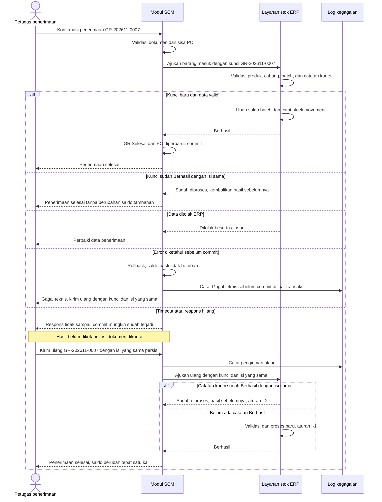
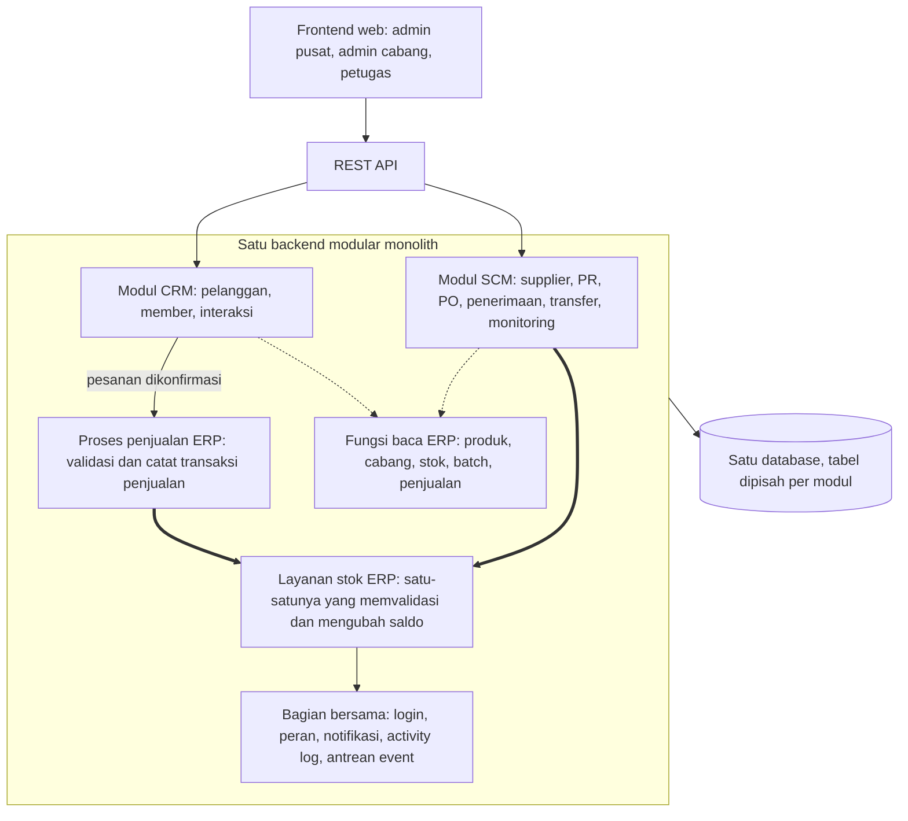

# Tahap 4 — Kajian Awal Integrasi ERP–SCM–CRM

> Proyek: SaaS Toko Asri · Modul: Integrasi ERP–SCM–CRM · Tahap: 4 (langkah pertama)
> Penanggung jawab SCM: Naurah · Versi: **0.6** · Tanggal: 10 November 2026 · Status: **Draf revisi untuk review, belum masuk bagian 4.1–4.11**

Dokumen ini adalah langkah pertama Tahap 4 sesuai bagian H master prompt: ringkasan keputusan yang relevan, konflik dan ketidakjelasan, asumsi, daftar keputusan yang perlu dikonfirmasi, dan rekomendasi arsitektur awal. Versi 0.6 adalah revisi atas review versi 0.5; ringkasan perubahan semua versi ada di [bagian 9](#9-ringkasan-revisi). Bagian 4.1–4.11 baru dikerjakan setelah dokumen ini disetujui.

---

## 1. Label

| Label | Arti |
| --- | --- |
| **FAKTA** | Hasil wawancara mitra (W1–W16, Tahap 1). Tidak diubah |
| **KEPUTUSAN DESAIN** | Sudah ditetapkan di Tahap 1–3. Keputusan dari Tahap 3 v0.2 masih menunggu persetujuan tertulis (S-01) |
| **ASUMSI SEMENTARA** | Dipakai sebagai dasar rancangan, belum disepakati |
| **PERLU KESEPAKATAN TIM** | Harus diputuskan bersama Kayla, Rei, atau penanggung jawab integrasi |
| **PERLU KONFIRMASI MITRA** | Harus ditanyakan ke Toko Asri karena tidak ada di W1–W16 |
| **REKOMENDASI** | Usulan analis; boleh ditolak tim |

Satu informasi dapat berlabel ganda, misalnya **REKOMENDASI + PERLU KESEPAKATAN TIM**: arahnya diusulkan analis, tetapi belum berlaku sebelum tim setuju.

### 1.1 Istilah perubahan stok

Istilah berikut dipakai secara konsisten di seluruh dokumen:

| Istilah | Arti | Pelaku |
| --- | --- | --- |
| **Menginisiasi** perubahan stok | Membuat dokumen sah (penerimaan, transfer) lalu **mengajukan kejadian stok** beserta kuncinya ke ERP | SCM |
| **Memvalidasi** perubahan stok | Memeriksa produk, cabang, batch, kunci, dan saldo cukup | ERP |
| **Mengubah saldo** stok | Menulis saldo per batch per cabang dan mencatat stock movement | **Hanya ERP** |

SCM tidak pernah mengubah saldo stok. Jika ERP menolak, saldo tidak berubah walaupun SCM sudah mengajukan.

**CRM tidak menginisiasi perubahan saldo stok.** CRM hanya meneruskan pesanan pelanggan yang sudah dikonfirmasi ke **proses penjualan ERP**. ERP memvalidasi dan mencatatnya sebagai penjualan, lalu **proses penjualan ERP** yang memanggil layanan stok ERP untuk mengurangi saldo (ASUMSI SEMENTARA dari Tahap 2; urutan batch FEFO saat penjualan adalah AS-2).

---

## 2. Dokumen yang Dibaca

| Dokumen | Versi | Status |
| --- | --- | --- |
| Tahap 1 — Analisis Kebutuhan Modul SCM | Dokumen Claude Docs, 10 Nov 2026 | Sumber fakta W1–W16 |
| Tahap 2 — Analisis Proses Bisnis As-Is dan To-Be | Dokumen Claude Docs, 10 Nov 2026 | Memuat asumsi integrasi tim (ERP Kayla, CRM Rei) |
| Tahap 3 — Perancangan Fitur SCM | `tahap-3-perancangan-fitur-scm.md` **v0.2** | Dipakai sebagai acuan; **persetujuan tertulis belum ada** (S-01) |

Dokumen rancangan ERP milik Kayla dan CRM milik Rei **belum tersedia**. Semua hal tentang isi modul ERP dan CRM di bawah ini berasal dari asumsi tim di Tahap 2, bukan dari rancangan mereka.

---

## 3. Ringkasan Keputusan yang Relevan untuk Integrasi

### 3.1 Kepemilikan data

| No | Keputusan | Sumber | Label |
| --- | --- | --- | --- |
| 1 | ERP pemilik **master produk** (identitas, nama, satuan, kategori, status aktif), cabang, stok, batch, saldo batch, stock movement, penjualan | Tahap 2, Tahap 3 §2.1 | ASUMSI SEMENTARA (asumsi tim) |
| 2 | ERP satu-satunya modul yang **memvalidasi dan mengubah saldo stok**; modul lain hanya menginisiasi | Tahap 2, Tahap 3 PK-8 | KEPUTUSAN DESAIN |
| 3 | Selisih stok harus dilaporkan ke kantor sebelum data diperbarui | W15 | FAKTA |
| 4 | Stock opname dan penyesuaian stok di ERP, dengan persetujuan kantor | Tahap 2 | KEPUTUSAN DESAIN (berdasar asumsi tim) |
| 5 | SCM pemilik PR, PO, penerimaan barang, transfer | Tahap 3 §2.1 | KEPUTUSAN DESAIN |
| 6 | SCM pemilik **master supplier** (termasuk lead time default) dan **hubungan supplier–produk**, yaitu daftar produk yang dipasok tiap supplier. Hubungan ini hanya **merujuk ID produk ERP** dan **tidak menyimpan harga**; SCM tidak memiliki atau menyalin master produk. Harga transaksi disimpan sebagai snapshot di PO (bagian 3.1.1) | Tahap 3 F01, K-01 | **REKOMENDASI + PERLU KESEPAKATAN TIM** (Kayla, tim integrasi) |
| 7 | SCM tidak menyimpan saldo stok maupun saldo batch | Tahap 3 BR-F06-04 | KEPUTUSAN DESAIN |
| 8 | **Stok minimum dan stok target adalah parameter perencanaan milik SCM**, bukan data stok | Tahap 3 F10, K-02 | **REKOMENDASI + PERLU KESEPAKATAN TIM** (Kayla, tim integrasi) |
| 9 | CRM membaca stok dari ERP, tidak dari SCM; CRM tidak mengubah stok | Tahap 2, Tahap 3 AS-6 | ASUMSI SEMENTARA |
| 10 | Satu login bersama dengan peran | Tahap 3 AS-7 | ASUMSI SEMENTARA |
| 11 | Notifikasi dan activity log sebagai layanan bersama | Tahap 3 K-03, K-04 | REKOMENDASI + PERLU KESEPAKATAN TIM |

Alasan rekomendasi no. 6 dan 8:

- **Supplier** dipakai terutama oleh proses pengadaan (PR → PO → penerimaan). Pembelian dilakukan melalui supplier dan diputuskan admin (FAKTA W6, W7). ERP cukup **membaca** supplier untuk pencatatan keuangan. Jika ERP ternyata sudah merancang data supplier, pemiliknya dipilih satu dan modul lain membaca, bukan menyalin.
- **Produk tetap milik ERP.** Hubungan supplier–produk adalah data pengadaan yang menempel pada supplier, bukan master produk kedua. Rinciannya di bagian 3.1.1.
- **Stok minimum dan stok target** tidak menyatakan berapa barang yang ada, melainkan kapan dan berapa banyak membeli. Karena itu keduanya diperlakukan sebagai parameter keputusan pengadaan, bukan bagian data stok ERP. Jika ERP sudah memiliki field stok minimum, SCM membaca dari ERP dan hanya menambah stok target.

### 3.1.1 Batas master produk dan data supplier–produk

| Data | Pemilik | Isi | Yang **tidak** dilakukan modul lain | Label |
| --- | --- | --- | --- | --- |
| Master produk | ERP | ID produk, nama, satuan, kategori, status aktif | SCM tidak membuat, mengubah, menonaktifkan, atau menyalin produk | ASUMSI SEMENTARA (asumsi tim) |
| Master supplier | SCM | Nama, kontak, alamat, lead time default, status aktif | ERP tidak membuat atau mengubah supplier; hanya membaca | REKOMENDASI + PERLU KESEPAKATAN TIM |
| Hubungan supplier–produk | SCM | **Hanya** pasangan ID supplier + **ID produk ERP**: produk apa dipasok supplier mana | Tidak menyimpan nama, satuan, atau kategori produk (dibaca dari ERP lewat ID). **Tidak menyimpan harga beli acuan** | REKOMENDASI + PERLU KESEPAKATAN TIM |
| Harga transaksi | SCM, pada item PO | Harga beli satuan yang diisi admin pusat saat membuat PO. Disimpan sebagai **snapshot**: tidak berubah setelah PO Dipesan (Tahap 3 BR-F04-03) dan tidak ikut berubah bila ada PO lain | ERP tidak menulis harga beli; ERP menerima data PO untuk keuangan (K-15) | KEPUTUSAN DESAIN (Tahap 3 v0.2) |
| Harga beli terakhir | SCM, **dihitung** | Harga pada PO **sah** terbaru untuk pasangan supplier–produk itu. PO sah = Dipesan, Diterima Sebagian, Diterima Lengkap, atau Ditutup. **PO Draf dan Dibatalkan tidak pernah dipakai** (Tahap 3 BR-F01-02) | Tidak disimpan sebagai data master dan tidak diisi manual. Hanya menjadi isian awal saat membuat PO baru | KEPUTUSAN DESAIN (Tahap 3 v0.2) |
| Lead time | SCM, pada master supplier | Lead time default per supplier (Tahap 3 F01); bila kosong dipakai 3 hari dari FAKTA W10 | — | KEPUTUSAN DESAIN (Tahap 3 v0.2). Lead time per pasangan supplier–produk tidak termasuk ruang lingkup Tahap 3 |

Harga beli **acuan** yang diisi manual pada hubungan supplier–produk (misalnya daftar harga dari supplier) **tidak termasuk ruang lingkup Tahap 3**. Jika tim membutuhkannya, itu fitur baru dan harus disepakati lebih dulu (PERLU KESEPAKATAN TIM, P-05).

Aturan pencegahan duplikasi master produk:

1. Produk baru **dibuat di ERP lebih dulu**. SCM hanya dapat menautkan produk yang sudah ada di ERP ke supplier.
2. Hubungan supplier–produk menyimpan **ID produk ERP**, bukan salinan data produk.
3. Produk yang dinonaktifkan di ERP tidak dapat dipilih di PR, PO, atau hubungan supplier–produk baru. Dokumen lama tetap merujuk ID yang sama.
4. Bila ERP ternyata juga merancang data supplier atau hubungan supplier–produk, tim memilih satu pemilik; modul lain membaca (P-05, E-05).

### 3.2 Titik integrasi yang sudah dirancang

| No | Titik integrasi | Arah | Memicu perubahan saldo stok di ERP? | Sumber |
| --- | --- | --- | :---: | --- |
| 1 | Data produk, cabang, satuan | ERP → SCM | Tidak | Tahap 3 §2.1 |
| 2 | Stok tersedia / stok layak jual per cabang | ERP → SCM | Tidak | F02, F03, F07, F10 |
| 3 | Saldo per batch per cabang | ERP → SCM | Tidak | F06, F07, F09 |
| 4 | Data penjualan per produk per cabang | ERP → SCM | Tidak | F08, F10 (AS-4) |
| 5 | Data PO saat Dipesan, Dibatalkan, Ditutup | SCM → ERP | Tidak | F04; satu PO = satu supplier dan satu cabang tujuan (AS-10) |
| 6 | Pengajuan kejadian barang masuk dari penerimaan, kunci `GR-…` | SCM → ERP | **Ya, bila ERP menerima.** ERP memvalidasi lalu menambah saldo | F05; barang supplier diterima di cabang tujuan PO (AS-8) |
| 7 | Pengajuan kejadian barang keluar saat transfer dikirim, kunci `TR-…-KIRIM` | SCM → ERP | **Ya, bila ERP menerima.** ERP memvalidasi lalu mengurangi saldo asal | F07 |
| 8 | Pengajuan kejadian barang masuk saat transfer diterima, kunci `TR-…-TERIMA` / `-SUSULAN-n` | SCM → ERP | **Ya, bila ERP menerima.** ERP memvalidasi lalu menambah saldo tujuan | F07 |
| 9 | Pembukaan form penyesuaian stok ERP untuk batch kedaluwarsa | SCM → ERP | Tidak langsung. Saldo diubah ERP setelah kantor menyetujui | F09 |
| 10 | Status penyesuaian stok (baca-saja, Should) | ERP → SCM | Tidak | F09 |
| 11 | Ketersediaan stok untuk pelayanan pelanggan | ERP → CRM | Tidak | AS-6 |
| 12 | Pesanan pelanggan yang dikonfirmasi | CRM → proses penjualan ERP | **Tidak langsung.** CRM tidak mengajukan kejadian stok. ERP memvalidasi pesanan sebagai transaksi penjualan, lalu proses penjualan ERP memanggil layanan stok ERP untuk mengurangi saldo (FEFO, AS-2) | Tahap 2 (asumsi CRM), ASUMSI SEMENTARA |
| 13 | Estimasi kedatangan barang dari PO | SCM → CRM | Tidak | K-12, belum pasti dibutuhkan |
| 14 | Sinyal permintaan pelanggan | CRM → SCM | Tidak | F10, Could |

SCM menginisiasi perubahan stok hanya di tiga titik (no. 6–8). Di ketiganya, ERP yang memvalidasi dan mengubah saldo. Pada titik no. 12, yang menginisiasi pengurangan saldo adalah proses penjualan milik ERP sendiri, bukan CRM.

### 3.3 Syarat konsistensi yang sudah ditetapkan

Tahap 3 §2.2 sudah menetapkan PK-1 s.d. PK-9: satu kejadian stok = satu kunci unik (nomor dokumen + langkah), kirim ulang dengan kunci yang sama, ERP tidak memproses kunci yang sama dua kali, semua-atau-tidak, status SCM berubah setelah ERP berhasil, dokumen terkunci selama pemrosesan belum tuntas, rekonsiliasi berkala, SCM tidak menulis langsung ke data stok ERP, dan ERP menolak stok negatif. Tahap 4 bertugas memilih **mekanisme** yang memenuhi syarat ini, bukan mengubah syaratnya. PK-3 dirinci menjadi aturan idempotency I-1 s.d. I-4 di bagian 6.2.1.

---

## 4. Konflik dan Ketidakjelasan

### 4.1 Pertentangan antara master prompt Tahap 4 dan dokumen Tahap 1–3

| No | Master prompt Tahap 4 | Dokumen Tahap 1–3 | Dampak | Rekomendasi |
| --- | --- | --- | --- | --- |
| C-01 | "Penjualan dilakukan langsung di toko dan melalui WhatsApp" | Tidak ada di W1–W16 | Informasi tanpa sumber di dokumen SCM | **Belum diperlakukan sebagai fakta.** Tanyakan sumbernya. Jika dari wawancara CRM (Rei), catat dengan rujukan. Bagi SCM, dampaknya hanya pada data penjualan yang dibaca dari ERP |
| C-02 | "Pelanggan yang sering berbelanja dapat dicatat sebagai member" | Tidak ada di W1–W16 | Sama seperti C-01 | Sama seperti C-01. Tidak berdampak ke SCM |
| C-03 | "Tidak terdapat sistem utang pelanggan" | Tidak ada di W1–W16 | Sama seperti C-01 | Sama seperti C-01 |
| C-04 | "Cabang melaporkan stok yang **habis atau menipis**" | FAKTA W9: toko melaporkan stok **habis** setiap hari. Apakah stok menipis juga dilaporkan masih ditanyakan (Tahap 1, pertanyaan mitra no. 6) | Bila "menipis" dianggap fakta, kebutuhan F10 terlihat lebih lemah dari sebenarnya | Pertahankan W9 apa adanya sampai mitra menjawab. Ubah kalimat di master prompt menjadi "stok habis" |
| C-05 | ERP pemilik "data pengguna dan autentikasi" | Tahap 3 AS-7: login bersama milik "integrasi" | Tidak jelas siapa yang membangun login dan tabel peran | PERLU KESEPAKATAN TIM: ERP atau platform/integrasi. Bagi SCM yang penting satu sumber |
| C-06 | Transfer: "persetujuan **jika diperlukan**" | Tahap 3 BR-01 menetapkan transfer **selalu** disetujui admin pusat, dengan dasar W5 dan W7. Setelah diperiksa ulang: **W7 hanya tentang keputusan pembelian ulang**, dan **W5 hanya menyebut barang slow moving dilaporkan ke admin lalu dapat dipindahkan**. Tidak ada wawancara yang secara eksplisit menyebut persetujuan transfer, siapa penyetujunya, atau transfer yang bukan karena slow moving | Kedua dokumen sama-sama belum punya dasar fakta. Master prompt membuka kemungkinan transfer tanpa persetujuan; Tahap 3 menyajikan persetujuan wajib seolah berdasar wawancara | **ASUMSI SEMENTARA + PERLU KONFIRMASI MITRA** (AS-15, M-04). Rancangan sementara tetap memakai persetujuan admin pusat, sebagai REKOMENDASI: W5 menunjukkan admin terlibat dalam pemindahan barang, dan persetujuan memberi titik kendali untuk masalah W16. Dasar BR-01 untuk transfer di Tahap 3 dikoreksi di v0.3 (S-05) |
| C-07 | Transfer: "**cabang asal** mengajukan" | Tahap 3 F07: pengaju boleh cabang asal, cabang tujuan, atau admin pusat (AS-9, ASUMSI SEMENTARA) | Alur berbeda di titik pengajuan | Pertahankan Tahap 3; AS-9 masih ditanyakan ke mitra. Pengajuan tidak melibatkan ERP sehingga tidak mengubah integrasi |
| C-08 | Aliran 4.3 no. 6: "SCM mengirim **permintaan** transfer stok kepada ERP" | Tahap 3: ERP baru terlibat saat **kirim** dan **terima**. Pengajuan dan persetujuan murni dokumen SCM | Bila ERP diberi tahu sejak pengajuan, ERP bisa "memesan" stok yang belum tentu dikirim | Ubah aliran no. 6 menjadi "SCM mengajukan kejadian barang keluar saat transfer dikirim" |
| C-09 | 4.4C membedakan stok "**ditolak atau dikembalikan**" | Tahap 3 v0.2: "ditolak" = pengajuan ditolak admin pusat (tidak ada stok bergerak); barang baik yang dikembalikan lewat **transfer baru**; barang rusak tidak kembali ke stok | Istilah berbeda bisa menimbulkan jalur pengembalian di dalam satu transfer, yang Tahap 3 sengaja hindari | Petakan istilah master prompt ke kategori Tahap 3 (bagian 4.3). Jangan menambah jalur pengembalian dalam satu transfer |
| C-10 | 4.11 no. 6: "Bagaimana ERP mencatat **stok dalam perjalanan**" | Tahap 3: jumlah dalam perjalanan adalah **status dokumen transfer di SCM**; ERP mengurangi saldo asal saat kirim dan menambah saldo tujuan saat terima | Dua kemungkinan desain: (a) hanya SCM yang mencatat barang dalam perjalanan; (b) ERP punya lokasi virtual "dalam perjalanan" | PERLU KESEPAKATAN TIM. REKOMENDASI: opsi (a), karena lebih sederhana dan tidak membuat stok ganda. Konsekuensinya, total saldo ERP selama transfer berjalan lebih kecil dari stok fisik (lihat contoh bagian 4.4) |
| C-11 | Event 4.5: StockTransferRequested, StockTransferApproved, PurchaseRequestSubmitted, PurchaseRequestApproved | Di Tahap 3, kejadian ini hanya dipakai **di dalam SCM** (notifikasi, log) | Bila diterbitkan ke ERP, ERP menerima event yang tidak ia butuhkan | Tetap dievaluasi di 4.5 sesuai permintaan, tetapi ditandai sebagai event internal SCM tanpa penerima ERP |
| C-12 | Event 4.5: StockAvailabilityRequested | — | Ini permintaan data (query), bukan event | Di 4.5 diperlakukan sebagai pembacaan sinkron, bukan event |
| C-13 | 4.11 no. 7: stok untuk "dijanjikan kepada pelanggan" (*available to promise*) | Tahap 2/3: stok CRM = stok ERP; saldo berkurang saat penjualan diproses ERP; tidak ada pencadangan. Tahap 3 juga memutuskan tidak ada pencadangan stok untuk transfer | Available to promise butuh pencadangan stok, fitur baru di ERP | PERLU KESEPAKATAN TIM (Rei, Kayla). REKOMENDASI MVP: CRM memakai **stok layak jual** (K-16) tanpa pencadangan |
| C-14 | Aliran 4.3 no. 11: ERP mengirim data transaksi penjualan ke CRM | Tidak dibahas di Tahap 1–3 karena di luar SCM | Bukan wilayah SCM | Dicantumkan di 4.3 sebagai aliran ERP–CRM; detailnya diserahkan ke Kayla dan Rei |
| C-15 | 4.2: "Minimum stok **atau reorder point**" | Tahap 3 v0.2: stok minimum = titik pesan ulang, ditambah stok target | Istilah berbeda untuk konsep yang sama | Pakai istilah Tahap 3 dan sebutkan padanannya |
| C-16 | ERP "data pembelian atau keuangan jika memang menjadi bagian ERP" | Tahap 3 K-01 dan K-15 | Bila ERP membuat dokumen pembelian sendiri, terjadi duplikasi PO | PERLU KESEPAKATAN TIM. REKOMENDASI: PO hanya di SCM; ERP menerima datanya untuk keuangan |
| C-17 | Prinsip: "Jangan mengasumsikan semua modul harus memiliki database terpisah" | Tahap 2: database terpusat sebagai ASUMSI SEMENTARA | Sejalan | Dievaluasi di rekomendasi arsitektur (bagian 6) |
| C-18 | Kajian v0.1 §6.2 mengusulkan status sinkron **disederhanakan** menjadi berhasil atau ditolak | Tahap 3 §1.5 memakai empat nilai status sinkron | Penyederhanaan berisiko menghilangkan jejak kegagalan yang dibutuhkan untuk audit dan pemulihan | **Usulan v0.1 dicabut.** Diganti tiga lapis status (bagian 5) |
| C-19 | Kajian v0.2 §3.1: ERP pemilik produk (no. 1), tetapi "supplier **dan produk yang dipasok** dimiliki SCM" (no. 6) | Tahap 3 §2.1 dan F01: SCM mengelola daftar produk yang dipasok tiap supplier dengan memilih produk dari ERP | Kalimat v0.2 bisa dibaca SCM memiliki data produk, sehingga berisiko ada dua master produk | **Diselesaikan di v0.3.** ERP pemilik master produk; SCM pemilik master supplier dan hubungan supplier–produk yang hanya merujuk ID produk ERP (bagian 3.1.1) |
| C-20 | Tahap 3 §2.2 PK-3: ERP "tidak memproses kunci yang sama dua kali", tanpa aturan untuk kunci sama dengan isi berbeda. Tahap 3 §2.2 skenario 6 menyebut konflik, tetapi tidak merinci isi yang dibandingkan | Tahap 3 juga mengizinkan data yang **Ditolak ERP** diperbaiki lalu diajukan lagi | Tanpa aturan rinci, perbaikan setelah Ditolak ERP bisa dianggap konflik, atau sebaliknya pengajuan berbeda dengan kunci lama bisa diterima | **Diselesaikan di v0.3** dengan aturan idempotency bagian 6.2.1. Kunci hanya "terpakai" bila ERP Berhasil |

### 4.2 Ketidakjelasan yang memengaruhi integrasi

| No | Hal | Mengapa penting |
| --- | --- | --- |
| U-01 | Stack teknologi tim (bahasa, framework, database) belum diketahui | Menentukan apakah modular monolith dalam satu codebase realistis |
| U-02 | Apakah ketiga anggota bekerja di satu repositori atau terpisah | Menentukan pola komunikasi: panggilan fungsi internal atau HTTP |
| U-03 | Apakah ERP sudah punya rancangan saldo per batch | Seluruh F06, F07, F09 bergantung padanya |
| U-04 | Apakah penjualan di ERP memilih batch secara FEFO (AS-2) dan memblokir batch kedaluwarsa (K-16) | Menentukan akurasi monitoring kedaluwarsa dan stok layak jual untuk CRM |
| U-05 | Bagaimana data dari aplikasi stok umum (FAKTA W11) dan buku (FAKTA W2) dipindahkan | Tanpa saldo awal per batch, monitoring dan rekomendasi kosong di awal |
| U-06 | Format satuan kuantitas (K-06) | Kuantitas yang diajukan SCM ke ERP harus satu satuan |
| U-07 | Apakah CRM mencatat pesanan sebelum diteruskan ke ERP | Menentukan apakah ada "stok dijanjikan" yang perlu dihitung |

### 4.3 Pemetaan istilah transfer (untuk 4.4C)

| Istilah master prompt | Padanan Tahap 3 v0.2 | Saldo ERP |
| --- | --- | --- |
| Diminta | Jumlah diajukan (status Diajukan) | Tidak berubah |
| Disetujui | Jumlah disetujui (status Disetujui) | Tidak berubah |
| Dikirim | Jumlah dikirim per batch (langkah Kirim) | ERP mengurangi saldo asal |
| Sedang dalam perjalanan | Status Dalam Perjalanan | Tidak tercatat di asal maupun tujuan (bila C-10 opsi a) |
| Diterima baik | Kategori diterima baik | ERP menambah saldo tujuan |
| Rusak | Kategori rusak | Tidak berubah lagi |
| Hilang | Kategori tidak sampai yang dinyatakan hilang oleh admin pusat | Tidak berubah lagi |
| Ditolak | Pengajuan ditolak admin pusat (sebelum kirim) | Tidak pernah berubah |
| Dikembalikan | Barang baik: transfer baru arah balik. Barang rusak: hanya catatan, tidak kembali ke stok | Mengikuti transfer baru |

### 4.4 Contoh transfer: 10 dikirim, 8 baik, 1 rusak, 1 hilang

Data uji (bukan data mitra): transfer `TR-202611-0003` memindahkan 10 unit produk *Nugget 500 g*, batch `B2311A`, dari cabang A ke cabang B. Sebelum transfer, saldo ERP batch itu 30 di A dan 5 di B. Diagram status mengikuti Tahap 3 F07; arsitektur mengikuti rekomendasi bagian 6 dan C-10 opsi (a).

**Langkah demi langkah**

| No | Langkah | Pelaku | Pengajuan ke ERP (kunci) | Hasil validasi ERP | Saldo ERP A | Saldo ERP B | Status transfer SCM | Rincian di dokumen SCM |
| --- | --- | --- | --- | --- | ---: | ---: | --- | --- |
| 0 | Awal | — | — | — | 30 | 5 | — | — |
| 1 | Ajukan 10 | Admin cabang | Tidak ada | — | 30 | 5 | Diajukan | Diminta 10 |
| 2 | Setujui 10 | Admin pusat (ASUMSI SEMENTARA, AS-15) | Tidak ada | — | 30 | 5 | Disetujui | Disetujui 10 |
| 3 | Kirim 10 | Cabang A | Barang keluar A, 10 (`TR-202611-0003-KIRIM`) | Diterima: produk, batch, dan saldo A cukup | **20** | 5 | Dalam Perjalanan | Dikirim 10; dalam perjalanan 10 |
| 4 | Terima: 8 baik, 1 rusak, 1 tidak sampai | Cabang B | Barang masuk B, 8 (`TR-202611-0003-TERIMA`) | Diterima | 20 | **13** | Diterima dengan Selisih | Baik 8; rusak 1; tidak sampai 1; dalam perjalanan 0 |
| 5 | Catat 1 rusak | Cabang B | Tidak ada | — | 20 | 13 | Diterima dengan Selisih | Rusak 1 tercatat beserta keterangan penanganannya |
| 6 | Nyatakan 1 hilang | Admin pusat | Tidak ada | — | 20 | 13 | **Selesai** | Hilang 1 dengan keterangan |

**Stock movement yang tercatat di ERP**

| Urutan | Kunci | Cabang | Batch | Jumlah | Rujukan |
| --- | --- | --- | --- | ---: | --- |
| 1 | `TR-202611-0003-KIRIM` | A | B2311A | −10 | Transfer kirim |
| 2 | `TR-202611-0003-TERIMA` | B | B2311A | +8 | Transfer terima |

Hanya dua stock movement. Barang rusak dan hilang tidak membuat stock movement, karena keduanya tidak pernah masuk saldo B.

**Pencatatan barang rusak dan hilang**

| Hal | Barang rusak (1 unit) | Barang hilang (1 unit) | Label |
| --- | --- | --- | --- |
| Masuk saldo stok layak jual ERP? | **Tidak**, di cabang mana pun | **Tidak**, di cabang mana pun | KEPUTUSAN DESAIN (Tahap 3 BR-F07-05, BR-F07-07) |
| Masuk saldo stok ERP dalam bentuk lain? | Tidak di MVP. Kategori stok tidak layak jual di ERP belum ada | Tidak | PERLU KESEPAKATAN TIM (K-21, E-09) |
| Dicatat di mana? | Dokumen transfer SCM, sebagai **selisih kategori rusak** beserta keterangan penanganannya | Dokumen transfer SCM, sebagai **selisih kategori tidak sampai** yang dinyatakan hilang oleh admin pusat | KEPUTUSAN DESAIN (Tahap 3 F07) |
| Membuat stock movement? | Tidak | Tidak | KEPUTUSAN DESAIN |
| Catatan kerugian keuangan | Belum diputuskan. Jika ERP membutuhkannya, SCM menyediakan data selisih (nomor transfer, produk, batch, jumlah, kategori) untuk dibaca ERP. Catatan itu **tidak boleh** berbentuk stock movement dan **tidak** mengubah saldo | Sama | PERLU KESEPAKATAN TIM (K-21, E-09) |

Dengan aturan ini, saldo ERP selalu menggambarkan barang yang layak jual dan ada di cabang, sedangkan riwayat barang yang bermasalah tetap utuh di dokumen SCM.

**Pemeriksaan jumlah**

| Titik | Saldo ERP A + B (layak jual) | Barang fisik dalam perjalanan | Selisih di dokumen SCM (rusak + hilang) | Total |
| --- | ---: | ---: | ---: | ---: |
| Setelah langkah 0 | 35 | 0 | 0 | 35 |
| Setelah langkah 3 | 25 | 10 | 0 | 35 |
| Setelah langkah 4 | 33 | 0 | 2 | 35 |
| Setelah langkah 6 | 33 | 0 | 2 (tercatat di SCM) | 35 |

Selama langkah 3–4, saldo ERP (25) lebih kecil dari barang milik toko (35) karena 10 unit dalam perjalanan. Ini konsekuensi C-10 opsi (a). Angka lengkapnya didapat dengan menjumlahkan saldo ERP dan transfer Dalam Perjalanan di SCM.

**Pencegahan perubahan saldo ganda**

| Kejadian | Mengapa saldo tidak berubah dua kali |
| --- | --- |
| Tombol Kirim ditekan dua kali, atau jawaban untuk `-KIRIM` tidak sampai lalu dikirim ulang dengan isi yang sama | ERP mengenali kunci `TR-202611-0003-KIRIM` sudah Berhasil dengan isi yang sama, lalu mengembalikan hasil sebelumnya. Saldo A tetap 20, bukan 10 (aturan I-2, bagian 6.2.1) |
| Kunci `TR-202611-0003-KIRIM` diajukan lagi dengan jumlah 9, atau dengan batch lain | Isi berbeda dari pengajuan yang sudah Berhasil. ERP menolak sebagai **konflik idempotency**; saldo A tetap 20 dan kejadian dicatat untuk diperiksa admin pusat (aturan I-3) |
| Tombol Terima ditekan dua kali | Konfirmasi kedua ditolak SCM karena transfer tidak lagi Dalam Perjalanan. Bila pengajuan tetap sampai ke ERP dengan isi yang sama, ERP mengembalikan hasil sebelumnya tanpa menambah saldo B lagi (aturan I-2) |
| Cabang B mencoba menambah 1 unit rusak ke stok | Tidak ada jalur; barang rusak tidak pernah menjadi stok tersedia (Tahap 3 BR-F07-05) |
| Unit hilang ditemukan setelah dinyatakan hilang | Tidak dapat diterima susulan pada transfer yang sudah Selesai; ditangani lewat penyesuaian stok di ERP dengan persetujuan kantor (Tahap 3 F07-A12) |
| Admin pusat menyatakan hilang dua kali | Pernyataan hilang tidak membuat kejadian stok; pernyataan kedua ditolak karena jumlah tidak sampai yang tersisa = 0 |

---

## 5. Lapisan Status: Dokumen, Pemrosesan Stok, dan Kegagalan Teknis

### 5.1 Evaluasi ulang usulan v0.1

Kajian v0.1 mengusulkan status sinkron empat nilai disederhanakan menjadi "berhasil" atau "ditolak" bila arsitektur modular monolith dipakai. Setelah ditinjau ulang, usulan itu **dicabut** karena dua alasan:

1. **Kegagalan teknis tetap mungkin di modular monolith**, dan hasilnya **tidak selalu pasti**:
   - kegagalan yang **diketahui terjadi sebelum transaksi database di-commit** (misalnya error program, database menolak karena dua proses bentrok, validasi teknis gagal): transaksi di-rollback dan saldo pasti tidak berubah;
   - **timeout, respons hilang, atau koneksi terputus** di sekitar atau sesudah commit (misalnya respons tidak sampai ke browser, server berhenti tepat setelah commit, koneksi database putus saat commit): transaksi **mungkin sudah berhasil**, sehingga hasilnya belum diketahui oleh pihak yang menunggu jawaban.
2. **Jejak kegagalan tidak boleh ikut hilang.** Jika status gagal hanya disimpan di dalam transaksi yang dibatalkan, catatannya ikut terhapus. Akibatnya admin tidak tahu ada percobaan yang gagal, dan audit tidak lengkap.

Penggantinya adalah **tiga lapis status** yang dicatat terpisah.

### 5.2 Tiga lapis status

| Lapis | Menjawab pertanyaan | Disimpan pada | Contoh nilai |
| --- | --- | --- | --- |
| **1. Status dokumen bisnis** | Dokumen ini sampai tahap mana? | Dokumen SCM (PR, PO, GR, transfer) | Draf, Selesai, Dibatalkan (GR); Disetujui, Dalam Perjalanan, Diterima dengan Selisih (transfer) |
| **2. Status pemrosesan perubahan stok** | Apakah kejadian stok untuk langkah ini sudah diterima ERP? | Satu catatan per kunci kejadian | Belum diajukan, Menunggu ERP, Berhasil, Ditolak ERP, Gagal teknis sebelum commit, Hasil belum diketahui |
| **3. Catatan kegagalan teknis** | Apa yang gagal, kapan, sudah berapa kali dicoba? | Log kegagalan, **ditulis di luar transaksi utama** | Waktu, kunci, jenis kegagalan, pesan, percobaan ke-n, pengguna yang mengirim ulang |

**Nilai status pemrosesan perubahan stok (lapis 2)**

| Nilai | Arti | Kepastian saldo ERP | Tindakan yang diizinkan |
| --- | --- | --- | --- |
| Belum diajukan | Langkah belum dikonfirmasi | Pasti belum berubah | Lanjutkan langkah |
| Menunggu ERP | Pengajuan sedang diproses | Belum pasti | Tidak ada; dokumen terkunci. Pengajuan lain dengan kunci yang sama menunggu sampai pengajuan ini selesai (bagian 6.2.1, penanganan pengajuan bersamaan) |
| Berhasil | ERP sudah memvalidasi dan mengubah saldo | Pasti sudah berubah, tepat sekali | Status dokumen bisnis berpindah ke tahap berikutnya |
| Ditolak ERP | ERP menolak karena **alasan bisnis** (produk nonaktif, saldo tidak cukup, batch tidak valid) | Pasti tidak berubah | Selama kunci **belum pernah Berhasil**, data boleh diperbaiki lalu diajukan lagi dengan **kunci yang sama**; ERP memvalidasi ulang dari awal (aturan I-4). Dokumen terbuka untuk diedit |
| Gagal teknis sebelum commit | Backend **menerima error yang jelas sebelum transaksi di-commit**, lalu transaksi di-rollback | **Pasti tidak berubah** | Kirim ulang dengan kunci dan isi yang sama; ERP tidak punya catatan Berhasil sehingga memakai aturan I-1. Dokumen tetap terkunci sampai Berhasil atau Ditolak ERP |
| Hasil belum diketahui | **Timeout, respons hilang, atau koneksi terputus**, sehingga tidak dapat dipastikan apakah transaksi sudah di-commit. Berlaku di **kedua** arsitektur | **Belum diketahui — saldo mungkin sudah berubah** | Hasil **wajib dipastikan melalui catatan kunci di ERP**: kirim ulang dengan **kunci dan isi yang sama persis**, atau baca status kunci di ERP. Isi dokumen **tidak boleh diubah**. ERP menjawab I-2 bila sudah Berhasil dengan isi sama, I-1 bila belum ada catatan Berhasil |

**Aturan penggolongan:** sebuah kegagalan hanya boleh digolongkan **Gagal teknis sebelum commit** bila backend dapat memastikan error terjadi sebelum commit dan rollback sudah dijalankan. Bila tidak dapat dipastikan, kegagalan **wajib** digolongkan **Hasil belum diketahui**. Timeout dan respons hilang tidak pernah dianggap bukti rollback, termasuk pada modular monolith.

Pada modular monolith, status dokumen SCM dan saldo ERP di database selalu sejalan karena keduanya berada dalam satu transaksi. Ketidakpastian ada di **pihak yang menunggu jawaban** (frontend, pengguna, atau proses yang kehilangan koneksi database saat commit). Karena itu, Hasil belum diketahui dicatat di log (lapis 3) dan diselesaikan dengan kirim ulang atau pemeriksaan catatan kunci.

Konflik idempotency (aturan I-3) **bukan** nilai status pemrosesan dokumen. Konflik hanya terjadi bila kunci yang sudah Berhasil diajukan dengan isi berbeda. Hasil transaksi yang sudah Berhasil **tidak berubah**, status dokumen tetap Berhasil, dokumen **tidak** dibuka untuk mengubah isi kejadian lama, dan konflik dicatat di lapis 3 serta dilaporkan ke admin pusat. Koreksi atas kejadian yang sudah Berhasil hanya lewat penyesuaian stok di ERP.

**Ringkasan perilaku per status pemrosesan (pemeriksaan konsistensi v0.6)**

| Status pemrosesan | Saldo ERP | Isi dokumen | Pengiriman ulang | Status dokumen bisnis |
| --- | --- | --- | --- | --- |
| Berhasil | Sudah berubah tepat satu kali | Terkunci untuk langkah itu | Tidak perlu; bila terjadi, ERP menjawab I-2 | **Berpindah ke tahap berikutnya** |
| Ditolak ERP (alasan bisnis) | Tidak berubah | **Boleh diperbaiki** | Dengan kunci yang sama, selama kunci belum pernah Berhasil (I-4) | Tetap di tahap sebelumnya |
| Gagal teknis sebelum commit | **Dipastikan** tidak berubah | **Terkunci** | Dengan kunci dan isi yang sama (I-1) | Tetap di tahap sebelumnya |
| Hasil belum diketahui | **Mungkin sudah** berubah | **Terkunci** | Wajib dengan kunci dan isi yang sama; hasil dipastikan lewat catatan kunci di ERP (I-2 atau I-1) | Berpindah hanya setelah hasil dipastikan Berhasil |
| Konflik idempotency (bukan nilai status) | Hasil Berhasil yang lama tidak berubah | Tidak dibuka untuk mengubah kejadian lama | Tidak dapat diulang dengan isi berbeda | Tetap Berhasil |

Hubungan dengan Tahap 3 §1.5: Menunggu ERP, Berhasil, dan Ditolak ERP sama. **Gagal terhubung** di Tahap 3 dipecah menjadi **Gagal teknis sebelum commit** dan **Hasil belum diketahui**, dengan rincian penyebab dipindah ke lapis 3. Perubahan ini hanya memperjelas istilah, bukan ruang lingkup fitur; bila disetujui, diterapkan di Tahap 3 v0.3 (S-03).

### 5.3 Contoh penerimaan barang pada arsitektur yang direkomendasikan

Cara membaca dua cabang terakhir:

- **Error diketahui sebelum commit:** status dokumen GR tetap Draf, status pemrosesan Gagal teknis sebelum commit, dan log menyimpan rinciannya. Saldo pasti tidak berubah.
- **Timeout atau respons hilang:** petugas tidak tahu apakah penerimaan sudah tercatat. Status yang ditampilkan adalah Hasil belum diketahui, isi dokumen dikunci, dan satu-satunya tindakan adalah kirim ulang dengan isi yang sama. Catatan kunci di ERP yang menentukan hasilnya, sehingga saldo berubah tepat satu kali.

Kedua keadaan terlihat oleh petugas dan admin pusat lewat log, sehingga pemulihan dan audit tetap mungkin.

---

## 6. Rekomendasi Arsitektur Awal

### 6.1 Perbandingan

| Aspek | Modular monolith | Microservices |
| --- | --- | --- |
| Jumlah aplikasi yang dijalankan | Satu backend, satu database | Minimal tiga layanan, bisa tiga database |
| Pengajuan perubahan stok dari SCM | Dokumen SCM dan saldo ERP diproses dalam satu transaksi database: berhasil bersama atau batal bersama | Transaksi terdistribusi; butuh idempotency, retry, dan rekonsiliasi penuh |
| Login dan peran | Satu mekanisme, langsung dipakai semua modul | Perlu token antarlayanan |
| Beban tim 3 orang | Rendah; satu deployment | Tinggi; tiga deployment, jaringan, monitoring |
| Keadaan "hasil belum diketahui" setelah kegagalan | Tetap mungkin, tetapi lebih jarang: hanya saat timeout, respons hilang, atau koneksi putus di sekitar commit. Tetap harus ditangani dengan kunci kejadian | Lebih sering: setiap gangguan jaringan antarlayanan. Harus ditangani lengkap |
| Kemandirian modul | Dijaga lewat batas kode dan aturan akses | Dijaga oleh pemisahan fisik |
| Cocok untuk | Tim kecil, satu produk, satu bisnis | Tim besar, skala dan rilis terpisah per layanan |

### 6.2 Rekomendasi

**REKOMENDASI + PERLU KESEPAKATAN TIM: modular monolith dengan satu database bersama**, dengan batas modul yang tegas:

1. **Satu backend, tiga modul** (ERP, SCM, CRM), ditambah bagian **bersama** (login, peran, notifikasi, activity log, bila disepakati).
2. **Setiap modul punya tabel sendiri**, dan hanya modul pemilik yang boleh menulis ke tabelnya.
3. **Perubahan saldo stok hanya lewat layanan stok milik ERP.** SCM menginisiasi dengan mengajukan kejadian stok (jenis, cabang, produk, batch, jumlah, kunci) ke layanan itu. ERP **memvalidasi**, lalu **mengubah saldo** dan mencatat stock movement. Pemanggilan ini berada di dalam transaksi database yang sama dengan perubahan status dokumen SCM, sehingga keduanya berhasil bersama atau batal bersama (PK-4, PK-5). Satu transaksi menjamin isi database tetap sejalan, tetapi **tidak** menjamin pemanggil selalu tahu hasilnya; untuk itu dipakai kunci kejadian (no. 4).
4. **Kunci kejadian tetap wajib** (PK-1, PK-3). ERP menyimpan kunci setiap kejadian yang Berhasil beserta isinya, lalu menerapkan aturan idempotency di bagian 6.2.1. Di arsitektur ini kunci melindungi dari klik ganda, permintaan ulang dari browser, dan pengiriman ulang setelah **Hasil belum diketahui** atau Gagal teknis, sekaligus menjadi jejak audit. Pengajuan bersamaan dengan kunci yang sama ditangani dengan unique constraint dan klaim kunci di dalam transaksi (bagian 6.2.1).
5. **Tiga lapis status** (bagian 5) dipakai penuh, termasuk pembedaan Gagal teknis sebelum commit dan Hasil belum diketahui. Log kegagalan teknis ditulis di luar transaksi utama agar tidak ikut terhapus.
6. **Pembacaan data lintas modul** (stok, batch, penjualan, produk) lewat **fungsi baca atau view milik modul pemilik**, bukan query langsung ke tabel modul lain. Dengan begitu, ERP bisa mengubah struktur tabelnya tanpa merusak SCM.
7. **Event internal** dipakai untuk hal yang tidak boleh membatalkan transaksi utama: notifikasi dan pemutakhiran daftar monitoring. Event ditulis ke tabel antrean di transaksi yang sama, lalu diproses sesudahnya [REKOMENDASI].
8. **REST API** dipakai untuk komunikasi frontend–backend. Antarmodul di dalam backend tidak perlu HTTP.

#### 6.2.1 Aturan idempotency kejadian stok

Aturan ini berlaku untuk setiap kejadian stok yang diajukan SCM ke layanan stok ERP (penerimaan, transfer kirim, transfer terima, terima susulan). Aturan ini sama untuk arsitektur yang direkomendasikan maupun arsitektur cadangan (bagian 6.4). Kemampuan ERP menjalankannya masih **PERLU KESEPAKATAN TIM** (E-02, AS-3).

**Isi yang dibandingkan.** Dua pengajuan dianggap **berisi sama** bila seluruh unsur berikut sama:

| Unsur | Contoh |
| --- | --- |
| Jenis kejadian | Barang masuk / barang keluar |
| Cabang | Cabang A |
| Daftar baris, dibandingkan tanpa memedulikan urutan baris. Setiap baris berisi: | |
| — produk (ID produk ERP) | Nugget 500 g |
| — batch (nomor batch + tanggal kedaluwarsa) | `B2311A`, 30-05-2027 |
| — jumlah | 20 |

Yang **tidak** dibandingkan: waktu pengiriman, pengguna yang mengirim, nomor percobaan, dan catatan bebas. Unsur ini boleh berbeda antara pengiriman pertama dan pengiriman ulang.

**Dasar penentuan aturan.** Aturan dipilih berdasarkan **catatan kunci di ERP**, bukan berdasarkan status yang terlihat di SCM. SCM atau pengguna bisa saja melihat Hasil belum diketahui padahal ERP sudah Berhasil, di **kedua** arsitektur, sehingga hanya catatan ERP yang dapat dipercaya.

ERP menyimpan, per kunci, **hanya** pengajuan yang Berhasil beserta isinya. Pengajuan yang Ditolak ERP dan percobaan yang gagal teknis dicatat di log (lapis 3), tetapi **tidak** membuat kunci terpakai.

**Aturan**

| Kode | Catatan kunci di ERP saat pengajuan diterima | Perilaku ERP | Saldo |
| --- | --- | --- | --- |
| I-1 | **Belum ada pengajuan yang Berhasil** untuk kunci ini (kunci baru, atau semua percobaan sebelumnya gagal teknis tanpa tercatat di ERP) | Validasi bisnis dan pemrosesan baru. Bila lolos: ubah saldo, catat stock movement, simpan kunci beserta isinya, jawab **Berhasil**. Bila tidak lolos: jawab **Ditolak ERP** dengan alasan | Berubah satu kali bila Berhasil |
| I-2 | **Sudah Berhasil** dan **isinya sama** | Tidak memproses ulang. **Selalu** jawab **sudah diproses** dengan hasil sebelumnya (stock movement yang sama). Berlaku apa pun penyebab pengajuan ulang: klik ganda, timeout, respons hilang, Hasil belum diketahui atau Gagal teknis di sisi SCM, atau pengiriman ulang oleh pengguna lain | **Tidak berubah lagi** |
| I-3 | **Sudah Berhasil** tetapi **isinya berbeda** | Tolak sebagai **konflik idempotency**. Catat di log dan beri tahu admin pusat, karena kemungkinan ada kesalahan program atau isi diubah setelah dikirim. Hasil Berhasil yang lama tetap berlaku | **Tidak berubah** |
| I-4 | Pengajuan terakhir **Ditolak ERP karena alasan bisnis**, dan belum ada yang Berhasil | Data boleh diperbaiki di SCM lalu diajukan lagi dengan **kunci yang sama**. ERP memvalidasi dan memproses dari awal seperti I-1. Di catatan kunci ERP keadaan ini sama dengan "belum ada catatan", karena klaim kunci ikut dibatalkan saat ditolak; penolakannya hanya tercatat di log | Berubah satu kali bila Berhasil |

Yang perlu diperhatikan:

- **Gagal teknis dan Hasil belum diketahui bukan aturan di sisi ERP.** Keduanya keadaan di sisi SCM atau pengguna. Pemulihannya sama: SCM mengirim ulang **kunci dan isi yang sama persis**, lalu ERP memeriksa catatan kunci dan menerapkan I-2 (bila sudah Berhasil dengan isi sama) atau I-1 (bila belum ada catatan Berhasil).
- **Gagal teknis sebelum commit** hanya dipakai bila backend dapat memastikan error terjadi sebelum commit dan rollback sudah dijalankan. Saldo pasti tidak berubah, dan pengiriman ulang jatuh ke I-1.
- **Hasil belum diketahui** (timeout, respons hilang, koneksi terputus) **tidak pernah** dianggap bukti rollback, **termasuk pada modular monolith**. Transaksi mungkin sudah di-commit dan saldo mungkin sudah berubah. Karena itu pengiriman ulang **wajib** memakai kunci dan isi yang sama persis.
- **Isi dokumen dikunci** selama kedua keadaan itu (PK-6). Jika isinya diubah lalu dikirim padahal ERP sudah Berhasil, ERP menolaknya sebagai konflik (I-3), bukan memproses isi baru.
- **Konflik idempotency (I-3) tidak membuka kunci.** Berbeda dengan I-4, data tidak bisa "diperbaiki" untuk kunci yang sudah Berhasil. Koreksi atas kejadian yang sudah Berhasil dilakukan lewat penyesuaian stok di ERP (Tahap 3 F05-A8).

**Penanganan pengajuan bersamaan**

Aturan I-1 s.d. I-4 belum cukup bila dua pengajuan dengan kunci yang sama tiba **pada saat yang sama**, misalnya klik ganda yang sangat cepat, pengiriman ulang otomatis saat permintaan pertama masih berjalan, atau dua pengguna. Cara "periksa dulu apakah kunci sudah ada, lalu proses" **tidak aman**: kedua proses bisa sama-sama memeriksa sebelum salah satunya menyimpan, keduanya melihat "belum ada", lalu keduanya mengubah saldo.

Mekanisme yang direkomendasikan (**REKOMENDASI + PERLU KESEPAKATAN TIM**, E-02, P-07). Bagian ini menetapkan **perilaku** yang wajib; struktur tabel fisik dibahas di Tahap 5.

| Kode | Mekanisme | Fungsi |
| --- | --- | --- |
| K-M1 | **Unique constraint** pada kunci kejadian di catatan kunci milik ERP | Database sendiri yang menjamin satu kunci hanya bisa dimiliki satu catatan. Tidak bergantung pada pemeriksaan di kode program |
| K-M2 | **Klaim kunci sebagai langkah pertama** di dalam transaksi pemrosesan: ERP menyimpan kunci beserta sidik isinya **sebelum** validasi bisnis, di transaksi yang sama dengan perubahan saldo dan stock movement | Klaim, perubahan saldo, dan stock movement berhasil bersama atau batal bersama |
| K-M3 | **Pengajuan kedua menunggu.** Saat transaksi pertama sudah mengklaim kunci tetapi belum commit, usaha klaim kunci yang sama oleh transaksi kedua **tertahan oleh database** sampai transaksi pertama commit atau rollback | Hanya satu proses yang dapat memproses kunci itu pada satu waktu |
| K-M4 | **Setelah menunggu:** bila transaksi pertama **commit**, klaim kedua gagal karena kunci sudah ada; ERP membaca catatan dan membandingkan sidik isi → **I-2** bila sama, **I-3** bila berbeda. Bila transaksi pertama **rollback** (ditolak bisnis atau gagal teknis), klaimnya ikut hilang; klaim kedua berhasil dan diproses sebagai **I-1** (sejalan dengan I-4) | Pengajuan kedua tidak pernah memproses ulang kejadian yang sudah Berhasil |
| K-M5 | **Sidik isi**: isi ternormalisasi (jenis kejadian, cabang, lalu baris diurutkan dengan produk, nomor batch, tanggal kedaluwarsa, jumlah) diubah menjadi nilai hash dan disimpan bersama kunci. Isi lengkapnya juga disimpan untuk audit [REKOMENDASI] | Membedakan isi sama dan isi berbeda tanpa bergantung urutan baris |
| K-M6 | **Batas waktu tunggu** (lock timeout). Bila pengajuan kedua menunggu terlalu lama, ia dihentikan dengan error dan pemanggil memperlakukannya sebagai **Hasil belum diketahui**, lalu mengirim ulang kunci dan isi yang sama | Pengguna tidak menunggu tanpa batas; nilainya PERLU KESEPAKATAN TIM (P-07) |
| K-M7 | **Kunci baris saldo** saat saldo diubah, ditambah aturan database bahwa saldo tidak boleh negatif | Dua kunci **berbeda** yang menarik batch yang sama secara bersamaan tidak membuat saldo negatif (PK-9) |
| K-M8 | **Lapisan SCM**: SCM juga mengunci dokumen saat konfirmasi (PK-6), sehingga klik ganda biasanya sudah terhenti di SCM | Pertahanan tambahan. Jaminan ERP (K-M1 s.d. K-M4) **tetap berlaku sendiri** walaupun lapisan SCM gagal |

Hubungan dengan aturan I:

| Keadaan saat pengajuan kedua tiba | Yang terjadi | Aturan |
| --- | --- | --- |
| Pengajuan pertama sedang diproses (belum commit) | Pengajuan kedua menunggu (K-M3) | — |
| Pengajuan pertama commit, isi sama | Pengajuan kedua menerima hasil sebelumnya | I-2 |
| Pengajuan pertama commit, isi berbeda | Pengajuan kedua ditolak sebagai konflik | I-3 |
| Pengajuan pertama rollback karena ditolak bisnis atau gagal teknis | Pengajuan kedua diproses dari awal | I-1 (sejalan I-4) |
| Pengajuan kedua melewati batas waktu tunggu | Error ke pemanggil; diperlakukan Hasil belum diketahui, lalu dikirim ulang | I-2 atau I-1 saat dikirim ulang |

Perilaku menunggu pada K-M3 sudah **diuji pada PostgreSQL 16** (hasil di bawah). MySQL dengan mesin InnoDB juga dikenal berperilaku menunggu pada unique key, tetapi **belum diuji** di sini; bila tim memilih database lain, K-M3 wajib diuji ulang (P-07). Pada arsitektur cadangan (6.4), mekanisme yang sama dijalankan di dalam transaksi milik layanan ERP, sehingga tetap berlaku.

**Contoh pengujian** (data uji, bukan data mitra)

Kunci `GR-202611-0007`: barang masuk, cabang A, produk Nugget 500 g, batch `B2311A` kedaluwarsa 30-05-2027, jumlah 20. Saldo awal batch itu di cabang A = 0.

| Uji | Situasi | Catatan kunci di ERP sebelum pengajuan | Aturan | Jawaban ERP yang diharapkan | Saldo A setelahnya | Stock movement untuk kunci ini |
| --- | --- | --- | --- | --- | ---: | ---: |
| UJI-1 | Pengajuan pertama | Belum ada | I-1 | Berhasil | 20 | 1 |
| UJI-2 | Isi sama persis, dikirim ulang karena klik ganda | Berhasil, isi sama | I-2 | Sudah diproses, hasil UJI-1 | 20 | 1 |
| UJI-3 | Kunci sama, jumlah 25 | Berhasil, isi berbeda | I-3 | Ditolak: konflik idempotency | 20 | 1 |
| UJI-4 | Kunci sama, batch `B2311B` | Berhasil, isi berbeda | I-3 | Ditolak: konflik idempotency | 20 | 1 |
| UJI-5 | Isi sama, dikirim pengguna lain lima menit kemudian | Berhasil, isi sama | I-2 | Sudah diproses, hasil UJI-1 | 20 | 1 |
| UJI-6 | **Arsitektur cadangan:** ERP sudah memproses UJI-1, tetapi jawabannya hilang sehingga SCM menampilkan Hasil belum diketahui. SCM mengirim ulang isi yang sama | Berhasil, isi sama | I-2 | Sudah diproses, hasil UJI-1. SCM lalu menandai Berhasil | 20 | 1 |
| UJI-7 | **Arsitektur yang direkomendasikan, error sebelum commit:** error program saat UJI-1 diterima backend sebelum commit, rollback dijalankan, status Gagal teknis sebelum commit. SCM mengirim ulang isi yang sama | Belum ada | I-1 | Berhasil | 20 | 1 |
| UJI-11 | **Arsitektur yang direkomendasikan, respons hilang sesudah commit:** transaksi UJI-1 sudah di-commit, tetapi respons ke browser hilang sehingga petugas melihat Hasil belum diketahui. Petugas mengirim ulang isi yang sama | Berhasil, isi sama | I-2 | Sudah diproses, hasil UJI-1 | 20 | 1 |
| UJI-12 | **Arsitektur yang direkomendasikan, koneksi database putus saat commit:** hasil commit tidak diketahui; ternyata commit tidak terjadi. Status Hasil belum diketahui, lalu dikirim ulang isi yang sama | Belum ada | I-1 | Berhasil | 20 | 1 |
| UJI-13 | Saat status Hasil belum diketahui, isi diubah menjadi jumlah 18 lalu dikirim (seharusnya dicegah PK-6; diuji untuk memastikan ERP tetap aman), padahal UJI-1 sudah Berhasil | Berhasil, isi berbeda | I-3 | Ditolak: konflik idempotency | 20 | 1 |
| UJI-14 | **Bersamaan:** dua pengajuan dengan kunci dan isi sama (jumlah 20) tiba hampir bersamaan | Belum ada | I-1 lalu I-2 | Satu Berhasil, satu Sudah diproses | 20 | 1 |
| UJI-15 | **Bersamaan:** dua pengajuan dengan kunci sama, isi berbeda (20 dan 25) | Belum ada | I-1 lalu I-3 | Yang lebih dulu mengklaim Berhasil, yang lain konflik idempotency | 20 | 1 |
| UJI-18 | **Bersamaan, melewati batas tunggu:** pengajuan kedua menyerah saat pengajuan pertama masih diproses, lalu dikirim ulang | Belum ada, lalu Berhasil | I-1, lalu I-2 saat dikirim ulang | Pengajuan kedua error batas waktu; saat dikirim ulang Sudah diproses | 20 | 1 |
| UJI-19 | Koneksi pengajuan pertama terputus sebelum commit, lalu dikirim ulang | Belum ada | I-1 | Pengajuan pertama tidak mengubah apa pun; kiriman ulang Berhasil | 20 | 1 |

Uji untuk I-4 dengan kunci `GR-202611-0008`:

| Uji | Situasi | Catatan kunci di ERP sebelum pengajuan | Aturan | Jawaban ERP yang diharapkan | Saldo setelahnya | Stock movement untuk kunci ini |
| --- | --- | --- | --- | --- | --- | ---: |
| UJI-8 | Pengajuan pertama, produk nonaktif | Belum ada | I-1 | Ditolak ERP: produk nonaktif | Tidak berubah | 0 |
| UJI-9 | Produk diaktifkan, data diperbaiki, diajukan lagi dengan kunci yang sama | Hanya penolakan bisnis; belum ada Berhasil | I-4 | Berhasil | Berubah satu kali | 1 |
| UJI-10 | Setelah UJI-9, isi UJI-9 dikirim ulang | Berhasil, isi sama | I-2 | Sudah diproses, hasil UJI-9 | Tidak berubah lagi | 1 |

Uji bersamaan lain dengan kunci `TR-202611-0003-KIRIM` dan batch bersaldo 10:

| Uji | Situasi | Aturan | Hasil yang diharapkan | Saldo setelahnya | Stock movement |
| --- | --- | --- | --- | ---: | ---: |
| UJI-16 | **Bersamaan, kunci sama:** pengajuan pertama keluar 15 (ditolak karena saldo tidak cukup), pengajuan kedua keluar 10 | I-1 ditolak, lalu I-1 (sejalan I-4) | Pertama Ditolak ERP dan klaimnya batal; kedua Berhasil | 0 | 1 |
| UJI-17 | **Bersamaan, kunci berbeda:** `TR-202611-0004-KIRIM` dan `TR-202611-0005-KIRIM` masing-masing keluar 8 dari batch yang sama | I-1 untuk keduanya | Satu Berhasil, satu Ditolak ERP karena saldo tidak cukup (K-M7) | 2 | 1 |

Kriteria lulus: untuk setiap kunci, jumlah stock movement **tidak pernah lebih dari satu**; saldo hanya berubah pada pengajuan Berhasil yang pertama; pengajuan ulang dengan isi sama setelah Berhasil selalu mendapat hasil sebelumnya, apa pun status yang terlihat di SCM; pengajuan bersamaan dengan kunci yang sama tidak pernah menghasilkan dua stock movement; dan saldo tidak pernah negatif.

**Hasil pengujian prototipe mekanisme**

Pengujian dijalankan pada **PostgreSQL 16.15** dengan skema uji minimal dan satu fungsi pemroses yang menerapkan K-M1 s.d. K-M5 dan K-M7. Skema itu **hanya untuk menguji perilaku**, bukan rancangan database Tahap 5. Permintaan bersamaan dijalankan sebagai dua koneksi database terpisah; pemrosesan pertama diperlambat dengan jeda agar keduanya benar-benar tumpang tindih. Seluruh rangkaian dijalankan **lima kali** dan keadaan akhirnya identik.

| Uji | Hasil aktual | Saldo akhir | Stock movement per kunci | Status |
| --- | --- | ---: | ---: | --- |
| UJI-1 | I-1 Berhasil | 20 | 1 | Lulus |
| UJI-2 | I-2 Sudah diproses | 20 | 1 | Lulus |
| UJI-3 | I-3 Konflik idempotency | 20 | 1 | Lulus |
| UJI-4 | I-3 Konflik idempotency | 20 | 1 | Lulus |
| UJI-8 | Ditolak ERP: produk nonaktif; kunci tidak tersimpan | — | 0 | Lulus |
| UJI-9 | I-1 Berhasil dengan kunci yang sama | — | 1 | Lulus |
| UJI-10 | I-2 Sudah diproses | — | 1 | Lulus |
| UJI-14 | Pengajuan kedua menunggu, lalu I-2 Sudah diproses; pengajuan pertama I-1 Berhasil | 20 | 1 | Lulus |
| UJI-15 | Pertama (20) I-1 Berhasil; kedua (25) I-3 Konflik | 20 | 1 | Lulus |
| UJI-16 | Pertama Ditolak ERP (saldo tidak cukup); kedua menunggu lalu I-1 Berhasil | 0 | 1 | Lulus |
| UJI-17 | Satu Berhasil, satu Ditolak ERP (saldo tidak cukup) | 2 | 1 (total) | Lulus |
| UJI-18 | Kedua dihentikan "canceling statement due to lock timeout"; kiriman ulang I-2 Sudah diproses | 20 | 1 | Lulus |
| UJI-19 | Koneksi pertama diputus sebelum commit: saldo 0, tanpa stock movement; kiriman ulang I-1 Berhasil | 20 | 1 | Lulus |

Uji yang **tidak** dijalankan terpisah karena di tingkat database setara dengan uji di atas: UJI-5 dan UJI-11 (setara UJI-2), UJI-7 (setara jalur rollback UJI-8 dan UJI-19), UJI-12 (setara UJI-19), UJI-13 (setara UJI-3). **UJI-6 belum diuji**, karena memerlukan dua layanan terpisah yang terhubung lewat jaringan (arsitektur cadangan).

### 6.3 Diagram arsitektur awal

Cara membaca diagram:

| Panah | Arti |
| --- | --- |
| Berlabel "pesanan dikonfirmasi" (CRM ke Proses penjualan ERP) | CRM **mengirim pesanan** pelanggan yang sudah dikonfirmasi. Ini **bukan** pengajuan perubahan saldo; CRM tidak berhubungan langsung dengan layanan stok (ASUMSI SEMENTARA dari Tahap 2) |
| Tebal (SCM dan Proses penjualan ERP ke Layanan stok ERP) | **Mengajukan** perubahan saldo. SCM mengajukan kejadian stok dengan kunci (penerimaan, transfer). Proses penjualan ERP, setelah memvalidasi dan mencatat transaksi penjualan, meminta pengurangan saldo sesuai FEFO (AS-2). Layanan stok ERP yang memvalidasi dan mengubah saldo |
| Putus-putus (SCM dan CRM ke Fungsi baca ERP) | **Membaca** data ERP tanpa mengubahnya. CRM membaca ketersediaan stok dari sini |
| Tipis (Layanan stok ERP ke Bagian bersama) | Event internal untuk notifikasi dan activity log setelah saldo berubah. SCM dan CRM juga menulis event internal ke bagian bersama; panahnya tidak digambar agar diagram tetap terbaca |
| Backend ke database | Semua modul memakai satu database, tetapi setiap modul hanya menulis ke tabelnya sendiri. Hanya Layanan stok ERP yang menulis saldo stok |

Frontend juga dapat memanggil fungsi ERP dan CRM secara langsung lewat REST API untuk layar milik modul itu; panahnya tidak digambar karena tidak berkaitan dengan integrasi SCM.

### 6.4 Kapan rekomendasi ini tidak berlaku

Jika tim sudah membangun **backend terpisah per anggota** (U-02), modular monolith tidak realistis tanpa menyatukan kode. Pilihan cadangannya:

- **Tiga layanan dengan satu database bersama**, berkomunikasi lewat REST internal.
- Semua syarat Tahap 3 §2.2 berlaku penuh: kunci kejadian, kirim ulang, timeout, rekonsiliasi.
- Status pemrosesan sama dengan arsitektur yang direkomendasikan, tetapi **Hasil belum diketahui** jauh lebih sering terjadi karena ada jaringan antarlayanan, dan **Gagal teknis sebelum commit** hanya boleh dipakai bila ERP menjawab dengan error yang jelas. Kegagalan komunikasi **tidak boleh** dianggap bukti bahwa saldo belum berubah. Pemulihannya dengan kirim ulang memakai **kunci dan isi yang sama persis**, atau menanyakan status kunci ke ERP; jawaban ERP mengikuti aturan I-2 atau I-1 (bagian 6.2.1, uji UJI-6). Isi dokumen dikunci selama status ini.
- Satu aturan tetap: SCM tidak menulis langsung ke tabel stok ERP.

Microservices penuh dengan database terpisah per layanan **tidak direkomendasikan** untuk proyek ini. Biayanya tinggi bagi tim tiga orang, dan tidak ada kebutuhan Toko Asri yang memerlukannya.

---

## 7. Asumsi yang Dibawa ke Tahap 4

AS-1 s.d. AS-10 berasal dari Tahap 2; AS-11 s.d. AS-15 baru di Tahap 4. Semuanya belum disetujui tim atau mitra.

| ID | ASUMSI SEMENTARA | Asal |
| --- | --- | --- |
| AS-1 | ERP menyimpan batch dan saldo per batch per cabang | Tahap 2 |
| AS-2 | Penjualan di ERP mengurangi saldo per batch secara FEFO | Tahap 2 |
| AS-3 | ERP menyimpan kunci kejadian yang Berhasil beserta isinya, mengembalikan hasil sebelumnya untuk kunci dan isi yang sama, dan menolak kunci sama dengan isi berbeda (aturan I-1 s.d. I-4) | Tahap 2, dirinci di v0.3 |
| AS-4 | ERP menyediakan data penjualan harian per produk per cabang | Tahap 2 |
| AS-5 | Penyesuaian stok kedaluwarsa ada di ERP dengan persetujuan kantor | Tahap 2 |
| AS-6 | CRM membaca stok dari ERP | Tahap 2 |
| AS-7 | Satu login bersama dengan peran | Tahap 2 |
| AS-8 | Supplier mengirim langsung ke cabang tujuan PO | Tahap 2 (tabel ASUMSI SEMENTARA); dipakai Tahap 3 F04, F05 |
| AS-9 | Transfer boleh diajukan cabang asal, cabang tujuan, atau admin pusat | Tahap 2 (tabel ASUMSI SEMENTARA); dipakai Tahap 3 F07 |
| AS-10 | Satu PO = satu supplier dan satu cabang tujuan | Tahap 2 (tabel ASUMSI SEMENTARA); dipakai Tahap 3 BR-F04-01 |
| AS-11 | Satu database terpusat dipakai semua modul | Tahap 2, dievaluasi di bagian 6 |
| AS-12 | Barang dalam perjalanan hanya dicatat sebagai status transfer di SCM, tidak di ERP | Baru (C-10) |
| AS-13 | CRM memakai stok layak jual tanpa pencadangan | Baru (C-13) |
| AS-14 | Log kegagalan teknis dapat ditulis di luar transaksi utama | Baru (bagian 5) |
| AS-15 | Setiap transfer antarcabang disetujui admin pusat sebelum dikirim. **Tidak ada di wawancara**; dipakai sebagai rancangan sementara (REKOMENDASI) sampai mitra menjawab M-04 | Tahap 3 BR-01, dikoreksi statusnya di v0.3 (C-06) |

---

## 8. Keputusan yang Perlu Dikonfirmasi Sebelum 4.1–4.11

Diurutkan dari yang paling menentukan. Prioritas 1 memengaruhi hampir semua bagian Tahap 4.

### 8.1 Penanggung jawab integrasi/platform

| No | Prioritas | Pertanyaan | Dampak jika belum disepakati |
| --- | :---: | --- | --- |
| P-01 | 1 | Apakah sistem dibangun sebagai **satu backend modular** atau **layanan terpisah**? Apa stack teknologinya? (U-01, U-02) | Tahap 4 harus merancang dua versi penanganan kegagalan |
| P-02 | 1 | Apakah semua modul memakai **satu database**? (AS-11) | Menentukan apakah satu transaksi lintas modul mungkin |
| P-03 | 2 | Siapa pemilik **login dan peran**, ERP atau platform? Peran apa saja yang ada? (C-05, AS-7) | Otorisasi SCM tidak bisa dirancang final |
| P-04 | 2 | Apakah **notifikasi**, **activity log**, dan **log kegagalan teknis** dibuat bersama? (K-03, K-04, AS-14) | SCM bisa membangun komponen yang dobel dengan modul lain |
| P-05 | 2 | Apakah **master supplier dan hubungan supplier–produk** dimiliki SCM (dengan master produk tetap di ERP), dan **stok minimum/stok target** menjadi parameter perencanaan SCM? (bagian 3.1 no. 6 dan 8, bagian 3.1.1) | Duplikasi master supplier, master produk, atau parameter. Catatan: hubungan supplier–produk **tidak** menyimpan harga acuan; harga acuan manual adalah fitur baru yang harus disepakati dulu (bagian 3.1.1) |
| P-06 | 3 | Jam pengecekan terjadwal harian (K-10) | Kecil; bisa diputuskan di Tahap 8 |
| P-07 | 1 | Database apa yang dipakai, apakah mendukung unique constraint dengan perilaku menunggu (K-M3), dan berapa **batas waktu tunggu** pengajuan bersamaan (K-M6)? (bagian 6.2.1) | Tanpa perilaku K-M3, pengajuan bersamaan bisa mengubah saldo dua kali |

### 8.2 Kayla (ERP)

| No | Prioritas | Pertanyaan | Dampak jika belum disepakati |
| --- | :---: | --- | --- |
| E-01 | 1 | Apakah ERP menyimpan **saldo per batch per cabang**? (AS-1, U-03) | F06, F07, F09 tidak bisa diintegrasikan |
| E-02 | 1 | Apakah ERP menyediakan **layanan stok** tempat SCM mengajukan kejadian stok, yang memvalidasi, mengubah saldo, menyimpan kunci beserta isinya, menjalankan aturan idempotency I-1 s.d. I-4 (isi sama → hasil sebelumnya; isi berbeda → konflik), dan menangani pengajuan bersamaan dengan unique constraint serta klaim kunci di dalam transaksi (K-M1 s.d. K-M4)? (AS-3, K-20, bagian 6.2.1) | Risiko saldo bertambah atau berkurang dua kali, atau pengajuan berbeda diterima dengan kunci lama |
| E-03 | 1 | Apakah penjualan mengurangi saldo **per batch secara FEFO** dan **memblokir batch kedaluwarsa**? Apakah ada angka **stok layak jual**? (AS-2, K-16) | Monitoring kedaluwarsa dan ketersediaan untuk CRM tidak akurat |
| E-04 | 2 | Apakah ERP perlu lokasi **dalam perjalanan** untuk transfer, atau cukup SCM yang mencatatnya? (C-10, AS-12) | Bisa terjadi dua catatan barang dalam perjalanan |
| E-05 | 2 | Apakah ERP setuju **master supplier dan hubungan supplier–produk dimiliki SCM**, ERP hanya membaca, dan SCM hanya merujuk ID produk ERP? Apakah ERP butuh jumlah diterima baik/ditolak untuk hutang? (K-01, K-15, C-16, C-19) | Duplikasi PO, supplier, atau master produk |
| E-06 | 2 | Apakah ERP sudah punya **stok minimum** per produk per cabang? Jika ya, SCM membaca dari ERP dan hanya menambah stok target (K-02) | Duplikasi parameter |
| E-07 | 2 | **Data penjualan** apa yang boleh dibaca SCM: jumlah per produk per cabang per hari saja, atau per transaksi? | SCM hanya butuh agregat; data per transaksi berisiko membawa data pelanggan |
| E-08 | 2 | Bagaimana **saldo awal** dan **migrasi** dari buku dan aplikasi stok umum dilakukan? (U-05) | Monitoring dan rekomendasi kosong saat sistem mulai dipakai |
| E-09 | 3 | Apakah ERP perlu **catatan kerugian keuangan** untuk barang rusak/hilang dari transfer? Jika ya, ERP membaca data selisih dari dokumen SCM; catatan itu bukan stock movement dan tidak mengubah saldo (K-21, bagian 4.4) | Kecil untuk MVP; tanpa keputusan, kerugian hanya tercatat sebagai selisih di SCM |

### 8.3 Rei (CRM)

| No | Prioritas | Pertanyaan | Dampak jika belum disepakati |
| --- | :---: | --- | --- |
| R-01 | 1 | Apa sumber informasi **penjualan via WhatsApp, member, dan tidak ada utang pelanggan**? (C-01–C-03) | Informasi tanpa sumber bisa masuk dokumen akademik sebagai fakta |
| R-02 | 2 | Apakah CRM butuh **stok layak jual** saja, atau **stok yang bisa dijanjikan** dengan pencadangan? (C-13, AS-13) | Pencadangan adalah fitur baru di ERP |
| R-03 | 2 | Apakah CRM mencatat pesanan sebelum diteruskan ke ERP? (U-07) | Menentukan aliran CRM → ERP |
| R-04 | 3 | Apakah CRM butuh **estimasi kedatangan** dari PO? (K-12) | Menentukan ada atau tidaknya aliran SCM → CRM |
| R-05 | 3 | Apakah CRM akan mengirim **sinyal permintaan pelanggan** ke SCM? (F10, Could) | Bisa ditunda |

### 8.4 Naurah (SCM)

| No | Prioritas | Pertanyaan | Dampak jika belum disepakati |
| --- | :---: | --- | --- |
| S-01 | 1 | Apakah **Tahap 3 v0.2 sudah disetujui** sebagai acuan? | Tahap 4 bisa dibangun di atas spesifikasi yang masih berubah |
| S-02 | 2 | Setuju **mengoreksi kalimat C-04** ("habis atau menipis" menjadi "habis") di master prompt? | Konsistensi dengan W9 |
| S-03 | 2 | Setuju **tiga lapis status** (bagian 5) dan pemecahan *Gagal terhubung* menjadi *Gagal teknis sebelum commit* dan *Hasil belum diketahui* di Tahap 3 v0.3? | Tahap 3 dan Tahap 4 memakai istilah berbeda |
| S-04 | 3 | Event internal SCM (PR dan transfer sebelum kirim) cukup dievaluasi dan ditandai internal di 4.5, tidak dihapus (C-11)? | Kelengkapan sesuai master prompt |
| S-05 | 2 | Setuju **mengoreksi dasar BR-01 untuk transfer** di Tahap 3 v0.3: dari "W5, W7" menjadi ASUMSI SEMENTARA AS-15, tanpa mengubah alur transfer? (C-06) | Dokumen Tahap 3 menyajikan asumsi sebagai fakta wawancara |

### 8.5 Mitra Toko Asri

Pertanyaan yang memengaruhi integrasi. Pertanyaan mitra di Tahap 1–3 yang tidak tercantum di sini tetap berlaku.

| No | Prioritas | Pertanyaan | Dampak jika belum dikonfirmasi |
| --- | :---: | --- | --- |
| M-01 | 2 | Saat melapor ke admin, apakah toko juga melaporkan stok yang hampir habis, atau hanya yang sudah habis? (C-04; Tahap 1 pertanyaan no. 6) | Menentukan kalimat fakta di dokumen |
| M-02 | 2 | Siapa yang biasanya meminta pemindahan barang antarcabang? (AS-9, C-07) | Hak akses pengajuan transfer |
| M-03 | 3 | Bagaimana barang yang rusak atau kurang saat dipindah antarcabang ditangani saat ini? (K-14) | Penyelesaian selisih transfer |
| M-05 | 3 | Apakah supplier mengirim langsung ke tiap toko, atau ke satu lokasi lalu dibagi? (AS-8; Tahap 1 pertanyaan no. 2) | Bila ke lokasi pusat, penerimaan dan transfer tambahan berubah |
| M-06 | 3 | Apakah satu pesanan ke supplier bisa untuk beberapa toko sekaligus? (AS-10) | Struktur data PO berubah |
| M-04 | 1 | **Apakah pemindahan barang antarcabang harus disetujui seseorang sebelum dikirim? Jika ya, siapa (admin pusat, kantor, atau kepala toko)? Apakah aturannya sama untuk semua alasan pemindahan?** (AS-15, C-06) | Persetujuan transfer saat ini hanya asumsi; alur F07 dan hak akses bisa berubah |

---

## 9. Ringkasan Revisi

### 9.1 Revisi 0.1 → 0.2

| No | Catatan review | Perubahan di v0.2 | Bagian |
| --- | --- | --- | --- |
| 1 | Diagram arsitektur tidak terender | Diagram ditulis ulang dengan sintaks Mermaid sederhana tanpa tag ` `, label diberi tanda kutip, arti panah dibedakan lewat gaya garis dan dijelaskan di tabel, dan sudah diuji render dengan Mermaid CLI. Ditambah sequence diagram penerimaan barang | 5.3, 6.3 |
| 2 | Kalimat yang menyiratkan SCM mengubah stok | Tambah definisi menginisiasi / memvalidasi / mengubah saldo. Kolom "Mengubah stok?" di tabel titik integrasi diganti "Memicu perubahan saldo stok di ERP?". Rekomendasi arsitektur no. 3 dan diagram menegaskan hanya layanan stok ERP yang menulis saldo | 1.1, 3.2, 6.2, 6.3 |
| 3 | Penyederhanaan status sinkron | Usulan v0.1 dicabut (C-18). Diganti tiga lapis status: dokumen bisnis, pemrosesan perubahan stok, dan catatan kegagalan teknis. Log kegagalan ditulis di luar transaksi utama agar tidak ikut terhapus | 4.1, 5 |
| 4 | Contoh transfer rusak dan hilang | Contoh 10 dikirim, 8 baik, 1 rusak, 1 hilang: langkah, saldo ERP, status SCM, stock movement, pemeriksaan jumlah, dan pencegahan perubahan saldo ganda | 4.4 |
| 5 | Kepemilikan supplier dan stok minimum/target | Ditandai REKOMENDASI + PERLU KESEPAKATAN TIM beserta alasan, dan masuk daftar pertanyaan Kayla dan tim integrasi | 3.1, 8.1 (P-05), 8.2 (E-05, E-06) |
| 6 | Konsistensi fakta | Kolom label di tabel keputusan; fakta W2, W7, W9, W11, W15 diberi label FAKTA; C-01–C-03 tegas "belum diperlakukan sebagai fakta"; keputusan Tahap 3 v0.2 diberi catatan masih menunggu persetujuan | 1, 3.1, 4.1, 4.2 |

### 9.2 Revisi 0.2 → 0.3

| No | Catatan review | Perubahan di v0.3 | Bagian |
| --- | --- | --- | --- |
| 1 | Kepemilikan produk dan supplier ambigu | 3.1 no. 1 menegaskan ERP pemilik **master produk**. 3.1 no. 6 diubah: SCM pemilik **master supplier** dan **hubungan supplier–produk** yang hanya merujuk ID produk ERP. Tambah bagian 3.1.1 berisi batas data dan empat aturan pencegahan duplikasi master produk. Ambiguitas v0.2 dicatat sebagai C-19. P-05 dan E-05 diperbarui; tetap PERLU KESEPAKATAN TIM | 3.1, 3.1.1, 4.1 (C-19), 8.1, 8.2 |
| 2 | W7 dipakai sebagai dasar persetujuan transfer | C-06 ditulis ulang: W7 hanya tentang pembelian ulang, W5 tidak menyebut persetujuan. Persetujuan transfer kini **ASUMSI SEMENTARA + PERLU KONFIRMASI MITRA** (AS-15, M-04), dipertahankan sebagai rancangan sementara (REKOMENDASI). Tambah label PERLU KONFIRMASI MITRA, bagian 8.5 untuk pertanyaan mitra, dan S-05 untuk koreksi dasar BR-01 di Tahap 3 | 1, 4.1 (C-06), 4.4, 7 (AS-15), 8.4 (S-05), 8.5 |
| 3 | Aturan idempotency kurang rinci | Tambah bagian 6.2.1: isi yang dibandingkan (jenis kejadian, cabang, produk, batch, jumlah), aturan I-1 s.d. I-4, dan contoh pengujian UJI-1 s.d. UJI-5. Kunci hanya terpakai setelah Berhasil, sehingga data yang Ditolak ERP boleh diperbaiki dengan kunci yang sama. Celah aturan lama dicatat sebagai C-20. Tabel pencegahan di 4.4, tabel status di 5.2, AS-3, dan E-02 disesuaikan | 3.3, 4.1 (C-20), 4.4, 5.2, 6.2, 6.2.1, 6.4, 7, 8.2 |

Yang tidak berubah: konflik C-01 s.d. C-18 (C-06 ditulis ulang isinya, nomornya tetap), ketidakjelasan U-01 s.d. U-07, contoh transfer, tiga lapis status, perbandingan dan rekomendasi arsitektur, diagram, opsi cadangan, dan semua pertanyaan sebelumnya. Ruang lingkup fitur SCM Tahap 3 tidak diubah.

### 9.3 Revisi 0.3 → 0.4

| No | Catatan review | Perubahan di v0.4 | Bagian |
| --- | --- | --- | --- |
| 1 | Aturan idempotency I-1 s.d. I-4 | Aturan kini ditentukan oleh **catatan kunci di ERP**, bukan status yang terlihat di SCM. I-2 berlaku **selalu** bila kunci sudah Berhasil dengan isi sama, termasuk setelah timeout atau Gagal teknis. I-4 dibatasi pada penolakan **alasan bisnis**; Gagal teknis dikeluarkan dari I-4 dan dijelaskan sebagai keadaan di sisi SCM yang dipulihkan lewat I-1 atau I-2. Ditegaskan bahwa pada arsitektur cadangan Gagal teknis bukan bukti saldo belum berubah. Konflik idempotency dipisah dari nilai status Ditolak ERP. Uji ditambah: UJI-6 (arsitektur cadangan, jawaban hilang), UJI-7 (rollback), UJI-8 s.d. UJI-10 (perbaikan setelah ditolak) | 5.2, 6.2.1, 6.4, 11 |
| 2 | Pencatatan rusak dan hilang pada transfer | Tambah tabel pencatatan: barang rusak dan hilang **tidak masuk saldo stok layak jual ERP**, dicatat sebagai **selisih** di dokumen transfer SCM, tidak membuat stock movement. Catatan kerugian keuangan tetap **PERLU KESEPAKATAN TIM** (E-09, K-21) dan tidak boleh berbentuk stock movement. Judul kolom pemeriksaan jumlah diperjelas | 4.4, 8.2 (E-09), 10 |
| 3 | Isi hubungan supplier–produk dan harga | Hubungan supplier–produk ditegaskan **hanya** menyimpan produk yang dipasok supplier (ID supplier + ID produk ERP), **tanpa harga acuan**. Harga transaksi disimpan sebagai **snapshot** di item PO. Harga beli terakhir **dihitung** dari PO sah terbaru, tidak pernah dari PO Draf atau Dibatalkan. Harga acuan manual dinyatakan di luar ruang lingkup dan perlu kesepakatan bila diinginkan | 3.1, 3.1.1, 8.1 (P-05) |
| 4 | Validitas diagram 5.3 dan 6.3 | Kedua diagram diuji ulang dengan Mermaid CLI 11.16 dan berhasil dirender tanpa error. Isi dan alur tidak diubah. Diagram 6.3 memakai panah dari subgraph ke node, yang didukung Mermaid versi 9 ke atas (dipakai GitHub) | 5.3, 6.3 |

Yang tidak berubah: konflik C-01 s.d. C-20, ketidakjelasan U-01 s.d. U-07, asumsi AS-1 s.d. AS-15, alur contoh transfer, tiga lapis status, rekomendasi arsitektur, dan seluruh pertanyaan konfirmasi. Ruang lingkup fitur SCM tidak diubah dan tidak ada fakta wawancara baru.

### 9.4 Revisi 0.4 → 0.5

| No | Catatan review | Perubahan di v0.5 | Bagian |
| --- | --- | --- | --- |
| 1 | Pernyataan "Gagal teknis pada modular monolith selalu rollback" terlalu mutlak | Status pemrosesan Gagal teknis dipecah menjadi **Gagal teknis sebelum commit** (error diketahui sebelum commit, rollback, saldo pasti tidak berubah) dan **Hasil belum diketahui** (timeout, respons hilang, koneksi terputus; saldo mungkin sudah berubah). Ditambah aturan penggolongan: bila tidak dapat dipastikan, wajib dianggap Hasil belum diketahui. Untuk Hasil belum diketahui, kirim ulang wajib dengan kunci dan isi sama persis; ERP memakai I-2 bila sudah Berhasil, I-1 bila belum. Sequence diagram 5.3 kini punya cabang error sebelum commit dan cabang timeout dengan pengiriman ulang. Perbandingan arsitektur 6.1 diperbaiki. Uji ditambah UJI-11, UJI-12, UJI-13; UJI-6 dan UJI-7 diselaraskan | 5.1, 5.2, 5.3, 6.1, 6.2, 6.2.1, 6.4, 8.4 (S-03), 10, 11 |
| 2 | Panah CRM → Layanan stok ERP memberi kesan CRM menginisiasi perubahan saldo | Diagram 6.3 ditambah node **Proses penjualan ERP**. Alurnya: CRM mengirim pesanan dikonfirmasi ke proses penjualan ERP → ERP memvalidasi dan mencatat penjualan → proses penjualan ERP meminta layanan stok ERP mengurangi saldo sesuai FEFO. Keterangan panah, bagian 1.1, dan titik integrasi no. 12 di 3.2 disesuaikan | 1.1, 3.2, 6.3, 10 |
| 3 | Validitas diagram | Diagram 5.3 dan 6.3 diuji render ulang dengan Mermaid CLI 11.16 tanpa error | 5.3, 6.3 |

Yang tidak berubah: fakta wawancara, asumsi AS-1 s.d. AS-15, kepemilikan data, konflik C-01 s.d. C-20, aturan I-1 s.d. I-4, contoh transfer, dan ruang lingkup fitur SCM.

### 9.5 Revisi 0.5 → 0.6

| No | Catatan review | Perubahan di v0.6 | Bagian |
| --- | --- | --- | --- |
| 1 | Idempotency untuk pengajuan bersamaan (kritis) | Tambah **penanganan pengajuan bersamaan**: unique constraint pada kunci, klaim kunci sebagai langkah pertama di dalam transaksi, pengajuan kedua menunggu sampai yang pertama commit atau rollback, perbandingan sidik isi, batas waktu tunggu, kunci baris saldo, dan lapisan SCM sebagai pertahanan tambahan (K-M1 s.d. K-M8). Dijelaskan mengapa "periksa dulu lalu proses" tidak aman, dan bagaimana mekanisme ini sejalan dengan I-1 s.d. I-4. Uji baru UJI-14 s.d. UJI-19. Mekanisme **diuji nyata pada PostgreSQL 16.15**, lima kali pengulangan dengan hasil identik; uji yang tidak dijalankan disebutkan terang | 5.2, 6.2, 6.2.1, 8.1 (P-07), 8.2 (E-02), 10, 11 |
| 2 | Referensi AS-9 tanpa definisi | Dokumen Tahap 2 ditelusuri: **AS-8, AS-9, dan AS-10 terdefinisi** di tabel "ASUMSI SEMENTARA di Tahap 2" dan dipakai di Tahap 3. Ketiganya dipulihkan ke bagian 7 dengan isi dan sumber aslinya. AS-8 dan AS-10 dirujuk di titik integrasi 3.2 dan ditambah pertanyaan mitra M-05, M-06. Kini semua rujukan AS-1 s.d. AS-15 punya definisi | 3.2, 7, 8.5, 10 |
| 3 | Konsistensi status | Baris Ditolak ERP ditegaskan "selama kunci belum pernah Berhasil". Baris Hasil belum diketahui ditegaskan "hasil wajib dipastikan melalui catatan kunci di ERP". Konflik idempotency ditegaskan tidak mengubah hasil lama dan tidak membuka dokumen. Ditambah tabel ringkasan perilaku per status untuk pemeriksaan konsistensi. Tiga lapis status tidak disederhanakan | 5.2, 6.2.1 |
| 4 | Verifikasi diagram | Kode Mermaid 5.3 dan 6.3 diperiksa ulang terhadap isi dokumen dan diuji render dengan Mermaid CLI 11.16 tanpa error. Isi diagram tidak diubah karena sudah sesuai | 5.3, 6.3 |

| 5 | Temuan tambahan saat audit ID | Kode uji idempotency memakai awalan yang sama dengan kode ketidakjelasan (U-1 vs U-01). Kode uji diganti menjadi **UJI-1 s.d. UJI-19** di seluruh dokumen, termasuk ringkasan revisi lama; kode ketidakjelasan U-01 s.d. U-07 tetap | 6.2.1, 9, 11 |

Yang tidak berubah: fakta wawancara, kepemilikan data, contoh transfer 10/8/1/1, rekomendasi modular monolith, konflik C-01 s.d. C-20, dan ruang lingkup fitur SCM.

---

## 10. Keputusan yang Masih Menunggu Konfirmasi

| Kepada | Keputusan | Kode |
| --- | --- | --- |
| Naurah | Persetujuan Tahap 3 v0.2 sebagai acuan | S-01 |
| Naurah | Koreksi kalimat "habis atau menipis" | S-02, C-04 |
| Naurah | Tiga lapis status; Gagal teknis sebelum commit dan Hasil belum diketahui | S-03, C-18 |
| Naurah | Koreksi dasar BR-01 untuk transfer di Tahap 3 v0.3 | S-05, C-06 |
| Tim integrasi | Satu backend modular atau layanan terpisah; stack teknologi | P-01 |
| Tim integrasi | Satu database bersama | P-02 |
| Tim integrasi | Pemilik login dan daftar peran | P-03, C-05 |
| Tim integrasi | Layanan bersama untuk notifikasi, activity log, log kegagalan | P-04 |
| Tim integrasi + Kayla | Database yang dipakai, perilaku unique constraint saat pengajuan bersamaan, dan batas waktu tunggu | P-07, E-02 |
| Tim integrasi + Kayla | Master supplier dan hubungan supplier–produk milik SCM (master produk tetap ERP); stok minimum dan stok target sebagai parameter SCM | P-05, E-05, E-06, C-19 |
| Kayla | Saldo per batch per cabang di ERP | E-01 |
| Kayla | Layanan stok ERP dengan validasi, aturan idempotency I-1 s.d. I-4, dan mekanisme pengajuan bersamaan K-M1 s.d. K-M8 | E-02, AS-3, C-20 |
| Kayla + Rei | Pesanan CRM diproses oleh proses penjualan ERP, yang kemudian memanggil layanan stok ERP | E-03, R-03 |
| Kayla | FEFO saat penjualan, blokir batch kedaluwarsa, stok layak jual | E-03 |
| Kayla | Barang dalam perjalanan dicatat di SCM saja | E-04, C-10 |
| Kayla | Data penjualan yang boleh dibaca SCM | E-07 |
| Kayla | Saldo awal dan migrasi data | E-08 |
| Kayla | Catatan kerugian keuangan rusak/hilang (bukan stock movement) | E-09, K-21 |
| Rei | Sumber informasi WhatsApp, member, utang pelanggan | R-01, C-01–C-03 |
| Rei + Kayla | Stok layak jual vs stok yang bisa dijanjikan | R-02, C-13 |
| Rei | Pencatatan pesanan di CRM sebelum ke ERP | R-03 |
| Rei | Estimasi kedatangan dari PO dan sinyal permintaan | R-04, R-05 |
| Mitra | **Perlu tidaknya persetujuan transfer dan siapa penyetujunya** | M-04, AS-15, C-06 |
| Mitra | Pelaporan stok menipis | M-01, C-04 |
| Mitra | Siapa yang meminta pemindahan barang | M-02, AS-9 |
| Mitra | Penanganan barang rusak/kurang saat transfer | M-03, K-14 |
| Mitra | Supplier kirim langsung ke toko; satu PO untuk beberapa toko | M-05, M-06, AS-8, AS-10 |

---

## 11. Langkah Berikutnya

Setelah dokumen ini disetujui, bagian 4.1–4.11 dikerjakan dengan ketentuan:

1. Arsitektur memakai rekomendasi bagian 6.2, kecuali P-01/P-02 menjawab lain. Bila belum ada jawaban, rancangan ditulis untuk modular monolith dan opsi cadangan 6.4 dicatat di setiap bagian yang terdampak (terutama 4.6).
2. Konflik C-01 s.d. C-20 diselesaikan sesuai rekomendasi di tabel 4.1, kecuali Anda memutuskan lain.
3. Tiga lapis status (bagian 5) dan aturan idempotency I-1 s.d. I-4 beserta mekanisme pengajuan bersamaan K-M1 s.d. K-M8 dan uji UJI-1 s.d. UJI-19 (bagian 6.2.1) menjadi dasar 4.6 dan 4.8.
4. Batas master produk dan data supplier–produk (bagian 3.1.1) menjadi dasar 4.2.
5. Persetujuan transfer ditulis sebagai ASUMSI SEMENTARA (AS-15) di 4.4C dan 4.9 sampai M-04 terjawab.
6. Pertanyaan bagian 8 dibawa utuh ke bagian 4.11, dilengkapi alasan dan dampaknya.
